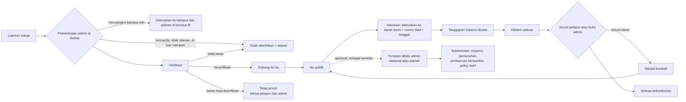
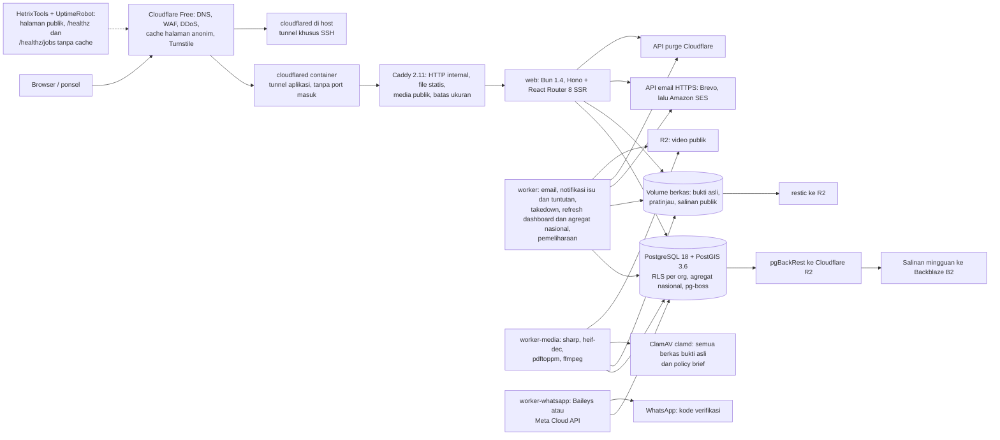

# Sadar Bersuara — Rencana Platform Pelaporan dan Pemantauan Isu Publik

Dokumen ini adalah kritik dan rencana pengganti untuk brief awal tim dan mockup `suarakm-web/`. Brief awal tidak lagi ada di folder repo. Salinannya disimpan sementara di luar repo dan perlu dipulihkan sebagai `docs/initial-brief.md` (§14 butir 7).
Versi paket npm diperiksa langsung ke registry npm, dan versi infrastruktur (Bun, Caddy, PostgreSQL, image PostGIS, GlitchTip, Garage, Umami, pgBackRest, restic, ClamAV) ke halaman rilis resminya, pada **12 Oktober 2026**.
Klaim hukum dan rujukan disertai sumber (§15). Fase 1 sebagian besar sudah dibangun di repo ini; butir yang masih terbuka bertanda [sebagian] dan [belum] di §13, dan cara menjalankannya ada di `README.md`. Hal yang belum terverifikasi ditandai **[belum terverifikasi]** dan dikaitkan ke spike Fase 0 (P1–P22, §13).
Keputusan produk tim tanggal **13 Oktober 2026**, keputusan tanggal **16 Oktober 2026** (satu peran admin, platform dikelola organisasi mahasiswa dan bukan layanan kampus, laporan diperiksa dulu sebelum terbit, tuntutan yang ditulis admin masuk Fase 1, peta berlapis warna, serta daftar dan masuk dengan nama, email, dan nomor WhatsApp), dan usulan perubahan dari `docs/architecture.md` sudah dimasukkan ke dokumen ini. Detail teknis ada di `docs/architecture.md` dan `docs/decisions.md` (§10).

Asumsi dari jawaban tim:
- Tidak ada tenggat tetap. Rencana disusun per fase dengan kriteria selesai, bukan tanggal.
- Semua layanan berjalan di server milik sendiri (sudah ada, spesifikasi besar). Biaya wajib hanya domain.
- Multi-tenant penuh sejak MVP: satu platform dipakai bersama aliansi kampus (KM ITB, lalu UI, UGM, Undip, dst.).
- Runtime produksi dan package manager: **Bun versi stabil terbaru** (saat ini 1.4.3, rilis 10 Okt 2026), bukan npm dan bukan Node. Playwright dan Lighthouse juga berjalan di runtime Bun (`bunx --bun`), diuji 22 Okt 2026: seluruh suite E2E lulus di Bun 1.4.3, jadi CI tidak lagi memasang Node.
- Styling memakai framework (Tailwind CSS), bukan CSS biasa.
- Prinsip: sesuai use case, tidak over-engineering, tetapi aman, cepat, aksesibel, dan mudah diserahterimakan tiap tahun.
- Sumber daya server (CPU, RAM, disk) bukan batasan, karena VPS sudah besar (klarifikasi tim). Yang tetap mengikat ada di luar server: ponsel dan jaringan 4G pengunjung (§10.8), batas Cloudflare Free, kuota email Brevo, dan keamanan.
- Kerumitan implementasi bukan alasan memilih pola yang lebih lemah; yang dinilai adalah hasil terbaik bagi pengguna (klarifikasi tim). Anggaran performa, aksesibilitas, keamanan, teks yang jujur, dan keputusan produk tetap mengikat.

## 0. Ringkasan Keputusan

| Area | Keputusan | Alasan Utama |
|---|---|---|
| Posisi produk | **Pemantau publik independen** yang dikelola organisasi mahasiswa, bukan kanal pengaduan pemerintah dan bukan layanan resmi kampus atau universitas. Admin meneruskan isu ke instansi yang berwenang, dan label verifikasi tiap isu tampil terbuka. Penerusan berjalan lewat kanal resmi instansi itu (surat resmi, email resmi, kanal pengaduan instansi, audiensi); nomor tiket dan tenggatnya dicatat dan dipantau terbuka. Platform tidak mengarahkan pelapor ke situs pelaporan lain | Platform warga tanpa kewenangan jarang direspons (Peixoto & Fox: dari 23 platform, hanya 7 sangat responsif, semuanya melibatkan pemerintah) |
| Verifikasi | **Wajib, pramoderasi**, tidak bisa dilewati: laporan yang masuk hanya terlihat di `/kelola` sampai admin memeriksanya, dan laporan bercanda atau tidak relevan ditolak dengan alasan | Risiko hukum (KUHP Pasal 433, UU PDP Pasal 65 tentang doxing, kewajiban PSE) dan kredibilitas |
| Yang tampil publik | **Isu (gabungan laporan) di tingkat instansi atau jabatan**, bukan laporan mentah dan bukan nama orang | Pasal 27A UU ITE dan Pasal 433 KUHP melindungi individu. Risiko pidana untuk kritik terhadap lembaga jauh berkurang setelah Putusan MK 105/2024 dan MK 282/2025 |
| Peran internal | **Satu peran: admin.** Setiap admin memeriksa, menggabung, menerbitkan, meneruskan, mencatat tanggapan, menulis tuntutan, serta mengatur tim dan pengaturan. Superadmin platform terpisah dan hanya menambah organisasi (keputusan 16 Okt 2026) | Platform warga ke warga; tidak ada pejabat kampus dalam alurnya. |
| Tuntutan | **Fase 1, ditulis admin**, tidak dibuat dari laporan. Lingkup nasional atau daerah (provinsi, opsional kabupaten/kota). Setiap tuntutan dipecah menjadi subtuntutan dengan dua sumbu status (respons dan pemenuhan), pembaruan bertanggal dan bersumber, serta policy brief PDF opsional per subtuntutan. Progres dihitung dari subtuntutan. Sejak 19 Okt 2026: satu kategori per tuntutan, penilaian kepentingan 1–5 oleh warga (anonim atau tampilkan nama, §5.7), tampil tepat di bawah hero beranda, dan pedoman bahasa netral di editor | Tuntutan yang besar terlalu rumit untuk dinilai sekaligus; dipecah menjadi bagian yang bisa diselesaikan satu per satu (keputusan 16 Okt 2026). Penempatan, kategori, skor dari sisi warga, dan postingan netral dari rapat tim 19 Okt 2026 |
| Badan hukum | **Perkumpulan berbadan hukum** milik aliansi, sebagai pengendali data tunggal dan pendaftar PSE | Organisasi mahasiswa bukan badan hukum; pendaftaran PSE butuh NIB |
| Framework web | **React Router 8 (framework mode, SSR per host + cache CDN) di Bun** | Tema dan OG image harus mengikuti tenant dari header `Host`; migrasi dari mockup (React Router 7) paling murah; tanpa React Server Components |
| Bukan Astro | Astro hanya unggul di halaman konten; aplikasi ini mayoritas interaktif. Satu framework lebih mudah diserahterimakan | §10.2 |
| Styling | **Tailwind CSS 4.3** + CSS variable tema per tenant | Paling banyak dipakai, tanpa runtime, tema tenant cukup ganti variabel |
| Komponen formulir | **HTML native** untuk select berjenjang, radio, checkbox, input tanggal (`type="date"` dengan pilihan cepat "Hari ini" dan "Kemarin"), `<datalist>`, dan `<dialog>`. Tanpa library komponen | Native paling ringan dan paling baik di ponsel. React Aria tidak lagi dipakai karena wilayah memakai select berjenjang dan saran instansi memakai `<datalist>` |
| Server | **Hono 4.13** di Bun (auth, unggah, CSRF, header keamanan) + handler React Router | Satu bahasa (TypeScript). Rate limit ada di Cloudflare, Turnstile, batas OTP per alamat, dan kuota SQL, karena Hono tidak punya rate limiter bawaan; pengecualiannya API data publik `/api/v1` (Fase 2) dengan penghitung di memori (§10.3) |
| Proses | **Empat proses dari satu image**: `web`, `worker`, `worker-media`, dan `worker-whatsapp` | `worker-media` membuka berkas tak tepercaya dengan role database paling terbatas, sehingga celah di decoder tidak mencapai laporan dan kontak. `worker-whatsapp` satu-satunya pemegang kunci sesi WhatsApp |
| Bukti | Gambar (termasuk HEIC), PDF, dan video di Fase 1. Berkas dikirim **setelah pelapor masuk** di langkah 7. Salinan publik: gambar yang disensor, PDF sebagai gambar per halaman, video maksimal 720p | Tidak ada endpoint unggah anonim; tidak ada PDF bukti pelapor yang terbit. Pengecualian: policy brief yang ditulis admin terbit sebagai PDF asli setelah dipindai ClamAV |
| Akun | **Daftar** dengan nama lengkap, email, nomor WhatsApp, dan pernyataan 18+; **Masuk** dengan email atau nomor WhatsApp. Lalu pengguna memilih tujuan kode: email atau WhatsApp. Email dan nomor masing-masing unik per akun | Keputusan 16 Okt 2026. Staf tetap wajib TOTP setelah kode |
| WhatsApp | Kode dikirim lewat **pustaka WhatsApp Web tidak resmi Baileys 6.7.24** dari `worker-whatsapp` dengan nomor khusus, ditautkan superadmin di `/admin/whatsapp`. Adaptor **Meta Cloud API** resmi sudah ada dan aktif lewat satu konfigurasi (`WHATSAPP_PROVIDER=meta`). Bila WhatsApp mati, pilihan WhatsApp nonaktif dan email tetap jalan | Pilihan tim 16 Okt 2026 setelah diberi tahu bahwa API resmi berbayar per pesan dan butuh akun Meta Business terverifikasi, sedangkan pustaka tidak resmi melanggar ketentuan WhatsApp dan nomornya bisa diblokir kapan saja |
| Tampilan nasional | **Domain apex di Fase 1**, dari satu materialized view berisi angka agregat; sel dengan n kecil disembunyikan | Satu-satunya jalur baca lintas kampus, dengan role database terpisah |
| Email | **Setiap perubahan status** ke pelapor dan semua pengikut. Sebagian kuota harian dicadangkan untuk kode verifikasi; notifikasi di atas batas ditunda ke pagi berikutnya | Brevo Free hanya 300 email/hari; kode verifikasi tidak boleh gagal karena notifikasi |
| Database | **PostgreSQL 18 + PostGIS 3.6**, RLS per tenant | Agregasi wilayah, pencarian teks bahasa Indonesia bawaan, isolasi tenant di level database |
| ORM dan auth | **Drizzle 0.45** (driver `pg`, sama dengan pg-boss) + **Better Auth 1.7** (plugin kode verifikasi milik sendiri untuk email dan WhatsApp, organization, 2FA; passkey belum dibangun) | Satu pustaka koneksi; sesi, peran per organisasi, dan TOTP tanpa kode auth buatan sendiri. Plugin `emailOTP` dan `phoneNumber` bawaan diganti satu plugin karena `phoneNumber` menyimpan kode tanpa hash dan melewatkan TOTP staf |
| Antrean kerja | **pg-boss 12** di Postgres yang sama | Tidak perlu Redis |
| Peta | **SVG choropleth yang dirender di server** (d3-geo + topojson-client), tanpa library peta di browser, dengan dua lapisan warna muda ke tua: laporan terverifikasi dan tuntutan daerah per provinsi. Ukuran lingkaran tidak dipakai. Batas dari OpenStreetMap (ODbL) sampai izin BIG terbit | 0 KB JS untuk peta, setiap wilayah punya label aksesibel, tidak perlu server tile. Mengubah dan menyebarkan data BIG butuh izin (UU 4/2011 Pasal 59) |
| Grafik | **SVG yang dirender di server** (kode sendiri, tanpa library grafik), dengan tabel data di setiap grafik | Recharts dari mockup dilepas: JS `/data` turun dari 241,82 KB menjadi 139,31 KB gz, dan long task 190–280 ms saat grafik masuk layar hilang |
| i18n | **Paraglide JS 2** (Indonesia utama, Inggris kedua) | Pesan dikompilasi dan hanya pesan yang dipakai ikut terkirim, bertipe |
| Kualitas | Biome 2.5, TypeScript 7.0, `bun test`, Playwright 1.63 + axe, size-limit, Lighthouse 13.5, knip, lefthook, CI | Build rusak sempat ter-commit; harus ada gerbang otomatis |
| Biaya rutin | Domain ±Rp50 rb–Rp219 rb/tahun; relay email gratis (Brevo Free, 300 email/hari), lalu Amazon SES US$0,10 per 1.000 email. Biaya sekali di awal: pendirian perkumpulan ±Rp3,5–6,5 jt (§12) | Email yang dikirim langsung dari server sendiri akan masuk spam |

## 1. Kritik terhadap Brief Awal

Tingkat: **K** = kritis (membatalkan konsep atau menimbulkan risiko hukum/kredibilitas), **P** = penting, **M** = minor.

| # | Tingkat | Temuan | Bukti atau Alasan | Perbaikan |
|---|---|---|---|---|
| 1 | K | Tidak ada *theory of change*: siapa yang wajib merespons isu? | Peixoto & Fox (2016): teknologi menaikkan kapasitas, bukan kemauan pemerintah. Kanal yang tidak mewajibkan siapa pun menjawab hanya bergantung pada niat baik pejabat yang sedang menjabat | Teruskan isu lewat kanal resmi dan catat nomor tiket. Upayakan MoU dengan pemda/DPRD. Tampilkan lama tunggu secara terbuka (§5.4, §5.8) |
| 2 | K | "Verifikasi (bisa di-skip?)" | Laporan yang menyebut pejabat berisiko pidana (KUHP Pasal 433, delik aduan). Doxing dilarang UU PDP Pasal 65(2). PSE wajib menangani konten terlarang (Permenkominfo 5/2020 Pasal 9–15) | Pramoderasi wajib. Laporan mentah privat; yang publik hanya isu di tingkat instansi |
| 3 | K | Statistik "EXPECTED 12.481 laporan…" dijadikan isi beranda | Angka palsu di platform transparansi merusak kredibilitas. Mockup menampilkannya tanpa label "data contoh" (`BandKM.tsx`) | Buat *empty state* yang jujur. Sembunyikan persentase sampai jumlah minimum (§5.8) |
| 4 | K | Tidak ada badan hukum, pengendali data, PSE, DPIA, atau DPO | UU PDP berlaku penuh sejak 17 Okt 2024; PP 33/2026 berlaku 16 Jan 2027. Komdigi membatasi login Wikimedia sejak 25 Feb 2026 sampai Wikimedia mendaftar, dan mengirim surat peringatan ke 25 PSE pada Jul 2026 dan 25 PSE lagi pada Sep 2026 dengan ancaman pemutusan akses | §11 |
| 5 | K | Alur pengelola tidak ada sama sekali, padahal itu inti sistem (verifikasi, penggabungan, tanggapan, audit) | Mockup hanya punya sisi publik | Panel `/kelola` untuk admin adalah jalur kritis MVP (§6) |
| 6 | K | Multi-kampus bertentangan dengan branding "Powered by KM ITB", "KM Lapor!", dan "SuaraKM" | "KM" tidak dipakai UI dan Undip (mereka BEM), dan publik membacanya "kilometer". Kata "Lapor!" dengan tanda seru sudah menjadi merek layanan pengaduan milik pemerintah (risiko merek, cek DJKI) | Nama netral aliansi **Sadar Bersuara** dengan nama turunan per kampus (§8.1) |
| 7 | P | Penomoran bolong (§14 terpotong, §16–17, §19, §22–44 tidak ada). §15 tiba-tiba berpindah ke voting. §18 Government Response Tracking hanya berisi judul | Struktur dokumen | Diganti seluruhnya oleh dokumen ini |
| 8 | P | Status mencampur siklus laporan dan isu, dan memakai label Inggris ("In Progress", "Government Responded") | §20 brief awal | Tiga siklus terpisah dengan label Indonesia (§5.4) |
| 9 | P | Skor kepuasan "satu suara per akun" mudah dimanipulasi dengan email sekali pakai. Tidak jelas siapa yang berhak menilai | Akun email sekali pakai murah dibuat, jadi "satu suara per akun" tidak mencegah manipulasi multi-akun | Penilaian dibuka hanya setelah ada klaim penyelesaian, satu penilaian per akun per klaim. Tampilkan distribusi dan n; sembunyikan jika n < 10; utamakan konfirmasi pelapor (§5.7) |
| 10 | P | Ranking "Most Supported" dan "Lowest Satisfaction" mendorong kemarahan dan menjadi tabel liga | Peringkat antarinstansi mengabaikan faktor perancu: beban kasus, kewenangan, dan luas wilayah berbeda | Opsi urutan di halaman jelajah, bukan papan peringkat instansi |
| 11 | P | Lokasi GPS adalah lokasi perangkat, bukan lokasi kejadian | Salah untuk saksi, pelapor yang melapor belakangan, dan pengungsi | Pilihan wilayah berjenjang sebagai jalur utama; GPS hanya opsi "saya sedang di lokasi" |
| 12 | P | NIK masih dipertimbangkan | UU PDP Pasal 16(2)(a): pengumpulan harus terbatas dan spesifik | Jangan kumpulkan NIK sama sekali |
| 13 | P | Laporan bencana tanpa jalur darurat | Platform bukan layanan darurat | Tampilkan banner "Hubungi 112" untuk urgensi Darurat atau kategori Kebencanaan |
| 14 | P | Kategori tumpang tindih | "Respons pemerintah" di kategori B adalah status, bukan subkategori. "Kebutuhan darurat" (B) dan "Bantuan korban bencana" (C) tumpang tindih. Kategori A berisi 16 subkategori yang terlalu luas | Rapikan taksonomi dengan ID stabil (§5.3) |
| 15 | P | "Dashboard real-time" | Data hasil moderasi memang tidak real-time. Real-time menambah kompleksitas tanpa manfaat | Agregat diperbarui berkala (mis. 15 menit) dengan keterangan "diperbarui pukul …" |
| 16 | P | "Respons Taktis sosmas" tidak didefinisikan | Brief awal | Definisikan sebagai tahap Advokasi: siapa, lewat kanal apa, tenggat berapa (§5.4) |
| 17 | P | Kapasitas moderasi relawan tidak dihitung | Admin adalah relawan dengan waktu terbatas; lonjakan volume (bencana, isu viral) tanpa rencana kapasitas langsung menjadi tumpukan | SLA internal, antrean, dan pembagian per kampus (§5.10) |
| 18 | M | Bahasa: "terbaharukan" tidak baku (KBBI: entri tidak ditemukan), "Submittor", campur Inggris | KBBI daring | §8 |
| 19 | M | Retensi data, hak akses dan hapus, serta aturan nonpartisan belum diatur | UU PDP Pasal 43 | §11 |

## 2. Kritik terhadap Mockup `suarakm-web/`

**Vonis: sebagian layak dipakai.** Bagian yang dipertahankan:
- Pemisahan `components/` dan `features/` (struktur lain diubah, §10.4).
- Formulir multilangkah: penanganan fokus antarlangkah dan dukungan reduced-motion sudah benar.
- Tiga kategori utama dari brief awal (subkategori dirapikan di §5.3; teks persetujuan diganti di §7).

Bagian di bawah wajib dibenahi sebelum dibangun lebih lanjut. Temuan dikonfirmasi pada audit 12 Okt 2026 (build, uji di browser, dan pembacaan kode), kecuali yang ditandai *dugaan*.

**Kritis**
1. **Build gagal.** `StepBukti.tsx:32` memakai `Film` dan `FileText` tanpa import (`tsc`: TS2304). Build yang rusak ini ter-commit (`40ac3d9`) karena tidak ada CI atau pre-commit.
2. **Unggahan bukti akan hilang** begitu backend tersambung. `reports.service.ts:13` dan `http.ts:20` mengirim `JSON.stringify` dengan header JSON, sehingga `File` menjadi `{}`.
3. **Report ID tidak aman sebagai kunci lacak.**
   - Formatnya hanya 4 digit acak (`KM-2026-XXXX`), jadi ruangnya 9.000 per tahun. Peluang tabrakan sudah ±50% pada ±112 laporan.
   - Siapa pun bisa melihat status laporan orang lain. Teks "Hanya kamu yang bisa melihat statusnya" tidak benar.
4. **Draf formulir di `localStorage` menyimpan data sensitif tanpa kedaluwarsa** (`draft.ts:25–29`): kontak, koordinat GPS, dan centang persetujuan. Draf tidak dihapus saat logout (`Navbar.tsx:18` hanya memanggil `hapusSesi`), sehingga bocor ke pengguna berikutnya di perangkat bersama.

**Penting**
- Wilayah kabupaten dan kecamatan berupa teks bebas (`StepLokasi.tsx`, `schema.ts:59`), jadi agregasi Provinsi > Kab/Kota > Kecamatan mustahil. ID provinsi juga buatan sendiri (`jabar`).
- Klaim antimanipulasi pada penilaian hanya berupa teks UI (`EvaluasiPublik.tsx:111`). Tombol dukung hanya dicegah ganda oleh state lokal (`DukungButton.tsx:12,31`) yang hilang saat halaman dimuat ulang.
- "Sesi" hanya berupa email di `localStorage` (`sesi.ts`), sehingga bisa dipalsukan.
- Hampir tidak ada UI kesalahan. Kegagalan jaringan tampil sebagai skeleton abadi atau "tidak ditemukan".
- Aksesibilitas:
  - Kontras di bawah WCAG: `tinta-400` 2,43:1 di atas krem; `km-blue` di atas krem 4,32:1.
  - `Select.tsx` memakai `aria-activedescendant` pada `<button>`.
  - Teks bantuan dan pesan kesalahan tidak terhubung ke input (`aria-describedby`).
  - `<ol>` stepper diberi `role="progressbar"` (`Stepper.tsx:7–13`), sehingga `<li>` kehilangan induk list.
- Performa:
  - `/dashboard` memuat ±298 KB gz JS sekaligus: Recharts (beserta Redux Toolkit bawaannya) dan Leaflet dalam satu chunk 536 KB mentah (156 KB gz).
  - Baseline JS di setiap route ±143 KB gz.
- Peta: basemap default Esri tanpa API key (*dugaan* melanggar ketentuan layanan Esri). Isian `.env.example` yang kosong menghapus URL tile (`"" ?? default`).
- Tooling: tidak ada linter, test, atau CI. Memakai npm, bukan Bun. React Router 7 dan Zod 3 sudah tertinggal satu major (terbaru 8.4.0 dan 4.6.6).
- Tidak ada i18n. Label Indonesia sekaligus dipakai sebagai nilai data (subkategori, metode kontak), sehingga menghalangi multi-tenant dan versi bahasa Inggris.

**Langkah:** migrasi bertahap, bukan tulis ulang. Lihat Fase 0 di §13.

## 3. Rujukan — Pelajaran yang Diadopsi

Rujukan desain dan rekayasa berasal dari perusahaan swasta, lembaga riset, dan penerbit data independen. Platform pelaporan warga lain tidak dipakai sebagai patokan (keputusan tim 15 Okt 2026): setiap keputusan produk di bawah berdiri di atas alasannya sendiri atau sumber industri.

| Rujukan | Yang Diambil | Yang Dihindari |
|---|---|---|
| **NN/g, Baymard, GitHub Primer, MDN** | Satu langkah per halaman dengan langkah aktif ditandai (NN/g, wizard). Langkah tinjauan dengan tautan ubah per bagian (Baymard, *order review*). Pesan kesalahan yang menyebut penyebabnya, plus ringkasan kesalahan di atas formulir (Primer Forms, Baymard). Progressive enhancement: isi dan fungsi dasar dulu, lalu JS (MDN). Rujukan desain per komponen ada di §9 | SPA murni: tim React menyarankan aplikasi baru dimulai dengan framework, dan tim Chrome menyarankan server rendering dibanding rehidrasi penuh (react.dev, web.dev) |
| **Tailwind CSS dan GitHub Primer** | Token desain sebagai CSS custom properties: Tailwind v4 mengubah setiap variabel tema menjadi variabel CSS, dan Primer menyajikan tokennya sebagai variabel CSS. Tema per tenant cukup menimpa variabel itu | Pipeline build token (tidak perlu untuk ±5 nilai per tenant) |
| **GitHub (halaman issue) dan Baymard (pelacakan pesanan)** | Urutan halaman isu: judul dan status, metadata satu baris, isi, lalu riwayat bertanggal; status pesanan yang menyebut langkah berikutnya | — |
| **Our World in Data** | Setiap grafik punya sumber, tanggal pembaruan, unduhan data, dan cara mengutip | — |
| **Full Fact** | Halaman tentang yang menyebut badan hukum, pendanaan, metode, dan koreksi | — |
| **Digital Public Goods Standard** | Lisensi terbuka, dokumentasi, privasi, dan do-no-harm sebagai target jangka panjang | — |

Keputusan produk yang berdiri di atas alasannya sendiri:
- **Pramoderasi, bukan pascamoderasi.** Laporan menyebut pejabat dan bisa memuat foto korban, jadi tidak ada yang terbit sebelum diperiksa admin; laporan bercanda atau tidak relevan ditolak di `/kelola` dan tidak pernah tampil (§1 butir 2, §5.5).
- **Tuntutan ditulis admin, bukan dibangkitkan dari laporan.** Laporan warga menjadi isu; tuntutan adalah posisi advokasi yang disusun pengelola, dipecah menjadi subtuntutan yang masing-masing dinilai dari respons dan pemenuhannya (§5.4).
- **Saran isu serupa saat melapor ("ikuti isu ini").** Satu masalah yang dilaporkan sepuluh kali menambah antrean, bukan bukti; mengikuti isu yang sudah ada memberi pelapor kabar yang sama (§5.6).
- **Survei "Sudah beres?" ke pelapor dan larangan publik menandai isu selesai.** Klaim selesai dari instansi perlu dikonfirmasi orang yang mengalaminya; tombol "selesai" untuk publik mengundang klaim yang tidak bisa diperiksa (§5.4, §5.7).
- **Label verifikasi dan metode verifikasi yang dicatat**, plus daftar periksa sebelum terbit (§5.5, §5.10).
- **Tanggapan resmi bertanggal ditampilkan utuh, tenggat dipublikasikan**, dan "Ditutup" tidak pernah dihitung sebagai "Selesai" (§5.4, §5.8).
- **Standar penolakan bernomor** agar setiap keputusan bisa merujuk satu nomor (§5.10).
- **Tanpa hitungan tanda tangan atau dukungan.** Angka dukungan mendorong kemarahan dan mudah dimanipulasi multi-akun (§1 butir 9, §5.8).
- **Tenancy berbasis host.** Satu host per kampus memisahkan tema, cookie, dan cache tanpa logika tenant di URL (§5.11).

Keputusan **build vs fork**:
- Memakai ulang platform pelaporan warga sumber terbuka **ditolak**. Rantai laporan → isu → tanggapan pemerintah → penilaian publik, ditambah tuntutan yang ditulis admin beserta subtuntutan dan policy brief-nya, tidak dimodelkan di sana, dan stack Perl/Rails/PHP menyulitkan serah terima tim mahasiswa.
- Yang dilakukan: **bangun aplikasi ramping** dengan model data sendiri (§5.2) dan hierarki wilayah Kemendagri.
- Kode dipublikasikan dengan lisensi terbuka, untuk kredibilitas dan Digital Public Goods.

## 4. Posisi dan Prinsip Produk (Direvisi)

1. **Independen dan nonpartisan.** Dikelola organisasi mahasiswa secara mandiri, independen dari universitas, pemerintah, dan partai politik; situs ini bukan layanan resmi kampus. Menilai program dan instansi, tidak pernah menilai kandidat. Tahapan Pemilu 2029 dimulai 2027, jadi aturan masa kampanye ditulis sejak awal.
2. **Diteruskan ke instansi yang berwenang.** Admin meneruskan isu lewat kanal resmi instansi itu, mencatat nomor tiket, dan memantau tenggat tanggapan; label verifikasi tiap isu tampil terbuka.
3. **Jujur soal kemampuan.** Tidak menjanjikan pemerintah akan bertindak, dan tidak menjanjikan tenggat yang tidak bisa dipenuhi relawan.
4. **Privasi sejak desain.** Data minimum; identitas dipisah dari laporan; lokasi publik hanya agregat; bukti publik hanya salinan yang sudah disunting.
5. **Setiap perubahan status tercatat:** tanggal, pelaku, alasan, dan tautan bukti. Log audit tidak bisa diubah.
6. **Aksesibel untuk ponsel kelas bawah di jaringan seluler** (§10.8).

## 5. Konsep Inti (Direvisi)

### 5.1 Alur

Laporan tidak pernah tampil publik sebelum diperiksa: isinya hanya terlihat di `/kelola` sampai admin memverifikasinya (atau menolaknya dengan alasan) dan menggabungkannya ke isu yang terbit. Halaman publik, peta, pencarian, dan OG image hanya membaca isu yang terbit (`app/features/issues/verify-first.test.ts`). Tuntutan tidak lahir dari laporan: admin menulisnya, lalu boleh menautkan isu terbit sebagai konteks.

### 5.2 Entitas Data

Setiap tabel milik tenant memiliki kolom `org_id`.

- `organizations`: tenant, yaitu organisasi mahasiswa pengelola (mis. KM ITB) beserta kampus tempatnya. Berisi host, slug, nama, kontak penanggung jawab, `theme` (kolom JSON: warna, logo, nama tampilan, font), dan `settings` (antara lain jeda penerimaan laporan). `org_counters` memberi nomor isu tanpa celah per kampus per tahun.
- `users` dan `members` (dikelola Better Auth): peran per organisasi, yaitu:
  - `reporter`: pelapor, pengikut, dan pengadu;
  - `admin`: satu-satunya peran internal (keputusan 16 Okt 2026, migrasi `0017` mengubah semua baris `moderator` menjadi `admin`). Memeriksa dan memverifikasi laporan, menggabung, menerbitkan, meneruskan (termasuk ke kampus lain), mencatat tanggapan, menulis tuntutan, mengundang dan mengeluarkan admin lain, serta mengubah pengaturan. Admin tidak bisa mengeluarkan dirinya sendiri dan admin terakhir selalu tersisa;
  - `editor`: masih diizinkan constraint database untuk Fase 2, tetapi tidak ada route yang menerimanya (§14 butir 16);
  - `superadmin`: penanda tingkat platform untuk pengurus aliansi, bukan peran tenant. Hanya menambah organisasi dan menautkan nomor WhatsApp pengirim kode.
  - Setiap akun menyimpan nama lengkap, email, nomor WhatsApp (E.164 `+62`, unik), tanda `email_verified` dan `phone_verified` yang terpisah, serta waktu dan versi teks pernyataan usia 18+ yang dicentang saat akun dibuat (§7). Akun yang dibuat sebelum migrasi `0018` belum punya nomor.
- `reports`: privat. Isinya cerita, kategori, wilayah (kode Kemendagri), titik opsional, dampak, tingkat urgensi, `submission_id` (kunci idempotensi dari browser), `forwarded_from_report_id` untuk salinan dari kampus lain, dan catatan persetujuan langkah 7: kotak yang dicentang (termasuk pernyataan usia 18+), waktu dari server, dan versi teks persetujuan.
- `report_contacts`: kontak pelapor, dipisah dari laporan dengan akses yang lebih ketat. Nomornya disalin dari akun saat laporan dikirim, hanya bila pelapor bersedia dihubungi.
- `evidence`:
  - File asli disimpan privat dan tidak pernah diubah.
  - Status unggah: menunggu berkas, diterima, siap, atau hilang (berkas tidak datang dalam batas waktu unggah), dengan jalur keluar ditolak karena batas video, ditolak karena malware (berkas yang terdeteksi ClamAV), perlu tinjauan manual, dan terbit.
  - Keputusan admin (`decision`): disensor (`redaction_boxes`, dalam satuan 1/10000 sisi gambar), tidak perlu disensor, atau jangan terbitkan.
  - Salinan publik dibuat setelah admin menyetujui: gambar di-encode ulang tanpa EXIF dengan wajah, plat nomor, dan KTP disensor; PDF menjadi gambar per halaman; video maksimal 720p hanya bila tidak perlu disensor.
- `issues`: publik. Gabungan laporan di tingkat instansi atau jabatan, wilayah agregat, label verifikasi, dua sumbu status, dan `version` untuk suntingan teks; penanda suntingan dan penurunan oleh admin (`redacted_at`, `taken_down_at`) beserta alasannya. `issue_events` menyimpan timeline publik. Belum dibangun: `issue_versions` (riwayat ringkasan). Klaim yang sedang berjalan adalah baris `resolution_claims` yang belum ditutup, jadi kolom `current_claim_id` tidak diperlukan (migrasi `0026`, ADR-22).
- `issue_reports`: relasi banyak-ke-banyak antara isu dan laporan.
- `referrals`: penerusan ke kanal resmi instansi. Berisi instansi, kanal (surat resmi, email resmi instansi, kanal pengaduan instansi, atau audiensi), nomor tiket, tanggal kirim, dan tenggat yang diisi admin (bawaan +14 hari **[usulan]**).
- `responses`: tanggapan instansi. Berisi teks, tanggal, dan sumber.
- `resolution_claims` (Fase 2, migrasi `0026`): setiap klaim selesai, dari "Diklaim selesai" sampai ditutup sebagai terkonfirmasi atau dibuka kembali, beserta dasar penutupannya (survei pelapor atau admin) dan tautan bukti admin bila ada. Penilaian warga dan survei terikat ke satu klaim.
- `agency_replies` (Fase 2, migrasi `0026`): hak jawab instansi lewat formulir. Berisi isu, akun pengirim, nama instansi, jabatan pengirim, teks, tautan sumber opsional, dan status (menunggu, diterima, ditolak beserta alasannya). Hak jawab yang diterima menjadi baris `responses`.
- `demands`: tuntutan yang ditulis admin (migrasi `0019`). Berisi kode publik `TUN-<kampus>-<yy>-<nnnn>`, lingkup nasional atau daerah (provinsi, opsional kabupaten/kota di dalamnya), kategori (`category`, migrasi `0024`, daftar tema tuntutan di §5.4), judul, teks tuntutan apa adanya, ringkasan, pihak yang dituju, tanggal diajukan, status (draf, terbit, ditutup), progres turunan, penanda disembunyikan, dan `version`. Kategori kosong hanya pada baris dari sebelum migrasi `0024`.
- `demand_items`: subtuntutan berurutan, masing-masing dengan teks, sumbu respons, sumbu pemenuhan, ringkasan policy brief, link brief opsional (`brief_url`, sejak 25 Okt 2026), dan `version`. `demands` juga punya `brief_url` opsional.
- `demand_updates`: timeline publik tuntutan (terbit, ditutup, dibuka kembali, perubahan status, catatan, policy brief terbit) dengan tanggal kejadian, teks sumber, dan tautan sumber opsional.
- `demand_issues`: tautan opsional ke isu terbit sebagai konteks. `demand_follows`: "ikuti tuntutan". `policy_briefs`: PDF policy brief per subtuntutan dengan status pindai ClamAV (menunggu, bersih, terinfeksi) dan waktu terbit.
- `demand_ratings` (migrasi `0024`): penilaian kepentingan tuntutan oleh warga (§5.7). Satu baris per akun per tuntutan (kunci `org_id`, `demand_id`, `user_id`), nilai 1–5, dan `show_name` (bawaan `false`, yaitu anonim). Terhapus bila akun dihapus atau ditutup di kampus itu.
- `whatsapp_log`, `whatsapp_sender`, dan `whatsapp_auth` (global, di luar RLS): catatan pengiriman kode WhatsApp dengan hash nomor, status satu nomor pengirim, dan kredensial sesi yang dienkripsi.
- `follows`: "ikuti isu". `ratings` dan `fix_surveys` (Fase 2, migrasi `0026`): penilaian (satu per akun per klaim, tidak bisa diubah) dan survei "sudah beres?" (satu per pelapor per klaim).
- `notifications` dan `email_log`: notifikasi per pengguna per kejadian, dan catatan setiap email yang dikirim untuk menghitung kuota.
- `moderation_decisions`: keputusan moderasi beserta alasannya (§5.10).
- `content_complaints`: aduan konten terhadap isu atau tuntutan, beserta keputusan dan bandingnya (kolom `status`: baru, diputuskan, banding, banding diputuskan). Tidak ditulis lagi sejak 25 Okt 2026 (aduan konten dihapus, §5.10); tabel dan baris lama tetap.
- `redaction_originals` dan `takedowns`: nilai asli judul dan ringkasan sebelum disunting (hanya untuk admin organisasi itu) dan status penghapusan berkas publik serta cache setelah suntingan, penyembunyian, penurunan, atau penghapusan atas permintaan subjek data.
- `invitations` (tabel Better Auth, dipakai kode sendiri): undangan anggota tim berlaku 7 hari **[usulan]**.
- `audit_log`: hanya bisa ditambah; trigger menolak UPDATE dan DELETE.
- `dashboard_snapshots` (angka dashboard per kampus) dan materialized view `national_aggregates` (angka nasional untuk domain apex).
- `regions`: kode dan nama wilayah resmi, dengan geometri yang disederhanakan untuk peta.
- `backup_runs`: satu baris per backup yang selesai, untuk cek kesehatan.
- Tidak ada tabel draf laporan. Draf hanya disimpan di browser (§7).

### 5.3 Taksonomi Kategori

Tetap tiga kategori utama, dengan perubahan berikut:
- Setiap subkategori memakai **ID stabil** (mis. `bansos.ketepatan_sasaran`), dengan label lewat i18n.
- "Respons pemerintah" dihapus dari subkategori karena itu status.
- "Kebutuhan darurat" tetap di Kebencanaan untuk kebutuhan saat kejadian. "Bantuan korban bencana" tetap di Bantuan Sosial untuk penyaluran bantuan, dengan penanda `terkait_bencana`. Definisi keduanya ditempatkan di bagian Metode halaman `/tentang` (`#metode`). Teksnya belum ditulis.
- Kategori A dikelompokkan menjadi tiga subgrup: Layanan Dasar, Infrastruktur dan Utilitas, Ekonomi dan Kebijakan. Tujuannya agar pilihan di ponsel tidak sepanjang 16 baris.

### 5.4 Siklus Status (Tiga Siklus Terpisah, Label Indonesia)

**Laporan** (privat, terlihat oleh pelapor):
- Terkirim
- Sedang diperiksa (dihapus 25 Okt 2026, permintaan tim: admin memutus langsung dari Terkirim; aksi `start_review` tidak ada lagi dan `in_review` hanya untuk baris lama)
- Lalu salah satu dari:
  - Terverifikasi (sejak 25 Okt 2026, permintaan tim: verifikasi langsung memasukkan laporan ke isu, baik isu yang sudah tampil maupun isu baru dengan judul, ringkasan, dan 4 butir daftar periksa, dalam satu transaksi lewat `verifyIntoIssue` di `app/features/moderation/verify-issue.server.ts`; pelapor menerima email "digabung", bukan email "terverifikasi". `verified` kini hanya status sementara atau baris lama, tab antrean tinggal Terkirim dan Belum bisa diverifikasi, dan tidak ada lagi draf isu)
  - Belum bisa diverifikasi · *alasan* (sejak 25 Okt 2026: alasan berupa teks bebas saja, tanpa pilihan kode)
  - Tidak diterbitkan · *alasan* (formulirnya dihapus dari halaman laporan admin 25 Okt 2026, permintaan tim; status `rejected` tetap untuk baris lama)
  - Digabung ke isu "…"
  - Diteruskan ke {kampus lain} (§5.10)

**Isu** (publik):
- Hanya laporan **terverifikasi** yang bisa digabung ke isu (keputusan tim 22 Okt 2026). Laporan yang belum diperiksa atau "Belum bisa diverifikasi" tidak pernah publik: hanya pelapor (di "Laporan saya") dan admin yang melihatnya. Karena itu setiap isu publik sudah terverifikasi dan label "Belum terverifikasi" tidak lagi tampil.
- **Status publik** (keputusan tim 22 Okt 2026): kartu, halaman isu, dan saringan `/isu` menampilkan satu status perjalanan yang diturunkan dari dua sumbu di bawah (`publicStage`, `shared/status.ts`): **Terverifikasi** (terbit, belum diteruskan) → **Diteruskan** (admin sudah mengirim ke instansi; juga Bukan kewenangan, Tidak ditindaklanjuti, dan Dieskalasi) → **Ditanggapi** → **Dalam penanganan** (juga Diklaim selesai dan Dibuka kembali) → **Selesai** (Selesai terkonfirmasi atau Ditutup). Status yang tersembunyi di balik satu tahap disebut dalam catatan di bawah pelacak status halaman isu ("Status saat ini: …"). Dua sumbu di bawah tetap dipakai admin di `/kelola`.
- Dua sumbu status, supaya kerja advokasi tidak dikira tindakan pemerintah:
  - Sumbu advokasi: **Dipantau** → **Diteruskan ke [instansi/kanal] · tanggal · tiket** → **Dieskalasi** (Ombudsman, DPRD, atau media).
  - Sumbu tanggapan pemerintah:
    - **Belum ditanggapi · N hari sejak diteruskan** (otomatis ditandai bila lewat tenggat)
    - **Ditanggapi [instansi] · tanggal** (teks tanggapan ditampilkan utuh)
    - **Dalam penanganan**
    - **Diklaim selesai** (dihapus 25 Okt 2026, permintaan tim: tidak ada lagi aksi `claim_resolved`; admin memakai "Tandai selesai" (`confirm_resolved`) langsung dari Belum ditanggapi, Ditanggapi, Dalam penanganan, Dibuka kembali, atau Tidak ditindaklanjuti. `claimed_resolved` dan `reopened` hanya untuk baris lama)
    - Lalu **Selesai terkonfirmasi** atau **Dibuka kembali**
    - Status lain: **Bukan kewenangan** (diteruskan ulang), **Tidak ditindaklanjuti**, **Ditutup · alasan**

- `refer` boleh dari **Dieskalasi** (tanggapan pemerintah Bukan kewenangan, Tidak ditindaklanjuti, Dibuka kembali, atau Belum ditanggapi): sumbu advokasi tetap **Dieskalasi**, sehingga "Bukan kewenangan (diteruskan ulang)" berjalan setelah eskalasi. Dari Dipantau atau Diteruskan, `refer` tetap menjadi Diteruskan.

**Tuntutan** (publik setelah terbit, ditulis admin, Fase 1):
- Siklus tuntutan: **Draf** (hanya di `/kelola`) → **Terbit** → **Ditutup · alasan publik**; **Dibuka kembali** mengembalikannya ke Terbit. Draf yang belum pernah terbit boleh dihapus.
- Setiap subtuntutan punya dua sumbu:
  - Respons: **Belum direspons**, **Direspons**. Direspons tidak pernah kembali.
  - Pemenuhan: **Belum dipenuhi**, **Sebagian dipenuhi**, **Dipenuhi**, **Ditolak**. Ditolak hanya bila sudah Direspons. Pemenuhan boleh bergerak ke dua arah; kemunduran dicatat seperti perubahan lain.
- Setiap perubahan status harus menggerakkan salah satu sumbu, dan setiap perubahan status atau catatan wajib punya tanggal (antara tanggal diajukan dan hari ini) dan teks sumber; tautan sumber opsional dan hanya `http(s)`. Penulisnya tampil sebagai "Admin {organisasi}".
- **Progres tuntutan dihitung, tidak pernah diketik:** "{n} dari {total} subtuntutan dipenuhi". Status keseluruhan Dipenuhi bila semua dipenuhi, Ditolak bila semua ditolak, Sebagian dipenuhi bila ada yang dipenuhi atau sebagian dipenuhi, selain itu Belum dipenuhi. Nilainya disimpan di `demands.progress` dan dihitung ulang dalam transaksi yang sama dengan setiap perubahan subtuntutan (`demandProgress`, `shared/status.ts`).
- Tuntutan tidak punya tenggat; yang dicatat adalah pihak yang dituju dan tanggal diajukan. Yang dinilai adalah hasil, bukan niat.
- **Kategori** (keputusan 19 Okt 2026): setiap tuntutan punya satu tema dari daftar khusus tuntutan, terpisah dari taksonomi laporan (§5.3) karena tuntutan tidak berasal dari laporan: Pendidikan, Kesehatan, Lingkungan Hidup, Ekonomi dan Kesejahteraan, Infrastruktur dan Transportasi, Hukum dan HAM, Tata Kelola dan Demokrasi, Kebencanaan, Bantuan Sosial (ID stabil di `DEMAND_CATEGORIES`, `shared/demands.ts`, dan CHECK di database). Kategori wajib di formulir admin (buat dan ubah), dan tuntutan tanpa kategori (hanya baris dari sebelum migrasi `0024`) tidak bisa diterbitkan. Publik melihatnya sebagai badge di `/tuntutan/:code`, di baris keterangan daftar, dan sebagai filter `kategori` di `/tuntutan`.
- Catatan rapat 19 Okt 2026 menegaskan model yang sudah dibangun: tuntutan ditulis admin (bukan dari laporan warga), lingkupnya nasional atau daerah, dan setiap tuntutan dipecah menjadi subtuntutan yang lebih spesifik dan strategis. Policy brief melekat pada subtuntutan, bukan satu kajian untuk satu tuntutan.

Transisi status diimplementasikan sebagai **state machine murni** di `shared/` (dites unit). Setiap transisi menulis `audit_log`, dan state machine juga mencantumkan email yang harus dikirim, sehingga transisi baru tidak lupa mengirim email.

Email perubahan status (kuota di §12):
- Setiap transisi state machine laporan mengirim email ke pelapor. Transisi itu menuju semua status laporan di atas: sedang diperiksa, terverifikasi, belum bisa diverifikasi (dengan alasan), tidak diterbitkan (dengan alasan dan saran), digabung ke isu, dan diteruskan ke kampus lain. Test unit memeriksa bahwa setiap transisi laporan di `shared/status.ts` punya email. Email tanda terima untuk status pertama "Terkirim" sudah dikirim (usulan desain, menunggu konfirmasi resmi di §14 butir 11).
- Setiap perubahan status isu dan setiap tanggapan instansi dikirim ke semua pengikut, satu email per pengikut per pembaruan; isu yang baru terbit juga mengirim email ke pengikutnya. **Dihapus 25 Okt 2026, permintaan tim:** tidak ada lagi email ke pengikut isu atau tuntutan (`notifyFollowers` dan `notifyDemandFollowers` dihapus, job `issue-notify` dan `demand-notify` tidak dibuat lagi). Isu dan tuntutan yang diikuti tampil di bagian "Yang Anda Ikuti" pada `/lacak` (`listFollowed`, `app/features/issues/followed.server.ts`). Email ke pelapor tentang laporannya sendiri tetap dikirim. Pelapor otomatis mengikuti isu saat laporannya digabung dan bisa berhenti mengikuti lewat tautan di setiap email. Tidak ada email ke pengikut saat isu disembunyikan atau diturunkan, dan jumlah pengikut tidak ditampilkan (sama dengan hitungan tanda tangan, §5.8).

Aturan tampilan:
- Transisi disimpan sebagai data, lalu kalimat timeline dirender darinya: *pelaku · waktu · isi + "Status berubah: Dalam penanganan"* (pola Primer Timeline: setiap item menyebut statusnya dalam teks).
- Setiap isu punya nomor publik stabil (mis. `ISU-2026-10-0042`, nomor urut per bulan sejak 22 Okt 2026). Riwayat versi ringkasan (`issue_versions`) belum dibangun; sampai ada, jejak suntingan hanya ada di `audit_log` (nama kolom dan hash nilai).
- **Dibuka kembali** memakai nomor isu yang sama dan menautkan klaim selesai sebelumnya. Isu yang ditutup menampilkan alasan dan jalan keluar: "Masalah masih terjadi? Buat laporan baru di lokasi ini." Karena itu penggabungan menolak isu yang berstatus Ditutup atau Selesai terkonfirmasi (`isTerminalIssue`), dan daftar tujuan gabung tidak menampilkannya; laporan baru menjadi isu baru.
- Publik tidak bisa menandai isu "selesai": klaim selesai dari siapa pun tanpa bukti tidak bisa diperiksa dan memicu sengketa.

### 5.5 Verifikasi dan Publikasi

- Semua laporan melewati pemeriksaan admin sebelum apa pun terbit. Laporan yang masuk, sedang diperiksa, atau ditolak tidak muncul di halaman publik, pencarian, peta, OG image, maupun daftar tuntutan; pemeriksaan ini dibuktikan dengan test dan pemeriksaan langsung. Jumlah laporan masuk tetap tampil sebagai angka di `/data` (§5.8). Target waktu ditetapkan per organisasi (§14 butir 6). Angka yang ditampilkan ke pelapor diambil dari median nyata dan ditulis "biasanya", bukan janji.
- Metode verifikasi dicatat: dokumen, foto lokasi, konfirmasi pihak kedua, sumber berita, atau kontak pelapor. Kontak pelapor hanya bisa dipilih bila pelapor bersedia dihubungi; nomor dan nama baru tampil setelah admin menekan "Tampilkan kontak", dan setiap tampilan dicatat di `audit_log` (`report.view_contact`).
- Yang terbit hanya isu. Laporan mentah, nama orang, dan kontak tidak pernah publik.
- Isu yang menyebut instansi memberi **hak jawab**. Instansi menjawab lewat email kontak organisasi (`/pedoman#hak-jawab` menampilkannya), lalu admin mencatatnya sebagai baris `responses` beserta sumbernya. Formulir khusus untuk instansi masuk Fase 2. **[backend selesai 21 Okt 2026]**: pengirim masuk akun (email terverifikasi), lolos Turnstile, dan mengisi nama instansi, jabatan, teks, serta tautan sumber opsional (paling banyak 5 per akun per kampus per 24 jam, dihitung di dalam tenant; instansi yang menjawab di beberapa kampus mendapat 5 di tiap kampus). Hak jawab menunggu di antrean `/kelola`; admin memeriksa bahwa pengirim mewakili instansi itu (email akun hanya terlihat oleh admin), lalu menerimanya sebagai tanggapan instansi (sumbu tanggapan menjadi "Ditanggapi"; sejak 25 Okt 2026 pengikut tidak menerima email) atau menolaknya dengan salah satu dari empat alasan. Pengirim menerima tanda terima dan keputusan lewat email. Halaman formulir dan antrean menunggu frontend.

### 5.6 Penggabungan Isu (Clustering)

- **MVP: manual oleh admin, dibantu saran otomatis.** Tidak memakai ML.
- Saran tujuan gabung sudah dibangun tanpa `ST_DWithin`, karena isu menyimpan kode wilayah, bukan titik: kabupaten/kota yang sama lebih dulu (ditandai "kab/kota sama"), lalu kemiripan judul `pg_trgm`, lalu peringkat full-text search konfigurasi `indonesian`, lalu yang terbaru; admin juga bisa mencari dengan kode atau kata ("Cari isu tujuan"). Stemmer Snowball Indonesia tersedia di PostgreSQL 18 (terverifikasi di source `REL_18_STABLE`).
- **Saat melapor**, tampilkan "Isu Serupa di Dekat Anda" dari isu terbit di kabupaten/kota yang dipilih. Pelapor bisa memilih "Ikuti isu ini" alih-alih membuat laporan baru. Mengikuti isu berarti menerima satu email untuk setiap pembaruan (§5.4).

### 5.7 Penilaian Warga (Fase 2)

- Dibuka saat isu berstatus "Diklaim selesai", dan ditutup saat "Selesai terkonfirmasi" atau "Dibuka kembali". Setiap klaim selesai adalah satu putaran penilaian baru.
- Satu penilaian per akun per klaim, dilindungi Turnstile.
- Penilaian pelapor dari isu tersebut ditampilkan terpisah ("menurut pelapor" dan "menurut warga lain"). "Warga lain" hanya menghitung akun yang berumur minimal 7 hari saat menilai.
- Jumlah penilaian per prefiks IP per klaim dibatasi. Klaim yang penilaiannya sebagian besar dari satu prefiks IP atau dari akun baru diberi penanda anomali di halaman admin.
- Yang ditampilkan adalah **distribusi 1–5 beserta n** untuk klaim yang sedang berjalan, tanpa angka rata-rata tunggal. Bagian ini disembunyikan jika n < 10.
- Survei "Sudah beres?" dikirim ke pelapor 4 minggu setelah klaim selesai. Status "Selesai terkonfirmasi" hanya datang dari survei ini, atau dari admin dengan bukti yang ditautkan.
- **[backend selesai 21 Okt 2026]** (migrasi `0026`, ADR-22): setiap "Diklaim selesai" membuka putaran klaim baru dan menjadwalkan survei 28 hari kemudian ke setiap pelapor isu itu yang bisa dihubungi lewat email (email terverifikasi, alamat bisa dikirimi, masih anggota kampus; akun yang hanya membuktikan nomor WhatsApp tidak disurvei dan tidak menghalangi putaran), lewat tautan bertanda tangan yang berlaku 30 hari. Satu jawaban "belum beres" langsung membuka kembali isu; "sudah beres" dari semua pelapor yang disurvei menjadikannya "Selesai terkonfirmasi"; selain itu menunggu jawaban lain atau keputusan admin. Penilaian: wajib masuk akun, Turnstile, satu per akun per klaim dan tidak bisa diubah, paling banyak 20 per prefiks IP per klaim, pelapor dan warga lain ditampilkan terpisah, warga lain hanya dari akun berumur minimal 7 hari saat menilai, distribusi 1–5 dengan n tanpa rata-rata dan tersembunyi bila n < 10, serta penanda anomali di halaman admin (lebih dari 30% dari satu prefiks atau dari akun berumur di bawah 30 hari, mulai 10 penilaian; penanda prefiks tetap ada setelah hash IP dihapus pada hari ke-30, karena jumlah terbanyak dari satu prefiks disimpan di `resolution_claims.max_prefix_ratings`, migrasi `0028`). Konfirmasi oleh admin menyimpan tautan bukti bila ada, tetapi belum mewajibkannya karena formulir admin saat ini belum punya kolomnya (keputusan terbuka). Halaman penilaian, survei, dan tampilannya di halaman isu menunggu frontend.

**Penilaian kepentingan tuntutan (Fase 1, keputusan 19 Okt 2026, sudah dibangun).** Penilaian isu per klaim di atas tetap Fase 2. Untuk tuntutan, warga menilai **seberapa penting** tuntutan itu, bukan seberapa terpenuhi; status pemenuhan tetap diturunkan admin dari subtuntutan (§5.4). Aturannya ditegakkan di `app/features/demands/rating.server.ts`:
- Skala 1–5: 1 Tidak penting, 2 Kurang penting, 3 Cukup penting, 4 Penting, 5 Sangat penting. Halaman penilaian `/tuntutan/:code/nilai` (privat, `no-store`, tidak di-cache CDN).
- Wajib masuk akun. Satu nilai per akun per tuntutan (`demand_ratings`), bisa diubah atau ditarik kapan saja. Menilai melewati Turnstile (kunci idempotensi `submissionId`; token ganda dengan pilihan yang sama dianggap berhasil); menarik nilai tidak.
- Hanya tuntutan berstatus Terbit yang bisa dinilai. Tuntutan yang ditutup menolak nilai baru, tetapi menarik nilai tetap bisa dan skor terakhir tetap tampil. Draf dan tuntutan yang disembunyikan menjawab 404.
- Nilai dari akun yang berumur kurang dari 7 hari disimpan, tetapi baru dihitung setelah akun berumur 7 hari (dihitung saat dibaca, `users.created_at`). Halaman admin menampilkan jumlah nilai yang masih menunggu.

**Peringkat tuntutan warga (25 Okt 2026, permintaan tim).** Warga tidak lagi memilih lima teratas: setiap warga mengurutkan semua tuntutan terbit (setiap tuntutan tepat satu nomor, diperiksa di server sebagai permutasi penuh). Poin Borda per daftar: dengan N tuntutan di daftar seorang warga, urutan p mendapat N − p + 1, sehingga daftar lima teratas yang sudah tersimpan tetap dihitung dengan N = 5. Ambang 10 warga dan umur akun 7 hari tetap. Migrasi `0040_full_ranking` melonggarkan batas `position` menjadi ≥ 1.
- Yang ditampilkan: distribusi per nilai dengan jumlah persis dan persen (`sharePercent`), lalu rata-rata satu desimal hanya bila penilai terhitung minimal 10. Di bawah itu tampil "Skor tampil setelah ada minimal 10 penilai. Saat ini n penilai." Berbeda dengan penilaian isu, rata-rata tunggal ditampilkan karena dipakai untuk mengurutkan "Paling Penting Menurut Warga" di beranda (§8.2).
- **Anonim atau tidak anonim:** setiap penilai memilih. Bawaannya anonim (hanya ikut dihitung). Penilai yang memilih "Tampilkan nama" muncul di "Penilai yang Menampilkan Nama" dengan nama akun, nilai, dan tanggal (hanya penilai yang sudah terhitung dan namanya tidak kosong, 20 terbaru, lalu "dan n penilai lain"). Email dan nomor WhatsApp tidak pernah tampil.
- Batas per prefiks IP dan penanda anomali (dibangun 21 Okt 2026, sama dengan aturan klaim di atas): paling banyak 20 akun dari satu prefiks alamat (IPv4 utuh atau IPv6 /64, disimpan sebagai HMAC dan dihapus setelah 30 hari) per tuntutan, akun ke-21 ditolak 429; halaman admin mendapat penanda bila satu prefiks memegang lebih dari 30% dari minimal 10 nilai (tampilan penanda adalah tugas frontend). Halaman publik di-cache CDN 60 detik dan penilaian tidak memicu purge, jadi nilai baru bisa butuh hingga satu menit untuk terlihat pengunjung anonim.

### 5.8 Metrik Dashboard yang Jujur

Ditampilkan:
- **Isu unik** di samping jumlah laporan (rasio deduplikasi).
- **Tingkat tanggapan** = isu yang mendapat tanggapan substantif dalam N hari ÷ isu yang tenggatnya sudah lewat. Pembilang, penyebut, dan N selalu ditampilkan.
- **Median dan P90 waktu ke tanggapan pertama**, plus histogram umur isu yang masih menunggu.
- **Diklaim selesai dan selesai terkonfirmasi**, berdampingan. Selisihnya adalah angka yang jujur. (Sejak 25 Okt 2026, permintaan tim: diganti "Isu Selesai", yaitu isu bertahap Selesai dibagi semua isu yang tampil, karena langkah klaim dihapus.)
- **Kinerja platform sendiri**: median waktu verifikasi dan jumlah antrean.
- **Isu lewat tenggat per instansi**: jumlah dan n, bukan peringkat.
- **Tuntutan** (dibaca langsung saat halaman dimuat, angka persis): total tuntutan (terbit dan ditutup, dengan rincian nasional dan daerah), tuntutan dalam proses (terbit, belum ditutup, status turunan Belum dipenuhi atau Sebagian dipenuhi), tuntutan dipenuhi (status turunan Dipenuhi, terbuka atau ditutup), dan subtuntutan dipenuhi dari seluruh subtuntutan pada tuntutan publik.
- Peta per kapita dengan catatan cakupan: "sedikit laporan tidak berarti tidak ada masalah". Belum dibangun (§14 butir 25).

Perubahan 25 Okt 2026 (permintaan tim): `/data` dibuka dengan "Tuntutan Publik", lalu peta; "Angka Utama", "Tentang Data Ini", dan tabel "Laporan yang Tidak Diterbitkan per Alasan" dihapus (tidak ada kata "Standar" di dashboard). Saringan status peta dan grafik "Alur Status" memakai lima tahap publik seperti Jelajah (`PUBLIC_STAGES`); snapshot versi 8.

Status 16 Okt 2026: tingkat tanggapan (N = 14 hari), median dan P90 waktu tanggapan pertama, histogram umur tunggu, isu lewat tenggat per instansi, jumlah per kode alasan (§5.10), empat angka tuntutan, dan bagian "Tuntutan Publik" (3 tuntutan terbaru) sudah dibangun. Peta per kapita dan peta kabupaten/kota masih tercantum di "Belum Diukur" pada `/data`.

Tidak ditampilkan: total kunjungan, "jangkauan", hitungan tanda tangan, klaim kemenangan, dan peringkat instansi.

Pengecualian sadar (keputusan tim 19 Okt 2026): skor kepentingan tuntutan dari warga (§5.7) dan urutan "Paling Penting Menurut Warga" di beranda. Ini bukan hitungan dukungan kumulatif: yang tampil adalah skala 1–5 dengan distribusi, n, ambang minimal 10 penilai, dan aturan umur akun 7 hari. Jumlah pengikut tetap tidak ditampilkan.

Saat data masih sedikit, tampilkan: *"Baru 37 laporan sejak 1 Nov 2026. Angka ini belum mewakili kondisi nasional."* Persentase disembunyikan sampai ambang minimum.

Aturan setiap grafik (pola Our World in Data, Datawrapper, Flourish, dan Storytelling with Data):
- Judul menyatakan temuan, subjudul menyatakan ukuran statistik. Data diberi label langsung, bukan hanya lewat legenda.
- Di bawah grafik ada daftar: Deskripsi · Sumber data · Satuan · Rentang waktu · **Terakhir diperbarui** · **Pembaruan berikutnya** · **Dikelola oleh** · "Cara mengolah data ini" · "Cara mengutip".
- Fase 1: angka setiap grafik ditampilkan sebagai tabel HTML, yang juga bisa dibaca tanpa JavaScript. Tidak ada unduhan data.
- Fase 2: dua tombol unduh, "Unduh data yang ditampilkan" dan "Unduh data lengkap", di bawah `/api/v1/`. Masing-masing berisi CSV, metadata JSON, dan README, dengan URL CSV stabil dan lisensi data terpisah dari lisensi situs. **[backend selesai 21 Okt 2026]**: setiap tabel `/data` punya CSV tetap di `/api/v1/data/<nama>.csv`, dan `/api/v1/data` memuat metadata (judul, kolom, URL CSV, waktu snapshot) beserta semua tabel dalam JSON; lisensi CC BY 4.0 ada di metadata dan header `Link`. Kontraknya (sebagai pengganti README) ada di `docs/architecture.md` (Public Data API). Tombol di `/data` menunggu frontend; paket "Unduh data lengkap" belum.
- Catatan kaki di grafik untuk data yang disembunyikan, mis. *"Wilayah dengan n < 5 tidak ditampilkan."*
- Penanda **"perubahan metode"** setiap kali taksonomi atau aturan verifikasi berubah. Sudah dibangun: catatannya `METHOD_CHANGES` (`app/features/data/method-changes.ts`: tanggal, grafik yang terdampak, teks) dikirim bersama kode yang mengubah aturan; "Tentang Data Ini" punya butir "Perubahan metode", dan grafik yang terdampak menambahkan "· Metode berubah {tanggal}" yang menaut ke `#metode`. Daftarnya masih kosong.
- Jika pengambilan data gagal, tampilkan snapshot terakhir yang berhasil beserta tanggalnya, bukan counter kosong yang terbaca sebagai nol.

### 5.9 Lokasi dan Peta

- **Input lokasi:**
  - Jalur utama adalah pilihan berjenjang Provinsi → Kab/Kota → Kecamatan → Desa/Kelurahan, memakai kode Kemendagri (Kepmendagri 300.2.2-2430/2025, 38 provinsi). Daftar lengkapnya (38 provinsi, 514 kabupaten/kota, 7.285 kecamatan, 83.762 desa/kelurahan) dimuat dari `db/seed/wilayah.tsv` oleh `bun db/seed/regions.ts`, di produksi juga (review putaran 2, 17 Okt 2026; sebelumnya produksi hanya memuat 2 provinsi dan 3 kabupaten/kota). Keempatnya `<select>` native; setiap pilihan memuat daftar anaknya dari route `/wilayah/<kode>.json` yang di-cache CDN.
  - Opsi "Gunakan lokasi saya (hanya jika Anda di tempat kejadian)" melakukan reverse-geocode di server. Nominatim publik tidak dipakai karena dibatasi 1 permintaan per detik. **[sebagian]** (21 Okt 2026, atas permintaan tim): tombol "Gunakan lokasi saya" di langkah lokasi meminta lokasi perangkat (Geolocation API), mengirim titiknya lewat POST ke `/wilayah/titik` (`no-store`, titik tidak masuk URL atau log), dan server mengenali **provinsinya saja** dengan `geoContains` d3-geo pada `provinces.topo.json` yang juga dipakai peta dashboard; pilihan provinsi terisi, kabupaten/kota sampai desa tetap dipilih manual. Titiknya (dibulatkan 5 desimal) disimpan di `reports.point` bila laporan dikirim, hanya terlihat admin di `/kelola/laporan/:kode`, ikut bila laporan diteruskan ke kampus lain, dan tidak pernah publik; memilih provinsi lain secara manual membuang titiknya. Isi otomatis kabupaten/kota, kecamatan, dan desa **[belum]**: butuh impor poligon batas desa BIG (`BATASWILAYAH_DESA`) dan izinnya, lalu `ST_Contains` di PostGIS dengan rute yang sama (§14 butir 25).
- **Publik:**
  - Lokasi yang tampil di isu: kabupaten/kota, atau kecamatan bila sudah ada minimal k laporan (mis. k = 5) di kecamatan itu. Titik presisi tidak pernah publik.
  - Choropleth sebagai **SVG yang dirender di server** dari geometri yang disederhanakan (TopoJSON), hanya tingkat provinsi (38 wilayah). Warna muda ke tua; ukuran lingkaran tidak dipakai (keputusan 16 Okt 2026). Setiap wilayah punya `<title>` untuk pembaca layar.
  - **Dua lapisan** yang dipilih lewat tautan (`?lapisan=laporan`, bawaan, atau `?lapisan=tuntutan`). **Sejak 25 Okt 2026 (permintaan tim) hanya lapisan Laporan** ("Peta Laporan", `MAP_LAYERS = ["laporan"]`); `?lapisan=tuntutan` dialihkan ke URL kanonis. Rancangan lama:
    - **Laporan**: laporan terverifikasi yang digabung ke isu terbit, dihitung per provinsi isunya, dengan saringan kategori dan status; jumlah 1–4 disembunyikan. Klik provinsi membuka `/isu?wilayah=<kode>`. Laporan terverifikasi yang belum digabung tidak dihitung, sehingga total peta bisa lebih kecil dari angka "Laporan terverifikasi" di Angka Utama. Total peta menghitung semua laporan itu, termasuk provinsi yang angkanya disembunyikan; total di bawah 5 juga disembunyikan.
    - **Tuntutan**: tuntutan daerah yang terbit atau ditutup per provinsi, dibaca langsung, angka persis, tanpa saringan. Klik provinsi membuka `/tuntutan?provinsi=<kode>`. Tuntutan nasional tidak pernah di peta; di sampingnya ada "Tuntutan Nasional" dengan jumlah, sampai 6 judul terbaru, dan tautan ke `/tuntutan?lingkup=nasional`.
    - Setiap lapisan punya legenda dan tampilan Tabel yang berfungsi tanpa JavaScript ("Laporan Terverifikasi per Provinsi", "Tuntutan Daerah per Provinsi").
  - Peta kabupaten/kota di halaman provinsi dan tab Grafik **[belum]**: butuh batas kabupaten/kota yang boleh diterbitkan (sama dengan spike P9; §14 butir 25). Klik provinsi membuka `/isu?wilayah=<kode>`, dan `/isu` punya select provinsi lalu kabupaten/kota (dua kali kirim, tanpa JS).
  - Kelas warna **tetap per ukuran, tidak pernah per tampilan**, dengan warna **"Tidak ada data"** terpisah: lapisan Laporan memakai 0, 1–4, 5–19, 20–49, 50+ (ramp biru, `MAP_CLASSES`), lapisan Tuntutan memakai 0, 1, 2, 3–4, 5+ (ramp ungu, `DEMAND_MAP_CLASSES`, `shared/dashboard.ts`). Tuntutan adalah ukuran lain dengan angka kecil yang persis; dengan skala laporan setiap provinsi bertuntutan akan tampil sebagai "1–4", label yang di lapisan laporan berarti angka disembunyikan (§14 butir 19). Skala tidak boleh berubah per tampilan, karena peta jadi tidak bisa dibandingkan.
  - Pilihan tampilan **per 100 ribu penduduk** atau jumlah absolut, dengan sumber data penduduk disebut.
  - Pencarian wilayah dan tautan "Lewati peta". Pencarian dibangun sebagai satu kotak "Cari isu atau wilayah": kata dicocokkan dengan teks isu (tsvector) atau nama provinsi dan kabupaten/kota (`ILIKE` pada `regions` tingkat 1 dan 2). Peta SVG tanpa label per wilayah tidak terbaca pembaca layar; setiap path punya `<title>`.
  - Warna tidak boleh menjadi satu-satunya penanda. Catatan kaki menyebut tahun acuan batas wilayah dan lisensinya.
- **Data batas wilayah:**
  - **Dasar hukum:** batas wilayah termasuk informasi geospasial dasar (IGD) yang bersifat terbuka dan boleh diakses siapa pun (UU 4/2011 Pasal 7 dan 42). Namun, mengubah IGD lalu menyebarluaskan hasilnya tanpa izin BIG dilarang (Pasal 59), dengan ancaman pidana paling lama 1 tahun atau denda paling banyak Rp250 juta (Pasal 65). Menyederhanakan poligon untuk peta web termasuk mengubah. BIG tidak menerbitkan lisensi terbuka untuk data ini.
  - **Pemakaian internal** (reverse-geocode titik ke desa di server, tanpa disebarluaskan): data BIG edisi 1 Juni 2026 (`BATASWILAYAH_KABKOTA_20260601` dan `BATASWILAYAH_DESA_20260601` dari tanahair.indonesia.go.id), dipakai apa adanya.
  - **Peta publik:** ajukan izin tertulis ke BIG untuk menerbitkan versi yang disederhanakan (Fase 0). Sampai izin terbit, peta publik memakai batas dari **OpenStreetMap** (ODbL) yang dicocokkan dengan kode Kepmendagri 300.2.2-2430/2025. Konsekuensi ODbL: peta wajib mencantumkan atribusi, dan GeoJSON atau TopoJSON hasil olahan yang diunduh publik wajib dirilis dengan lisensi ODbL juga. Hasil pengecekan data OSM 12 Okt 2026 (Overpass API dan taginfo, dibandingkan dengan daftar kode Kepmendagri 2025):
    - Provinsi: **38 dari 38** ada sebagai relasi `admin_level=4`, semuanya dengan tag `ref:ID:kemendagri` yang cocok dengan kode resmi (11 Aceh sampai 96 Papua Barat Daya, termasuk empat provinsi baru di Papua).
    - Kabupaten/kota: **514 dari 514** ada sebagai relasi `admin_level=5` (dicocokkan lewat nama). Hanya 146 yang punya tag `ref:ID:kemendagri`, dan nama di OSM umumnya tanpa awalan "Kabupaten" atau "Kota" (mis. dua relasi "Bekasi"). Karena itu kode tidak dicocokkan lewat nama, tetapi lewat posisi: titik di dalam setiap poligon OSM dicek terhadap data BIG internal untuk mendapat kode resminya.
    - Kecamatan dan desa: hanya 46 dan 195 kode di OSM, jauh dari 7.285 kecamatan dan 83.762 desa. Tingkat ini tidak dipakai untuk peta publik.
    - Belum dicek: apakah semua poligon tertutup dan valid. Ini dicek saat impor (spike Fase 0) dengan `ST_IsValid` di PostGIS.
  - Atribusi di bawah peta: "Batas wilayah © OpenStreetMap contributors, tersedia di bawah Open Database License (ODbL). Kode wilayah: Kepmendagri No. 300.2.2-2430 Tahun 2025." Setelah izin BIG terbit, diganti dengan sumber BIG beserta nomor izinnya.
  - `cahyadsn/wilayah` hanya dipakai untuk kode dan nama wilayah. Poligonnya berasal dari BIG dan disederhanakan tanpa pernyataan izin, jadi lisensi MIT repo itu tidak mencakup poligon tersebut.
  - Tidak dipakai: HDX COD-AB dan geoBoundaries (CC BY-IGO, tetapi masih 34 provinsi dengan batas 2017–2020), GADM (lisensinya melarang redistribusi), dan `emsifa/api-wilayah-indonesia` (tanpa lisensi).

### 5.10 Moderasi

Semua pekerjaan internal dilakukan satu peran, **admin** (keputusan 16 Okt 2026). Kata "moderasi" tetap dipakai untuk kegiatannya.

- Antrean per organisasi. Laporan tetap di kampus yang menerimanya; tidak ada perutean otomatis.
- **Meneruskan ke kampus lain (dihapus 25 Okt 2026 atas permintaan tim: tidak ada penerusan atau penerimaan laporan antarkampus).** Aksi `forward`, formulirnya, `forward.server.ts`, catatan "Diteruskan dari/ke" di panel dan `/lacak`, serta data contohnya dihapus. Status `forwarded`, kolom `forwarded_*`, label log audit `report.forward` dan `report.forward_in`, dan email `report_forwarded` tetap ada hanya untuk baris lama. Rancangan lama: admin di kampus A boleh meneruskan laporan ke kampus B bila menyangkut wilayah atau lingkup B. Sistem membuat salinan di B (dengan nomor laporan B dan bukti aslinya), mencatatnya di `audit_log` kedua kampus, mengubah laporan asli menjadi "Diteruskan", dan mengirim tautan lacak B ke pelapor. Kontak pelapor tidak ikut disalin, karena persetujuan pelapor diberikan kepada kampus A.
- Pedoman tertulis mencakup SARA, hoaks yang memicu kerusuhan fisik (UU 1/2024 Pasal 28), konten seksual, doxing, data anak, dan sikap nonpartisan.
- **Alur aduan konten (dihapus 25 Okt 2026 atas permintaan tim: warga tidak lagi bisa mengadukan isu atau tuntutan).** Tautan "Laporkan konten", `/isu/:code/laporkan`, `/tuntutan/:code/laporkan`, `/aduan/:code`, banding, `/kelola/aduan` beserta baris "Perlu Tindakan"-nya, email aduan, dan data contohnya dihapus. Keberatan atas isi halaman disampaikan lewat email kontak di `/pedoman#hak-jawab`. Tabel `content_complaints`, kolom `complaint_id`, template notifikasi `complaint_*` (worker melewatinya), label log audit `complaint.*`, `issue.redact`, dan `demand.hide`, serta penanda `hidden_at` pada tuntutan lama tetap ada hanya untuk baris lama. Rancangan lama (mengikuti EU DSA Pasal 16): tautan "Laporkan konten" di setiap isu dan setiap tuntutan → `/isu/:code/laporkan` atau `/tuntutan/:code/laporkan` (masuk dengan kode verifikasi lewat email atau WhatsApp; akun baru mendaftar dengan nama, email, nomor WhatsApp, dan centang 18+; Turnstile) → tanda terima di `/aduan/:code` dan lewat email → antrean aduan di `/kelola/aduan` → keputusan beralasan → satu kali banding yang diputuskan admin lain dalam 180 hari (DSA Pasal 20 ayat 1: minimal enam bulan).
  - Alasan aduan: data pribadi, menuduh orang yang bisa dikenali, ujaran kebencian SARA, informasi palsu, konten seksual, wajah atau identitas anak, kampanye politik praktis, dan alasan lain. Pengadu juga menyebut bagian yang diadukan (DSA Pasal 16 ayat 2 huruf b) dan wajib mencentang pernyataan iktikad baik (huruf d). Bagian tuntutan: judul atau ringkasan, subtuntutan atau statusnya, riwayat, policy brief, atau seluruh tuntutan. Identitas pengadu tidak pernah ditampilkan ke admin. Batas 10 aduan per akun per hari per organisasi.
  - Isu punya empat keputusan, masing-masing dengan kode alasan dan penjelasan yang dikirim ke pengadu: pertahankan, sunting (judul, ringkasan, atau tarik bukti; halaman publik menampilkan "Disunting admin · Standar n · tanggal"), sembunyikan (bisa diterbitkan lagi), dan hapus (permanen, URL isu menjawab 410). Sunting, sembunyikan, dan hapus mengutip satu standar bernomor di `/pedoman`.
  - Tuntutan punya dua keputusan: pertahankan atau sembunyikan. Sembunyikan mengembalikan tuntutan ke draf dengan `hidden_at` dan standar sebagai alasan (`demand.hide` di `audit_log`), menghapus cache URL-nya, dan editor menampilkan catatan bahwa tuntutan disembunyikan; menerbitkan ulang menghapus tanda itu. Sunting dan hapus tidak ditawarkan karena teksnya milik admin sendiri: admin memperbaikinya di editor, dan setiap suntingan diaudit dengan hash nilai.
  - Banding diputuskan admin yang berbeda dari pemutus pertama, dicek di aplikasi dan oleh constraint database (nama constraint lama `content_complaints_appeal_moderator_check` tetap).
  - SLA internal untuk aduan pengguna: 7 hari **[usulan]**, tampil di formulir, tanda terima, `/aduan/:code`, dan `/pedoman`.
- **Penurunan isu atas perintah hukum:** panel "Turunkan Isu Sesuai Perintah Hukum" di `/kelola/isu/:code` menyembunyikan (hanya isu terbit) atau menurunkan isu dengan alasan perintah pemutusan akses Komdigi atau permintaan pemilik data pribadi, dengan centang konfirmasi. Halaman 410 menyebut alasannya: perintah Komdigi menaut ke `/pedoman#perintah`, permintaan pemilik data ke `/privasi#hak`.
  - Perintah takedown dari Komdigi dipenuhi dalam 1×24 jam, atau 4 jam bila mendesak (Permenkominfo 5/2020 Pasal 15). Perintah mendesak di luar jam kerja relawan masih menjadi keputusan badan hukum (§14 butir 9).
  - Takedown menghapus cache seluruh host kampus itu di Cloudflare lewat job yang diulang sampai berhasil, dan pemantauan memberi peringatan bila belum selesai dalam 10 menit.
- **Ubah isu:** panel "Ubah Isu" di `/kelola/isu/:code` mengubah judul, ringkasan, subkategori, dan kabupaten/kota, dengan pemeriksaan versi dan `audit_log` (`issue.edit`, nama kolom dan hash nilai). Jejaknya hanya di `audit_log` sampai `issue_versions` dibangun.
- **Menutup akun pelapor** (`/kelola/laporan/:code/tutup-akun`, "Tutup Akun Pelapor"): untuk akun yang terbukti milik anak, dan untuk pelapor dewasa yang meminta akun dan laporannya dihapus (hak hapus UU PDP yang dijanjikan di `/privasi`). Admin menutupnya di organisasinya. Keanggotaan akun di organisasi itu dihapus; laporan, kontak, bukti, isu dan tuntutan yang diikutinya, nilai kepentingan tuntutan, penilaian klaim, dan survei "sudah beres?" di sana dihapus lewat jalur penghapusan atas permintaan subjek data (termasuk job takedown); hak jawab instansi yang dikirimnya tetap ada tetapi tautannya ke akun dikosongkan, jadi alamat emailnya tidak lagi tampil di antrean admin; sesinya dicabut; tindakan dicatat di `audit_log` (`account.close_minor` atau `account.close`). Setiap putaran klaim lama (dibuka sebelum langkah klaim dihapus 25 Okt 2026) yang masih terbuka dan mengundang pelapor itu diputuskan ulang dari jawaban yang tersisa: bila kini semua "sudah beres" atau ada "belum beres", isu langsung menjadi "Selesai terkonfirmasi" atau "Dibuka kembali" (dasar `survey`, halaman isu di-purge; pengikut tidak menerima email sejak 25 Okt 2026). Akun staf di organisasi mana pun dan superadmin ditolak. Sistem lalu membuka permintaan penghapusan ke DPO lewat kanal hak subjek data (§11). DPO menghapus akun global dan meminta admin organisasi lain menghapus data akun itu di sana. Superadmin tidak terlibat.
- Rencana kapasitas: SLA dan jumlah admin minimal per organisasi ditetapkan sebelum kampus diaktifkan. Bila snapshot mencatat 50 laporan atau lebih yang menunggu, `/lapor` dan `/lacak` menampilkan catatan "Pemeriksaan lebih lama dari biasanya." (`QUEUE_SLOW_AT`).
- **Jeda penerimaan laporan:** admin bisa menghentikan sementara laporan baru untuk organisasinya di `/kelola/pengaturan`, dan pengelola platform bisa menghentikan semua kampus sekaligus lewat variabel `INTAKE_PAUSED`. Selama jeda, setiap langkah `/lapor` menampilkan banner "Pelaporan sedang dihentikan sementara" dengan tautan ke halaman status publik; draf yang sudah diisi tetap tersimpan.
- **Bukti:** admin melihat pratinjau yang sudah di-encode ulang di `/kelola/bukti/:id/sunting`, lalu menyimpan satu keputusan: menggambar kotak sensor pada foto dan halaman PDF (dua gaya: kotak hitam untuk teks dan plat nomor, mosaik kasar untuk wajah; tidak pernah blur), "Tidak perlu disensor", atau "Jangan terbitkan" (untuk semua jenis berkas). Video tidak punya editor kotak: pilihannya hanya "Tidak perlu disensor" atau "Jangan terbitkan". Salinan publik dibuat setelah keputusan admin dan hanya saat isunya terbit. Berkas asli hanya bisa diunduh, tanpa diubah, setelah ClamAV menyatakannya bersih atau isinya cocok dengan jenis yang dinyatakan; nama unduhannya dibentuk dari jenis yang terdeteksi, dan setiap unduhan dicatat di `audit_log`.
- **Policy brief:** PDF yang ditulis admin untuk satu subtuntutan. Unggahan diperiksa `%PDF-` dan batas 10 MB, dipindai ClamAV di `worker-media`, dan baru terbit setelah admin menekan "Terbitkan policy brief". Policy brief disajikan sebagai unduhan PDF asli (pengecualian dari aturan bukti pelapor yang hanya terbit sebagai gambar per halaman, keputusan 16 Okt 2026), dengan `nosniff` dan CSP `sandbox`, selama tuntutannya publik. Sejak 25 Okt 2026 (permintaan tim): admin juga bisa menambahkan **link brief** eksternal opsional (misalnya Google Docs atau Google Drive) per tuntutan dan per subtuntutan (`brief_url`, hanya `http(s)://`, paling panjang 500 karakter, migrasi 0038). Halaman publik menampilkannya sebagai tautan "Baca brief" yang terbuka di tab baru. Fitur ini terpisah dari PDF policy brief yang diunggah dan dipindai.
- **Standar tertulis bernomor** di `/pedoman`, supaya setiap penolakan merujuk satu nomor yang bisa dibaca pelapor. Contoh alasan tolak:
  - duplikat;
  - menuduh orang yang bisa diidentifikasi melakukan kesalahan;
  - menyebut nama pegawai yang bukan pejabat;
  - perkara yang sedang diadili;
  - menuntut seseorang dipecat;
  - bersifat politik praktis.
- **Alasan dikirim ke pelapor** (sejak 25 Okt 2026, permintaan tim: hanya teks bebas dari admin, tanpa label standar, tanpa tautan `/pedoman#standar-n`, dan tanpa tabel per alasan di `/data`; `reason_code` boleh kosong sejak migrasi `0039`). Rancangan lama: alasan tolak dikirim ke pelapor di `/lacak` dan lewat email, beserta saran perbaikan dan tautan ke standar. Laporan bercanda atau tidak relevan ditolak dengan cara yang sama. Laporan bersifat privat, jadi yang publik hanya **jumlah per kode alasan** di `/data` (1–4 ditulis sebagai rentang).
- Setiap keputusan moderasi menyimpan `reason_code`, `reason_text`, `decided_by`, dan `decided_at`. Keputusan atas laporan belum punya banding di Fase 1, jadi `appeal_status` tidak disimpan di `moderation_decisions`; status banding aduan konten adalah kolom `status` di `content_complaints`. Field ini terinspirasi *statement of reasons* DSA, tanpa mengikuti seluruh skemanya karena DSA tidak berlaku untuk platform ini.
- **Sunting, jangan hapus** (pola revision deletion Wikipedia): bagian yang disensor pada isu publik ditampilkan sebagai *"Disunting admin · alasan · tanggal"*. Sejak aduan konten dihapus (25 Okt 2026) tidak ada jalur baru yang menyunting; penanda pada isu lama tetap tampil.
  - Penyuntingan dilakukan di tempat, sehingga semua pembaca (termasuk tampilan nasional dan ekspor nanti) hanya melihat teks yang sudah disunting. Catatan timeline dan teks tanggapan instansi belum terjangkau penyuntingan.
  - Nilai asli disimpan di `redaction_originals`, yang hanya bisa dibaca admin organisasi itu untuk banding dan permintaan hukum.
  - `audit_log` hanya mencatat nama kolom yang berubah dan hash HMAC dari nilainya, tidak pernah teksnya, sehingga log yang tidak bisa diubah itu tidak memuat data pribadi.
- Daftar periksa sebelum terbit:
  - tidak ada data pribadi di judul atau isi;
  - wilayah cocok dengan cerita;
  - kategori lengkap;
  - hanya laporan terverifikasi yang digabung; laporan yang belum diperiksa atau belum bisa dibuktikan tidak pernah terbit (22 Okt 2026).
- Pedoman mencantumkan tanggal terakhir diperbarui dan email kontak untuk keberatan atas isi halaman (aduan konten dihapus 25 Okt 2026).

### 5.11 Multi-Tenant

- **Model:** satu database, satu skema, kolom `org_id` di setiap tabel tenant, dan **Row-Level Security** Postgres (model "pool" dari panduan AWS SaaS). Aturannya:
  - `ENABLE` dan **`FORCE ROW LEVEL SECURITY`** di setiap tabel tenant.
  - Role dan extension dibuat oleh superuser di `infra/initdb.sql`, karena role migrasi tidak bisa membuat role atau memberi `BYPASSRLS`. Role database:
    - `sb_migrator`: pemilik tabel dan skema pg-boss, hanya dipakai langkah migrasi;
    - `sb_app`: role aplikasi untuk `web` dan `worker`, non-owner tanpa `BYPASSRLS`;
    - `sb_media`: role `worker-media`, hanya bisa membaca dan mengubah baris bukti;
    - `sb_backup`: hanya menulis penanda backup;
    - `sb_aggregates`: tidak bisa login, `BYPASSRLS`, pemilik view agregat nasional.
  - Tenant diset per transaksi dengan `set_config('app.org_id', $1, true)`. `SET` di level sesi tidak dipakai karena bocor di connection pool.
  - Query tanpa `app.org_id` gagal dengan SQLSTATE 42501, bukan mengembalikan 0 baris: setiap policy memanggil `public.current_org_id()`, yang melempar kesalahan bila setting itu kosong (`db/tenant.test.ts`).
  - Test lintas tenant untuk setiap tabel. Tenant yang salah tetap disaring diam-diam oleh RLS pada SELECT, jadi test wajib. Test katalog di CI menggagalkan build bila ada tabel yang bisa dijangkau aplikasi tanpa RLS dan tidak ada di daftar pengecualian.
  - Angka dashboard per organisasi ditulis tiap ±15 menit ke tabel `dashboard_snapshots` di bawah RLS, tanpa role lintas tenant.
  - Agregat nasional lintas kampus (**Fase 1**) disajikan dari satu materialized view `national_aggregates` milik `sb_aggregates`. Sel dengan n kecil sudah diganti NULL di query view itu. `sb_app` hanya punya hak SELECT dan `MAINTAIN` untuk me-refresh view; refresh berjalan dengan identitas pemilik view. Perilaku ini sudah diuji di PostgreSQL 18.6 (`db/national.test.ts`, spike P4 terjawab): pemilik yang tunduk pada RLS gagal me-refresh dengan "app.org_id is not set", sedangkan `sb_aggregates` (`BYPASSRLS`) melihat semua kampus; `sb_app` tidak bisa `SET ROLE sb_aggregates` dan tidak bisa mengubah view.
  - **Di luar RLS:** tabel Better Auth (`users`, `sessions`, `accounts`, `members`) dan skema pg-boss, karena keduanya menjalankan query sendiri di luar wrapper transaksi. Juga `email_log` (ditulis sebelum ada transaksi tenant), `regions` (data acuan global), `organizations` (dicari dari `Host` sebelum tenant diketahui), `backup_runs` (tanpa data tenant), materialized view `national_aggregates` (hanya angka yang sudah disensor, milik `sb_aggregates`), serta `whatsapp_log`, `whatsapp_sender`, dan `whatsapp_auth` (global, tanpa data tenant; kredensial sesi WhatsApp disegel dengan kunci yang hanya dipegang `worker-whatsapp`). Akses keanggotaan diperiksa di aplikasi dari tenant yang ditentukan `Host`, dan payload job hanya berisi ID.
- **URL:** `itb.<domain>`, `ui.<domain>`, dan seterusnya. Domain apex berisi tampilan nasional gabungan sejak Fase 1, dipilih dari host yang sama tanpa route tambahan. Apex hanya menampilkan angka agregat (termasuk angka tuntutan yang persis) dan daftar kampus, tanpa form, tanpa masuk akun, dan tanpa `/tuntutan`.
- **Sesi:** cookie hanya berlaku di host tempat pengguna masuk, sehingga pengguna masuk terpisah di setiap kampus. Anggota kampus A yang memakai sesinya di host B mendapat 403 di `/kelola`, dan anggota dua kampus mendapat 404 untuk laporan, isu, bukti, dan aduan milik A di host B (diuji lewat HTTP). Passkey belum dibangun; rencananya satu passkey berlaku untuk semua host kampus dengan relying party domain apex **[belum terverifikasi]** (spike P5).
- **Tema:** kolom JSON `organizations.theme` disuntikkan sebagai CSS variable di `<html>` saat SSR, sehingga tidak ada kedipan tema. Tailwind 4 `@theme` merujuk ke variabel tersebut. Tema dasar platform ada di kode. Sejak 25 Okt 2026 (permintaan tim) admin tidak lagi menyunting logo, warna, atau font di `/kelola/pengaturan`; halaman itu hanya berisi "Penerimaan Laporan" (bagian "Identitas Pengelola" juga dihapus hari itu), dan tema yang tersimpan tetap dipakai.
  - Desain km.itb.ac.id menjadi tema tenant ITB, bukan desain global.
  - Tema dasar platform netral.
- **Data dev:** seed membuat dua admin per organisasi (`admin.<slug>@sadarbersuara.test` dan `admin2.<slug>@sadarbersuara.test`) dan satu superadmin dev (`superadmin@sadarbersuara.test`), semuanya dengan nomor fiktif `+62 8110…`; seed sampel (`bun run db:seed:sample`) memakai admin tertua sebagai pelaku, menambah tuntutan sampel, dan hanya berjalan di database lokal.

## 6. Arsitektur Informasi dan Halaman

| Route | Isi | Render |
|---|---|---|
| `/` (host kampus) | Hero (pencarian isu dan wilayah, tombol laporan), lalu "Tuntutan yang Dikawal" tepat di bawah hero (bila ada tuntutan terbit: "Paling Penting Menurut Warga" bila ada yang memenuhi ambang, lalu "Terbaru"), "Isu Terbaru" (6 isu yang terakhir terbit, semua status) | SSR, cache CDN |
| `/` (domain apex) | Tampilan nasional (Fase 1): daftar kampus dengan tautan ke host masing-masing, tabel agregat per kampus (laporan, isu, tuntutan), kategori, provinsi, status, dan angka tuntutan, dengan "Terakhir diperbarui". Tanpa form, tanpa masuk akun, tanpa `/tuntutan` | SSR, cache CDN, tanpa JavaScript |
| `/lapor` | 6 langkah pertanyaan + langkah 7 "Periksa dan Kirim", satu route per langkah. Membutuhkan JavaScript; bila JavaScript mati, tampil pemberitahuan dan tautan ke halaman publik | SSR, **tanpa cache** (termasuk halaman sukses); masuk atau daftar dengan kode verifikasi lewat email atau WhatsApp di langkah 7 sebelum kirim |
| `/isu` | Jelajah isu, tab "Isu" di Jelajah: filter kategori, status, dan wilayah di URL, beserta urutan. Pencarian teks minimal 3 karakter; halaman berhenti di halaman 50 dengan pesan "Persempit pencarian Anda". Sejak 25 Okt 2026 (permintaan tim): 15 isu per halaman dengan nomor halaman `?halaman=` (halaman 1 tanpa parameter, nilai tidak sah dialihkan 301 ke URL kanonik, halaman di luar jangkauan dialihkan 302 ke halaman terakhir), dihitung dengan COUNT(*) di bawah saringan yang sama; di bawah daftar hanya "Sebelumnya", "Halaman X dari Y", dan "Berikutnya". Kursor dan batas 50 halaman dihapus. | SSR, cache CDN |
| `/isu/:id` | Detail isu: label verifikasi, dua sumbu status, penerusan dan tenggat, timeline bertanggal, tanggapan instansi, bukti yang sudah disetujui, ikuti, penilaian (Fase 2). Isu yang dihapus admin menjawab 410 | SSR, cache CDN, OG image per isu |
| `/isu/:id/berhenti` | Konfirmasi berhenti mengikuti, dari tautan bertanda tangan di email pengikut | SSR, tanpa cache |
| `/tuntutan` | Tab "Tuntutan" di Jelajah (Fase 1): kartu skor per status pemenuhan turunan (jumlah dan persen, tertaut ke daftar tersaring; jumlah bukan nol tidak pernah tampil 0%), filter `lingkup` (nasional atau daerah), `provinsi`, `kategori` (§5.4), `status`, dan pencarian `q` (minimal 3 karakter), 20 per halaman dengan kursor. Setiap baris menyebut kategori dan, bila ada minimal 10 penilai, "Kepentingan menurut warga {rata-rata} dari 5 · n penilai". Sejak 25 Okt 2026 (permintaan tim): 15 per halaman dengan nomor halaman `?halaman=` seperti `/isu`, bukan kursor; daftar berupa kisi kartu seperti kartu isu, bukan tabel; panel "Tuntutan mana yang paling penting menurut Anda?" dengan tombol "Susun peringkat Anda" di atas kartu skor (ajakan menyusun peringkat tidak lagi ada di halaman detail tuntutan). | SSR, cache CDN |
| `/tuntutan/:kode` | Detail tuntutan (`TUN-ITB-26-0007`): label, kategori, status turunan, progres, teks apa adanya, pihak yang dituju, subtuntutan dengan dua sumbu, policy brief, pembaruan, "Kepentingan Menurut Warga" (`#kepentingan`, §5.7: distribusi, n, rata-rata bila n ≥ 10, nilai Anda bila sudah masuk, penilai yang menampilkan nama), riwayat, isu terkait, ikuti | SSR, cache CDN, OG image per tuntutan (`/tuntutan/:kode/og.png?v=`) |
| `/tuntutan/:kode/dokumen/<id>.pdf` | Unduhan policy brief (PDF asli yang sudah dipindai dan diterbitkan admin) | Cache CDN 60 detik, `attachment`, `nosniff`, CSP `sandbox` |
| `/tuntutan/:kode/berhenti` | Berhenti mengikuti dari tautan bertanda tangan | SSR, tanpa cache |
| `/tuntutan/:kode/nilai` | Beri, ubah, atau tarik nilai kepentingan tuntutan (§5.7): masuk dengan kode verifikasi di halaman yang sama, skala 1–5, pilihan anonim atau tampilkan nama, Turnstile. Membutuhkan JavaScript | SSR, tanpa cache |
| `/undangan/:id` | Menerima undangan admin (hanya untuk pemilik alamat undangan), lalu pendaftaran TOTP | SSR, tanpa cache |
| `/data` | Dashboard: metrik §5.8 termasuk angka tuntutan, "Tuntutan Publik", peta SVG dua lapisan (Laporan dan Tuntutan), grafik, dan tabel angka setiap grafik dan setiap lapisan. Unduhan data masuk Fase 2 (CSV dan JSON sudah tersedia di `/api/v1/data`; tombolnya menunggu frontend). Sejak 25 Okt 2026 (permintaan tim): urutannya kini Angka Laporan dan Angka Tuntutan, Peta Laporan (lapisan laporan saja), Tanggapan Instansi, lalu Peringkat Isu; "Tuntutan Publik", "Isu Selesai", "Kinerja Moderasi", dan grafik tren, kategori, dan status dihapus. | SSR, cache CDN; peta dan grafik berupa SVG dari server |
| `/wilayah/<kode>.json` | Daftar anak wilayah untuk select berjenjang di langkah 2 | Resource route, cache CDN |
| `/lacak` | Status laporan saya, lewat sesi atau tautan bertanda tangan dari email yang kedaluwarsa 30 hari setelah dikirim. Setelah itu pelapor masuk. Pelapor juga bisa mengirim bukti yang belum terkirim | SSR, tanpa cache |
| `/tentang`, `/privasi`, `/pedoman`, `/aksesibilitas` | Tentang (dengan ringkasan metode verifikasi di bagian `#metode`; bagian Akuntabilitas dihapus 20 Okt 2026), kebijakan privasi, pedoman konten (daftar periksa lengkap di `#pemeriksaan`), dan pernyataan aksesibilitas. Tidak ada route `/metode` terpisah. Teks `/privasi` dan `/pedoman` masih draf (§14 butir 12) | SSR, cache CDN |
| `/masuk` | "Masuk atau Daftar": Masuk dengan email atau nomor WhatsApp; Daftar dengan nama lengkap, email, nomor WhatsApp, dan centang 18+; lalu pilih tujuan kode (Email atau WhatsApp) | SSR, tanpa cache |
| `/masuk/dua-langkah`, `/masuk/konfirmasi` | Pendaftaran dan pemeriksaan TOTP staf; konfirmasi ulang kode autentikator sebelum perubahan anggota, pengaturan, dan organisasi bila TOTP terakhir lebih dari 300 detik | SSR, tanpa cache |
| `/kelola/*` | **Panel admin** (satu peran, semua menu untuk setiap admin): ringkasan (`/kelola`), antrean laporan (`/kelola/antrean`), verifikasi atau tolak, gabung isu, pratinjau dan sunting bukti (`/kelola/bukti/:id/sunting`), teruskan ke kampus lain, daftar isu (`/kelola/isu`), penerusan dan tiket, catat tanggapan, perubahan status isu, ubah isu, penurunan atas perintah hukum, tuntutan (`/kelola/tuntutan`, `/kelola/tuntutan/baru`, `/kelola/tuntutan/:kode`), penutupan akun pelapor, log audit (`/kelola/audit`), anggota (`/kelola/anggota`), serta penerimaan laporan (`/kelola/pengaturan`; identitas pengelola, logo, dan tema tidak lagi disunting sejak 25 Okt 2026). Perubahan 25 Okt 2026 (permintaan tim): verifikasi langsung ke isu, tanpa "Tolak", "Teruskan", atau "Klaim selesai"; `/kelola/isu` bertab Semua, lima tahap publik (`tahap`), dan "Belum bisa diverifikasi" (ke antrean); log audit tanpa kolom Alasan; Anggota Tim tanpa lencana dua langkah; "Keluar" membuka halaman konfirmasi `/keluar` ("Keluar dari Akun?", tombol "Ya, keluar") | SSR, tanpa cache, wajib TOTP (passkey belum dibangun) |
| `/admin`, `/admin/whatsapp` | Superadmin aliansi: menambah organisasi beserta undangan admin pertamanya; menautkan, memantau, dan melepas nomor WhatsApp pengirim kode | SSR, tanpa cache, wajib TOTP |
| `/api/*` | Fase 1: hanya `/api/auth/*` dan `/api/upload/<id bukti>` (wajib masuk, pemilik laporan). Fase 2 (backend 21 Okt 2026): data publik di `/api/v1/` (JSON isu dan tuntutan, tabel `/data` dalam JSON dan CSV), hanya GET, CC BY 4.0, hanya di host kampus | Hono; `/api/auth` dan `/api/upload` tanpa cache, `/api/v1` cache CDN seperti halaman publik |
| `/healthz`, `/healthz/jobs` | Cek kesehatan untuk pemantauan uptime (§10.9) | Hono, tanpa cache |

Menu utama di header, sesuai urutan: Beranda (`/`), Lapor (`/lapor`), Jelajah (`/isu`), Dashboard (`/data`), dan Tentang (`/tentang`), ditambah Masuk di sisi kanan (keputusan tim 13 Okt 2026). Jelajah berisi dua tab, "Isu" (`/isu`) dan "Tuntutan" (`/tuntutan`); menu tetap lima butir dan Jelajah tetap aktif di kedua tab (keputusan 16 Okt 2026). Menu akun, footer, dan aturan alur per halaman ada di `DESIGN.md` (Information Architecture and Page Flow).

Halaman publik (isu, tuntutan, tabel data, `/lacak`, dan tampilan nasional) berfungsi penuh tanpa JavaScript. Hanya formulir laporan, formulir masuk atau daftar, dan formulir penilaian kepentingan tuntutan yang membutuhkan JavaScript.

Halaman bahasa Inggris memakai prefiks `/en/...` (Paraglide, strategi URL saja, Fase 2). Bahasa tidak dipilih lewat cookie, karena halaman anonim di-cache CDN tanpa kunci cookie.

### 6.1 Anatomi Halaman

**Semua Halaman, Semua Tenant:**
- Tidak ada masthead. Masthead "Sadar Bersuara — platform warga independen, bukan situs pemerintah atau universitas." dengan "Bagaimana mengenalinya?" dihapus 19 Okt 2026 atas masukan tim. Identitas pengelola tetap ada di footer identifier, dan pernyataan independensi tetap ada di deskripsi situs (meta), footer email, dan prinsip di `/tentang`.
- Footer identifier (pola kolom Legal & Trust Vercel, baris legal GitHub dan Apple): nama pengelola di baris "© {tahun} {organisasi}" (baris "Dikelola {organisasi}, organisasi mahasiswa di {kampus}" dihapus 21 Okt 2026, masukan tim), anggota aliansi, nomor badan hukum, pernyataan aksesibilitas (`/aksesibilitas`), privasi, pedoman, serta tautan ke halaman status publik (dipakai saat gangguan dan jeda penerimaan laporan). Kata "kampus" hanya menyebut tempat atau komunitas, tidak pernah pengelola.

**Beranda (`/`):**
- H1 menyebut tugas, bukan kampanye.
- Lalu pencarian isu atau wilayah, lalu kartu "Buat laporan" dengan satu kalimat syarat ("Siapa pun di Indonesia, usia 18+").
- "Tuntutan yang Dikawal" tepat di bawah hero (keputusan 19 Okt 2026), hanya bila ada tuntutan terbit. Bagian cara kerja di beranda dihapus pada hari yang sama (masukan tim); empat langkahnya ada di `/tentang`. Dua baris kartu: "Paling Penting Menurut Warga" lebih dulu, bila ada tuntutan terbit dengan minimal 10 penilai terhitung (3 teratas menurut rata-rata kepentingan satu desimal, lalu jumlah penilai; kartunya menulis baris kepentingan menurut warga), lalu "Terbaru" (3 tuntutan terbaru, urut dari yang terbaru; boleh sama dengan baris pertama). Kartu memakai bentuk kartu mockup dan huruf UI (bukan serif), tetap bernomor urut 01, 02, 03 per baris, dan hanya berisi teks biasa tanpa label warna, ikon, tombol, atau angka besar: nomor, judul, satu baris tempat dan kategori, sampai 3 subtuntutan berhuruf a, b, c (dua baris per subtuntutan; status hanya ditulis bila bukan "Belum dipenuhi"), "+N subtuntutan lain", lalu baris progres. Tidak ada paragraf pengantar atau panel putih (19 Okt 2026, masukan tim: terlalu banyak teks dan terasa seperti buatan AI; nomor urut tetap wajib; isi kartu disederhanakan lagi hari itu karena masih terasa seperti buatan AI). Bagian ini diakhiri "Lihat semua tuntutan".
- "Isu Terbaru": 6 isu yang terakhir terbit (urut `published_at`, semua status, hanya isu yang sudah diperiksa admin; laporan yang belum diperiksa tidak pernah publik), chip status pemerintah di tiap kartu, satu kalimat aturan, lalu "Lihat semua isu" ke `/isu`. Menggantikan daftar "Baru Ditanggapi Instansi" dan "Selesai Terkonfirmasi" (19 Okt 2026, masukan tim).
- Tanpa angka total yang hanya untuk pamer.

**Detail Isu (`/isu/:id`)**, urutan dari halaman issue GitHub dan riset pelacakan pesanan Baymard:
1. H1, lalu status publik (§5.4) dalam ringkasan fakta isu.
2. Satu kalimat metadata: kategori · wilayah · dibuka tanggal · n laporan.
3. *"Diteruskan ke {instansi} via {kanal} · tanggal · tiket {no}"* dan *"Tenggat: … · Belum ditanggapi · N hari"*.
4. Ringkasan isu.
5. "Di Halaman Ini" (daftar anchor).
6. Tanggapan instansi: **teks lengkap, tanggal, dan sumber**.
7. Timeline. Penggabungan berturut-turut tanpa perubahan status atau catatan diringkas menjadi satu entri "{n} laporan baru digabung ke isu ini" (dengan rentang tanggal bila lebih dari satu hari), dan perubahan fase ditulis di teks item, bukan hanya lewat pemisah visual (catatan aksesibilitas Primer).
8. Penilaian warga (Fase 2, jika sudah dibuka) dan tombol ikuti. Tautan data JSON masuk Fase 2 (backend `/api/v1/isu/<kode>` sudah ada sejak 21 Okt 2026; tautannya menunggu frontend).

**Daftar Tuntutan (`/tuntutan`)** (tab "Tuntutan" di Jelajah):
- Kartu skor: satu blok per status pemenuhan turunan (jumlah dan %, tertaut ke daftar yang sudah difilter). Persentase dihitung dari data lalu dites, dan jumlah bukan nol tidak pernah tampil 0% (`sharePercent`).
- Saringan lingkup, provinsi, kategori, status, dan pencarian; daftar berbentuk register bernomor dengan kolom Tuntutan, Direspons, Pemenuhan, dan Dokumen. Sel Tuntutan memuat kategori di baris keterangan dan skor kepentingan warga bila sudah ada rata-rata (§5.7). (25 Okt 2026, permintaan tim: register diganti kisi kartu; kartu memuat kategori, kode, judul, ringkasan, status pemenuhan, "{x} dari {y} subtuntutan dipenuhi", wilayah, dan tanggal diajukan.)
- Diakhiri "Mengalami masalah publik di daerah Anda? Buat laporan" bila ada hasil.

**Detail Tuntutan (`/tuntutan/:kode`)**, pola tabel Wikipedia:
- Label (kode, lingkup dan wilayah, kategori, Ditutup) → H1 → status turunan, satu kotak per subtuntutan, jumlah yang sudah direspons, skor kepentingan warga bila ada → pihak yang dituju dan tanggal diajukan → ringkasan dan alasan penutupan → "Di Halaman Ini".
- "Teks Tuntutan" **apa adanya**.
- "Subtuntutan": setiap subtuntutan dengan kedua sumbu (ikon dan kata, tidak pernah warna saja), ringkasan policy brief dan unduhannya (atau "Belum ada policy brief."), lalu pembaruan bertanggal dengan penulis "Admin {organisasi}" dan sumbernya. Tidak ada sel kosong: tulis eksplisit **"Belum ada tindakan."**
- "Kepentingan Menurut Warga" (`#kepentingan`, §5.7): rata-rata dan n bila n ≥ 10, tabel distribusi 1–5 (jumlah dan persen), aturan penilaian, nilai Anda bila sudah masuk, tautan ke `/tuntutan/:kode/nilai` (atau keterangan bahwa penilaian ditutup), dan daftar "Penilai yang Menampilkan Nama".
- "Riwayat" (timeline): kejadian subtuntutan hanya menyebut judul dan baris status; catatan dan sumbernya tampil sekali, di bawah subtuntutan itu.
- "Isu Terkait" (hanya isu terbit), lalu kartu "Ikuti tuntutan ini". Arah sebaliknya: halaman isu yang dikutip tuntutan terbit atau ditutup menampilkan "Bagian dari Tuntutan" di samping (judul, status pemenuhan, progres, "Lihat semua tuntutan"), dan blok itu tidak ada bila tidak ada tuntutan publik yang mengutipnya.

**Tentang dan Metode (`/tentang`, metode di bagian `#metode`)**, pola Full Fact:
- Pengelola: tidak lagi punya kartu sendiri di `/tentang` (dihapus 19 Okt 2026, masukan tim; bagian itu kini hanya "Prinsip"). Nama pengelola tetap tampil di footer, di baris "© {tahun} {organisasi}".
- Bagian "Akuntabilitas" (badan hukum, aliansi, pengurus bernama, pendanaan, penolakan dana dan konflik kepentingan, "Masukan dan Koreksi", Lisensi) dihapus dari `/tentang` pada 20 Okt 2026 atas permintaan tim. Catatan atribusi OSM ODbL dan Kepmendagri (`#lisensi`), baris kredit, dan "Terakhir ditinjau" juga dihapus pada 21 Okt 2026 atas permintaan tim, bersama tautan footer "Lisensi data dan kode" dan tautan "Lihat rinciannya di Pedoman konten" di `#metode`. Atribusi peta tetap ada di bawah peta `/data` (`#peta-sumber`). Kredit (`settings.credit`) masih bisa diisi di `/kelola/pengaturan`, tetapi tidak tampil di halaman publik mana pun. Nomor badan hukum dan aliansi tetap di footer. Daftar pengurus (`settings.officers`) masih bisa diisi di `/kelola/pengaturan`, tetapi tidak tampil di halaman publik mana pun.
- "Cara Kami Memverifikasi".
- Donatur di atas ambang beserta jumlah dan tujuannya, plus pernyataan "donatur tidak memengaruhi isi": ikut hilang bersama bagian Akuntabilitas (20 Okt 2026).
- Prinsip "Diteruskan ke instansi yang berwenang" (§4 butir 2), tanpa tautan ke situs pelaporan lain.
- "Terakhir ditinjau: tanggal": dihapus 21 Okt 2026 atas permintaan tim.

## 7. Formulir Pelaporan (Desain Ulang)

Pola alur host Airbnb dan panduan wizard NN/g: satu topik per langkah (pertanyaan terkait boleh dikelompokkan), semua langkah terlihat, draf tersimpan aman, dan halaman periksa jawaban sebagai konfirmasi (riset order review Baymard).

Formulir membutuhkan JavaScript (keputusan 13 Okt 2026). Langkah 1–6 adalah route terpisah tanpa action server: setiap langkah memeriksa isian dengan atribut HTML, menyimpan jawaban di `sessionStorage`, lalu pindah langkah di browser. Langkah 7 mengirim seluruh laporan ke action React Router, yang memvalidasi skema Zod lengkap. Bila JavaScript mati, `/lapor` menampilkan pemberitahuan bahwa formulir membutuhkan JavaScript, dengan tautan ke halaman publik yang tetap berfungsi tanpa JavaScript. Tombol kirim dinonaktifkan selama pengiriman berjalan.

Kalimat pembuka di atas setiap langkah hanya menjelaskan alur: laporan diperiksa admin lalu digabung dengan laporan serupa menjadi isu yang bisa dipantau siapa pun (`report_lead`). Syarat usia dan masuk dengan kode tidak lagi disebut di situ (dihapus 21 Okt 2026, masukan tim); keduanya tetap ada di langkahnya sendiri, yaitu centang usia dan masuk di langkah terakhir.

Aturan halaman pertanyaan:
- Label atau legend menjadi H1. Tautan "Kembali" di atas. Tombol "Lanjutkan" rata kiri.
- **Ringkasan kesalahan** di atas H1 dan mendapat fokus saat muncul. `<title>` diberi awalan "Kesalahan: ". Judulnya "Ada Masalah", dan setiap item menaut ke field-nya dengan kalimat yang sama dengan pesan di field.
- **Indikator langkah dipakai**, mengikuti stepper mockup atas permintaan tim (13 Okt 2026). Aturan lama "hanya jika uji pengguna menunjukkan perlu" tidak berlaku lagi. Cabang di langkah 1 dan 6 hanya menambah pertanyaan di langkah yang sama, jadi jumlah langkah tetap 7.
  - Judul "Langkah 3 dari 7", daftar `<ol>` dengan `aria-current="step"` pada langkah aktif, status "selesai/belum diisi" tersembunyi untuk pembaca layar, tidak bisa diklik, dan bilah progres `aria-hidden`. Tidak pernah `role="progressbar"`. Detailnya di `DESIGN.md` (Form Pages).
- Label merah hanya untuk kesalahan.
- Tautan "Lanjutkan draf laporan" di navigasi bila ada draf (pola draf issue Linear).
- Input tanggal memakai satu `<input type="date">` native dengan `min` dan `max`, ditambah tombol pilihan cepat "Hari ini" dan "Kemarin", bukan tiga kolom terpisah (`DESIGN.md`, baris `ui/date-input.tsx`).

Langkah:
1. **Apa Hubungan Anda dengan Masalah Ini?**
   - Pilihan: Saya mengalaminya sendiri / Saya melapor untuk orang lain / Saya melihat atau mengetahuinya.
   - Jika "untuk orang lain", tanyakan: *Apakah orang tersebut tahu dan setuju Anda melapor?* Pilihan: Ya / Belum sempat bertanya / Tidak bisa ditanya. Laporan tetap diterima, dengan penanda untuk admin.
2. **Di Mana Masalahnya?**
   - Langkah lokasi tidak lagi menampilkan catatan "Yang tampil untuk publik hanya kabupaten/kota, …" (dihapus 21 Okt 2026, masukan tim). Aturan lokasi publik tetap dijelaskan di `/privasi` dan di catatan privasi halaman isu.
   - Provinsi, kabupaten/kota, kecamatan, dan desa memakai empat `<select>` native berjenjang. Setiap pilihan memuat daftar anaknya dari `/wilayah/<kode>.json` (rata-rata ±14 kecamatan per kabupaten/kota dan ±11,5 desa per kecamatan), jadi tidak perlu combobox.
3. **Apa yang Terjadi?** Judul, cerita, kategori dan subkategori, waktu kejadian (tidak boleh di masa depan), instansi terkait (opsional, dengan saran dari `<datalist>` native; browser tanpa dukungan menampilkan kolom teks biasa). "Isu Serupa di Dekat Anda" tampil di langkah ini (§5.6).
4. **Siapa yang Terdampak?** Kelompok, rentang perkiraan jumlah, dan apakah masih berlangsung.
5. **Ada Foto atau Dokumen? (Boleh Dilewati)**
   - Peringatan: tutupi wajah, KTP, dan plat nomor.
   - Jenis berkas: gambar (termasuk HEIC dari iPhone), PDF, dan video.
   - Batas: maksimal 5 berkas, gambar atau PDF 10 MB, video 50 MB. Pemilih berkas memakai `accept="image/*,application/pdf,video/*"`. Video maksimal 3 menit dan maksimal 1920×1080 di orientasi mana pun: browser membaca durasi dan ukurannya lewat elemen `<video>` dan menolaknya sebelum masuk, dan server memeriksanya lagi.
   - Di langkah ini berkas hanya dipilih, belum dikirim. Berkas dikirim setelah laporan terkirim di langkah 7.
   - Unggahan yang bisa dilanjutkan saat koneksi putus masuk Fase 2. **[backend selesai 21 Okt 2026]**: URL bukti yang sama menerima protokol tus 1.0.0 (`HEAD` untuk posisi terakhir, `PATCH` untuk melanjutkan) dengan aturan yang sama dengan unggahan biasa; kontraknya di `docs/architecture.md` (Resumable Upload Contract). Klien di formulir dan `/lacak` menunggu frontend.
6. **Boleh Kami Hubungi?** Pilihan Ya/Tidak. Jika Ya: metode yang disukai, WhatsApp atau telepon, untuk pemeriksaan. Nomor tidak diketik ulang dan tidak disimpan di draf: saat laporan dikirim, nomor WhatsApp akun disalin ke `report_contacts`. Akun tanpa nomor (dibuat sebelum migrasi `0018`, atau nomornya diambil pemiliknya lewat Daftar) tidak bisa memilih Ya sampai menambah nomor di `/masuk` ("Tambahkan Nomor WhatsApp": nomor disimpan belum terverifikasi dan terbukti pada Masuk berikutnya dengan kode lewat WhatsApp). Hanya satu pertanyaan; checkbox duplikat dihapus.
7. **Periksa dan Kirim**
   - Ringkasan jawaban selebar dua pertiga layar. Setiap baris punya tautan "Ubah" dengan nama field tersembunyi untuk pembaca layar; setelah diubah, pengguna kembali ke halaman ini.
   - Pertanyaan yang dilewati tampil sebagai "Tidak diisi".
   - Jika belum masuk, pengguna masuk atau mendaftar di langkah ini dengan komponen yang sama dengan `/masuk` dan `/isu/:code/laporkan` (`SignIn`): **Masuk** dengan email atau nomor WhatsApp; **Daftar** dengan nama lengkap, email, nomor WhatsApp, dan centang 18+ yang tidak tercentang bawaan; lalu memilih tujuan kode, **Email** atau **WhatsApp**. Saat Daftar keduanya tampil disamarkan; saat Masuk hanya email atau nomor yang diketik yang tampil disamarkan, sedangkan pilihan lain hanya bertuliskan "Email yang terdaftar di akun ini" atau "Nomor WhatsApp yang terdaftar di akun ini", supaya nomor tidak membuka domain email dan email tidak membuka digit nomor sebelum Turnstile (review putaran 3, 17 Okt 2026). Tujuan yang disamarkan tampil di langkah kode setelah kode dikirim. Bila WhatsApp tidak tersedia, pilihannya nonaktif dengan pesan dan email tetap bisa dipakai; kiriman WhatsApp yang gagal menampilkan "Kode lewat WhatsApp gagal terkirim" dan tombol "Kirim lewat email". Yang sudah masuk melihat nomor akunnya yang disamarkan di ringkasan.
   - Persetujuan diletakkan tepat di atas tombol **"Setujui dan kirim"**.
   - Setelah laporan tersimpan, browser mengirim setiap berkas dalam permintaan terpisah ke `/api/upload/<id bukti>`. Hanya pemilik laporan yang sudah masuk yang bisa mengirim, dan hanya dalam batas waktu unggah. Tidak ada unggahan anonim.
   - Berkas yang hilang (misalnya tab ditutup sistem di browser dalam aplikasi) diminta lagi di langkah 7 atau bisa dikirim belakangan dari bagian "Bukti yang Belum Terkirim" di `/lacak`, oleh pemilik yang sudah masuk, sampai 24 jam setelah laporan dikirim (tautan bertanda tangan meminta masuk dulu). Admin melihat berkas yang tidak pernah datang.

Persetujuan: satu gagasan per kotak, sesuai UU PDP Pasal 22.
- ☐ Saya berusia 18 tahun atau lebih.
- ☐ Isi laporan ini benar sejauh yang saya tahu.
- ☐ Saya setuju isi laporan ini dipakai untuk menyusun isu publik **tanpa** nama dan kontak saya, setelah diperiksa.
- ☐ Saya setuju data laporan ini diolah {nama pengelola} menjadi angka dan peta gabungan untuk kajian dan advokasi.
- ~~☐ *(opsional)* Saya setuju isi laporan ini diteruskan ke instansi terkait.~~ (dihapus 25 Okt 2026, permintaan tim: tidak ada lagi centang ini, di formulir, halaman periksa, maupun panel admin; baris lama boleh tetap memuat `forward_to_agency`)
- Teks informasi, bukan checkbox: *"Laporan akan diperiksa dulu. Kami bukan lembaga pemerintah dan tidak bisa menjamin pemerintah menanggapi."*

Kotak usia wajib dan tidak tercentang secara bawaan (keputusan 13 Okt 2026). Action langkah 7 menolak laporan tanpa centang itu (skema Zod di server). Semua persetujuan disimpan bersama laporan sebagai catatan persetujuan: kotak yang dicentang, waktu dari server, dan versi teks persetujuan. Ini pernyataan diri, bukan verifikasi usia (§11).

Pernyataan usia berlaku untuk setiap akun baru, termasuk staf. Akun hanya dibuat lewat Daftar, yang ada di langkah 7, di `/masuk`, saat masuk untuk "Ikuti isu ini" atau "Ikuti tuntutan ini", di formulir aduan konten, dan saat menerima undangan admin. Di setiap jalur, kotak "Saya berusia 18 tahun atau lebih" tampil sebelum kode verifikasi dipakai, dan server menolak pembuatan akun tanpa centang atau tanpa nomor WhatsApp. Waktu dan versi teksnya disimpan di akun. Masuk ke akun yang sudah ada tidak menanyakan usia lagi. Hook pembuatan akun Better Auth ini dibangun dan dites (`server/auth.test.ts`).

Satu akun per orang (keputusan 16 Okt 2026): email unik dan nomor unik. Nomor dinormalkan ke E.164; masukan 08…, 62…, dan +62… diterima, nomor 0800–0809 dan telepon rumah ditolak dengan pesan berbahasa Indonesia yang menyebut cara memperbaikinya. Kanal yang menerima kode menjadi terverifikasi. Daftar hanya memverifikasi kanal yang dipilih, dan masuk dengan email atau nomor dulu memperlihatkan apakah akun itu ada (hanya dibatasi rate limit); keduanya tercatat sebagai keputusan terbuka (§14 butir 20).

Halaman sukses:
- Nomor laporan, mis. **`LPR-2026-10-0001`** (keputusan tim 22 Okt 2026):
  - `LPR`, tahun, bulan, dan nomor urut empat digit yang mulai lagi dari 0001 setiap bulan, per kampus (penghitung `org_counters` jenis `report`, per bulan, di transaksi yang sama dengan laporan). Kode kampus tidak lagi ada di nomor; setiap kampus punya situsnya sendiri, jadi dua kampus boleh punya nomor yang sama.
  - Laporan yang terverifikasi lalu digabung menjadi isu memakai nomor isu `ISU-2026-10-0001` dengan aturan yang sama. Nomor tuntutan (`TUN-ITB-26-0007`) dan aduan lama (`ADU-ITB-26-21AFT`, acak) tidak berubah.
  - Saat diketik, huruf kecil, spasi, dan tanda hubung diterima (`lpr 2026 10 0001`).
- Nomor laporan **bukan rahasia**. Melacak status butuh sesi masuk atau tautan bertanda tangan yang dikirim lewat email.
- Tampilkan langkah selanjutnya **dan kapan**, bukan janji. Dibangun: "Biasanya selesai dalam {durasi}, dihitung dari laporan 90 hari terakhir" dari median nyata (hanya bila snapshot punya n ≥ 5), satu baris kontak, dan "Simpan sebagai PDF" (`window.print()` setelah hidrasi; `@media print` menyembunyikan semua di luar `<main>`). **[belum]**: survei masukan singkat ("30 detik"), karena butuh penyimpanan sendiri dan keputusan produk.
- Panel konfirmasi tanpa tautan di dalamnya (masalah kontras), dan halaman tetap valid bila disimpan sebagai bookmark (pola halaman sukses Stripe dan halaman konfirmasi Primer). Kode yang tidak pernah dikirim ke kampus ini, atau kode kampus lain, mendapat 404, sehingga halaman tidak pernah mengonfirmasi laporan yang tidak ada.

Banner darurat untuk urgensi **Darurat** atau kategori **Kebencanaan**: *"Ada nyawa terancam? Hubungi 112 sekarang. Laporan di sini tidak ditangani sebagai keadaan darurat."*

Draf formulir:
- Draf hanya disimpan di `sessionStorage`. Tidak ada draf di server.
- Jika spike P20 menunjukkan browser dalam aplikasi (Instagram, Facebook, TikTok, WhatsApp) kehilangan `sessionStorage` saat pengguna berpindah ke aplikasi email untuk mengambil kode, draf dipindah ke `localStorage` dengan masa berlaku 24 jam, dan browser dalam aplikasi yang dikenal menampilkan saran "Buka di browser".
- Berkas yang dipilih tidak bisa disimpan di draf. Setelah halaman dimuat ulang penuh, jawaban tetap ada, tetapi berkas harus dipilih lagi.
- **Tanpa** kontak, koordinat, dan persetujuan.
- Dihapus saat keluar dan setelah kirim.
- Field kondisional dibersihkan saat jawaban yang memicunya berubah.

## 8. Teks dan Penamaan

### 8.1 Nama

**Diputuskan tim: Sadar Bersuara.**

- Tidak ditemukan platform atau aplikasi lain bernama persis "Sadar Bersuara" (penelusuran web 12 Okt 2026). Nama serupa yang ada: Yayasan Madani Berkelanjutan (LSM lingkungan) dan LPPL Radio Suara Bandar Madani (Parepare). Pendaftaran merek tetap perlu dicek di DJKI (pdki-indonesia.dgip.go.id) sebelum peluncuran.
- Penulisan: **Sadar Bersuara** (dua kata) di UI dan materi. Nama tampilan diganti dari "Suara Madani" pada 19 Okt 2026 (masukan tim). Nama teknis di backend ikut diganti pada 21 Okt 2026 (permintaan pengguna): slug `sadar-bersuara` (paket, proyek compose, image, path `/opt` dan `/run`, unit systemd), database `sadar_bersuara` dan `sadar_bersuara_test`, serta `sadarbersuara` untuk domain contoh (`sadarbersuara.test`, `sadarbersuara.id`). `sadarbersuara.id` hanya placeholder: domain asli belum diputuskan (§14 item 2). Singkatan peran database, env, dan cookie ikut menjadi `sb_` / `SB_` / `__Host-sb`. Yang tetap: nama folder dan repositori GitHub, serta frontend milik rekan tim (docs/decisions.md ADR-19).
- Nama turunan per kampus: **"Sadar Bersuara · KM ITB"**, **"Sadar Bersuara · BEM UI"**. Domain ditunda; subdomain per kampus mengikuti domain yang dipilih nanti.
- Risiko yang dikelola lewat copy:
  - Nama lama "Suara Madani": kata "madani" juga dipakai dalam slogan pemerintah Malaysia ("Malaysia MADANI", sejak 2023), dan istilah "masyarakat madani" punya sejarah wacana tersendiri di Indonesia. Nama baru tidak memakai kata itu.
  - Halaman Tentang tidak lagi punya kartu "Makna Nama" (dihapus 19 Okt 2026, masukan tim). Sikap independen dan nonpartisan tetap ditegaskan di bagian "Prinsip". Tagline dan hero tetap lugas (§8.2).
- Nama lama ditinggalkan:
  - "SuaraKM": "KM" tidak berarti bagi publik dan kampus lain.
  - "KM Lapor!": bertabrakan dengan merek layanan pengaduan milik pemerintah yang memakai kata "Lapor!". "Lapor" tetap dipakai sebagai kata kerja biasa di navigasi ("Buat laporan").
- Hindari kata *Aliansi, BEM, Nasional,* dan *Mahasiswa* dalam nama produk. Platform tidak boleh mengklaim mewakili semua mahasiswa.

### 8.2 Beranda

- **Headline:** *Laporkan Masalah Publik / Pantau Tanggapannya Bersama* (dua baris, tanpa titik sejak 21 Okt 2026)
- **Subheadline:** tidak ada. Dihapus 19 Okt 2026 atas masukan tim (teks beranda terlalu panjang): hero hanya berisi judul, kotak cari, dan dua tombol. Identitas pengelola tetap ada di footer, dan petunjuk "minimal 3 karakter" hanya tampil di `/isu`.
- **CTA:** *Buat laporan* (utama) dan *Buat akun* (kedua, membuka tab Daftar di `/masuk?daftar=1`, tidak tampil bila sudah masuk), plus kotak cari ke `/isu`. Keputusan 19 Okt 2026 (masukan tim): *Buat akun* menggantikan kalimat "Siapa pun di Indonesia, usia 18+." dan tautan *Laporan saya* di kartu laporan, lalu kartu biru di belakang tombol juga dihapus sehingga kedua tombol langsung di atas latar hero; pernyataan 18+ tetap diminta di formulir Daftar, dan *Laporan saya* tetap ada di menu akun dan footer. Sebelumnya "Buat akun" bukan CTA beranda.
- **Tagline:** *Laporkan. Pantau. Kawal.*
  - Opsi "Dari Laporan Menjadi Perubahan" ditolak karena menjanjikan hasil.
  - Opsi bahasa Inggris dipindah ke versi `/en`.
- "Terbaharukan" diganti "diperbarui" (KBBI).
- **Penempatan tuntutan (keputusan 19 Okt 2026):** tuntutan publik menjadi isi utama setelah hero. "Tuntutan yang Dikawal" duduk tepat di bawah hero, langsung disusul "Isu Terbaru" (cara kerja di beranda dihapus hari itu), dengan baris kartu "Paling Penting Menurut Warga" dan "Terbaru" (§6.1). Headline hero tidak berubah; teks dan CTA hero dirampingkan di hari yang sama (§8.2).

### 8.3 Aturan Bahasa dan Penulisan

Aturan ini berlaku untuk semua kode, teks UI, dan dokumen proyek. Pelanggaran dianggap bug dan diperbaiki saat review.

**A. Kode: Bahasa Inggris**

- Semua identifier, nama file, nama folder, pesan commit, dan dokumentasi teknis memakai bahasa Inggris. Istilah domain diterjemahkan secara konsisten (lihat glosarium di bawah).
- Komentar:
  - Maksimal **5 kata** per section, fungsi, atau class. Cukup satu komentar per unit.
  - Komentar menjelaskan *alasan*, bukan mengulang isi kode. Kode yang sudah jelas tidak perlu komentar.
  - Tanpa emoji, emotikon, atau simbol hiasan seperti `===`, `---`, `***`, `;`, atau garis pemisah.
  - Contoh benar: `// Prevent cross-tenant leaks`. Contoh salah: `// ===== Ini fungsi untuk mengambil data laporan dari server ;) =====`.
  - Batas 5 kata dan larangan `;` diperiksa otomatis oleh `tooling.test.ts` ("comment rule"); cakupannya ada di `docs/architecture.md` (Code Organization and the Dependency Rule).
- Gaya bahasa:
  - Bahasa Inggris yang wajar, seperti ditulis developer biasa: langsung ke inti, konkret, tidak bertele-tele, tidak berulang, dan tidak puitis.
  - Hindari kata yang terdengar mewah, tetapi kosong (*seamless, robust, leverage, empower, cutting-edge*).
  - Pilih kata yang paling umum dipakai untuk konsep tersebut.
- Format kode diatur oleh Biome, bukan selera pribadi.

Glosarium kode (Inggris) dan UI (Indonesia):

| Kode | UI |
|---|---|
| report | Laporan |
| issue | Isu |
| demand | Tuntutan |
| referral | Penerusan |
| response | Tanggapan |
| rating | Penilaian (tuntutan: penilaian kepentingan) |
| follow | Ikuti |
| evidence | Bukti |
| region | Wilayah |
| demand item | Subtuntutan |
| policy brief | Policy brief |
| organization | Organisasi (pengelola); "kampus" hanya untuk tempat atau komunitas |
| admin | Admin |
| manage (panel admin) | Kelola |

**B. Teks UI: Bahasa Indonesia**

- Semua teks yang dilihat pengguna memakai bahasa Indonesia: label, tombol, pesan, email, dan halaman konten. Versi `/en` adalah terjemahan, bukan sumber.
- Istilah yang lebih umum dalam bahasa Inggris tetap dipakai, mis. *email, WhatsApp, PDF, CSV*. Istilah yang punya padanan Indonesia yang lazim memakai padanannya, mis. *kode verifikasi* (bukan OTP), *unggah* (bukan upload), *masuk* (bukan login), *tautan* (bukan link).
- Sapaan **"Anda"** di semua teks. Mockup saat ini memakai "kamu". "Anda" adalah sapaan formal yang netral lintas kampus, dan juga dipakai situs produk besar berbahasa Indonesia, mis. apple.com/id.
- Gaya bahasa (bahasa sederhana, NN/g):
  - Kalimat pendek, kata kerja di depan, satu gagasan per kalimat.
  - Konkret, jelas, tidak berulang, dan tidak puitis.
  - Tidak kaku seperti surat dinas, dan tidak terdengar seperti hasil mesin.
  - Hindari kata yang ingin terdengar keren, tetapi kabur (*solusi, inovatif, sinergi, memberdayakan, revolusioner*).
- Pesan kesalahan mengikuti panduan teks Shopify Polaris dan riset pesan kesalahan adaptif Baymard: sebutkan cara memperbaiki, tanpa kata "tidak valid".
  - Contoh: *"Masukkan alamat email dengan format seperti nama@contoh.com."*
- Teks contoh ditaruh sebagai petunjuk di bawah label, bukan placeholder (NN/g).
- Kata "tuntutan" hanya dipakai untuk tuntutan yang ditulis admin: halaman Tuntutan, "Tuntutan yang Dikawal" di beranda, dan bagian tuntutan di Dashboard. Teks laporan dan isu tidak memakainya, karena untuk korban bencana kata itu terdengar konfrontatif.
- Teks tidak pernah menyiratkan bahwa universitas atau pejabat kampus mengelola atau mendukung situs ini, dan tidak menyebut "moderator" (`app/messages.test.ts`, "one admin role, never run by the campus").
- Status ditulis netral, mis. "Belum ditanggapi · 45 hari sejak diteruskan". Jangan memakai "mengabaikan", untuk menghindari risiko pencemaran nama baik.
- **Postingan tuntutan netral** (keputusan 19 Okt 2026): judul, ringkasan, teks, pihak yang dituju, subtuntutan, dan ringkasan policy brief menyebut fakta, data, dan sumbernya, lalu apa yang dituntut dari lembaga yang dituju. Tanpa kata yang menilai atau menghina orang maupun lembaga, tanpa huruf kapital semua, dan tanpa tanda seru beruntun. Formulir tuntutan di `/kelola` menampilkan pedoman ini, dan editor `/kelola/tuntutan/:kode` menampilkan "Periksa Bahasa Netral" dari `neutralFindings` (`shared/neutral-language.ts`): daftar kata bermuatan yang dicocokkan per kata utuh (mis. *mengabaikan, zalim, korup, pembohong, pengkhianat, bodoh*; *korupsi* tetap boleh), "!!", dan tiga kata atau lebih berturut-turut dalam huruf kapital (akronim seperti BPJS lolos). Temuan ini hanya saran dan tidak pernah menghalangi terbit; pemeriksaan otomatis hanya mencari kata dan pola tertentu, jadi admin tetap membaca ulang seluruh teks.
- Tanpa emoji di UI.

**C. Kapitalisasi dan Tanda Baca**

- **Judul halaman, heading, judul section, dan header tabel** memakai huruf kapital di awal setiap kata (EYD V). Pengecualian: kata tugas yang tidak berada di awal judul.
  - Bahasa Indonesia: *di, ke, dari, dan, atau, yang, untuk, dengan, pada, dalam, oleh, bagi, tentang, serta, tetapi, terhadap, per, saat, sebelum, jika*.
  - Bahasa Inggris (kode dan dokumen teknis): *a, an, the, and, or, but, of, in, on, at, to, for, by, with, vs*.
  - Contoh: "Isu di Daerah Anda", "Cara Kami Memverifikasi Laporan", "Periksa dan Kirim".
- Label field, teks tombol, status, dan isi tabel memakai huruf kalimat biasa (hanya huruf pertama kapital), mis. tombol "Buat laporan" dan status "Sedang diperiksa".
- Tanda baca mengikuti EYD V:
  - koma sebelum "tetapi" dan "melainkan";
  - titik dua sebelum rincian;
  - tanpa spasi sebelum tanda baca;
  - paling banyak satu tanda seru, dan hanya bila perlu;
  - pemisah ribuan memakai titik dan desimal memakai koma (12.481 dan 2,7).
- Angka dan tanggal diformat lewat `Intl` dengan locale `id-ID`.
- Awalan terikat ditulis serangkai: *nonpartisan, pramoderasi, antimanipulasi, subkategori, antarlangkah*.
- Pemisah "·" hanya untuk metadata singkat dalam satu baris (mis. "Kategori · Wilayah · Tanggal"), bukan hiasan.

**D. Tabel di UI**

- Semua sel tabel rata tengah secara vertikal: `th` dan `td` memakai `align-middle` di gaya dasar Tailwind (`@layer base`).
- Header tabel memakai aturan kapitalisasi C. Angka rata kanan, teks rata kiri.

**E. Penerapan pada Mockup**

Pindahkan semua teks UI ke file pesan Paraglide (`messages/id.json`), lalu periksa tiap kunci dengan aturan B dan C. Ganti identifier dan komentar berbahasa Indonesia di kode menjadi bahasa Inggris (mis. `tunda` menjadi `delay`, `useSesi` menjadi `useSession`, `halaman` menjadi `lazyPage`). Perbarui `DESIGN.md`: aturan lama "huruf kalimat biasa" untuk judul section diganti dengan aturan C.

## 9. Desain Visual dan Aksesibilitas

- Desain km.itb.ac.id dipertahankan **sebagai tema tenant ITB**. Larangan "terlalu AI" di `DESIGN.md` tetap berlaku.
- Perbaikan kontras wajib (WCAG 2.2 AA):
  - Border input minimal setara navy/55 (≥3:1).
  - `tinta-400` dan `tinta-500` digelapkan.
  - Tautan di atas krem memakai biru yang lebih gelap dari `#176bff` (saat ini 4,32:1).
- Komponen:
  - HTML native untuk `<select>` (termasuk wilayah berjenjang), radio, checkbox, dan input tanggal `type="date"` dengan pilihan cepat "Hari ini" dan "Kemarin" (§7).
  - `<datalist>` native untuk saran instansi dan `<dialog>` native dengan `showModal()` untuk modal. Tanpa library komponen; React Aria tidak dipakai.
  - Semua di-style dengan Tailwind.
- Setiap grafik disertai tabel data. Peta punya tabel wilayah sebagai alternatif untuk keyboard dan pembaca layar.
- Font: tiga keluarga (Tilt Warp, Aleo, Barlow) di tema ITB. Subset latin, woff2, maksimal 2 bobot per keluarga, dan `font-display: swap`. Tema dasar platform cukup satu keluarga.
- Logo memakai SVG. `logo-km.png` 168 KB di mockup diganti.
  - Logo dan ornamen KM ITB adalah aset sementara milik KM ITB, hanya dipakai di tema tenant ITB (lambang sementara berupa WebP 5,2 KB), sampai KM ITB menyerahkan SVG resmi. Daftarnya ada di `DESIGN.md` (Temporary KM ITB Assets, Replace Before Release). Tema dasar platform tetap netral.
- Tampilan komponen diambil dari mockup. Pola perilaku komponen mengikuti rujukan perusahaan swasta besar (GitHub Primer, Shopify Polaris, Stripe, Linear, Vercel, Apple, Airbnb) dan riset Baymard serta NN/g, bukan situs atau design system pemerintah. Rujukannya per komponen ada di `DESIGN.md` (Components dan Sources).
- Gerak (motion) mengikuti mockup: reveal dan stagger, hover, serta press, dibuat dengan CSS lebih dulu tanpa library animasi, dan seluruh durasinya menjadi 0 di bawah `prefers-reduced-motion`. Aturan dan token ada di `DESIGN.md` (Motion).
- Footer identifier (§6.1) wajib di setiap tenant. Masthead dihapus 19 Okt 2026 (§6.1).
- Mode gelap tidak masuk MVP (YAGNI).

## 10. Arsitektur Teknis

Bagian ini adalah ringkasan. Detail teknis (alur data per fitur, role database, job, cache, mode kegagalan, nilai awal setiap timeout dan batas, struktur folder, serta spike P1–P22) ada di `docs/architecture.md`. Setiap keputusan teknis beserta pemicu untuk meninjaunya kembali dan sumbernya ada di `docs/decisions.md`. Urutan yang berlaku bila ada perbedaan: keputusan produk tim tanggal 13 Okt 2026, lalu perilaku produk di PLAN.md, lalu detail teknis di kedua dokumen itu. Struktur folder (§10.4), anggaran performa (§10.8), dan perkiraan RAM (§10.9) sengaja disalin di sini agar PLAN.md bisa dibaca sendiri; untuk angka dan detail teknisnya, `docs/architecture.md` yang berlaku.

### 10.1 Gambaran

Empat proses aplikasi dari satu image: **web** (`server/index.ts`), **worker**, **worker-media**, dan **worker-whatsapp** (ketiganya `worker/index.ts`, dengan daftar antrean dipilih lewat variabel lingkungan). `worker-whatsapp` mengirim kode verifikasi WhatsApp dan satu-satunya proses yang memegang kunci sesi WhatsApp (`WHATSAPP_CREDS_KEY`). `worker-media` dipisah karena membuka berkas tak tepercaya dengan libvips, libheif, poppler, dan ffmpeg. Proses ini memakai role `sb_media`, hanya terhubung ke Postgres dan clamd, dan hanya me-mount direktori yang dibaca atau ditulisnya, sehingga celah di decoder tidak mencapai laporan, kontak, atau `web`. Tanpa microservice, tanpa Redis, tanpa Kubernetes.

Disk server memakai satu kontainer LUKS dengan tiga volume logis: data Postgres, berkas, dan data Docker. Postgres ikut dienkripsi karena menyimpan cerita laporan dan kontak, dan data Docker menyimpan nilai variabel lingkungan container. Volume dibuka dengan passphrase lewat SSH Cloudflare Access melalui tunnel khusus SSH di host, yang tidak bergantung pada Docker. Docker hanya bisa start bila volume sudah terbuka, sehingga tidak ada data yang tertulis ke disk root tanpa enkripsi. Server tidak reboot otomatis.

### 10.2 Perbandingan Framework (Alasan Memilih React Router 8)

Syarat penentu:
1. Setiap respons HTML harus tahu tenant dari `Host` dan bahasa dari path, untuk tema tanpa kedipan dan OG image per isu saat dibagikan ke WhatsApp atau X.
2. Aplikasi mayoritas interaktif.
3. Tim berganti tiap tahun.
4. Harus jalan di Bun.

| Opsi | OG per Isu dan Tema per Tenant | JS Awal | Biaya Migrasi dari Mockup | Ops Self-Host | Status | Putusan |
|---|---|---|---|---|---|---|
| Vite SPA (sekarang) + injektor meta | Manual, tema muncul setelah JS | 101 KB + route | Nol | Statis | Stabil | Ditolak: tema baru muncul setelah JS dan OG harus dirakit sendiri; tim React menyarankan aplikasi baru dimulai dengan framework (react.dev) |
| **React Router 8 framework mode** | `meta()` dari `loaderData`, CSS variable saat SSR | 101 KB + route, tanpa RSC | **Rendah–sedang** (route sudah React Router; data masih lewat TanStack Query dan harus dipindah ke loader) | 1 proses Bun | GA 17 Jun 2026; 8.4.0 | **Dipilih** |
| Next.js 16.4 | Ya | + runtime RSC | Tinggi (App Router dan RSC) | Kunci enkripsi Server Actions, tuning memori sharp, konfigurasi streaming | Stabil; riwayat kerentanan RSC (CVE-2025-55182, CVSS 10) | Ditolak: kompleksitas RSC dan ops |
| TanStack Start 1.169 | Ya | ≈ React Router 8 | Sedang | Node/Nitro | 1.0 dinyatakan stabil 13 Okt 2026 | Ditolak: rilis stabilnya belum berumur 14 hari, dan React Router 8 sudah berjalan di Bun |
| Astro 7.3 + React islands | Ya (SSR per host) | ±0 di halaman konten | Tinggi untuk halaman aplikasi | Adapter Node | Stabil | Ditolak: unggul hanya di halaman konten; dua sistem jika dicampur |
| SvelteKit 3 | Ya | Terkecil | Tulis ulang total | Adapter Node | GA 1 Okt 2026 | Ditolak: tulis ulang; tim memakai React |

Halaman konten dirender SSR per host lalu di-cache CDN. Prerender saat build tidak dipakai, karena tema dan nama tenant bergantung pada header `Host`. Keunggulan Astro yang tersisa adalah ±0 KB JS di halaman konten; selisih ini diterima demi satu framework untuk seluruh aplikasi.

**Diverifikasi Langsung (Spike di Bun 1.4.2, 12 Okt 2026, Ulangi di 1.4.3):**
- React Router 8.4.0 SSR berjalan di `Bun.serve` lewat `createRequestHandler`.
- `meta()` menghasilkan `og:title` berbeda per header `Host`.
- `tsc` (TypeScript 7.0.2) bersih setelah `react-router typegen`.

Dua catatan dari spike:
- CLI React Router berjalan di Node jika dipanggil biasa, lalu gagal ("requires Node > 22.22"). **Selalu jalankan dengan `bun --bun react-router …`.**
- Di v8, argumen `meta` bernama `loaderData`, bukan `data` seperti contoh lama di v7.

### 10.3 Stack (Versi Diverifikasi 15 Okt 2026)

Versi dicek ulang pada 15 Okt 2026 dengan `bun info <paket> time --json` dan halaman rilis resmi. Aturan umur rilis minimal 14 hari dari Renovate berlaku untuk setiap pin langsung di `package.json` dan pin infrastruktur, kecuali rilis yang menambal kerentanan yang sudah dipublikasikan. Paket transitif hanya dijaga `bunfig.toml` (`minimumReleaseAge`, 14 hari sejak 21 Okt 2026, sebelumnya 3 hari). Pengecualian yang berlaku:
- Bun 1.4.3 (10 Okt 2026): menambal CVE-2026-48618 dan membatasi reset stream HTTP/2 (CVE-2023-44487, CVE-2025-8671).
- pgBackRest 2.59.3 (4 Okt 2026): menambal subkey dan salt enkripsi yang bisa lemah.

Pin yang belum berumur 14 hari per 15 Okt 2026 dan tidak menambal kerentanan sudah diganti rilis terbaru yang cukup umur (15–16 Okt 2026, `package.json`): drizzle-orm 0.45.3, hono 4.13.12 (naik ke 4.13.13 pada 20 Okt 2026 setelah berumur 16 hari), lucide-react 1.49.0, zod 4.6.5, Paraglide JS 2.25.4, size-limit 14.1.0, knip 6.39.0 (6.40.0 pada 20 Okt 2026), lefthook 2.1.15 (2.1.17 pada 20 Okt 2026), Vite 8.3.2 (naik ke 8.3.3 pada 21 Okt 2026, rilis 6 Okt 2026 dan berumur 15 hari, karena GHSA-587h-7wmj-h5pm HIGH pada launch-editor bawaan server dev Vite untuk Windows; gerbang osv lockfile CI memblokirnya), pg-boss 12.35.1 (skema antrean dev dan test dikembalikan ke versi 43), @types/bun 1.4.2, @playwright/test 1.63.0, @axe-core/playwright 4.13.0; mailpit (hanya dev) v1.31.3; cloudflared 2026.9.3 di workflow deploy dan `infra/host-setup.sh`; k6 `grafana/k6:2.3.0` (dipin digest); Lighthouse 13.5.0 (lewat `bunx --bun`, hanya CI). Dependensi baru 16 Okt 2026: `baileys` 6.7.24 (rilis stabil 29 Jul 2026; `latest` di npm adalah 7.0.0-rc14, kandidat rilis yang tidak dipakai) dan `uqr` 0.1.3 (3 Apr 2026). Dependensi baru 21 Okt 2026: `aws4fetch` 1.0.20 (28 Agu 2024, MIT, tanpa dependensi) untuk adaptor SES. Paket transitif yang belum 14 hari, lolos penjaga 3 hari `bunfig.toml`: 52 dari 585 paket di `bun.lock` per 16 Okt 2026 (dicek terhadap waktu rilis di registry npm), antara lain rolldown 1.2.13 dan binding-nya (lewat Vite), cron-parser 5.10.2 (pg-boss), set-cookie-parser 3.1.3 dan nanostores 1.5.5 (Better Auth), strtok3 10.4.1 (file-type), `process-warning` 5.1.1 (pino) dan `@types/node` 26.6.5 (protobufjs). Sejak 21 Okt 2026 `minimumReleaseAge` di `bunfig.toml` bernilai 14 hari (1209600 detik), jadi setiap perubahan lockfile berikutnya menegakkan 14 hari untuk paket transitif juga. Lockfile tidak disusun ulang saat itu (menyusun ulang menggeser paket bersama frontend seperti `rolldown`; keputusan tim), dan paket terkunci termuda, `electron-to-chromium` 1.5.453 dari 13 Okt 2026, genap 14 hari pada 27 Okt 2026. `libsignal` milik Baileys adalah dependensi GitHub yang dipin ke commit `bcea72d` dengan hash integritas di `bun.lock`; osv-scanner tidak bisa memeriksanya, jadi `infra/osv-commits.ts` menanyakan commit penuhnya ke API OSV. Yang masih di bawah 14 hari dan sengaja dipertahankan: Caddy 2.11.7 (cukup umur 17 Okt 2026; 2.11.6 adalah rilis keamanannya tetapi membawa regresi HTTP/2). Konfigurasi Renovate (`.github/renovate.json`, `minimumReleaseAge` 14 hari) dan `bunfig.toml` (`minimumReleaseAge` 14 hari) menjaga aturan ini ke depan; aplikasi Renovate belum dipasang di repositori per 21 Okt 2026 (tugas admin repositori, [docs/nfr-audit.md](docs/nfr-audit.md) SC-12).

| Lapisan | Pilihan | Versi | Alternatif yang Ditolak dan Alasannya |
|---|---|---|---|
| Runtime dan package manager | **Bun** | 1.4.3 | npm/Node: instruksi tim; Bun juga lebih cepat untuk install dan test |
| Framework UI | **React** + **React Router** (framework mode) | 19.3.0 / 8.4.0 | Lihat §10.2 |
| Build | **Vite** (Rolldown bawaan) | 8.3.3 | — |
| Bahasa | **TypeScript** strict, tanpa `any` | 7.0.2 | API programatik baru tersedia di 7.1; **jangan tambah typescript-eslint** (belum kompatibel) |
| Styling | **Tailwind CSS** (`@tailwindcss/vite`) + `clsx` (tanpa `tailwind-merge`: komponen tidak bergantung pada penimpaan class yang bertabrakan, dan `class-conflicts.test.tsx` menjaganya) | 4.3.3 / 2.1.1 | **UnoCSS 66**: ekosistem lebih kecil. **Panda CSS 2.2**: butuh codegen, komunitas lebih kecil. **StyleX 0.19**: pra-1.0. **CSS biasa atau CSS Modules**: tanpa sistem token dan utilitas |
| Komponen aksesibel | **HTML native**: `<select>` berjenjang, `<datalist>`, `<dialog>` | — | **React Aria Components 1.22.1**: semula untuk Combobox dan Dialog; tidak diperlukan setelah wilayah memakai select berjenjang dan saran instansi memakai `<datalist>`. Radix 1.8 dan Base UI 1.9: tidak perlu tanpa komponen kustom |
| Formulir dan validasi | **`<Form>` + action React Router** + **Zod** di server (di browser hanya bila perlu umpan balik instan per field) | — / 4.6.5 | React Hook Form: bergantung pada JS di client dan tidak perlu untuk satu topik per langkah. Zod 3: sudah lewat. Valibot: lebih kecil, tetapi tim sudah memakai Zod |
| Data fetching | **Loader dan action React Router** | — | **TanStack Query dihapus**: tidak perlu cache client terpisah setelah ada loader SSR |
| i18n | **Paraglide JS** | 2.25.4 | i18next 26: runtime lebih besar, semua pesan ikut terkirim. Lingui 6: butuh plugin Babel di pipeline Rolldown |
| Peta | **d3-geo** + **topojson-client** di server, menghasilkan SVG | 3.1.1 / 3.1.0 | Leaflet 1.9.4 (42 KB gz) dan MapLibre 6.14 (±428 KB gz menurut pengukuran riset): tidak perlu tanpa basemap. Kedua pustaka d3 jarang rilis karena sudah stabil |
| Grafik | **SVG buatan sendiri yang dirender di server** + tabel data. Grafik tren (`app/features/data/trend-lines.tsx`): satu SVG `preserveAspectRatio="none"` dengan garis monoton Fritsch-Carlson (sama dengan `curveMonotoneX` d3), label sumbu dan label langsung berupa HTML, tooltip hanya untuk pointer. Diagram batang berupa HTML dan CSS | — | **Recharts 3.10.1**: semula dimuat terpisah; dilepas karena total JS `/data` 241,82 KB gz dan long task 190–280 ms saat grafik masuk layar (139,31 KB gz setelah dilepas, tanpa long task; 143,78 KB gz pada build 16 Okt 2026 setelah fitur Fase 1). ECharts 6: 188 KB gz core. Chart.js dan uPlot: canvas, aksesibilitas manual |
| Ikon | **lucide-react**, hanya import bernama (`tooling.test.ts` menolak import seluruh set) | 1.49.0 | — |
| OG image | Template SVG + **sharp** (SVG ke PNG), font dipasang di image | 0.35.5 | satori: masih pra-1.0 (0.57) dan menambah dependensi |
| HTTP server | **Hono** di `Bun.serve` (secure headers, CSRF, batas body, load shedding); CSP dihitung di `app/entry.server.tsx` | 4.13.13 | Express: lebih lambat, tidak native Web API. Hono tidak punya rate limiter bawaan, jadi rate limit ada di aturan Cloudflare, Turnstile, batas OTP per alamat, dan kuota SQL (penghitung di memori hilang saat deploy), kecuali `/api/v1`: 120 permintaan per menit per klien di memori proses (`server/middleware/rate-limit.ts`, pengecualian tercatat di `docs/decisions.md` baris Rate limiting) |
| Database | **PostgreSQL** + **PostGIS** + `pg_trgm` + FTS `indonesian` | 18.6 / 3.6 (image `postgis/postgis:18-3.6`) | Supabase self-host: 11+ layanan, RAM 4–8 GB, masih PG 17. PocketBase: SQLite tanpa PostGIS, pra-1.0 |
| ORM dan migrasi | **Drizzle ORM** dengan driver **`pg` (node-postgres)**, sama dengan pg-boss + **drizzle-kit**. RLS lewat `.enableRLS()` (API 0.45); `FORCE ROW LEVEL SECURITY` di migrasi custom karena drizzle-kit hanya menulis `ENABLE`; `customType` untuk `geometry(Point,4326)` karena `geometry()` bawaan membuang SRID | 0.45.3 / pg 8.23.1 / drizzle-kit 0.31.11 | Prisma: lebih berat. Drizzle 1.0 masih RC, jadi pin `0.45.x`. **Driver `bun-sql` tidak dipakai**: ada bug terbuka yang membuat json/jsonb tersimpan sebagai string (oven-sh/bun#28819, drizzle-orm#6132) dan konversi zona waktu salah (drizzle-orm#4311). Aplikasi tetap berjalan di runtime Bun |
| Auth | **Better Auth**: plugin milik sendiri `accountOtp` (`server/account-otp.server.ts`: lookup, cek akun baru, kirim kode lewat email atau WhatsApp, verifikasi, status kiriman WhatsApp; kode di-hash SHA-256), `organization`, `twoFactor({ allowPasswordless: true })` (TOTP), dan Turnstile pada setiap permintaan kode. Hook setelah login `twoFactor` dipasang ulang pada `/account/verify-code`, dan middleware `/kelola` dan `/admin` memeriksa bahwa sesi staf diverifikasi TOTP; dites untuk kedua kanal. Plugin `emailOTP` dan `phoneNumber` bawaan tidak dipakai: `phoneNumber` menyimpan kode tanpa hash, masuk dengan kata sandi, mendaftar dengan email sementara, dan hook TOTP-nya tidak berlaku di jalur verifikasinya. `@better-auth/passkey` terpasang, passkey belum dibangun | 1.7.7 / 1.7.7 | Auth buatan sendiri dari nol: berisiko. Kode: 6 digit, 300 detik, 3 percobaan (sesuai OWASP ASVS 5.0 §6.5.5, maksimal 10 menit) |
| Antrean kerja | **pg-boss** dengan driver `pg` bawaannya (dokumentasi pg-boss: berjalan di runtime Bun). `@opentelemetry/api` 1.9.1 dipasang langsung karena menjadi peer wajib pg-boss; telemetri tidak dikonfigurasi | 12.35.1 | BullMQ: butuh Redis, dan adaptor Bun-nya berulang kali regresi |
| Pemrosesan media | **sharp** (re-encode WebP, rotasi, hapus EXIF/GPS, kotak sensor dengan `composite`) + **heif-dec** dari paket Debian `libheif-examples` untuk HEIC + **pdftoppm** dari `poppler-utils` untuk PDF menjadi gambar per halaman + `ffmpeg -map_metadata -1` untuk video (ditolak bila lebih dari 3 menit atau di atas 1080p, ditranskode maksimal 720p). Semua berjalan hanya di `worker-media` | 0.35.5 / libheif 1.23.4 / poppler 25.03 | Diverifikasi di Bun: EXIF hilang setelah re-encode. Pakai image `oven/bun` berbasis Debian dan kirim `node_modules`; sharp tidak bisa ikut `bun build --compile` (sharp#4283). Binary sharp prebuilt tidak bisa membaca HEIC. Image `oven/bun:1.4.3-debian` adalah Debian trixie 13.7 (spike P11 terjawab). Paket Debian tidak dipin per versi: `infra/Dockerfile` membaca tanggal snapshot yang disebut image dasar dan memasang dari snapshot.debian.org (`APT::Snapshot`), sehingga versi bergeser hanya bila digest image dasar naik (build 16 Okt 2026: libheif 1.23.4-1~deb13u1, poppler-utils 25.03.0-5+deb13u4, ffmpeg 7:7.1.5-0+deb13u1). sharp 0.35.5 prebuilt gagal membaca HEIC ("Support for this compression format has not been built in: HEVC"), jadi `heif-dec` mendekode ke PNG dulu; berkas dengan beberapa gambar tingkat atas masuk tinjauan manual, dan HEIC berurutan ditolak saat unggah. Cadangan ffmpeg tidak diperlukan. Konverter HEIC di browser tidak dipakai |
| Validasi file | **file-type** (cek magic bytes) + **ClamAV** untuk setiap berkas bukti asli sebelum decoder (foto, PDF, video, sampai 50 MB; sejak 21 Okt 2026, ASVS V5.4.3) dan PDF policy brief (clamd via TCP, perintah `INSTREAM`, klien ±40 baris di atas `node:net`) | 22.1.1 / 1.5.4 | Percaya `Content-Type` dari klien: tidak aman. Salinan publik gambar dan video selalu di-encode ulang; berkas aslinya tetap dipindai karena admin bisa mengunduhnya. Paket klien ClamAV di npm tidak terawat. CI menguji dengan file EICAR |
| Pengirim WhatsApp | **Baileys** (npm `baileys`, MIT, repo WhiskeySockets/Baileys; bukan fork tiruan) hanya di `worker-whatsapp`, lewat antarmuka penyedia (`worker/whatsapp/provider.ts`) yang dipilih `WHATSAPP_PROVIDER`: `baileys` (bawaan produksi), `meta` (WhatsApp Cloud API resmi, template autentikasi salin-kode), atau `dev` (menulis pesan ke Mailpit; ditolak di produksi). QR penautan dirender di server menjadi path SVG dengan **uqr** | 6.7.24 / 0.1.3 | API resmi Meta: berbayar per pesan autentikasi dan butuh akun Meta Business terverifikasi; disiapkan sebagai adaptor yang aktif dengan satu konfigurasi. Better Auth `phoneNumber`: lihat baris Auth. Paket tiruan Baileys pernah dipakai mencuri sesi WhatsApp (2025), jadi nama paket diperiksa |
| Anti-bot | **Cloudflare Turnstile** (gratis), hanya pada empat aksi: setiap permintaan kode verifikasi (di mana pun pengguna masuk), kirim laporan, penilaian (peringkat tuntutan di `/tuntutan/peringkat` sudah dibangun; penilaian isu per klaim selesai dibangun di backend 21 Okt 2026), dan hak jawab instansi (backend 21 Okt 2026) | — | reCAPTCHA: privasi |
| Email | **Brevo Free** (300 email/hari, gabungan email kampanye dan transaksional), lalu **Amazon SES**. Satu penyedia aktif sekaligus, dipilih lewat `EMAIL_PROVIDER`, selalu lewat API HTTPS (bukan SMTP), sehingga IP server tidak muncul di header email dan port 587 tidak diperlukan. Adaptor SES (`sesSender` di `server/email.ts`, 21 Okt 2026) memanggil SES API v2 `SendEmail` dengan tanda tangan SigV4 dari **aws4fetch** | — / aws4fetch 1.0.20 | MTA sendiri dari IP kampus: tanpa PTR dan reputasi, masuk spam (pedoman pengirim Gmail). `@aws-sdk/client-sesv2`: 2 MB dan 11 dependensi untuk satu panggilan; SigV4 tulisan sendiri: kode tanda tangan yang harus dirawat dan diuji sendiri terhadap suite AWS (ADR-06). Catatan Brevo Free: akun harus disetujui dulu, email memuat stiker "Sent with Brevo", dan domain pengirim wajib diautentikasi (SPF/DKIM); tanpa itu alamat pengirim ditulis ulang ke domain Brevo |
| Reverse proxy | **Caddy** | 2.11.7 | Nginx: konfigurasi TLS lebih manual |
| Error tracking (Fase 2) | **GlitchTip** (protokol envelope Sentry), tanpa Valkey (`VALKEY_URL` kosong: antrean, cache, dan sesi di Postgres), dikirim oleh pengirim sendiri `server/error-report.ts` tanpa dependensi | 6.2.6 | Sentry self-host: butuh 16 GB RAM. `@sentry/bun` 11.8.0: rilis 6 hari (aturan 14 hari), 87 MB dalam 26 paket, dan menginstrumentasi `pg` serta `http` |
| Analitik (Fase 2) | **Umami** (tanpa cookie, database dan role sendiri di cluster Postgres yang sama, tanpa Redis) | 3.4.0 | Plausible CE: AGPL dan ClickHouse. Google Analytics: privasi |
| Uptime | **HetrixTools Free** (utama) + **UptimeRobot Free** (cadangan), layanan hosted di luar server, Cloudflare, dan jaringan kampus | — | Uptime Kuma self-host: butuh server kedua yang harus dibayar, dirawat, dan diserahterimakan; VPS termurah DomaiNesia Cloud VPS Lite ±Rp48 rb/bulan + PPN. Oracle Always Free: butuh kartu kredit dan VM yang menganggur bisa diambil kembali. GitHub Actions terjadwal: minimal 5 menit, bisa tertunda, dan mati sendiri setelah 60 hari tanpa aktivitas repo |
| Backup | **pgBackRest** (PITR, repo terenkripsi langsung ke Cloudflare R2) + **restic** hanya untuk volume bukti, ke bucket R2 terpisah. Salinan mingguan repo database ke **Backblaze B2** lewat `rclone sync` dari GitHub Actions, dengan kunci tulis yang tidak pernah ada di server. Setiap backup menulis baris `backup_runs`, dan `/healthz/jobs` memeriksa umurnya. Bucket lock R2 untuk mencegah server yang dibobol menghapus backup, bila tersedia di Free **[belum terverifikasi]** (spike P15) | 2.59.3 / 0.19.1 | Dump manual: tanpa PITR. Semua backup di satu akun Cloudflare: satu akun terkunci berarti semua backup hilang |
| Penyimpanan file | **Volume filesystem terenkripsi (LUKS)** di MVP, satu kontainer LUKS dengan volume logis terpisah untuk Postgres, berkas, dan data Docker; **Garage** (S3) bila perlu skala | — / 2.4.1 | **MinIO CE: repo diarsipkan, "NO LONGER MAINTAINED"** |
| Lint dan format | **Biome** | 2.5.15 | ESLint + Prettier: lebih lambat; typescript-eslint belum mendukung TS 7 |
| Unit dan integration test | **`bun test`** (bawaan Bun) | 1.4.3 | Vitest 5: dependensi tambahan dan CLI-nya berjalan di Node |
| E2E dan aksesibilitas | **Playwright** + **@axe-core/playwright** (berjalan di runtime Bun lewat `bunx --bun`), `e2e/*.e2e.ts`, `bun run e2e` | 1.63.0 / 4.13.0 | — |
| Anggaran bundle | **size-limit** + CLI **lighthouse** (lewat `bunx --bun` di job `image`, dibandingkan dengan anggaran oleh `infra/lighthouse-budget.ts`) | 14.1.0 / 13.5.0 | `@lhci/cli`: masih 0.15 dan tidak diperbarui sejak Jun 2025 |
| Kode mati dan dependensi tak terpakai | **knip** | 6.40.0 | — |
| Lint migrasi | **squawk** (aturan expand/contract pada setiap migrasi baru) | 2.66.0 | Review manual saja: migrasi yang mengunci tabel atau menghapus kolom lolos tanpa terlihat |
| Git hooks | **lefthook** | 2.1.17 | Husky: tiap hook berupa skrip shell terpisah; lefthook memakai satu file YAML dan menjalankan perintah secara paralel |

Kompatibilitas Bun:
- **Lolos smoke test** (Bun 1.4.2, 12 Okt 2026): Hono, Better Auth, dan sharp.
- **Terjawab saat membangun Fase 1** (16 Okt 2026, seluruh test dan build di Bun): Drizzle dan pg-boss dengan driver `pg`; TOTP Better Auth untuk akun tanpa password; Paraglide di Vite 8; klien ClamAV `INSTREAM` (EICAR dalam lampiran PDF terdeteksi); CSP hash + `'strict-dynamic'` dengan `<Scripts />` React Router 8; peta SVG dari TopoJSON yang disederhanakan (batas provinsi OSM, `DESIGN.md` Map Boundaries).
- **Masih terbuka:** passkey staf (belum dibangun, staf memakai TOTP), TTL 60 detik di zona Cloudflare Free (§10.6), dan impor batas OSM kabupaten/kota ke PostGIS.
- Daftar lengkap spike Fase 0 adalah P1–P22 di `docs/architecture.md`, beserta statusnya. Setiap klaim yang ditandai **[belum terverifikasi]** di dokumen ini atau di `docs/` punya spike di daftar itu.

### 10.4 Struktur Repo

**Aturan Struktur:**
1. Setiap folder berisi **minimal 2 item** (file atau folder). Folder yang hanya berisi satu item diratakan ke induknya.
2. Dikelompokkan **per fitur**, bukan per jenis file. Tidak ada folder global `hooks/`, `types/`, `utils/`, `helpers/`, `common/`, atau `misc/`. Tipe dan hook diletakkan di samping kode yang memakainya.
3. Kedalaman maksimal 4 level dari root (contoh terdalam: `app/features/report/steps/`).
4. Nama file dan folder: bahasa Inggris, `kebab-case`. Komponen React diekspor dengan nama `PascalCase`.
5. Unit test diletakkan di samping file yang dites (`*.test.ts`). Test E2E ada di `e2e/`.
6. Pengecualian hanya untuk path dan nama yang ditentukan alat: `.github/workflows/` dan nama file yang ditentukan GitHub di `.github/` (mis. `pull_request_template.md`), isi `db/migrations/` (dibuat drizzle-kit), `project.inlang/` dan folder hasil generate `app/paraglide/` (ditentukan Paraglide, di-gitignore), `messages/` (hanya `messages/id.json`, karena plugin format pesan inlang menyimpan pesan di `./messages/{locale}.json` menurut `pathPattern` di `project.inlang/settings.json`; `en.json` menyusul bersama versi Inggris di Fase 2), serta nama berkas konvensi alat (`Dockerfile`, `*.Dockerfile`, `Caddyfile`, `README.md`, `DESIGN.md`, `PLAN.md`).
7. Repo adalah aplikasinya. Isi folder `suarakm-web/` (mockup) sudah dipindah dan disusun ulang di root repo; mockup tetap bisa dibaca dari git `40ac3d9`.
8. Kode di `app/` menjangkau database atau rahasia hanya lewat modul `*.server.ts`, sehingga build React Router gagal bila modul itu masuk ke bundle browser. Modul di `server/` dan `db/` yang diimpor langsung dari `app/` juga bernama `*.server.ts` (mis. `server/auth.server.ts`, `server/purge.server.ts`, `server/turnstile.server.ts`); Biome `noRestrictedImports` melarang berkas di `app/` yang bukan `*.server.ts` mengimpor berkas lain dari kedua folder itu; berkas `*.server.ts` di `app/` boleh mengimpor apa pun dari `server/` dan `db/` (mis. `db/schema/`). CLI dan `worker/` tidak masuk bundle, jadi tidak perlu akhiran ini. Cakupan pemeriksaan React Router untuk modul di luar `app/` **[belum terverifikasi]** (spike P13), begitu pula aturan Biome (spike P12). Use case adalah fungsi biasa di `app/features/<fitur>/*.server.ts` yang menerima transaksi; tidak ada repository, kelas use case, atau DI container.

Pohon folder yang sesuai kode ada di satu tempat saja, `docs/architecture.md` › Folder Structure, supaya tidak ada dua salinan yang berbeda. Pemetaan setiap berkas mockup ke lokasi barunya (atau alasan tidak dibawa) ada di `docs/mockup-port-map.md`.

### 10.5 Keamanan

Target **OWASP ASVS 5.0 Level 2** untuk seluruh aplikasi. Untuk admin dan superadmin, email dan WhatsApp tidak dihitung sebagai faktor autentikasi (ASVS §6.3.6).

- **Sesi:** sesi di database dengan cookie host-only `__Host-sb.session_token` (`HttpOnly; Secure; SameSite=Lax; Path=/`, tanpa `Domain`; prefiks `__Host-` sejak 21 Oktober 2026, ASVS V3.3.3), token sesi hanya lewat `Set-Cookie`, API same-origin (tanpa CORS). CSRF dicegah dengan pemeriksaan `Origin` di middleware root React Router (`server/middleware/csrf.ts`): setiap permintaan selain GET wajib ber-`Origin` sama dengan host kampus, atau `Sec-Fetch-Site: same-origin` bila `Origin` tidak ada; tidak ada GET yang mengubah data. `trustedOrigins` Better Auth adalah daftar host kampus yang dibangun saat start, jadi menambah kampus diakhiri dengan restart `web`.
- **Pelapor:** masuk dengan kode verifikasi lewat email atau WhatsApp (6 digit, 300 detik, 3 percobaan, di-hash).
- **Staf (admin, dan superadmin platform):** wajib **passkey** (WebAuthn), dengan TOTP sebagai cadangan, diperiksa di middleware `/kelola` dan `/admin` (§10.3). Status Fase 1: TOTP dibangun dan wajib setelah kode verifikasi lewat kanal mana pun; passkey belum (§14 butir 25). Untuk uji coba lokal (permintaan tim 25 Okt 2026), `STAFF_TOTP=off` di `.env` membuat admin cukup masuk dengan kode email, termasuk tanpa konfirmasi ulang di `/kelola/anggota` dan `/kelola/pengaturan`; saklar ini hanya berlaku saat `NODE_ENV=development` (`staffTotpRequired` di `server/auth.server.ts`), sehingga production dan tes selalu mewajibkan TOTP. Sesi staf berakhir setelah 12 jam dan setiap aksi masuk `audit_log`. Perubahan anggota, pengaturan, organisasi, dan nomor WhatsApp pengirim meminta pemeriksaan ulang TOTP bila kode terakhir lebih dari 300 detik lalu (`/masuk/konfirmasi`, pola *sudo mode* GitHub; 5 kali salah mengakhiri sesi). Membuka kontak pelapor atau mengunduh berkas asli dicatat.
- **Isolasi tenant:** RLS `FORCE`, role aplikasi tanpa hak owner, `set_config(..., true)` per transaksi, test katalog dan test lintas tenant di CI, serta test lintas host (anggota kampus A yang memakai sesinya di host B mendapat 403 di `/kelola`; anggota dua kampus mendapat 404 untuk data A di host B, juga diuji lewat HTTP) (§5.11).
- **Input:**
  - Validasi Zod di server untuk setiap action.
  - Hanya URL `http(s)` yang diterima untuk tautan sumber.
  - Parameter route di-encode.
  - Teks pengguna dirender sebagai teks, bukan HTML.
- **Unggahan:** hanya dari pemilik laporan yang sudah masuk, satu berkas per permintaan, dalam batas waktu unggah, dengan batas byte per kampus per 24 jam → batas ukuran di Hono dan Caddy → body di-stream, jenis berkas dari magic bytes (bukan `Content-Type` klien) → di `worker-media`: ClamAV untuk setiap berkas asli, lalu `pdftoppm` untuk PDF, `heif-dec` untuk HEIC, sharp atau ffmpeg menghapus metadata.
  - File asli disimpan di volume privat dan hanya bisa diunduh admin sebagai lampiran dengan `nosniff` dan CSP `sandbox`, setelah lolos pindai ClamAV atau pemeriksaan jenis; nama unduhan memakai ekstensi dari jenis yang terdeteksi, bukan ekstensi pelapor. Metadata asli disimpan sebagai bukti (pola GlobaLeaks), sedangkan salinan publik selalu bersih.
  - Salinan publik dibuat hanya setelah admin menyunting dan menyetujui. Caddy hanya menyajikan `.jpg`, `.png`, dan `.webp` dari folder publik dengan tipe tetap, `nosniff`, dan CSP `sandbox`, sehingga berkas yang ditanam lewat celah decoder tidak bisa menjalankan skrip. Tidak ada PDF bukti pelapor yang terbit. Policy brief admin adalah pengecualian: salinan PDF yang bersih menurut ClamAV dan sudah dibersihkan metadatanya dengan qpdf (ADR-17) disajikan `web` sebagai unduhan; PDF asli tetap privat dengan `nosniff` dan CSP `sandbox; default-src 'none'`.
  - LUKS (data Postgres, berkas, dan data Docker, §10.1) hanya melindungi disk saat server mati. Enkripsi per berkas di tingkat aplikasi dipertimbangkan di Fase 2.
- **Header:** CSP berbasis hash (`'sha256-…'` + `'strict-dynamic'`) yang dihitung per respons, sehingga tetap benar untuk halaman yang di-cache CDN. Hash skrip inline baru bisa dihitung setelah HTML selesai dirender, jadi SSR dirender penuh (tanpa streaming) sebelum header dikirim. Pertukaran ini diterima karena halaman relatif kecil. Yang di-hash hanya skrip inline yang ditandai React dan React Router dengan token acak per render; token itu dihapus sebelum HTML dikirim, jadi header tetap berisi hash saja dan halaman tetap bisa di-cache CDN. Hash gaya tema dihitung dari string CSS yang dibangun server. Skrip atau gaya yang disisipkan pihak lain tidak mendapat hash. HTML dikirim dengan `no-transform`, dan fitur Cloudflare yang menyisipkan atau mengubah skrip (Rocket Loader, Email Address Obfuscation, Automatic HTTPS Rewrites, injeksi Web Analytics, dan Bot Fight Mode) dimatikan. Ditambah `X-Content-Type-Options`, `Referrer-Policy`, `Permissions-Policy` (geolokasi hanya `self`), dan `Strict-Transport-Security` yang dimulai dengan `max-age=300`, lalu dinaikkan ke satu tahun dengan `includeSubDomains` setelah semua host kampus terverifikasi, tanpa preload, karena kesalahan HSTS satu tahun sulit dibatalkan antarkepengurusan.
- **Rate limit dan Turnstile:** Turnstile pada empat aksi: setiap permintaan kode verifikasi (di mana pun pengguna masuk), kirim laporan, penilaian (penilaian kepentingan tuntutan sudah dibangun, §5.7; penilaian isu per klaim dibangun di backend 21 Okt 2026), dan hak jawab instansi (backend 21 Okt 2026). Rate limit berlapis: satu aturan Cloudflare untuk `/api/auth/` dan `/api/upload`, aturan Better Auth untuk lookup, cek akun, kirim, dan verifikasi kode, batas kode per alamat email dan per nomor WhatsApp (satu kode per 60 detik dan 8 per 24 jam), batas pengirim WhatsApp (60 per jam dan 300 per hari), kuota laporan per akun per kampus per hari di SQL (dihitung di dalam transaksi tenant), dan batas byte unggahan per kampus. Permintaan GET dilindungi cache CDN, load shedding, slot pencarian, dan minimal 3 karakter pencarian.
- **Data minimum:**
  - Tanpa NIK.
  - Nama, email, dan nomor WhatsApp wajib untuk akun, tetapi tidak pernah publik, tidak pernah ada di log atau analitik, dan hanya tampil untuk admin saat tugasnya butuh (tampilkan kontak yang diaudit di laporan, penanganan aduan).
  - Kontak di tabel terpisah.
  - Log IP 30 hari.
  - Log aplikasi tanpa data pribadi.
- **Rahasia:**
  - Rahasia aplikasi disimpan terenkripsi di repo sebagai satu berkas `infra/.env.sops` (SOPS + age). Kunci age dipegang dua orang pengurus dan server (kunci server disimpan di volume LUKS), dan diserahterimakan setiap tahun.
  - Saat deploy, berkas didekripsi ke tmpfs dan setiap container hanya menerima variabel miliknya. Setiap jenis kunci punya cara rotasi sendiri saat serah terima, dan tanggal kedaluwarsa token dicatat di register.
  - Kredensial akun (Cloudflare, registrar domain, Brevo, HetrixTools, organisasi GitHub, akun OSS dan BIG) disimpan di password manager bersama (§10.10).
  - `gitleaks` di CI.
- **Rantai pasok:** semua GitHub Action dipasang ke commit SHA penuh, bukan tag. Pada 19 Mar 2026, 76 dari 77 tag `aquasecurity/trivy-action` dibajak untuk mencuri rahasia CI (CVE-2026-33634). Renovate dikonfigurasi untuk memperbarui pin SHA tersebut (aplikasinya belum dipasang per 21 Okt 2026). `osv-scanner` memindai lockfile dan image container. CodeQL *default setup* untuk kode TypeScript belum diaktifkan (status `not-configured` per 21 Okt 2026, tugas admin repositori).
- **Akses admin:** SSH hanya lewat Cloudflare Access melalui tunnel khusus SSH di host; tidak ada port SSH yang terbuka ke internet. Tidak ada container yang mem-publish port, karena port yang dipublish Docker melewati UFW; CI memeriksanya.
- **Log:** Caddy menyimpan log akses (berisi IP) maksimal 30 hari (`roll_keep_for 720h`; bawaannya 90 hari), hanya dengan path tanpa query string, karena query memuat kata pencarian. Aplikasi tidak menulis IP klien ke stdout. Postgres tidak mencatat nilai parameter (`log_parameter_max_length` dan `log_parameter_max_length_on_error` = 0), karena bawaannya mencatat nilai lengkap. Docker memakai log driver `local` (rotasi 20 MB × 5 berkas per container).
- **Backup:** PITR dengan pgBackRest ke R2, volume bukti dengan restic, salinan mingguan repo database ke Backblaze B2 di luar akun Cloudflare, dan **uji restore tiap kuartal**. Arsip WAL yang gagal memicu peringatan, karena WAL yang menumpuk membuat Postgres berhenti.
- **Insiden:** runbook kebocoran data dengan notifikasi 3×24 jam (UU PDP Pasal 46).
- **Mode data contoh tidak boleh ikut ke produksi.** Build gagal jika flag data contoh aktif di produksi.

### 10.6 Performa

- Semua halaman anonim dirender SSR lalu di-cache Cloudflare. Cloudflare tidak meng-cache HTML secara default, jadi perlu Cache Rule "Eligible for cache". Paket Free mengizinkan 10 Cache Rule per zone. Kunci cache sudah memuat host, jadi aman untuk multi-tenant. Cache Rule memakai daftar path eksplisit (termasuk `/` di domain apex dan `/wilayah/*`), jadi route baru tidak di-cache sampai ditambahkan.
- **Mode TTL:** pakai mode `bypass_by_default` ("Use cache-control header if present, bypass cache if not"). Untuk halaman anonim berstatus 200 (dan redirect 301 ke URL kanonis), origin mengirim `Cache-Control: public, max-age=0, no-transform` ditambah `Cloudflare-CDN-Cache-Control: max-age=60, stale-while-revalidate=30, stale-if-error=86400`. Cloudflare mengabaikan `stale-if-error` bila ada `s-maxage`, jadi `s-maxage=60` tidak dipakai. Respons berstatus 400 ke atas memakai `no-store`, supaya error 503 tidak di-cache 60 detik. Apakah `bypass_by_default` membaca `Cloudflare-CDN-Cache-Control` **[belum terverifikasi]** (spike P1); bila tidak, kembali ke `s-maxage=60` tanpa stale.
  - Jangan pakai `respect_origin`: respons tanpa header `Cache-Control` akan memakai TTL bawaan Cloudflare 120 menit.
  - Jangan pakai `override_origin` ("Ignore cache-control header and use this TTL"): mode itu ikut meng-cache respons `private` dan `no-store`.
  - Jangan menggabungkan `s-maxage` dengan `stale-while-revalidate`, karena `s-maxage` menyiratkan `proxy-revalidate` (dokumentasi Cloudflare). Bila perlu stale-while-revalidate, pakai header `Cloudflare-CDN-Cache-Control`.
- **TTL 60 detik di paket Free:** batas minimum Edge TTL 2 jam di paket Free hanya berlaku untuk nilai TTL yang diatur di rule (mode `override_origin`). Mode yang mengikuti header origin tidak memuat nilai TTL, sehingga batas itu tidak punya nilai untuk diterapkan (skema API `edge_ttl`, Origin Cache Control yang selalu aktif di Free). Uji di zona Cloudflare lain menunjukkan `age` tidak pernah melewati `max-age` 300 detik. Dokumentasi tidak menyatakannya secara eksplisit untuk Free, jadi konfirmasi di zona sendiri sebelum peluncuran: jalankan `curl -sI` berulang dan pastikan `age` tidak melewati 60 serta status berubah menjadi `EXPIRED` atau `REVALIDATED`.
- **Purge saat konten berubah:**
  - Perubahan rutin (isu terbit atau diperbarui, tanggapan dicatat, perubahan tuntutan): `web` memanggil API purge per URL sekali setelah commit, tanpa antrean, untuk halaman isu atau tuntutan, `/isu` atau `/tuntutan`, `/`, dan `/data` beserta varian `.data`-nya, serta setiap versi OG image (`?v=1` sampai versi sekarang). Bila gagal, yang terlewat kedaluwarsa dalam 60 detik. Di paket Free, purge per URL dibatasi 800 URL per detik dan 100 URL per permintaan.
  - Perubahan yang mengurangi visibilitas (takedown, penyuntingan, batal terbit, penggabungan isu, penghapusan atas permintaan subjek data): job `takedown` menghapus berkas publik dan objek R2, lalu purge per hostname untuk host kampus dan host media R2. Purge per hostname membersihkan semua path, varian query, OG image, dan media tanpa mengosongkan cache kampus lain. Purge per hostname di Free dibatasi 5 permintaan per menit, jadi hanya dipakai untuk kasus ini, dengan job yang diulang sampai berhasil.
  - Refresh dashboard dan tampilan nasional tidak memicu purge; halaman itu menampilkan waktu pembaruannya sendiri.
- **Pengguna yang sedang masuk tidak boleh tersentuh cache.** Cache Rule dengan field `http.cookie` (tersedia di paket Free) melewati cache bila cookie sesi ada, dengan nama yang tepat: `http.cookie contains "__Host-sb.session_token"` (produksi memakai `cookiePrefix: "__Host-sb"`, karena Better Auth sendiri hanya menambah awalan `__Secure-`). Aturan yang lebih longgar juga cocok dengan cookie Cloudflare `__cf_bm` dan mematikan cache. Halaman yang di-cache tidak pernah mengirim `Set-Cookie`, dan setiap respons yang dirender dengan sesi memakai `Cache-Control: private, no-store`. Cloudflare tidak memakai `Vary: Cookie`, jadi tanpa aturan ini nama pengguna bisa bocor ke pengunjung lain.
- Angka dashboard per kampus ditulis worker ke `dashboard_snapshots` setiap ±15 menit di bawah RLS, lalu worker me-refresh materialized view `national_aggregates` untuk domain apex (§5.11). Keduanya tidak dihitung per permintaan, dan halaman menampilkan "Terakhir diperbarui".
- Kunci cache Free memuat query string dan tidak bisa mengabaikannya, sedangkan tautan dari media sosial membawa `fbclid` dan `utm_*`. Karena itu parameter yang tidak dikenal di route yang bisa di-cache dialihkan (301) ke URL kanonis sebelum menyentuh database. Pencarian teks memakai slot terbatas per proses, supaya tidak menghabiskan koneksi database.
- Peta adalah SVG dari server (tanpa JS). Grafik tren juga SVG dari server, tanpa library grafik (§10.3).
- Gambar publik disajikan sebagai WebP, satu-satunya format gambar yang ditulis `evidence-publish` dan disajikan Caddy. OG image 1200×630 dirender per isu dan di-cache.

### 10.7 Kualitas dan CI

- Wajib lolos di setiap PR (`.github/workflows/ci.yml`, GitHub Actions dengan `oven-sh/setup-bun`):
  - `bun install --frozen-lockfile`
  - `biome ci`
  - `bun run typecheck` (`react-router typegen` lalu `tsc --noEmit`)
  - `bun run coverage` (seluruh `bun test` sekali dengan lcov, lalu `infra/coverage-gate.ts`) di dalam container `media-test` dari `infra/compose.dev.yaml` (Bun 1.4.3, `heif-dec`, `pdftoppm`, ffmpeg) terhadap layanan `bun run db:up` (Postgres dengan `initdb.sql`, clamd, Mailpit), sehingga test HEIC tidak dilewati. Gagal bila cakupan baris atau fungsi kode backend di bawah 99%, ada file backend yang tidak muncul di laporan, atau satu file di bawah 90% baris (TDD, `docs/decisions.md` ADR-24)
  - `bun run acceptance` (`infra/acceptance-gate.ts`): minimal 99% skenario Given / When / Then di `docs/acceptance.md` punya test otomatis yang membawa ID-nya (BDD dan ATDD). Paling banyak 3 skenario yang menunggu infrastruktur (server asal, zona Cloudflare, akun B2) berada di daftar "Pre-Launch Checks", di luar hitungan itu, masing-masing dengan perintah persisnya (keputusan pengguna 22 Okt 2026)
  - `bun run build`, `bun run size`, `bun run knip`
  - Job `e2e`: runtime Bun (`bunx --bun playwright`, tanpa `actions/setup-node`), build produksi di port 5198 dengan sample seed, Playwright 1.63.0 + @axe-core/playwright 4.13.0 (`bun run e2e`, `e2e/*.e2e.ts`; pelanggaran serius atau kritis menggagalkan; `prefers-reduced-motion: reduce` agar animasi tidak memalsukan kontras), memeriksa halaman publik (termasuk `/tuntutan`, satu `/tuntutan/:code` beserta `/laporkan`-nya, dan `/data?lapisan=tuntutan`), `/kelola` (termasuk `/kelola/tuntutan`, `/kelola/tuntutan/baru`, dan satu penyunting tuntutan), serta `/admin` dan `/admin/whatsapp` dengan akun staf sekali pakai yang juga superadmin (`e2e/staff-session.ts`). Job yang sama lalu menjalankan Lighthouse 13.5.0 dengan profil yang sama pada build produksi berisi sample seed untuk `/`, `/isu`, `/data`, `/tuntutan`, satu `/tuntutan/:code`, dan satu `/isu/:code`, lalu `infra/lighthouse-budget.ts` (putaran review kedua)
  - Job `image`: `STACK_LIGHTHOUSE=1 infra/stack-test.sh` menjalankan Lighthouse 13.5.0 pada profil perangkat target (RTT 100 ms, 9 Mbps) untuk `/`, `/isu`, `/data`, `/tuntutan`, `/lapor`, dan `/tentang` di stack produksi tanpa data contoh (halaman berisi data contoh diukur di job `e2e`, karena sample seed menolak `NODE_ENV=production` dan host database produksi), lalu `infra/lighthouse-budget.ts`. Sesudahnya `infra/deploy-test.sh` menjalankan `deploy-gate.sh` dan `deploy.sh` asli (rilis A terpasang, rilis B yang `/healthz`-nya melaporkan SHA lain dipulihkan ke A), lalu `infra/restore-test.sh`. Job `deploy` membutuhkan `gates`, `e2e`, `scans`, dan `image`. Job `deploy` dan `backup-copy.yml` hanya berjalan bila variabel repositori `DEPLOY_ENABLED` dan `BACKUP_COPY_ENABLED` bernilai `true`, jadi sebelum host ada keduanya dilewati, bukan gagal. Sample seed di job `e2e` berjalan di image `media-test`, karena seed menjalankan pipeline media (ffmpeg, pdftoppm, qpdf, ClamAV).
  - `gitleaks`, `osv-scanner` lewat `infra/osv-gate.ts` (lockfile dan image, ditambah pemindaian mingguan di `scheduled-scan.yml`), CodeQL (*default setup*, pengaturan repositori, belum diaktifkan per 21 Okt 2026)
  - Build image produksi lalu `infra/stack-test.sh` (stack compose produksi lengkap di mesin CI), `infra/deploy-test.sh` (rollback otomatis), dan `infra/restore-test.sh` (drill restore)
  - Migrasi: urutan journal (drizzle-orm 0.45.x menjalankan semua migrasi tertunda dalam satu transaksi dan diam-diam melewati migrasi yang lebih tua dari yang terakhir dijalankan), squawk pada setiap migrasi baru, dan label `contract-migration` untuk langkah contract
  - Test katalog RLS, test konkuren untuk kirim laporan dan gabung isu, test sesi lintas host, dan boot pg-boss di skema baru
  - Pencarian `ports:` di compose dan `sql.raw(` di kode
- lefthook menjalankan Biome dan typecheck sebelum commit (`bunx --bun lefthook install` sekali setelah clone, karena Bun tidak menjalankan skrip lifecycle dependensi).
- TDD untuk logika domain: state machine status, generator ID, aturan penilaian, dan kebijakan RLS.

### 10.8 Anggaran Performa

Target perangkat: kelas Galaxy A24 di 4G (9 Mbps, RTT 100 ms). Rujukan Alex Russell, "Performance Inequality Gap 2026", menyebut ±0,3 MiB JS untuk muat 3 detik.

**Benchmark Lighthouse** (Lighthouse 13.5.0, Chrome 153, mobile, throttling simulasi, rata-rata 2 run, 12 Okt 2026). Profil bawaan Lighthouse (±1,6 Mbps, RTT 150 ms, CPU 4×) lebih lambat dari profil target. Angka JS dan total adalah ukuran terkompresi.

| Situs | Perf | LCP | TBT | JS | Total | A11y |
|---|---|---|---|---|---|---|
| km.itb.ac.id | 80 | 4,7 s | 46 ms | 190 KB | 1.452 KB | 100 |
| Our World in Data (grafik) | 37 | 8,9 s | 1.573 ms | 1.348 KB | 1.858 KB | 79 |
| **Mockup `/`** | 90 | 3,1 s | 7 ms | 143 KB | 530 KB | 96 |
| **Mockup `/lapor`** | 91 | 3,0 s | 8 ms | 169 KB | 440 KB | 97 |
| **Mockup `/isu/:id`** | 86 | 3,7 s | 27 ms | 151 KB | 465 KB | 100 |
| **Mockup `/dashboard`** | 81 | 4,1 s | 151 ms | 298 KB | 649 KB | 100 |

Catatan pengukuran:
- Ini angka lab, bukan data lapangan: satu mesin, satu region, 2 run. Pengukuran berikutnya memakai median dari 5 run.
- LCP beberapa situs berbeda lebih dari 2× antar-*run*.
- Mockup diukur di localhost, jadi waktu respons servernya terlalu bagus. Host sungguhan menambah ±200–600 ms.

Kesimpulan:
- **LCP mockup (3,0–4,1 s) sudah di atas target 2,5 s, bahkan di localhost.**
  - Penyebab paling murah diperbaiki: `public/logo-km.png` 168 KB dimuat di setiap route, ditambah font 80–141 KB.
  - Perbaikan: logo SVG, subset font, dan kurangi bobot font.
- `/dashboard`: chunk grafik 156 KB gz tidak boleh ikut muat awal. Hasilnya, grafik kini dirender sebagai SVG di server tanpa library grafik (§10.3).
- Peta tidak boleh menjadi elemen LCP: peta interaktif dengan tile memuat banyak berkas sebelum terlihat. Peta di sini SVG dari server (§5.9).
- Target LCP 2,5 s adalah ambang "baik" Core Web Vitals dari tim Chrome: LCP ≤ 2,5 s, INP ≤ 200 ms, dan CLS ≤ 0,1, diukur pada persentil ke-75 (web.dev).
- React dan React Router saja sudah ±101 KB gz, jadi anggaran JS per route ditetapkan 130–180 KB gz, bukan angka situs tanpa framework. Selisih ini adalah harga interaktivitas yang diterima secara sadar.

**Anggaran** (dicek di CI, lab mobile):

| Route | JS Gzip saat Muat Awal | HTML Gzip (Termasuk SVG Inline) | Gambar dan Font |
|---|---|---|---|
| Halaman konten (`/`, `/tentang`, `/privasi`, `/pedoman`, halaman 404) | ≤ 130 KB | ≤ 30 KB | ≤ 150 KB |
| `/isu`, `/isu/:id`, `/tuntutan`, `/tuntutan/:id`, `/lacak` | ≤ 150 KB | ≤ 30 KB | ≤ 150 KB |
| `/lapor`, termasuk halaman sukses (Turnstile dimuat di langkah 7, di luar hitungan) | ≤ 180 KB | ≤ 30 KB | ≤ 150 KB |
| `/data` (peta dan grafik berupa SVG dari server) | ≤ 150 KB | ≤ 60 KB | ≤ 150 KB |

- Anggaran JS per route ditulis di `.size-limit.js`, yang membaca manifest klien React Router. Route lain di berkas itu: `/aksesibilitas` ≤ 130 KB; `/masuk`, `/masuk/dua-langkah`, `/masuk/konfirmasi`, halaman `berhenti` dan `laporkan` isu dan tuntutan, `/tuntutan/:code/nilai`, `/aduan/:code`, dan `/undangan/:id` ≤ 150 KB; route `/kelola` dan `/admin` ≤ 180 KB. Route halaman tanpa anggaran, atau anggaran untuk route yang tidak ada, menggagalkan pemeriksaan. Tidak ada lagi anggaran total `/data`, karena tidak ada chunk yang dimuat belakangan.
- Hasil build terakhir (19 Okt 2026, `bun run size`, semua di bawah anggaran): `/` 126,58 KB, `/tentang` 128,1 KB, `/isu` 136,26 KB, `/isu/:code` 141 KB, `/tuntutan` 134,83 KB, `/tuntutan/:code` 135,62 KB, `/tuntutan/:code/nilai` 138,32 KB, `/lacak` 136,34 KB, `/masuk` 135,61 KB, `/data` 149,69 KB (sisa 0,31 KB), langkah `/lapor` 137,24–158,34 KB (terbesar `/lapor/periksa`), dan route `/kelola` serta `/admin` 125,6–151,38 KB gz (terbesar `/kelola/tuntutan/:code`). Halaman apex tidak mengirim JavaScript sama sekali. Agar `/` dan `/data` tetap di bawah anggaran setelah kategori dan skor kepentingan ditambahkan (19 Okt 2026), label kategori dan baris skor di ringkasan tuntutan beranda dan `/data` dirender di server (`toDigest`, `app/features/demands/digest.server.ts`), dan ambang penilai dikirim lewat loader.

- Target lab: LCP ≤ 2,5 s, TBT ≤ 50 ms, CLS ≤ 0,05. Banner apa pun harus memesan ruangnya sejak awal.
- Perlambatan CPU Lighthouse dikalibrasi ke mesin yang mengukur (`infra/lighthouse.sh`), mengikuti tabel kalibrasi di dokumentasi throttling Lighthouse dengan target perangkat kelas menengah: titik tengah setiap kelas mesin memakai nilai yang disarankan (`benchmarkIndex` 460 → 1×, 1.250 → 2×, 1.750 → 4×), di antaranya diinterpolasi tanpa lompatan, di luar rentang dibatasi 1× dan 4×. Setiap halaman diukur 3 kali (bawaan Lighthouse CI) dan anggaran membaca median per metrik. Di mesin lokal WSL `benchmarkIndex` berubah antar-run (1.031–2.800 pada 20 Okt 2026), sehingga kalibrasi per run memang diperlukan. Tanpa kalibrasi, runner CI yang lebih lambat dari desktop kelas atas mengukur perangkat yang lebih lambat dari Galaxy A24, sehingga TBT terbaca terlalu tinggi.
- Target lapangan (p75): LCP ≤ 2,5 s, INP ≤ 200 ms, CLS ≤ 0,1, diukur lewat web-vitals (Umami, Fase 2).
- Tanpa Google Tag Manager. Satu-satunya skrip pihak ketiga adalah Cloudflare Turnstile, dan hanya dimuat di halaman yang menjalankan salah satu dari empat aksi itu (aduan konten dihapus 25 Okt 2026, §5.10): `/masuk`, langkah 7 `/lapor`, `/tuntutan/peringkat` (peringkat tuntutan; `/tuntutan/:id/nilai` kini hanya mengalihkan ke sana dengan 301), `/isu/:id/nilai` (penilaian isu per klaim) dan `/isu/:id/hak-jawab` (hak jawab instansi); keduanya dibangun di backend 21 Okt 2026, halamannya menunggu frontend. Halaman detail tuntutan tidak memuat Turnstile; daftar `/tuntutan` menautkan ke `/tuntutan/peringkat`. "Ikuti isu ini" saat belum masuk membuka `/masuk?kembali=/isu/<kode>`, jadi halaman isu tidak memuat Turnstile.
- Temuan aksesibilitas yang berulang di mockup:
  - `<li>` titik progres kehilangan induk list karena `<ol>` diberi `role="progressbar"` (`Stepper.tsx:7–13`).
  - Kontras `text-white/90` di beranda.
  - `aria-label` logo tidak memuat teks yang terlihat (`label-content-name-mismatch`).

### 10.9 Deployment dan Kebutuhan Server

`infra/compose.yaml` berisi `cloudflared`, `caddy`, `web`, `worker`, `worker-media`, `worker-whatsapp`, `postgres` (image `postgis/postgis:18-3.6` ditambah pgBackRest), `clamav`, container sekali jalan `migrate`, dan `restic` (profil `backup`, setiap 6 jam). `glitchtip` dan `umami` ditambahkan di Fase 2 (21 Okt 2026). Setiap service punya `mem_limit`, `cpus`, dan `oom_score_adj`, dan jaringan Docker dipisah menjadi sembilan sehingga `worker-media` hanya menjangkau Postgres, clamd, dan GlitchTip (untuk laporan error), Umami tidak menjangkau `web`, dan `web` hanya memercayai `X-Client-IP` dari alamat tetap Caddy. Pemantauan uptime memakai layanan hosted di luar server (§10.3), dengan cek halaman publik lewat Cloudflare, endpoint `/healthz` yang tidak di-cache, dan `/healthz/jobs` (umur antrean, DLQ, arsip WAL, umur backup, umur dashboard, umur agregat nasional, takedown yang belum selesai, dan status pengirim WhatsApp), supaya cache Cloudflare tidak menutupi server asal yang mati.

Perkiraan sumber daya. RAM adalah batas memori container dari `docs/architecture.md` (Starting Values); disk adalah estimasi dari minimum dokumentasi tiap komponen:

| Komponen | RAM (Batas Container) | Disk |
|---|---|---|
| Postgres + PostGIS | 3 GB | 20 GB + WAL |
| web, worker, worker-media, worker-whatsapp (Bun) | 0,75 + 0,5 + 1,5 + 0,375 GiB (`worker-media` paling besar karena foto sampai 268 MP) | — |
| ClamAV | 3 GB (reload signature dimatikan agar RAM tidak berlipat) | 1 GB |
| Caddy, cloudflared | 0,25 + 0,125 GiB | 40 GB (termasuk image) |
| `migrate` (berjalan saat deploy di samping stack) dan `restic` (setiap 6 jam) | 0,5 + 0,5 GiB | — |
| OS, page cache, tunnel SSH di host | 1,5 GiB | — |
| **Total Fase 1** | **Minimal 12,0 GiB (10,5 GiB batas container + 1,5 GiB; dulu `MIN_RAM_KB=12582912`), 4 vCPU** | **±65 GB + bukti** (±5 MB/laporan → ±100 GB per 20 ribu laporan) |
| GlitchTip + Umami (Fase 2) | 0,5 + 0,5 GiB (terukur saat idle 21 Okt 2026: 171 + 134 MiB) | 5 GB (GlitchTip menyimpan 30 hari; Umami tidak punya pengaturan masa simpan, jadi timer bulanan `umami-prune.timer` menghapus data analitik yang lebih tua dari 13 bulan) |
| **Total Fase 2** | **Minimal 13,0 GiB (`MIN_RAM_KB=13631488` sejak 21 Okt 2026)** | ±70 GB + bukti |

Docker membaca `m` dan `g` sebagai MiB dan GiB. Angka minimum RAM naik dari perkiraan awal 7–10,5 GB karena PDF (dan ClamAV) tetap di Fase 1, `worker-media` menerima foto sampai batas piksel bawaan sharp, `migrate` dan `restic` ikut dihitung karena bisa berjalan di samping stack, dan `worker-whatsapp` (384 MiB) ditambahkan 16 Okt 2026. `infra/host-setup.sh` menolak host yang lebih kecil, `infra/budget.test.ts` menjaga minimum sama dengan jumlah batas compose, dan minimumnya naik menjadi 13,0 GiB (`MIN_RAM_KB=13631488`) saat GlitchTip dan Umami ditambahkan 21 Okt 2026. Minimum ini adalah keputusan yang menunggu konfirmasi tim (§14 butir 22). Puncak RAM ClamAV **[belum terverifikasi]** (spike P7); bila lebih besar, batas dan minimum naik bersama.

`worker-media` memproses dua foto sekaligus (`localConcurrency` 2), menggantikan "konkurensi media 1" dari keputusan 13 Okt 2026, karena sumber daya server bukan batasan (klarifikasi tim). Diukur: foto JPEG/PNG/WebP baseline 268 MP di bawah 0,4 GB untuk dua job. JPEG progresif, PNG interlaced, dan HEIC di atas 100 MP masuk tinjauan manual (`MAX_FULL_DECODE_PIXELS`, alasan `image_too_large`), karena decoder-nya menyangga seluruh gambar: satu JPEG progresif 268 MP mencapai 929 MB dan dua sekaligus mematikan container 1.536 MiB; dua berkas 100 MP sekaligus memuncak sekitar 0,75 GB. Batas 100 MP ini mengubah keputusan 13 Okt 2026 (foto sampai batas bawaan sharp) dan menunggu konfirmasi tim (§14 butir 22). Detailnya di `docs/architecture.md` (Background Jobs, Media limits).

Perlu dicek ke admin jaringan:
- Apakah port 7844 keluar (TCP dan UDP) dibuka untuk Cloudflare Tunnel. Port masuk tidak diperlukan.
- Apakah port UDP 123 keluar dibuka untuk sinkronisasi waktu (NTP). Port 587 tidak diperlukan, karena email dikirim lewat API HTTPS.
- Bandwidth upstream yang dijamin untuk server.

### 10.10 Operasional dan Alat Pendukung

**Jalur Masuk dan Akses:**
- **Cloudflare Tunnel** (`cloudflared` 2026.9.3) menghubungkan server ke Cloudflare tanpa membuka port masuk, cocok untuk jaringan kampus. Caddy berjalan dengan `auto_https off` di `:80` di dalam jaringan Docker, karena sertifikat otomatis tidak bisa dibuat tanpa port masuk. Enkripsi browser ke Cloudflare memakai Universal SSL, dan Cloudflare ke server berjalan di dalam tunnel. Ingress tunnel mencakup domain apex (tampilan nasional) dan `*.<domain>`, sedangkan DNS tetap satu CNAME per kampus tanpa wildcard.
- Caddy membaca IP pengunjung dari header `CF-Connecting-IP` (`trusted_proxies` diarahkan ke subnet container `cloudflared`) dan meneruskannya sebagai `X-Client-IP`, yang dibaca Hono dan Better Auth. `web` hanya memercayai header itu dari alamat tetap Caddy di jaringan `app` (`TRUSTED_PROXY_IP`); dari peer lain header itu dibuang. Caddy juga menimpa `X-Forwarded-Host` dan `X-Forwarded-Proto` dari klien. Tanpa ini, rate limit dan log hanya melihat IP `cloudflared`. Apakah `CF-Connecting-IP` sampai lewat tunnel **[belum terverifikasi]** (spike P1).
- Batas paket Free: unggahan maksimal 100 MB per permintaan untuk lalu lintas proxy **[belum terverifikasi]** (spike P1), dan timeout baca 125 detik. Karena itu setiap berkas bukti dikirim dalam permintaan sendiri (video maksimal 50 MB), bukan lima berkas sekaligus. Ketentuan Tunnel membatasi penyajian video, jadi video bukti yang dipublikasikan disajikan dari Cloudflare R2, bukan lewat tunnel.
- **Cloudflare Access** (gratis sampai 50 pengguna) untuk SSH admin dan untuk token layanan deploy dari CI. SSH memakai unit `cloudflared` kedua di host dengan tunnel yang hanya berisi SSH, karena tunnel aplikasi berjalan di Docker dan Docker baru bisa start setelah volume LUKS dibuka. Satu akun Cloudflare memegang DNS, tunnel, dan akses, sehingga hanya satu akun yang diserahterimakan; akun itu punya minimal dua Super Administrator dengan 2FA.

**Deploy dan Rollback:**
- Job `build` di GitHub Actions membangun image dan mendorongnya ke GitHub Container Registry (gratis untuk image publik) dengan tag commit SHA. Job `deploy` yang terpisah (environment `production` dengan reviewer wajib, tanpa checkout) masuk lewat Cloudflare Access. Kunci SSH deploy dibatasi ke perintah paksa `infra/deploy-gate.sh` yang hanya menerima SHA.
- `infra/deploy.sh <sha>`: pull image, jalankan container `migrate` (worker dihentikan dulu bila versi pg-boss berubah), salin aset baru tanpa menghapus aset lama selama 7 hari, `docker compose up -d --wait`, pastikan `/healthz` mengembalikan SHA baru, jalankan smoke test per host kampus (halaman anonim `HIT`, sesi `BYPASS`, semua hash skrip ada di CSP), lalu catat di `infra/.deployed-history`. Bila gagal, SHA sebelumnya otomatis dipasang ulang, dan perintah deploy tetap keluar dengan kode 1.
- Migrasi wajib expand/contract, sehingga image sebelumnya tetap berjalan di skema baru. Rollback lewat workflow manual yang menerima SHA sebelumnya, tanpa migrasi; `deploy.sh` menolak target yang lebih tua dari migrasi contract terakhir. Tag `latest` tidak pernah dipakai.
- Bila repo menjadi privat, reviewer wajib dan secret environment hilang di GitHub Free, sehingga pemisahan job deploy perlu ditinjau ulang (`docs/decisions.md`, baris CI/CD).
- Tidak dipakai: Watchtower (repo resmi diarsipkan 17 Des 2025, dan pembaruan otomatis bertentangan dengan rollback berbasis SHA), serta runner self-hosted (GitHub menyarankan tidak dipakai untuk repo publik).
- Perintah di runbook ditulis `docker compose` (Docker Compose sekarang versi 5.x), bukan "Compose v2".

**Tabel Alat:**

| Kebutuhan | Dipakai | Versi | Lisensi | Biaya | Fase |
|---|---|---|---|---|---|
| Container | Docker Engine + Docker Compose | 29.9.0 / 5.6.0 | Apache-2.0 | Gratis | 0 |
| Jalur masuk | Cloudflare Tunnel (`cloudflared`) | 2026.9.3 | Apache-2.0 | Gratis | 0 |
| SSH admin | Cloudflare Access | SaaS | Proprietary | Gratis sampai 50 pengguna | 0 |
| Registry image | GitHub Container Registry | SaaS | — | Gratis untuk image publik | 0 |
| Rahasia aplikasi | SOPS + age | 3.13.3 / 1.3.2 | MPL-2.0 / BSD-3 | Gratis | 0 |
| Kredensial akun | 1Password for Open Source (cadangan: Vaultwarden self-host) | — / 1.37.4 | Proprietary / AGPL-3.0 | Gratis bila diterima | 0 |
| Pembaruan dependensi | Renovate (aplikasi GitHub) | 44.153.1 | AGPL-3.0 | Gratis | 0 |
| Pemindaian kerentanan | osv-scanner (lockfile dan image) | 2.6.0 | Apache-2.0 | Gratis | 0 |
| Analisis kode statis | CodeQL | 2.27.2 | Ketentuan GitHub CodeQL | Gratis untuk repo publik | 0 |
| Uji beban | k6 (dijalankan ke server asal lewat Access, bukan lewat CDN; skrip `infra/load-test.js`, langkahnya di `docs/runbook.md`) | 2.3.0 | AGPL-3.0 | Gratis | 1 |
| Email dan kode WhatsApp saat development | Mailpit (`infra/compose.dev.yaml`, UI di `http://127.0.0.1:58025`); dengan `WHATSAPP_PROVIDER=dev` kode WhatsApp masuk sebagai email ke `wa-<nomor>@whatsapp.localhost` | 1.31.3 | MIT | Gratis | 0 |
| Pemantauan server | Agen server HetrixTools (CPU, RAM, disk) | SaaS | Proprietary | Gratis, 15 agen | 0 |
| Pengerasan host | unattended-upgrades + UFW (tolak semua koneksi masuk) | Bawaan distro | GPL | Gratis | 0 |
| Penampil log (opsional) | Dozzle, di balik Access | 11.3.1 | MIT | Gratis | 2 |

Catatan:
- Bitwarden Free hanya untuk 2 pengguna, terlalu kecil untuk pengurus lama, pengurus baru, dan pembina. Penerimaan 1Password for Open Source ditentukan 1Password.
- Akun HetrixTools gratis dinonaktifkan bila tidak ada yang masuk selama 90 hari. Ini masuk daftar periksa serah terima dan pengingat kalender.
- fail2ban dan CrowdSec belum dipakai: semua permintaan datang dari IP `cloudflared`, jadi blokir di host akan memblokir tunnel, bukan penyerang. Perlindungan dilakukan di Cloudflare (WAF dan rate limiting).

**Alat yang Dievaluasi dan Tidak Dipakai:**

| Alat | Alasan |
|---|---|
| Uptime Kuma | Pemantau di server yang sama tidak bisa melihat server itu mati; layanan hosted sudah gratis |
| Prefect | Untuk workflow data berbasis Python; antrean kerja sudah ditangani pg-boss |
| Appwrite | BaaS dengan 39 layanan di compose-nya; tumpang tindih dengan backend sendiri |
| Portainer CE | Butuh akses socket Docker (setara root); fitur baru hanya untuk edisi berbayar |
| Coolify, Dokploy | Konfigurasi deploy tersimpan di database alat, bukan di git; mengganti Caddy dengan Traefik; Coolify mengumumkan 11 celah kritis pada Jan 2026; Dokploy masih pra-1.0 |
| Podman | Quadlet tidak membaca file compose; tim sudah memakai Docker |
| Grafana, Prometheus, Loki | Terlalu berat untuk satu server; HetrixTools dan GlitchTip sudah mencukupi |
| Datadog | Berbayar; paket gratis hanya metrik infrastruktur 5 host dengan retensi 1 hari |
| HashiCorp Vault, OpenBao | Berlebihan untuk satu server; Vault kini berlisensi BSL |
| Trivy | Dapat dipakai bila dipasang ke SHA, tetapi osv-scanner sudah mencakup lockfile dan image, jadi cukup satu alat |
| Argo CD, Helm, Lens, Kubernetes | Hanya relevan untuk Kubernetes; platform ini tidak memakai Kubernetes |
| CircleCI | GitHub Actions sudah gratis untuk repo publik |
| Netdata | Antarmuka versi 2 tidak open source; berat |
| Kamal, Komodo | Kamal mengganti Caddy dan butuh registry serta Ruby; Komodo butuh MongoDB |

## 11. Hukum dan Kepatuhan (Wajib sebelum Peluncuran Publik)

Dasar hukum Indonesia bersifat mengikat. GDPR dan DSA dipakai sebagai pembanding praktik yang baik. Bagian ini adalah bahan perencanaan, **bukan nasihat hukum**: konsultasikan dengan LBH, klinik hukum fakultas, atau notaris.

1. **Badan hukum:**
   - Dirikan **perkumpulan berbadan hukum**. Alternatifnya yayasan.
   - Entitas ini menjadi pengendali data tunggal, pendaftar PSE, pemilik domain, dan pihak dalam kontrak vendor.
   - Organisasi mahasiswa tiap kampus bergabung sebagai anggota lewat perjanjian keanggotaan dan kode etik admin. Kampus atau universitasnya bukan pihak dalam perjanjian ini.
   - Jika ITB menjadi pengendali, ITB punya hak veto atas konten. Tanpa entitas sama sekali, pengurus menanggung risiko pribadi.
   - **Dasar dan langkah pendirian perkumpulan** (Permenkum 18/2025, berlaku 28 Mei 2025, menggantikan Permenkumham 3/2016):
     - Yang mengajukan permohonan adalah notaris yang diberi kuasa (Pasal 1 angka 5).
     - Pendiri adalah orang perseorangan. BEM atau KM bukan badan hukum, jadi tidak bisa menjadi pendiri; pengurus kampus menandatangani akta atas nama pribadi. Permenkum 18/2025 tidak menyebut jumlah minimum pendiri; satu-satunya rujukan angka adalah UU 17/2013 tentang Ormas Pasal 9 (minimal 3 orang).
     - Nama perkumpulan minimal 3 kata, huruf Latin, tanpa simbol (Pasal 5). "Sadar Bersuara" hanya 2 kata, jadi nama badan hukumnya perlu 3 kata atau lebih, mis. "Perkumpulan Sadar Bersuara Indonesia". Apakah kata "Perkumpulan" ikut dihitung perlu ditanyakan ke notaris. Nama produk tetap "Sadar Bersuara".
     - Urutan: permohonan nama lewat AHU (diperiksa ≤14 hari kerja, berlaku 60 hari) → akta notaris berisi anggaran dasar → permohonan pengesahan paling lama 30 hari sejak akta ditandatangani → pemeriksaan ≤14 hari kerja → SK dicetak notaris. Perkiraan total 2–6 minggu.
     - Dokumen (Pasal 12(3)): salinan akta, surat keterangan domisili, daftar anggota, sumber pendanaan, program kerja, surat pernyataan tidak dalam sengketa, notula rapat pendirian, dan pernyataan kesediaan membuat NPWP.
     - Perkumpulan tidak wajib diumumkan di Berita Negara. Yayasan wajib (UU 28/2004 Pasal 24).
   - **Alternatif yayasan:** bisa didirikan satu orang atau lebih (UU 16/2001 Pasal 9), dengan kekayaan awal minimal Rp10 juta yang dipisahkan dari harta pendiri (PP 63/2008 Pasal 6).
2. **PSE Lingkup Privat:** daftar lewat OSS **sebelum** pengguna umum masuk.
   - Dasar hukum: Permenkominfo 5/2020 Pasal 2(1) (kewajiban mendaftar) dan Pasal 7(2) (sanksi pemutusan akses bagi yang tidak mendaftar). Permenkominfo 10/2021 hanya mengubah Pasal 47 (batas waktu peralihan). Belum ada Permenkomdigi pengganti untuk PSE privat.
   - Penegakan 2026: login Wikimedia dibatasi sejak 25 Feb 2026 dan dipulihkan setelah Wikimedia mendaftar (Antara, 30 Apr 2026). Komdigi juga mengirim surat peringatan ke 25 PSE pada 26 Jun 2026 dan ke 25 PSE lain pada 17 Sep 2026, dengan ancaman pemutusan akses. Pemblokiran nyata yang terkonfirmasi baru kasus Wikimedia.
   - NIB: perkumpulan bisa membuat akun OSS dengan jenis badan usaha "Persekutuan dan Perkumpulan". FAQ OSS menyebut perkumpulan tanpa kegiatan usaha tidak wajib punya NIB, tetapi pendaftaran PSE berjalan lewat OSS, jadi NIB tetap dibuat. Penerbitan NIB tidak dikenai PNBP.
   - KBLI: OSS memakai KBLI 2025 sejak 15 Jun 2026. Kode lama 63122 dan 63121 tidak berlaku lagi. Kandidat: 94990 "Aktivitas Organisasi Keanggotaan Lainnya YTDL" atau 63900 "Aktivitas Jasa Portal Pencarian Web dan Informasi Lainnya". Tingkat risikonya dicek langsung di OSS saat mendaftar.
3. **UU PDP 27/2022 dan PP 33/2026.** PP 33/2026 ditetapkan dan diundangkan 16 Jul 2026 (LN 2026/88), berlaku 16 Jan 2027 (Pasal 225: enam bulan sejak diundangkan), dan berisi 225 pasal. Isinya dicek dari salinan teks lengkap yang menyebut jdih.setneg.go.id sebagai sumber. Database resmi (peraturan.bpk.go.id dan JDIH Setneg) belum memuatnya per 12 Okt 2026. Bangun sesuai PP ini sejak sekarang:
   - Notifikasi kebocoran tertulis paling lambat 3×24 jam ke subjek data dan Lembaga (Pasal 114), serta ke publik dalam kondisi tertentu (Pasal 115).
   - DPIA wajib bila pemrosesan berisiko tinggi, dan dilakukan sebelum pemrosesan (Pasal 120–122).
   - PPDP (DPO) wajib antara lain untuk pelayanan publik dan pemantauan sistematis berskala besar (Pasal 142–147).
   - Transfer data ke luar negeri diatur di Pasal 160–174.
   - Data anak: pengendali harus mengidentifikasi anak dan meminta persetujuan orang tua atau wali (Pasal 38). Karena itu akun hanya untuk usia 18+. Setiap akun baru, termasuk staf, wajib mencentang "Saya berusia 18 tahun atau lebih" (keputusan 13 Okt 2026, §7), dan centang itu disimpan bersama catatan persetujuan. Ini pernyataan diri, bukan verifikasi; kebijakan privasi menyebutkannya, dan admin dapat menutup akun yang terbukti milik anak serta menghapus datanya (§5.10).
   - Masa peralihan: sampai ada peraturan Lembaga, pemrosesan berjalan sepanjang tidak bertentangan dengan PP ini (Pasal 223).
   - Lembaga PDP belum dibentuk; Perpres pembentukannya masih difinalisasi (detikInet, 23 Jul 2026). PP 33/2026 tidak menunjuk penerima notifikasi sementara. Dalam praktik, Komdigi menjalankan fungsi pengawasan (CNBC Indonesia, 4 Feb 2026), jadi runbook mengirim notifikasi ke Komdigi sampai Lembaga terbentuk.
   - Dasar pemrosesan:
     - persetujuan eksplisit untuk akun pelapor;
     - kepentingan sah (dengan uji keseimbangan tertulis) untuk moderasi, keamanan, dan pihak ketiga yang disebut dalam laporan.
   - Data spesifik yang mungkin muncul: data anak, kesehatan korban, dan keuangan penerima bansos. Konsekuensinya:
     - **DPIA** wajib (UU PDP Pasal 34; format mengikuti GDPR Pasal 35(7));
     - **DPO** ditunjuk (UU PDP Pasal 53);
     - akun hanya untuk usia 18+, dengan pernyataan usia wajib saat akun dibuat (§7);
     - wajah anak disensor.
   - Data akun (keputusan 16 Okt 2026): nama lengkap, email, dan nomor WhatsApp wajib untuk setiap akun, termasuk admin, untuk memastikan satu orang satu akun dan untuk mengirim kode. Ketiganya tidak pernah publik, tidak dicatat di log atau analitik, dan hanya dilihat admin saat tugasnya butuh; `/privasi` menyebut apa yang dikumpulkan, untuk apa, dan berapa lama.
   - Retensi per field, kanal permintaan hak subjek data, dan daftar subprosesor dimuat di kebijakan privasi. Masa retensi yang sudah diputuskan (13 Okt 2026) dan wajib dipublikasikan:
     - berkas asli laporan yang tidak diterbitkan: 90 hari setelah ditolak;
     - job gagal di antrean (DLQ): 30 hari;
     - backup database (PITR pgBackRest): ±2–3 minggu (`repo1-retention-full=3`: 14 hari tepat setelah full backup, sekitar 20 hari sebelum full berikutnya); salinan kedua di Backblaze B2: sampai sekitar 8 minggu setelah data dihapus; riwayat backup bukti (restic): 3 bulan;
     - catatan pengiriman kode WhatsApp (`whatsapp_log`, hash nomor): 30 hari;
     - log IP tetap 30 hari (§10.5); masa simpan data teknis lain mengikuti nilai awal di `docs/architecture.md` dan ikut dipublikasikan;
     - data yang dihapus atau disunting tetap ada di backup sampai masa backup tersebut habis, dan kebijakan privasi menyebutkannya.
     - data akun (nama, email, nomor WhatsApp), laporan dan isu, serta aduan konten: belum diputuskan (§14 butir 29).
   - Hosting di server sendiri di Indonesia membuat transfer lintas negara untuk data utama tidak relevan. Namun, **setiap subprosesor asing** (relay email Brevo dan Amazon SES, Cloudflare termasuk R2, Backblaze B2 untuk salinan backup, dan WhatsApp milik Meta yang mengantar kode bila pengguna memilih WhatsApp) tetap perlu dinilai (Pasal 56) atau diganti. Backup dienkripsi di sisi klien dengan kunci yang hanya dipegang tim. Dasar transfer lintas negara untuk subprosesor ini dicek bersama ahli hukum (spike P22).
4. **Pencemaran nama dan konten:**
   - Risiko pidana untuk kritik terhadap lembaga atau pemerintah jauh berkurang:
     - MK 105/PUU-XXII/2024: Pasal 27A UU ITE hanya untuk individu;
     - **MK 282/PUU-XXIII/2025 (28 Agu 2026) membatalkan KUHP Pasal 240 dan 241**.
   - Penghinaan terhadap **individu** tetap delik (KUHP Pasal 433, delik aduan, dengan pembelaan kepentingan umum).
   - Konsekuensi: pramoderasi, yang publik hanya di tingkat instansi atau jabatan, tanpa nama orang, dan ada hak jawab.
5. **Perlindungan pelapor:** UU 31/2014 telah dicabut oleh **UU 3/2026** (berlaku 20 Mei 2026). Perlindungannya berjalan lewat LPSK dan proses pidana, bukan untuk unggahan publik. Pelapor anonim terhadap publik (pseudonim), tetapi tidak terhadap pengelola, karena email akun selalu tersimpan. Karena itu:
   - identitas dipisah dari laporan;
   - metadata dihapus pada salinan publik;
   - file asli dan metadatanya disimpan privat sebagai bukti (pola GlobaLeaks).
6. **Ombudsman:** laporan anonim tidak bisa menjadi laporan Ombudsman, karena UU 37/2008 Pasal 24 mensyaratkan identitas lengkap. Eskalasi isu ke Ombudsman adalah tindakan admin (sumbu advokasi, §5.4), bukan arahan kepada pelapor; platform tidak mengarahkan pelapor ke situs pelaporan lain.
7. **Pemilu:** tidak ada Pilkada di 2026. Tahapan Pemilu 2029 dimulai 2027. Aturan nonpartisan dan masa kampanye ditulis di pedoman.

8. **PP 17/2025 (PP Tunas, pelindungan anak di sistem elektronik):** berlaku sejak 27 Mar 2025, dengan masa penyesuaian sampai 27 Mar 2027 (Pasal 49).
   - Kewajiban penuh ditujukan untuk layanan yang dirancang untuk anak atau "mungkin digunakan atau diakses oleh Anak", diukur dengan indikator Pasal 4(2): kebijakan layanan, komposisi pengguna, iklan, desain yang menarik bagi anak, dan kemiripan dengan layanan anak. Platform untuk usia 18+ tanpa desain untuk anak kemungkinan di luar indikator ini.
   - Kewajiban dasar Pasal 2 tetap berlaku untuk semua PSE: informasi batas usia minimum, mekanisme verifikasi pengguna anak, dan mekanisme pelaporan. Mekanisme pelaporan dulu dipenuhi lewat tombol "Laporkan konten"; sejak tombol itu dihapus (25 Okt 2026) pelaporan lewat email kontak di `/pedoman`, dan apakah itu cukup **[belum terverifikasi]** (bersama ahli hukum). Informasi batas usia minimum dimuat di kebijakan privasi dan pedoman. Mekanisme untuk pengguna anak adalah pernyataan usia 18+ wajib saat akun dibuat (§7) dan penutupan akun yang terbukti milik anak (§5.10). Apakah pernyataan diri cukup sebagai "mekanisme verifikasi pengguna anak" **[belum terverifikasi]** (spike P22, bersama ahli hukum).

**Daftar Periksa MVP:** pemesanan nama dan akta perkumpulan → SK pengesahan → NIB → TDPSE → perjanjian keanggotaan kampus → DPIA dan DPO → kebijakan privasi dan pedoman konten → minimisasi data → pipeline bukti → SOP moderasi dan alur aduan konten → runbook kebocoran → inventaris subprosesor.

**Masih Perlu Konfirmasi Ahli Hukum:**
- Penerima notifikasi kebocoran sebelum Lembaga PDP terbentuk (dalam praktik Komdigi, tetapi tidak tertulis di PP 33/2026).
- Teks resmi PP 33/2026 setelah dimuat di database resmi.
- Apakah kata "Perkumpulan" ikut dihitung dalam syarat nama minimal 3 kata.
- Apakah pernyataan usia mandiri saat akun dibuat cukup untuk PP 33/2026 Pasal 38 dan PP 17/2025 Pasal 2 (spike P22).
- Dasar transfer lintas negara untuk Cloudflare, R2, Backblaze B2, dan Brevo (UU PDP Pasal 56; spike P22).

## 12. Biaya

Server sudah tersedia. Semua perangkat lunak open source tanpa biaya lisensi.
Kurs: 1 USD = Rp17.881 (ECB, 9 Okt 2026).

| Pos | Wajib? | Biaya |
|---|---|---|
| Domain `.or.id` (untuk perkumpulan atau organisasi; dokumen: akta notaris atau surat keterangan organisasi, dan KTP, menurut kebijakan PANDI v9.0 §8.5) | Pilih salah satu | ±Rp50 rb/tahun (Rumahweb; harga ditentukan registrar) |
| Domain `.id` | Pilih salah satu | ±Rp199–219 rb/tahun (perpanjangan) |
| Domain `.web.id` (tanpa dokumen) | Pilih salah satu | ±Rp50 rb/tahun |
| Relay email | **Wajib dalam praktik** | Brevo Free 300 email/hari → Rp0 (dengan stiker "Sent with Brevo"). Lebih dari itu: Amazon SES US$0,10/1.000 email (30 rb email/bulan ≈ Rp54 rb/bulan). Satu email per perubahan status ke pelapor dan setiap pengikut, jadi 100 dari 300 email harian dicadangkan untuk kode verifikasi dan notifikasi dibatasi 200 per hari; sisanya dikirim pagi berikutnya. Batas hari mengikuti waktu reset kuota Brevo **[belum terverifikasi]** (spike P17) |
| Backup offsite | **Wajib** (aturan 3-2-1) | Cloudflare R2 10 GB gratis (cukup untuk repo pgBackRest selama WAL dan full backup < 10 GB); di atas itu ±US$0,015/GB/bulan. Salinan kedua repo database di Backblaze B2: 10 GB pertama gratis, lalu US$6,95 per TB/bulan. Salinan kedua untuk bukti (±US$3,50/bulan pada ±500 GB) menunggu anggaran |
| Cloudflare Free dan Turnstile | Ya | Rp0 |
| Pemantauan uptime | Ya | Rp0. HetrixTools Free: 15 monitor, cek tiap 1 menit dari beberapa lokasi, notifikasi Telegram dan email, halaman status, tanpa kartu. Fitur paket gratis ini **[belum terverifikasi]** (spike P16); yang terverifikasi hanya bahwa akun gratis wajib masuk minimal sekali per 90 hari. UptimeRobot Free: 50 monitor, cek tiap 5 menit, boleh untuk penggunaan komersial, tanpa kartu; Telegram tidak tersedia di paket gratis. Daftarkan dengan email organisasi dan masukkan ke daftar periksa serah terima |
| PNBP persetujuan nama perkumpulan | Wajib, sekali | Rp150.000 (PP 30/2026, Lampiran I.A no. 13) |
| PNBP pengesahan perkumpulan | Wajib, sekali | Rp350.000 (PP 30/2026, Lampiran I.A no. 14) |
| Honor notaris (akta dan pengajuan ke AHU) | Wajib, sekali | Estimasi pasar Rp3–6 jt. Batas atas menurut UU 30/2004 Pasal 36(4): Rp5 jt untuk akta dengan nilai sosiologis. Paket jasa lengkap (akta, NPWP, NIB) ±Rp8,9–9,9 jt |
| NIB lewat OSS | Wajib untuk daftar PSE, sekali | Rp0 (tidak ada tarif PNBP) |
| Kode verifikasi lewat WhatsApp (Fase 1) | Opsional bagi pengguna, email selalu tersedia | Jalur yang dipakai: pustaka tidak resmi Baileys dengan satu nomor khusus, tanpa biaya per pesan, tetapi melanggar ketentuan WhatsApp sehingga nomor itu bisa diblokir kapan saja (diterima tim 16 Okt 2026; §14 butir 21). Jalur resmi bila diganti: WhatsApp Cloud API dengan template autentikasi, butuh akun Meta Business terverifikasi dan dibayar per pesan; tim diberi angka ±Rp357 ditambah PPN per pesan autentikasi di Indonesia. Meta menerbitkan kartu tarif dalam IDR yang berlaku sejak 1 Jul 2026; angka per pesan itu belum dicek ulang ke kartu tarif **[belum terverifikasi]** |

Biaya sekali di awal: ±Rp3,5–6,5 jt (PNBP Rp500 rb + honor notaris), atau ±Rp9–10 jt lewat paket jasa. Yayasan sebagai alternatif: PNBP Rp450 rb (nama Rp150 rb, pengesahan Rp200 rb, pengumuman Berita Negara Rp100 rb) ditambah kekayaan awal minimal Rp10 jt.

Kesimpulan: biaya rutin minimal hanya domain (±Rp50 rb–219 rb/tahun) selama email masih di bawah 300/hari dan backup masih di bawah 10 GB. Pada skala aliansi (±300 rb email/bulan, ±600 GB bukti), biaya rutin ±Rp690 rb/bulan (SES ±Rp536 rb + R2 ±Rp158 rb).

Yang pertama gagal saat isu viral:
1. Batas email gratis. Batas notifikasi harian menjaga kode verifikasi tetap terkirim, tetapi hanya membatasi jumlah kirim, bukan antrean: isu dengan N pengikut dan K pembaruan per hari butuh N × K email, sehingga antrean bisa terus bertambah. Karena itu akses produksi SES diajukan di Fase 0 dan menjadi syarat masuk uji coba tertutup. Mode sandbox SES hanya mengirim ke penerima yang terverifikasi, maksimal 200 email per 24 jam, jadi tidak bisa menjadi cadangan untuk pelapor. SES menjadi penyedia utama saat kampus kedua aktif, saat peringatan kuota 70% muncul dua kali dalam seminggu, atau saat notifikasi tertunda dua hari dalam seminggu. Peralihan penyedia cukup lewat konfigurasi `EMAIL_PROVIDER` (dan variabel `SES_*`) lalu restart, tetapi batas harian `EMAIL_QUOTA` harus dinaikkan ke kuota SES lewat perubahan kode agar volume ikut bertambah.
2. Server asal, jika halaman anonim tidak di-cache di Cloudflare.

## 13. Peta Jalan (Tanpa Tanggal, Setiap Fase Punya Kriteria Selesai)

Penanda status diperiksa terhadap kode pada 16 Okt 2026 dan diperbarui per butir sampai 21 Okt 2026: **[dibangun]** ada di kode dan dites; **[sebagian]** ada dengan celah yang disebut; **[backend selesai <tanggal>]** bentuk khusus [sebagian]: modul domain, migrasi, job, API, dan email ada dan dites, sedangkan halaman atau formulirnya menunggu frontend (celahnya disebut per butir); **[belum]** belum ada di kode; **[di luar kode]** tugas akun, organisasi, atau hukum yang tidak bisa diselesaikan di repo. Rinciannya ada di `docs/architecture.md` › Implementation Status.

**Fase 0 — Fondasi**
- Operasional **[di luar kode]**: akun Cloudflare organisasi (Tunnel, Access), SOPS + age, password manager bersama, Renovate (konfigurasi `.github/renovate.json` sudah ada), agen HetrixTools, dan pengajuan akses produksi Amazon SES.
- Server **[sebagian]**: `infra/host-setup.sh` sudah ada (LUKS dengan tiga volume logis, tunnel khusus SSH di host, UFW, swap mati atau terenkripsi, timer backup, cek RAM minimum) dan lolos `--dry-run`; belum dijalankan di server sungguhan.
- Organisasi dan hukum (paralel dengan teknis) **[di luar kode]**: perkumpulan, NIB, cek merek "Sadar Bersuara" di DJKI, permohonan izin BIG untuk peta yang disederhanakan, perjanjian aliansi, pedoman konten, DPIA, DPO.
- Teknis:
  - Perbaiki build. **[dibangun]**
  - Pindahkan isi `suarakm-web/` ke root repo dan susun ulang sesuai §10.4. Ganti nama paket menjadi `suara-madani`, serta teks "SuaraKM" di UI, `README.md`, `DESIGN.md`, dan kunci `localStorage` `suarakm:*`. `index.html` hilang saat pindah ke framework mode. **[dibangun]** (nama paket kini `sadar-bersuara` sejak 21 Okt 2026, ADR-19)
  - Pindah ke Bun (`bun.lock`, hapus `package-lock.json`). **[dibangun]**
  - Pasang Biome, `bun test`, Playwright, lefthook, dan CI. **[dibangun]** (`.github/workflows/ci.yml`; Playwright dan axe di `e2e/`)
  - Perbarui ke React Router 8 framework mode dan Zod 4. Hapus TanStack Query dan React Hook Form. **[dibangun]**
  - Ganti Select buatan sendiri dengan `<select>` native, pakai `<datalist>` dan `<dialog>` native, dan jangan pasang React Aria. **[dibangun]**
  - Pasang Paraglide. **[dibangun]**
  - Terapkan §8.3: identifier dan komentar ke bahasa Inggris, teks UI ke Paraglide, kapitalisasi judul, dan tabel `align-middle`. **[dibangun]** (`tooling.test.ts` menjaga aturan komentar; kapitalisasi dicek saat review)
  - Spike P1–P22 (`docs/architecture.md`), termasuk: cache dan header Cloudflare, CSP hash dengan React Router 8, Drizzle dan pg-boss dengan driver `pg` di Bun 1.4.3, RLS dan view agregat nasional, passkey dan TOTP tanpa password di banyak host, Paraglide di Vite 8, klien ClamAV dengan EICAR, decode HEIC, foto besar, PDF, dan video, ukuran SVG peta, batas wilayah OpenStreetMap, umur rilis setiap versi (P21), `sessionStorage` di browser dalam aplikasi (P20), dan cara menyajikan `/api/*` di server dev React Router (P10). **[sebagian]**: spike yang bisa dijawab di repo sudah terjawab; yang butuh akun Cloudflare, server, atau perangkat sungguhan (P1, P5 passkey, P8 iPhone, P15, P16, P18, P20) masih terbuka.
- **Selesai jika:** CI hijau; empat temuan kritis di §2 tertutup; semua spike terjawab; versi yang umurnya belum 14 hari sudah diganti rilis sebelumnya. Status: gerbang lokal hijau dan temuan kritis §2 tertutup; workflow CI belum pernah berjalan di GitHub; spike yang butuh infrastruktur masih terbuka; pin infrastruktur yang masih di bawah 14 hari dicatat di §10.3.

**Fase 1 — MVP dengan Satu Tenant Aktif (Struktur Multi-Tenant Penuh)**
- Skema dan RLS multi-tenant beserta test lintas tenant. **[dibangun]** (Fase 1: 25 migrasi, `0000_init` sampai `0024_tuntutan_ratings`, dan 24 tabel dengan FORCE RLS; sejak backend Fase 2 pada 21 Okt 2026: 29 migrasi sampai `0028_claim_prefix_max` dan 28 tabel; sejak penggabungan frontend 25 Okt 2026: 41 migrasi sampai `0040_full_ranking` dan 29 tabel, dijaga `db/tenant.test.ts` dan `db/fresh-migrate.test.ts`)
- Satu peran internal `admin` untuk semua pekerjaan pengelola, superadmin platform terpisah, dan teks yang tidak menyiratkan pengelolaan oleh kampus (keputusan 16 Okt 2026). **[dibangun]** (migrasi kontrak `0017_one_admin_role_contract`; guard di `app/messages.test.ts`)
- Auth: Daftar dengan nama, email, nomor WhatsApp, dan 18+; Masuk dengan email atau nomor WhatsApp; kode verifikasi lewat email atau WhatsApp; TOTP untuk staf setelah kode; pernyataan usia 18+ di setiap jalur pembuatan akun (§7). **[sebagian]**: semuanya dibangun, termasuk pemeriksaan ulang TOTP 300 detik sebelum perubahan anggota, pengaturan, organisasi, dan pengirim WhatsApp di `/masuk/konfirmasi`, serta satu kode per alamat atau nomor per 60 detik dan 8 per 24 jam; passkey belum (§14 butir 25). Akun tanpa nomor (dibuat sebelum migrasi `0018`, atau nomornya dilepas) menambah nomor di `/masuk` ("Tambahkan Nomor WhatsApp", disimpan belum terverifikasi, terbukti pada Masuk berikutnya lewat WhatsApp). Kode masuk terikat pada tujuan pengirimannya: bila email atau nomor akun berubah setelah kode dikirim, kode itu tidak berlaku (review putaran 3, 17 Okt 2026).
- Pengirim kode WhatsApp: `worker-whatsapp` dengan Baileys, penautan nomor di `/admin/whatsapp`, antrean `whatsapp-send` dengan DLQ, fallback ke email, adaptor Meta Cloud API. **[sebagian]**: dibangun dan dites dengan pengirim palsu dan mode dev; penautan nomor sungguhan, tombol tautkan dan lepas lewat browser, dan adaptor Meta terhadap Meta belum pernah dijalankan.
- Formulir §7 dengan pipeline bukti: gambar (termasuk HEIC), PDF, dan video, diproses di `worker-media`. **[dibangun]**; "Isu Serupa di Dekat Anda" dan saran instansi `<datalist>` dibangun; "Gunakan lokasi saya" (§5.9) **[sebagian]**: provinsi terisi dan titik disimpan untuk admin; kabupaten/kota sampai desa menunggu impor batas desa BIG (§14 butir 25).
- Laporan diperiksa dulu: tidak ada isi laporan yang belum diverifikasi di halaman publik, pencarian, peta, OG image, atau daftar tuntutan. **[dibangun]** (`app/features/issues/verify-first.test.ts` dan pemeriksaan langsung)
- Panel `/kelola`: pemeriksaan, verifikasi, gabung isu dengan saran tujuan, sunting bukti, teruskan ke kampus lain, penerusan, catat tanggapan, ubah isu, penurunan atas perintah hukum, tampilkan kontak pelapor yang diaudit, tampilkan akun pelapor yang diaudit (nama, email, nomor WhatsApp, tanggal daftar, jumlah laporan di kampus; ditambah 24 Okt 2026 atas permintaan tim), tutup akun pelapor, log audit, anggota, dan pengaturan (penerimaan laporan, identitas pengelola, logo, tema). **[dibangun]**
- Tuntutan yang ditulis admin (§5.4): `/tuntutan`, `/tuntutan/:kode` dengan OG image, ikuti, dan unduhan policy brief; `/kelola/tuntutan` untuk membuat, menyunting, mengurutkan subtuntutan, mencatat pembaruan bersumber, mengunggah dan menerbitkan policy brief, menautkan isu, menerbitkan, dan menutup; email ke pengikut; sample seed. **[dibangun]** (migrasi `0019_tuntutan`)
- Keputusan 19 Okt 2026 untuk tuntutan: kategori tuntutan (wajib sebelum terbit, filter `kategori`), penilaian kepentingan oleh warga dengan pilihan anonim atau tampilkan nama (`/tuntutan/:kode/nilai`, §5.7), "Tuntutan yang Dikawal" tepat di bawah hero beserta "Paling Penting Menurut Warga" (§8.2), serta pedoman dan pemeriksaan bahasa netral di editor tuntutan (§8.3). **[sebagian]** (migrasi `0024_tuntutan_ratings`): semuanya dibangun kecuali batas per prefiks IP dan penanda anomali penilaian dari §5.7 (lihat daftar di luar lingkup di Fase 2).
- Halaman isu publik dengan OG image, `/lacak`, halaman konten (termasuk `/aksesibilitas`), dan dashboard (§5.8) dengan empty state. **[sebagian]**: semuanya dibangun, termasuk tingkat tanggapan (N = 14 hari), median dan P90 waktu tanggapan pertama, histogram umur tunggu, isu lewat tenggat per instansi, jumlah per kode alasan, penanda perubahan metode, angka tuntutan, dan peta dua lapisan; peta per kapita dan peta kabupaten/kota belum (tercantum di "Belum Diukur" di `/data`; §14 butir 25).
- Tampilan nasional di domain apex, termasuk angka tuntutan. **[dibangun]** (migrasi `0020_national_demands`)
- Email setiap perubahan status ke pelapor, pengikut isu, dan pengikut tuntutan, dengan cadangan kuota untuk kode verifikasi. **[dibangun]**
- Jeda penerimaan laporan per kampus dan untuk semua kampus. **[dibangun]**
- Deploy dengan `infra/deploy.sh`, backup (termasuk salinan B2), dan pemantauan (HetrixTools, UptimeRobot, `/healthz/jobs`, dan log aplikasi). **[sebagian]**: skrip, workflow, compose produksi, `/healthz/jobs`, log, job harian `maintenance-daily`, `db/jobs-cli.ts`, dan `docs/runbook.md` dibangun; `infra/stack-test.sh`, `infra/deploy-test.sh`, dan `infra/restore-test.sh` lolos di mesin lokal dan dijalankan job `image` di CI; deploy, backup ke R2 dan B2, dan monitor belum pernah dijalankan dengan akun sungguhan.
- **Syarat mulai uji coba tertutup:** akses produksi SES sudah diberikan, domain pengirim terverifikasi, serta SPF dan DKIM aktif untuk Brevo dan SES. **[di luar kode]**
- **Selesai jika:**
  - Uji coba tertutup dengan 20–50 pelapor lolos. **[di luar kode]**
  - Uji beban k6 ke server asal lolos (SSR tanpa cache dan unggahan 50 MB bersamaan, lalu uji ketahanan 1 jam). **[sebagian]**: `infra/load-test.js` dibangun. Uji 10 menit **di mesin lokal, bukan server asal** (21 Okt 2026; compose produksi, sample seed 220 laporan dan 52 isu, tanpa Cloudflare dan ClamAV) lolos setelah tiga perbaikan: 30,0 permintaan/detik, 18.001 permintaan SSR tanpa gagal (18.011 iterasi termasuk 10 unggahan), p95 40,7 ms, p99 54,9 ms; 10 unggahan 50 MB dari 3 IP, paling banyak 4 berjalan bersamaan, sisanya 503 dengan `Retry-After` lalu selesai semua; `web` tanpa restart. Uji pertama sebelum perbaikan gagal (1,4% SSR error, p99 6,1 detik, `web` crash). Angka lengkap di `docs/architecture.md` (Server Budget). Uji ke server asal lewat Access, soak 1 jam, dan purge di tengah uji belum.
  - Restore backup teruji, termasuk restore satu tenant dan restore dari salinan B2, serta satu rollback berhasil. **[sebagian]**: restore PITR dan restic lolos di mesin lokal (`infra/restore-test.sh`); restore satu tenant dibangun dan lolos drill lokal pada skema produksi (21 Okt 2026): ekspor dari cluster hasil restore (`infra/restore-tenant.sh`, `infra/tenant-export.sh`) lalu pemuatan dalam satu transaksi (`infra/tenant-load.sh`, hanya jalan dengan `--confirm` setelah operator membaca `after-target.txt`, karena takedown, keputusan aduan, dan penutupan akun setelah waktu target harus diterapkan ulang oleh orang); `infra/restore-test.sh` memakai migrasi produksi dan dua kampus sampel, lalu memeriksa checksum per tabel: tenant yang dipulihkan sama dengan kondisi pada waktu target, tenant lain dan tabel bersama tidak berubah. Belum dijalankan di server produksi. Rollback otomatis lolos drill lokal (`infra/deploy-test.sh`, juga di CI): rilis yang `/healthz`-nya melaporkan SHA lain dipulihkan ke rilis sebelumnya. Restore dari B2 dan rollback di server sungguhan belum.
  - Audit aksesibilitas axe tanpa pelanggaran serius. **[dibangun]** di CI (`e2e/`, Playwright 1.63.0, @axe-core/playwright 4.13.0; halaman publik termasuk tuntutan, `/kelola` termasuk penyunting tuntutan, dan `/admin` sejak putaran review kedua), lolos di mesin lokal; uji di CI belum pernah berjalan di GitHub.
  - Anggaran performa terpenuhi. **[sebagian]**: anggaran JS `size-limit` hijau di setiap route; Lighthouse ada di job `image` (`infra/lighthouse-budget.ts` lewat `STACK_LIGHTHOUSE=1`) dan lolos di mesin lokal. Di GitHub, sebelum kalibrasi CPU, TBT terbaca 168–315 ms (`/`, `/isu`); hasil setelah kalibrasi belum ada.
  - TDPSE terbit. **[di luar kode]**

**Fase 2 — Aliansi dan Akuntabilitas**
- Kampus kedua diaktifkan, dengan tema, subdomain, dan antrean moderasi sendiri. **[di luar kode]**: kodenya sudah multi-tenant (dua kampus sampel berjalan di dev dan di drill lokal); yang belum ada adalah organisasi kedua sungguhan, domainnya (§14 butir 2), dan server produksi.
- Survei "Sudah beres?" dan penilaian warga per klaim selesai (§5.7). **[backend selesai 21 Okt 2026]**: putaran klaim, job `survey-send` 28 hari setelah "Diklaim selesai", aturan survei yang mengonfirmasi atau membuka kembali isu, penilaian dengan aturan umur akun, batas prefiks IP, dan penanda anomali. Halaman survei, penilaian, dan tampilannya di halaman isu menunggu frontend. Email survei mati secara bawaan (`SURVEY_ENABLED=false`) sampai `/isu/:kode/survei` ada; selama itu job survei menunggu dan dicoba lagi setiap pagi, lalu terkirim setelah dinyalakan.
- Pengingat tenggat penerusan. **[backend selesai 21 Okt 2026]**: job `deadline-reminders` pukul 07.00 WIB mengirim satu email ringkasan per hari ke setiap admin kampus, berisi penerusan yang lewat tenggat tanpa tanggapan (aturan yang sama dengan filter "Lewat tenggat" di `/kelola/isu`), lewat antrean email biasa sehingga plafon harian dan penundaan ke pagi berikutnya berlaku. Label log audit di `/kelola/audit` menunggu frontend.
- Formulir hak jawab khusus untuk instansi (§5.5). **[backend selesai 21 Okt 2026]**: kiriman lewat akun dan Turnstile, antrean admin, hak jawab yang diterima tercatat sebagai tanggapan instansi, email tanda terima dan keputusan ke pengirim. Formulir dan halaman antrean menunggu frontend.
- Data publik di `/api/v1/`: JSON per isu, "Unduh data yang ditampilkan" per grafik, dan ekspor CSV agregat berlisensi CC BY 4.0. **[backend selesai 21 Okt 2026]**: JSON isu dan tuntutan, tabel `/data` dalam JSON dan CSV dengan angka dan aturan sensor yang sama, cache CDN dan ETag, batas permintaan per klien di server asal, tanpa data pribadi. Tombol unduh dan tautan JSON di halaman menunggu frontend.
- SES menjadi penyedia email utama saat kampus kedua aktif. **[backend selesai 21 Okt 2026]**: adaptor SES (API v2 `SendEmail` dengan SigV4) di `server/email.ts`, dipilih dengan `EMAIL_PROVIDER=ses` dan tiga variabel `SES_*`; kesalahan kuota dan throttling SES ditunda, bukan digagalkan. Brevo tetap bawaan. Batas harian (`EMAIL_QUOTA`) masih angka Brevo, jadi peralihan saat ini memberi cadangan penyedia, belum menambah volume; batas itu menunggu kuota produksi SES diketahui.
- Versi bahasa Inggris. **[belum]**: pekerjaan frontend (`messages/en.json` dan rute `/en`, §10.4 butir 6), di luar lingkup pekerjaan backend 21 Okt 2026.
- Unggahan yang bisa dilanjutkan. **[backend selesai 21 Okt 2026]**: inti tus 1.0.0 di `/api/upload/<id bukti>` di samping `POST` tunggal, tanpa dependensi baru (`@tus/server` dievaluasi lalu tidak dipakai, ADR-21). Byte yang sudah tersimpan tetap ada saat koneksi putus, lalu pelapor melanjutkan dari posisi itu; batas tipe, ukuran, jendela 24 jam, slot unggah, dan plafon harian kampus tetap berlaku. Klien menunggu frontend.
- GlitchTip dan Umami. **[backend selesai 21 Okt 2026]**: keduanya di `infra/compose.yaml` dengan database dan role sendiri, tanpa Redis atau Valkey, UI hanya lewat tunnel SSH. Error server dari `web` dan semua worker dikirim ke GlitchTip bila `ERROR_REPORTING=true`, tanpa email, nomor telepon, IP, atau isi laporan. Skrip Umami dilayani dari origin yang sama (`/stats/script.js`), jadi CSP tidak berubah; pemasangannya menunggu frontend (kontrak di `docs/architecture.md`).
- **Selesai jika:** dua kampus berjalan dengan SLA verifikasi tercapai, dan metrik §5.8 terbit. **[di luar kode]**: butuh dua kampus aktif di server produksi; target SLA verifikasi masih terbuka (§14 butir 6).
- Di luar lingkup pekerjaan backend 21 Okt 2026, beserta alasannya:
  - Passkey staf: butuh host apex sungguhan untuk relying party (spike P5) dan keputusan wajib atau tidak (§14 butir 25).
  - Versi bahasa Inggris: frontend (butir di atas).
  - "Gunakan lokasi saya", peta per kapita, dan peta kabupaten/kota: data BIG dan BPS beserta izinnya belum ada (§14 butir 25).
  - Server sungguhan (deploy, backup ke R2, monitor), penautan nomor WhatsApp sungguhan dan adaptor Meta terhadap Meta, restore dari salinan B2, dan rollback sungguhan: butuh akun dan server yang belum ada (Fase 0 dan Fase 1 di atas).
  - Fase 3: hanya bila ada kebutuhan nyata.
  - Batas per prefiks IP dan penanda anomali untuk penilaian kepentingan tuntutan (Fase 1, §5.7): mekanismenya sudah ada untuk penilaian klaim isu (`client_hash` di `ratings`, batas 20 per prefiks, penanda di `claimReview`) dan bisa dipakai ulang, tetapi `demand_ratings` bisa diubah dan ditarik sehingga aturan hitungnya (per nilai aktif atau per kiriman) perlu diputuskan dulu, dan penandanya hanya terlihat setelah frontend menampilkannya di halaman admin tuntutan. Keputusan terbuka (§14 butir 31).
  - Semua keputusan di §14: milik tim, bukan kode.

**Fase 3 — Perluasan (Hanya jika Ada Kebutuhan Nyata)**
- Penerimaan laporan lewat WhatsApp atau bot untuk bencana.
- Ekspor data isu dalam format standar terbuka, dipilih saat ada mitra yang membutuhkannya.
- Peta grid teragregasi (k ≥ 5) dengan basemap PMTiles self-host; titik presisi tetap tidak publik.
- Basis pengetahuan instansi.
- Pengajuan status Digital Public Goods.

Yang **sengaja tidak** dikerjakan:
- Microservice, Kubernetes, dan Redis.
- Clustering dengan ML.
- Dashboard real-time.
- Aplikasi mobile native.
- Mode gelap.
- Tabel liga atau peringkat instansi.

## 14. Keputusan Terbuka untuk Tim

1. Bentuk badan hukum: perkumpulan (rekomendasi) atau yayasan. Siapa pengurus awalnya?
2. Domain (ditunda): `.or.id` setelah badan hukum ada, `.id`, atau `.web.id` sementara. Sampai diputuskan, pengembangan memakai domain lokal atau staging.
3. Kanal penerusan resmi per kampus: instansi, pemda, atau DPRD mana yang diajak MoU?
4. Lisensi kode: AGPL-3.0 (turunan yang dijalankan sebagai layanan wajib terbuka) atau MIT/Apache-2.0.
5. **Ambang promosi isu menjadi tuntutan.** Sudah diputuskan 16 Okt 2026 dan tidak lagi terbuka: isu tidak pernah dipromosikan menjadi tuntutan. Tuntutan ditulis admin dan boleh menautkan isu terbit sebagai konteks (§5.4).
6. Target waktu verifikasi dan jumlah admin minimal per organisasi.
7. Pulihkan brief awal ke repo sebagai `docs/initial-brief.md` (disarankan, sebagai rujukan §1), atau cukup dirangkum di dokumen ini.
8. **Pernyataan usia.** Sudah diputuskan 13 Okt 2026 dan tidak lagi terbuka: checkbox "Saya berusia 18 tahun atau lebih" wajib untuk setiap akun baru, termasuk staf (§7); ini pernyataan diri, bukan verifikasi (§11). Kecukupannya terhadap PP 33/2026 Pasal 38 dan PP 17/2025 Pasal 2 dicek bersama ahli hukum (spike P22).
9. **Perintah takedown di luar jam kerja.** Perintah Komdigi yang mendesak (4 jam, §5.10) bisa datang malam hari, sedangkan admin adalah relawan tanpa jaga 24 jam. Desain saat ini: email ke alamat takedown yang ditandai sebagai perintah Komdigi memanggil telepon petugas jaga minggu itu kapan pun, dan jeda penerimaan laporan bisa menghentikan laporan baru seketika. Badan hukum memutuskan apakah ini cukup, atau menerima risikonya secara tertulis.
10. **Target RPO dan RTO.** Usulan: RPO 5 menit untuk database dan 6 jam untuk bukti, RTO 24 jam, ketersediaan baca publik 99,5% per 30 hari. Angka ini menentukan jadwal backup, runbook pemulihan, dan janji di kebijakan privasi. Sampai diputuskan, `docs/architecture.md` dan `docs/decisions.md` menandai angka ini sebagai usulan.
11. **Email tanda terima saat laporan dikirim.** Keputusan 13 Okt 2026 mengirim email pada setiap perubahan status, tetapi belum menyebut apakah status pertama "Terkirim" ikut dihitung. Bila ya, setiap laporan memakai satu email lagi dari batas 200 notifikasi per hari, dan email itu membawa tautan `/lacak`. Bila tidak, nomor laporan hanya ada di halaman sukses. Usulan desain: kirim. Sudah dibangun (template `report_submitted`, dikirim dari `insertReport`); keputusan resmi tim masih ditunggu (`docs/architecture.md`, Open Question 3).
12. **Teks hukum `/privasi` dan `/pedoman`.** Kedua halaman sudah dibangun dengan teks draf dari §5.10, §11, dan masa retensi yang sudah diputuskan. Teks itu wajib ditinjau ahli hukum oleh badan hukum pengelola sebelum peluncuran publik. Tinjauan itu juga mencakup kalimat salinan bukti publik di `/privasi` serta bagian baru `/pedoman#aduan` (Aduan Konten dan Banding, SLA 7 hari **[usulan]**). Status draf tidak ditampilkan sebagai banner.
13. **Angka laporan yang persis dan diperbarui tiap 15 menit.** Total laporan per kampus ditampilkan persis dan diperbarui setiap ±15 menit (§5.8, §10.6). Orang yang memantau `/data` bisa mengaitkan setiap laporan baru dengan jendela 15 menit. Menutup celah ini bertentangan dengan dua keputusan yang tercatat (total kampus persis dan refresh 15 menit). Opsi: angka turunan laporan diambil dari snapshot harian, atau total dibulatkan ke kelompok di bawah ambang `LOW_DATA_REPORTS`. Mana yang dipilih, atau risiko ini diterima?
14. **Ringkasan Privasi di `/tentang`.** Diputuskan 21 Okt 2026 atas permintaan tim: bagian "Privasi" dihapus dari `/tentang`. Kebijakan privasi dan pedoman konten cukup ditautkan dari baris legal footer.
15. **Indeks GIN untuk pencarian isu.** Kolom `issues.search` (tsvector `indonesian` yang tersimpan, migrasi `0005_issue_search.sql`) sengaja tanpa indeks GIN: operator `@@` tidak LEAKPROOF, jadi di bawah FORCE RLS planner tidak pernah memakainya untuk `sb_app` (sudah diukur). Kolom tersimpan itu sudah cukup cepat: 0,9–2,5 ms per pencarian pada 5.000 isu terbit. Indeks baru terpakai bila superuser membuat fungsi pembungkus LEAKPROOF. Ini keputusan keamanan: dibuat bila volume isu menuntutnya, atau tidak?

16. **Peran `editor`.** Satu peran admin sudah diputuskan (16 Okt 2026). `editor` masih diizinkan constraint database dan dihitung sebagai staf, tetapi setiap halaman dan aksi menolaknya. Dihapus dari constraint, atau disimpan untuk Fase 2?
17. **Ombudsman dan 112.** Ombudsman hanya muncul sebagai kanal eskalasi yang dipilih admin (sumbu advokasi), tidak pernah sebagai tempat pembaca diarahkan. Banner 112 di formulir laporan adalah nomor telepon keselamatan jiwa, bukan situs. Keduanya dipertahankan, atau Ombudsman dihapus dari pilihan eskalasi?
18. **Verifikasi sebelum isu bergerak.** Laporan berstatus "Belum bisa diverifikasi" (sudah diperiksa admin) masih boleh digabung ke isu terbit berlabel "Belum terverifikasi" (§5.4), dan penerusan serta eskalasi tidak dikunci pada label verifikasi. `/tentang` dan `/pedoman` menyebut arti label itu (laporannya sudah diperiksa tetapi belum bisa dibuktikan; laporan yang belum diperiksa tidak pernah terbit), tetapi tidak menyebut penerusan dan eskalasi. Dipertahankan, atau hanya laporan terverifikasi yang boleh digabung dan diteruskan?
19. **Tuntutan.** (a) Menambah, menyunting, atau mengubah urutan subtuntutan pada tuntutan yang sudah terbit dicatat di `audit_log` dan menghapus cache, tetapi tidak menulis timeline dan tidak mengirim email; perubahan status, catatan, policy brief, terbit, ditutup, dan dibuka kembali menulis keduanya. Apakah "setiap pembaruan" berarti perubahan subtuntutan juga? (b) Catatan dan sumber pembaruan hanya tampil sekali di bawah subtuntutannya, sedangkan Riwayat hanya menyebut judul dan statusnya; konfirmasi bacaan ini. (c) Lapisan Tuntutan di peta memakai kelas 0, 1, 2, 3–4, 5+ dan warna ungu sendiri, pengecualian dari satu skala bersama (§5.9). (d) "Ditolak" memakai tinta gelap, bukan merah; satu baris kode untuk mengubahnya.
20. **Akun.** (a) Sudah diperbaiki 16 Okt 2026: hanya email atau nomor yang sudah terverifikasi yang menemukan atau menghalangi akun, dan Daftar yang membuktikan sebuah kanal mengambilnya dari akun yang belum memverifikasinya (email lama diganti alamat `.invalid` yang tidak pernah dikirimi email, nomor lama dikosongkan). Yang masih terbuka: bila email dan nomor sama-sama menunggu verifikasi di akun lain, Daftar ditolak; bila nomor menunggu verifikasi di akun lain saat pengirim WhatsApp mati, Daftar dengan nomor itu tidak punya kanal sampai pengirim pulih; akun yang emailnya dilepas belum punya layar untuk menambah email baru. Perubahan perilaku: akun yang mendaftar lewat email sebelum perbaikan ini nomornya belum terverifikasi, jadi baru bisa masuk dengan nomor setelah sekali masuk dengan email dan memilih kode lewat WhatsApp (belum ada di produksi). (b) Terjawab 17 Okt 2026: akun tanpa nomor menambahkannya di `/masuk` ("Tambahkan Nomor WhatsApp"). (c) Masuk dengan email atau nomor lebih dulu memperlihatkan apakah akun itu ada; hanya rate limit yang melindungi (diterima sebagai paparan yang sama dengan pemeriksaan keunikan saat Daftar). Batas yang berlaku (diperiksa 20 Okt 2026): 20 permintaan per 60 detik per alamat IP klien (`CGNAT_LIMIT` di `server/auth.server.ts`, IP dari `CF-Connecting-IP` lewat Caddy) untuk pencarian akun, pemeriksaan Daftar, kirim kode, dan cek kode, ditambah aturan Cloudflare di depan. Turnstile hanya ada pada permintaan kode, bukan pada pencarian akun; memindahkannya ke pencarian butuh perubahan di formulir Masuk (frontend). Penghitung limiter ada di memori proses `web`, jadi kembali nol saat restart atau deploy.
21. **Risiko WhatsApp tidak resmi.** Nomor pengirim bisa diblokir WhatsApp kapan saja. Pemicu pindah ke API resmi Meta (`WHATSAPP_PROVIDER=meta` dengan template autentikasi yang disetujui, akun Meta Business terverifikasi, dan biaya per pesan): nomor diblokir, kiriman gagal berulang, atau badan hukum tidak menerima risikonya. Jangan menautkan nomor WhatsApp sungguhan di lingkungan dev; nomor seed fiktif tetapi bisa dimiliki orang.
22. **Infrastruktur yang menunggu konfirmasi.** (a) Minimum RAM host 13,0 GiB sejak GlitchTip dan Umami (12,0 GiB tanpa keduanya) (§10.9). (b) `repo1-retention-full=3` untuk PITR 2–3 minggu menambah satu full backup di R2. (c) Batas 100 MP untuk JPEG progresif, PNG interlaced, dan HEIC mengubah keputusan foto sampai batas bawaan sharp. (d) Dibangun 20 Okt 2026: setiap respons halaman membawa `Server-Timing` (waktu database, jumlah statement, waktu total), dan test "query budget per page" gagal bila jumlah statement sebuah halaman naik (`/` 16, `/isu` 5, `/isu/:code` 15, `/data` 18, `/tuntutan` 15, `/api/v1/data` 22, `/api/v1/isu/:kode` 15, termasuk `BEGIN`, `set_config`, dan `COMMIT`; diukur ulang 21 Okt 2026 dengan satu tuntutan terbit beserta subtuntutannya dan snapshot dashboard di fixture, karena angka 20 Okt diukur tanpa tuntutan sehingga tiga halaman sebenarnya sudah melewatinya; tuntutan itu juga mengutip isu fixture sejak putaran review kedua, sehingga `/isu/:code` dan `/api/v1/isu/:kode` ikut membaca subtuntutan, policy brief, dan nilai kepentingan: 12 menjadi 15). Bila tidak diinginkan, cukup hapus satu middleware.
23. **Subjek email isu.** Selesai 20 Okt 2026: subjek email pengikut isu kini menyebut kejadian yang memicunya (misalnya "Pembaruan isu {kode}: diteruskan ke instansi" dan "…: instansi menanggapi"), bukan status tanggapan pemerintah saat email dikirim, sehingga penerusan yang langsung diikuti tanggapan menghasilkan dua subjek berbeda. Status terkini tetap tercantum di isi email (`server/emails/render.ts`, `mail_issue_subject_*`). Sejak 25 Okt 2026 email pengikut dihapus (§5.4), jadi subjek ini hanya dipakai untuk job lama yang masih antre.
24. **Rujuk ulang setelah eskalasi.** `refer` dari Dieskalasi mempertahankan sumbu advokasi di "Dieskalasi" (§5.4). Dipertahankan?
25. **Bagian Fase 1 yang belum dibangun.** Tiga hal tercantum di §13 Fase 1 tetapi belum dibangun, tanpa keputusan menundanya (ditegaskan lagi oleh review putaran 3, 17 Okt 2026). Untuk masing-masing: (a) dibangun di Fase 1, atau (b) dipindah ke Fase 2 dan §13 diubah. Sampai diputuskan, Fase 1 belum selesai.
    - **Passkey staf** (§10.5; TOTP masih satu-satunya faktor kedua). Penghambatnya keputusan, bukan pustaka: bila passkey wajib, setiap admin yang ada harus mendaftarkan passkey sebelum bisa masuk `/kelola` lagi, dan relying party di domain apex (spike P5) baru bisa diuji di host sungguhan. Rencana bila dibangun: plugin `@better-auth/passkey` 1.7.7 (sudah terpasang, belum dipasang di `server/auth.server.ts`) dengan `rpID` domain apex, tabel `passkeys` (sudah ada di skema), halaman pendaftaran passkey di samping TOTP, middleware `/kelola` dan `/admin` yang menerima passkey atau TOTP, serta `WebAuthn.addVirtualAuthenticator` lewat CDP untuk pemeriksaan browser.
    - **"Gunakan lokasi saya"** (§5.9). Penghambatnya data: poligon batas desa BIG (`BATASWILAYAH_DESA`) dan izinnya (§13 Fase 0, organisasi dan hukum). Batas OpenStreetMap tidak membawa kode Kemendagri, jadi bukan pengganti. Sudah ada sejak 21 Okt 2026: tombol, rute POST `/wilayah/titik`, pengisian provinsi dari batas provinsi peta dashboard, dan penyimpanan titik untuk admin (§5.9). Sisa rencana: impor poligon ke tabel PostGIS, ganti pencarian provinsi di rute itu dengan `ST_Contains` pada batas desa, lalu isi otomatis keempat pilihan berjenjang.
    - **Peta per kapita dan peta kabupaten/kota** (§5.8, §5.9). Penghambatnya data: jumlah penduduk per provinsi dari BPS yang bisa dikutip di "Sumber data" (38 provinsi, termasuk empat provinsi hasil pemekaran 2022), dan batas kabupaten/kota yang boleh diterbitkan (spike P9). Rencana: tabel penduduk bersumber dengan tahun rujukan, kelas warna muda ke tua seperti peta dua lapisan, dan catatan cakupan "sedikit laporan tidak berarti tidak ada masalah". Sisa anggaran JS `/data` sekitar 0,9 kB.
26. **Akun yang hanya terverifikasi lewat WhatsApp.** Email yang belum terverifikasi tidak pernah dikirimi email (gate putaran 1, 17 Okt 2026), jadi akun yang dibuat dengan kode WhatsApp tidak menerima tanda terima, kabar status, kabar tuntutan, atau keputusan aduan sampai memakai satu kode lewat email. Pilihan: (a) pemberitahuan di halaman sukses dan `/lacak` agar pelapor memverifikasi email, (b) kabar status lewat WhatsApp, (c) wajib verifikasi email saat Daftar. Sementara keputusan belum diambil, tidak ada lagi kegagalan diam-diam (putaran review kedua): akun dengan email belum terverifikasi melihat pemberitahuan di `/lapor/sukses`, `/lacak`, dan kartu ikuti isu atau tuntutan (`report_email_unverified`, `follow_email_unverified`: keluar, lalu masuk lagi dengan kode lewat Email), dan kartu ikuti tidak lagi menjanjikan email kepadanya. Teks yang masih menjanjikan email: `privacy_use_email`, `complaint_sent_note`, `complaint_what_next`, `mail_complaint_received_body`, `complaint_waiting`, `guidelines_complaint_body` (`complaint_sign_in_intro` sudah menyebut "email yang sudah terverifikasi").
27. **squawk pada PR pertama ke `main`.** Selesai tanpa keputusan: semua migrasi sampai 0024 masuk `main` lewat push langsung (17 dan 20 Okt 2026), bukan lewat PR. Langkah squawk CI hanya berjalan pada `pull_request` dan hanya memeriksa migrasi yang baru terhadap cabang dasar, jadi migrasi lama tidak diperiksa lagi. Migrasi `_contract` berikutnya tetap butuh label `contract-migration`.
28. **Nomor Kepmendagri data wilayah.** Kepala berkas `db/wilayah.sql` cahyadsn (commit `d68e8d5`) menyebut Kepmendagri 300.2.2-2138/2025, sedangkan README repositori itu menyebut 300.2.2-2430/2025 untuk berkas yang sama. Jumlahnya cocok dengan angka 2430 yang dikutip (38/514/7.285/83.762), tetapi nomor keputusannya perlu dicek ke sumber Kemendagri sebelum atribusi "Kode wilayah: Kepmendagri No. 300.2.2-2430 Tahun 2025" dianggap pasti.

29. **Masa simpan data akun, laporan, dan aduan.** Masa simpan yang diputuskan 13 Okt 2026 (§11 butir 3) mencakup berkas yang ditolak, DLQ, backup, `whatsapp_log`, dan log IP, tetapi belum mencakup data akun (nama, email, nomor WhatsApp), laporan dan isu, serta aduan konten. `/privasi` masih menulis "Belum ditetapkan, dicantumkan di sini sebelum peluncuran publik" untuk keduanya (`privacy_retention_account_period`, `privacy_retention_complaint_period`). Pilihan, misalnya: (a) data akun selama akun aktif lalu dihapus sekian hari setelah akun ditutup, (b) laporan dan aduan selama isu atau tuntutannya terbit ditambah masa tertentu, (c) masa tetap per jenis. Setelah diputuskan, isi kedua teks itu dan daftar di §11 butir 3. Sampai diputuskan, kebijakan privasi belum lengkap untuk peluncuran publik.

30. **Nama penilai di halaman publik.** Penilai kepentingan tuntutan yang memilih "Tampilkan nama" (§5.7) membuat nama akun, nilai, dan tanggal penilaiannya tampil di halaman tuntutan. Teks `/privasi` belum menyebut hal ini (belum diubah 19 Okt 2026). Perlu: (a) kalimat di `/privasi` tentang data yang tampil bila penilai memilih tampil, dasar pemrosesannya (persetujuan saat memilih), dan cara menariknya ("Hapus nilai saya" di `/tuntutan/:kode/nilai`); (b) tinjauan hukum bersama butir 12, termasuk apakah nama orang di daftar dukungan tuntutan butuh perlindungan tambahan; (c) moderasi per nama: nama akun diketik bebas saat Daftar, dan ini permukaan publik pertama untuk nama warga, padahal aduan tuntutan hanya bisa menyasar bagian tuntutan (`partsFor("demand")`) dan admin hanya bisa menyembunyikan seluruh tuntutan atau menutup akun. Belum ada tombol admin untuk menyembunyikan satu nama penilai (misalnya mengubah `show_name` menjadi anonim dengan alasan standar dan `audit_log`). Sampai selesai, fitur ini sudah aktif tetapi kebijakan privasi dan moderasinya belum lengkap.

31. **Keputusan dari pekerjaan backend Fase 2 (21 Okt 2026).** Setiap butir sudah dibangun dengan pilihan sementara yang disebut di dokumen rujukannya; tim memilih dipertahankan atau diubah.
    - Pengingat tenggat: hanya penerusan yang tenggatnya sudah lewat (tenggat hari ini belum dihitung), atau juga pada hari tenggat? Belum ada pilihan berhenti per admin (`docs/architecture.md` › Deadline Reminders).
    - API data publik: batas 120 permintaan per menit per klien, dan apakah domain apex menyajikan angka nasional lewat API (`docs/architecture.md` › Public Data API).
    - Email: batas harian `EMAIL_QUOTA` masih angka Brevo (300, 200, 100); dijadikan nilai env di modul server, dan berapa angkanya setelah kuota produksi SES diketahui (ADR-06).
    - GlitchTip: alert lewat webhook, atau email lewat Brevo dengan biaya dari kuota 300 email per hari. Umami: rotasi salt pengunjung bulanan (bawaan) atau harian, masa simpan data analitik 13 bulan (dihapus `infra/umami-prune.sh` setiap bulan) atau lebih pendek, dan teks analitik di `/privasi` (ADR-20, `docs/architecture.md` › Analytics Snippet).
    - Unggahan yang bisa dilanjutkan: kunci per berkas di memori mengandaikan satu proses `web`; perlu `DELETE` untuk membuang bagian yang salah atau tidak (ADR-21).
    - Survei dan hak jawab: konfirmasi admin wajib membawa tautan bukti (§5.7) atau tidak; satu "belum beres" langsung membuka kembali isu atau menunggu admin; hak jawab tanpa tautan sumber boleh merujuk halaman isu; admin diberi email untuk hak jawab baru (ADR-22); ambang penanda anomali 10 penilaian (`docs/architecture.md` › Starting Values, baris Rating eligibility).
    - Restore satu tenant: hitungan laporan isu dihitung ulang setelah pemuatan, dan jeda penerimaan laporan diwajibkan selama pemuatan (`docs/runbook.md` › Restore One Tenant).
    - Database tidak tersedia: halaman kini menjawab 500 setelah batas tunggu pool 2 detik; diubah menjadi 503 dengan `Retry-After` atau tidak (`docs/architecture.md` › Failure Modes and Timeouts).
    - Survei "Sudah beres?": `SURVEY_ENABLED` bawaannya `false` sampai halaman `/isu/:kode/survei` terbit, karena tautan di email akan 404 sebelum itu; job yang jatuh tempo saat nonaktif dijadwalkan ulang ke 07.00 WIB berikutnya, bukan dibuang. Kapan dinyalakan (`docs/runbook.md` › Daily Maintenance).
    - Penilaian kepentingan tuntutan: batas per prefiks IP dan penanda anomali (§5.7) dibangun seperti pada penilaian klaim atau tidak, dan bila ya, batas dihitung per nilai aktif atau per kiriman, karena nilai tuntutan bisa diubah dan ditarik.

Masa simpan yang diputuskan 13 Okt 2026 (§11 butir 3) tidak lagi terbuka; masa simpan data akun, laporan, dan aduan masih terbuka (butir 29).

## 15. Sumber Utama (Diakses 12–15 Okt 2026)

Daftar lengkap sumber teknis ada di `docs/architecture.md` (bagian Sources) dan di kolom Source setiap baris `docs/decisions.md`. Daftar di bawah memuat sumber yang dikutip di dokumen ini.

**Versi Paket:**
- `bun info <paket> version` dan `bun info <paket> time` pada registry npm.
- `gh api repos/<repo>/releases/latest` untuk Caddy, Umami, pgBackRest, restic, dan ClamAV.
- Bun: github.com/oven-sh/bun/releases (bun-v1.4.3, 10 Okt 2026) · catatan keamanan 1.4.3: https://bun.com/blog/bun-v1.4.3
- pgBackRest 2.59.3 (perbaikan enkripsi): https://github.com/pgbackrest/pgbackrest/releases/tag/release/2.59.3 · Caddy 2.11.6 (keamanan) dan 2.11.7 (regresi 2.11.6): https://github.com/caddyserver/caddy/releases/tag/v2.11.7
- PostgreSQL: https://www.postgresql.org/versions.json (18.6) · image PostGIS: Docker Hub `postgis/postgis:18-3.6`.
- GlitchTip: tag GitLab `glitchtip/glitchtip-backend` (v6.2.6) · Garage: git.deuxfleurs.fr/Deuxfleurs/garage (v2.4.1, 8 Sep 2026).
- Postgres Snowball `indonesian`: source `postgres/postgres` cabang `REL_18_STABLE`, `src/backend/snowball/libstemmer/stem_UTF_8_indonesian.c`.
- drizzle-kit 0.31.11 (21 Sep 2026): https://www.npmjs.com/package/drizzle-kit/v/0.31.11
- squawk 2.66.0 (23 Sep 2026): https://github.com/sbdchd/squawk/releases/tag/v2.66.0 · aturan: https://squawkhq.com/docs/rules
- osv-scanner 2.6.0 (14 Sep 2026; 2.7.0 dari 12 Okt 2026 belum berumur 14 hari): https://github.com/google/osv-scanner/releases/tag/v2.6.0
- Debian trixie: `libheif-examples` 1.23.4 (berisi `heif-dec`): https://packages.debian.org/trixie/libheif-examples · `libheif1` (bergantung pada `libheif-plugin-libde265`): https://packages.debian.org/trixie/libheif1 · `poppler-utils` 25.03 (berisi `pdftoppm`): https://packages.debian.org/trixie/poppler-utils
- Aturan umur rilis: https://docs.renovatebot.com/key-concepts/minimum-release-age/ · https://bun.com/docs/runtime/bunfig

**Framework dan Teknis:**
- React Router v8: https://remix.run/blog/react-router-v8 · https://reactrouter.com/how-to/middleware
- Kerentanan RSC (CVE-2025-55182; CVE-2025-66478 ditolak sebagai duplikat): https://miggo.io/post/react2shell-cve-2025-55182-cve-2025-66478-critical-rce-vulnerabilities-in-react-and-nextjs · self-hosting Next.js: https://nextjs.org/docs/app/guides/self-hosting
- TanStack Start v1 RC: https://tanstack.com/blog/announcing-tanstack-start-v1 · 1.0 stabil (13 Okt 2026): https://tanstack.com/blog/tanstack-start-1-0
- TypeScript 7: https://devblogs.microsoft.com/typescript/announcing-typescript-7-0/
- Vite 8: https://vite.dev/blog/announcing-vite8
- Astro 7: https://github.com/withastro/astro/releases/tag/astro@7.0.0
- Progressive enhancement (MDN): https://developer.mozilla.org/en-US/docs/Glossary/Progressive_Enhancement · Rendering on the Web (tim Chrome): https://web.dev/articles/rendering-on-the-web · React, memulai aplikasi baru dengan framework: https://react.dev/learn/creating-a-react-app
- Tailwind CSS, variabel tema menjadi variabel CSS: https://tailwindcss.com/docs/theme · Primer, token sebagai variabel CSS: https://primer.style/product/getting-started/foundations/color-usage/
- Digital Public Goods Standard: https://digitalpublicgoods.net/standard/
- Performance Inequality Gap 2026: https://infrequently.org/2025/11/performance-inequality-gap-2026/
- Web Vitals: https://web.dev/articles/vitals
- Kalibrasi perlambatan CPU Lighthouse (diakses 20 Okt 2026): https://github.com/GoogleChrome/lighthouse/blob/main/docs/throttling.md
- OWASP ASVS 5.0: https://github.com/OWASP/ASVS
- Postgres RLS: https://www.postgresql.org/docs/current/ddl-rowsecurity.html
- AWS RLS multi-tenant: https://aws.amazon.com/blogs/database/multi-tenant-data-isolation-with-postgresql-row-level-security/
- Better Auth plugins: https://better-auth.com/docs/plugins/organization · https://better-auth.com/docs/plugins/2fa · membuat plugin sendiri: https://www.better-auth.com/docs/concepts/plugins · plugin `phoneNumber` yang tidak dipakai (diperiksa di `node_modules/better-auth@1.7.7/dist/plugins/phone-number/routes.mjs`): https://www.better-auth.com/docs/plugins/phone-number
- Drizzle RLS: https://orm.drizzle.team/docs/rls · migrasi custom: https://orm.drizzle.team/docs/kit-custom-migrations · migrator 0.45.3 (satu transaksi, melewati migrasi lama): https://github.com/drizzle-team/drizzle-orm/blob/0.45.3/drizzle-orm/src/pg-core/dialect.ts · `enableRLS` dan geometry di 0.45.3: https://unpkg.com/drizzle-orm@0.45.3/pg-core/table.d.ts
- Better Auth captcha (Turnstile, `endpoints`): https://www.better-auth.com/docs/plugins/captcha · hook setelah login `twoFactor` di 1.7.7: https://unpkg.com/better-auth@1.7.7/dist/plugins/two-factor/index.mjs · prefiks cookie `__Secure-`: https://unpkg.com/better-auth@1.7.7/dist/cookies/index.mjs
- Hono: daftar middleware bawaan (tanpa rate limiter): https://github.com/honojs/hono/tree/main/src/middleware · CSRF: https://hono.dev/docs/middleware/builtin/csrf
- React Router modul `.server`: https://reactrouter.com/api/framework-conventions/server-modules
- Biome `noRestrictedImports` dan `noImportCycles`: https://biomejs.dev/linter/rules/no-restricted-imports/ · https://biomejs.dev/linter/rules/no-import-cycles/
- Paraglide JS (`project.inlang`, `outdir`): https://github.com/opral/paraglide-js/blob/main/README.md
- PostgreSQL 18 REFRESH MATERIALIZED VIEW (hak `MAINTAIN`, berjalan sebagai pemilik): https://www.postgresql.org/docs/18/sql-refreshmaterializedview.html · CREATE ROLE: https://www.postgresql.org/docs/18/sql-createrole.html · logging (`log_parameter_max_length`): https://www.postgresql.org/docs/18/runtime-config-logging.html · arsip WAL: https://www.postgresql.org/docs/18/continuous-archiving.html
- MDN `<datalist>`: https://developer.mozilla.org/en-US/docs/Web/HTML/Reference/Elements/datalist
- HEIC di iOS: WebKit bug 267277 (iOS berhenti mentranskode HEIC kecuali `accept` membatasi jenis gambar, 5 Mar 2024): https://bugs.webkit.org/show_bug.cgi?id=267277 · WebKit bug 303803 (diperbaiki 8 Jan 2026): https://bugs.webkit.org/show_bug.cgi?id=303803
- sharp: format prebuilt (tanpa HEIC): https://sharp.pixelplumbing.com/install · `limitInputPixels`: https://sharp.pixelplumbing.com/api-constructor · `composite`: https://sharp.pixelplumbing.com/api-composite
- FFmpeg demuxer HEIF: https://patchwork.ffmpeg.org/comment/80162/ · https://trac.ffmpeg.org/ticket/6521
- Docker, port yang dipublish melewati firewall host: https://docs.docker.com/engine/network/packet-filtering-firewalls/ · data-root: https://docs.docker.com/engine/daemon/
- Cloudflare Tunnel untuk SSH: https://developers.cloudflare.com/cloudflare-one/connections/connect-networks/use-cases/ssh/
- Batas body 100 MB (halaman Workers; untuk lalu lintas proxy dicek di spike P1): https://developers.cloudflare.com/workers/platform/limits/
- Bug Bun SQL json/jsonb: https://github.com/oven-sh/bun/issues/28819 · https://github.com/drizzle-team/drizzle-orm/issues/6132 · https://github.com/drizzle-team/drizzle-orm/issues/4311 (semua masih terbuka per 12 Okt 2026)
- pg-boss di Bun: https://github.com/timgit/pg-boss/blob/master/docs/database-backends.md
- Kebijakan Nominatim: https://operations.osmfoundation.org/policies/nominatim/
- Lisensi GADM: https://gadm.org/license.html
- HDX COD-AB Indonesia: https://data.humdata.org/dataset/cod-ab-idn
- Cloudflare Tunnel dan Access: https://developers.cloudflare.com/tunnel/ · https://developers.cloudflare.com/cloudflare-one/account-limits/ · https://developers.cloudflare.com/cloudflare-one/faq/cloudflare-tunnels-faq/ · https://www.cloudflare.com/sase/products/access/
- Insiden trivy-action (CVE-2026-33634): https://www.aquasec.com/blog/trivy-supply-chain-attack-what-you-need-to-know
- GitHub Actions secure use dan runner self-hosted: https://docs.github.com/en/actions/reference/security/secure-use
- Watchtower diarsipkan: https://github.com/containrrr/watchtower
- SOPS: https://github.com/getsops/sops · Renovate untuk Bun: https://docs.renovatebot.com/modules/manager/bun/ · osv-scanner image: https://google.github.io/osv-scanner/usage/scan-image
- Log Docker dan Caddy: https://docs.docker.com/engine/logging/drivers/local/ · https://caddyserver.com/docs/caddyfile/directives/log
- Coolify (celah keamanan Jan 2026): https://thehackernews.com/2026/01/coolify-discloses-11-critical-flaws.html · Appwrite compose: https://github.com/appwrite/appwrite/blob/2.4.0/docker-compose.yml
- Data wilayah: https://github.com/cahyadsn/wilayah · https://github.com/cahyadsn/wilayah_boundaries
- UU 4/2011 tentang Informasi Geospasial: https://peraturan.bpk.go.id/Details/39136/uu-no-4-tahun-2011
- Batas wilayah BIG: https://tanahair.indonesia.go.id
- Lisensi dan atribusi OpenStreetMap: https://www.openstreetmap.org/copyright · https://osmfoundation.org/wiki/Licence/Attribution_Guidelines
- geoBoundaries IDN: https://www.geoboundaries.org/api/current/gbOpen/IDN/ADM1/
- Pengecekan OSM: https://overpass-api.de/api/interpreter · https://taginfo.openstreetmap.org/keys/ref%3AID%3Akemendagri
- Cloudflare cache default: https://developers.cloudflare.com/cache/concepts/default-cache-behavior/
- Harga Amazon SES: https://aws.amazon.com/ses/pricing/ · akses produksi (sandbox: penerima terverifikasi, 200 email per 24 jam): https://docs.aws.amazon.com/ses/latest/dg/request-production-access.html
- Pedoman pengirim Gmail: https://support.google.com/a/answer/81126
- MinIO (diarsipkan): https://github.com/minio/minio

**Riset dan Rujukan Produk:**
- Peixoto & Fox (2016): https://bulletin.ids.ac.uk/index.php/idsbo/article/download/34/html?inline=1
- Primer Timeline: https://primer.style/product/components/timeline/
- Primer Forms (ringkasan kesalahan, pesan per field, tombol kirim tidak dinonaktifkan): https://primer.style/product/ui-patterns/forms/ · Baymard, pesan kesalahan adaptif: https://baymard.com/blog/adaptive-validation-error-messages
- Our World in Data: https://ourworldindata.org/grapher/life-expectancy · https://ourworldindata.org/grapher/share-of-population-in-extreme-poverty?tab=map
- Grafik: Storytelling with Data (judul memuat temuan): https://www.storytellingwithdata.com/blog/2020/7/1/words-are-your-friendbut-only-if-you-choose-them-wisely · Datawrapper Academy (ukuran data dijelaskan di judul atau deskripsi): https://www.datawrapper.de/academy/why-datawrapper-does-not-include-axis-labels-for-many-charts · Flourish (label langsung, footer sumber dan metode): https://flourish.studio/learn/text/ · Datawrapper, label langsung sebagai pengganti legenda: https://www.datawrapper.de/blog/color-keys-for-data-visualizations
- Full Fact: https://fullfact.org/about/ · https://fullfact.org/about/funding/
- DSA statement of reasons: https://transparency.dsa.ec.europa.eu/page/api-documentation
- Wikipedia revision deletion: https://en.wikipedia.org/wiki/Wikipedia:Revision_deletion

**Desain dan Pola UI** (daftar lengkap di `DESIGN.md`, Sources):
- Alur host Airbnb: https://www.airbnb.com/resources/hosting-homes/a/how-to-get-started-on-airbnb-3 · NN/g, wizard: https://www.nngroup.com/articles/wizards/
- Baymard, order review: https://baymard.com/blog/office-depot-order-review-experience · pelacakan pesanan: https://baymard.com/research-articles/integrate-tracking-info
- Stripe, halaman sukses: https://docs.stripe.com/payments/checkout/custom-success-page · Primer, toast dan halaman konfirmasi: https://primer.style/accessibility/toasts
- Linear, draf issue: https://linear.app/changelog/2023-05-11-issue-drafts · GitHub, halaman dan saringan issue: https://docs.github.com/en/issues/tracking-your-work-with-issues/using-issues/filtering-and-searching-issues-and-pull-requests
- Footer: Vercel (Legal & Trust): https://vercel.com/ · GitHub: https://github.com/ · Apple: https://www.apple.com/ac/globalfooter/8/en_US/styles/ac-globalfooter.built.css

**Hukum:**
- UU 27/2022 (PDP): https://peraturan.bpk.go.id/Details/229798 · per pasal: https://pasal.id/peraturan/uu/uu-no-27-tahun-2022/pasal-16
- PP 33/2026 (salinan teks lengkap dan ringkasan; belum ada di database resmi per 12 Okt 2026): https://ddslaw.id/pp-33-tahun-2026-pelindungan-data-pribadi/ · https://fwp.co.id/pp-33-tahun-2026-pelindungan-data-pribadi/ · https://katadata.co.id/finansial/makro/6a9979b7c5745/pp-pelindungan-data-pribadi-berlaku-januari-2027-ini-aturan-baru-data-anak · https://meridianhukum.com/peraturan/pp-no-33-tahun-2026
- UU 3/2026 (Pelindungan Saksi dan Korban, mencabut UU 13/2006 dan UU 31/2014): https://peraturan.bpk.go.id/Details/349942 (diverifikasi langsung)
- Putusan MK 282/PUU-XXIII/2025 (KUHP Pasal 240 dan 241): https://www.hukumonline.com/berita/a/mk-batalkan-pasal-penghinaan-pemerintah--apa-dampaknya-bagi-kebebasan-kritik-lt6abfa0d6577d8 (dicek silang dengan beberapa media)
- KUHP Pasal 433: https://www.hukumonline.com/klinik/a/pasal-433-kuhp-baru-tentang-pencemaran-nama-baik-lt65b71f5a49552
- Permenkominfo 5/2020 (PSE UGC): https://smartlegal.id/pse/2021/04/19/kenalan-dulu-sama-pse-privat-user-generated-content/
- UU 37/2008 (Ombudsman): https://jdih.kemenkeu.go.id/api/download/fulltext/2008/37TAHUN2008UU.htm
- GDPR Pasal 35: https://gdpr-info.eu/art-35-gdpr/
- EU DSA Pasal 16: https://www.eu-digital-services-act.com/Digital_Services_Act_Article_16.html
- GlobaLeaks threat model: https://docs.globaleaks.org/en/stable/technical/security/threat-model.html
- Penegakan PSE 2026: https://www.antaranews.com/berita/5549361 (Wikimedia) · https://portal.komdigi.go.id/kanal-publik/berita-kini/10354 (Jul 2026) · https://portal.komdigi.go.id/kanal-publik/berita-kini/10548 (Sep 2026)
- Permenkum 18/2025 (perkumpulan): https://peraturan.bpk.go.id/Details/326227/permenkum-no-18-tahun-2025
- PP 30/2026 (tarif PNBP Kemenkum): https://peraturan.bpk.go.id/Details/351388/pp-no-30-tahun-2026
- UU 30/2004 (Jabatan Notaris, Pasal 36): https://peraturan.bpk.go.id/Details/40758/uu-no-30-tahun-2004
- UU 16/2001 dan UU 28/2004 (Yayasan): https://peraturan.bpk.go.id/Details/44893/uu-no-16-tahun-2001 · https://peraturan.bpk.go.id/Details/40703/uu-no-28-tahun-2004 · PP 63/2008: https://peraturan.bpk.go.id/Details/4879/pp-no-63-tahun-2008
- UU 17/2013 (Ormas): https://peraturan.bpk.go.id/Details/38876/uu-no-17-tahun-2013
- OSS (NIB perkumpulan dan KBLI 2025): https://oss.go.id/id/pencarian?tab=faq&q=perkumpulan&lang=id · https://oss.go.id/id/kbli
- PANDI, Kebijakan Pendaftaran Nama Domain v9.0: https://pandi.id/public/files/2024/10/kebijakan-pendaftaran-nama-domain-versi-9-0-bilingual-new-1729151599.pdf
- Estimasi honor notaris (pasar): https://izin.co.id/blog/tata-cara-pendirian-perkumpulan-dan-legalitasnya/ · https://izin.co.id/pendirian-perkumpulan · https://kontrakhukum.com/semua-layanan/
- PP 17/2025 (PP Tunas): peraturan.bpk.go.id, PDF resmi LN 2025/36
- Lembaga PDP: detikInet (23 Jul 2026) dan CNBC Indonesia (4 Feb 2026)

**Layanan Pihak Ketiga:**
- Brevo Free: https://help.brevo.com/hc/en-us/articles/208580669 · https://www.brevo.com/pricing/
- Cloudflare CDN-Cache-Control: https://developers.cloudflare.com/cache/concepts/cdn-cache-control/ · cookie Cloudflare (`__cf_bm`): https://developers.cloudflare.com/fundamentals/reference/policies-compliances/cloudflare-cookies/ · rate limiting Free: https://developers.cloudflare.com/waf/rate-limiting-rules/
- Cloudflare Cache Rules: https://developers.cloudflare.com/cache/how-to/cache-rules/ · https://developers.cloudflare.com/cache/how-to/cache-rules/settings/ · https://developers.cloudflare.com/cache/how-to/edge-browser-cache-ttl/ · https://developers.cloudflare.com/cache/concepts/cache-control/ · https://developers.cloudflare.com/cache/how-to/purge-cache/ · skema API: https://github.com/cloudflare/api-schemas
- HetrixTools: https://hetrixtools.com/pricing/ · akun gratis tidak aktif setelah 90 hari: https://docs.hetrixtools.com/free-accounts-inactivity · UptimeRobot: https://uptimerobot.com/pricing/
- Backblaze B2: harga (10 GB pertama gratis): https://www.backblaze.com/cloud-storage/pricing · aturan siklus hidup: https://www.backblaze.com/docs/cloud-storage-lifecycle-rules · rclone untuk B2: https://rclone.org/b2/
- GitHub environment (reviewer wajib dan secret environment di repo publik): https://docs.github.com/en/actions/reference/workflows-and-actions/deployments-and-environments
- Jadwal GitHub Actions: https://docs.github.com/en/actions/reference/workflows-and-actions/events-that-trigger-workflows#schedule
- Oracle Always Free: https://docs.oracle.com/en-us/iaas/Content/FreeTier/freetier_topic-Always_Free_Resources.htm
- DomaiNesia Cloud VPS Lite: https://www.domainesia.com/cloud-vps-lite/
- WhatsApp Business Platform pricing (kartu tarif IDR berlaku 1 Jul 2026): https://developers.facebook.com/docs/whatsapp/pricing · template autentikasi salin-kode: https://developers.facebook.com/docs/whatsapp/business-management-api/authentication-templates
- Baileys (WhiskeySockets, MIT): https://github.com/WhiskeySockets/Baileys · https://www.npmjs.com/package/baileys (6.7.24, dist-tag `legacy`; `latest` 7.0.0-rc14) · uqr: https://github.com/unjs/uqr

**Bahasa dan Copy:**
- KBBI: https://kbbi.kemendikdasmen.go.id/entri/terbaharukan
- Malaysia MADANI: https://www.nst.com.my/amp/news/nation/2023/01/871706/pm-launches-malaysia-madani-slogan
- Nama serupa "Madani": https://www.goodnewsfromindonesia.id/2026/08/01/ketika-musik-tradisi-dayak-dan-isu-lingkungan-dirangkai-jadi-satu-lahirlah-lagu-suara-tanah-kita · https://peraturan.bpk.go.id/Download/67140/PERDA%20NO%2012%20THN%2012.pdf
- Shopify Polaris, teks field dan pesan kesalahan: https://shopify.dev/docs/api/app-home/polaris-web-components/forms/textfield · Baymard, pesan kesalahan adaptif: https://baymard.com/blog/adaptive-validation-error-messages
- NN/g form design: https://www.nngroup.com/articles/web-form-design/
- NN/g, bahasa sederhana: https://www.nngroup.com/articles/plain-language-experts/
- Sapaan "Anda" di situs produk berbahasa Indonesia: https://www.apple.com/id/iphone/
