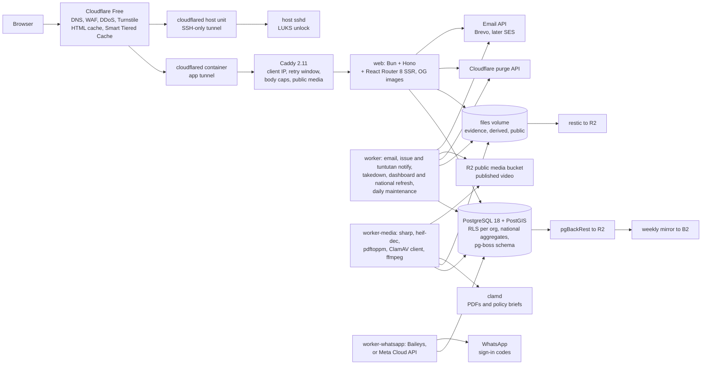
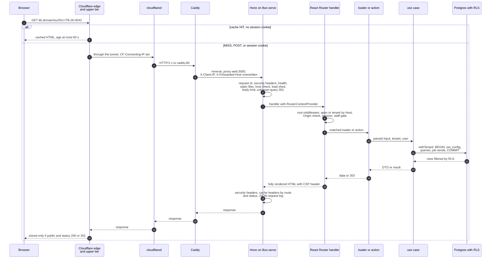
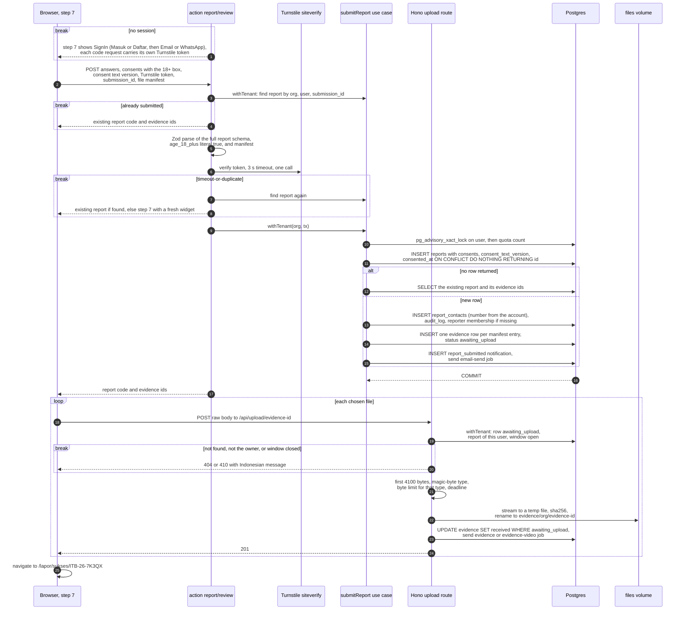
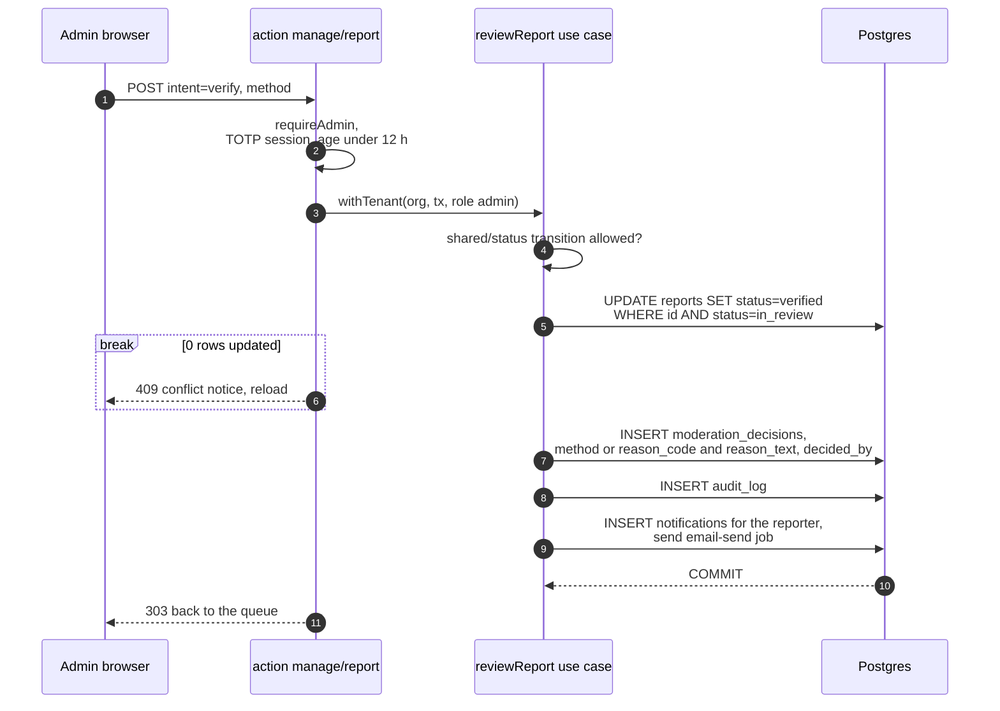
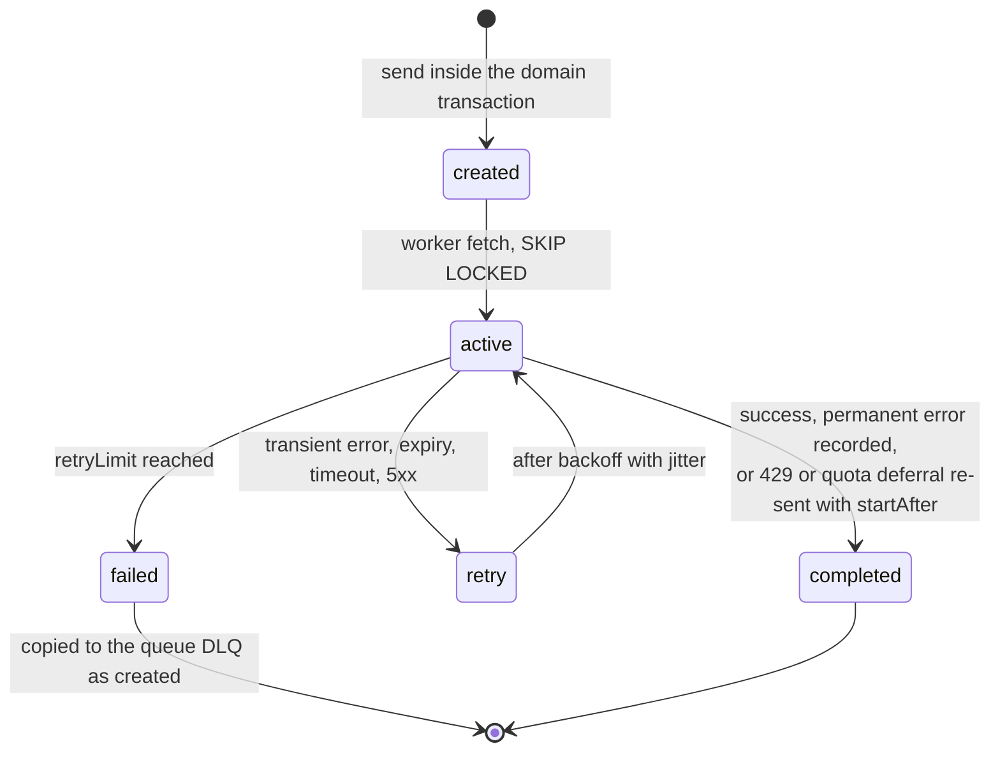
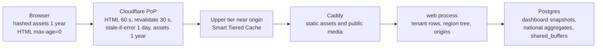
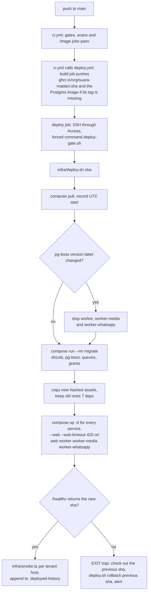

# Suara Madani Architecture

Status: Phase 1 implemented, checked against the code on 16 October 2026. The design was rebuilt on 13 October 2026 from all eight research domains, the four scout reports, the 73 findings of the first reviews, the 168 findings of review round 1 and the 22 findings of review round 2, then built in workflow 7 (15 to 16 October 2026), reviewed in three fix rounds, and extended in workflow 8 (16 October 2026) by the user's decisions: one tenant role `admin`, a platform run by student organisations rather than a campus service, verify first, admin-authored tuntutan in Phase 1, two colour-only map layers, and sign-up with name, email and WhatsApp number with codes by email or WhatsApp ([Table 3](#confirmed-product-decisions)). Where a section still describes something that is not in the code, [Implementation Status](#implementation-status) says so, and the code wins. Each concept's decision, trigger and sources are in [decisions.md](decisions.md); this document shows how they fit together. This document's departures from PLAN.md were applied to PLAN.md on 13 October 2026 ([Applied PLAN.md Changes](#applied-planmd-changes)) and again on 16 October 2026. Precedence when documents differ: the user's product decisions, then PLAN's product behavior, then the technical detail in this document and decisions.md (PLAN §10). The user decided the 20 product proposals and 13 open questions on 13 October 2026; [Confirmed Product Decisions](#confirmed-product-decisions) records each answer and where the design changed, and those answers override PLAN and earlier review findings. How to run the project locally is in the root `README.md`.

Conventions:
- `[S#]` points to [Sources](#sources). "PLAN" means PLAN.md in this repository. "Phase N" means PLAN §13 "Fase N".
- **[unverified]** marks a claim no source confirmed. Every one is assigned to a [Phase 0 spike](#phase-0-spikes). **[proposed]** marks a value chosen here without a source.
- Every tuning number appears once, in [Starting Values](#starting-values). Where a value now lives in code, the file named in its row is the copy that runs.
- Product behavior is PLAN's behavior plus the four approved changes (login at step 7 of the report form; only merged issues are public; rating opens after "Diklaim selesai" only and shows a 1–5 distribution with n, hidden when n < 10; formal "Anda" copy with 6 question steps plus a review step) and the [Confirmed Product Decisions](#confirmed-product-decisions). "Item N" means row N of the first table there, "Question N" row N of the second.

## Contents

1. [Implementation Status](#implementation-status)
2. [Constraints](#constraints)
3. [Architecture Overview](#architecture-overview)
4. [Code Organization and the Dependency Rule](#code-organization-and-the-dependency-rule)
5. [Modules](#modules)
6. [Database Roles and RLS](#database-roles-and-rls)
7. [Request Lifecycle](#request-lifecycle)
8. [Vertical Slice Data Flows](#vertical-slice-data-flows)
9. [Background Jobs](#background-jobs)
10. [Email](#email)
11. [Caching Layers and Invalidation](#caching-layers-and-invalidation)
12. [Failure Modes and Timeouts](#failure-modes-and-timeouts)
13. [Security Controls](#security-controls)
14. [Observability and Targets](#observability-and-targets)
15. [Deploy, Rollback, Backup and DR](#deploy-rollback-backup-and-dr)
16. [Performance Budgets](#performance-budgets)
17. [Starting Values](#starting-values)
18. [Folder Structure](#folder-structure)
19. [Phase 0 Spikes](#phase-0-spikes)
20. [Open Questions](#open-questions)
21. [Confirmed Product Decisions](#confirmed-product-decisions)
22. [Applied PLAN.md Changes](#applied-planmd-changes)
23. [Rejected Review Findings](#rejected-review-findings)
24. [Review Finding Ledger](#review-finding-ledger)
25. [Sources](#sources)

## Implementation Status

Checked against the code on 16 October 2026 (PLAN §13 carries the same marks per roadmap item). Gates on that date: typecheck, Biome, `bun run test`, build, size-limit and knip all pass (counts in the workflow build log).

Built and tested in Phase 1:
- Multi-tenant schema with FORCE RLS on every tenant table (23 tables), 24 migrations (`0000_init` to `0023_email_quota_lever`), the catalog test and cross-tenant tests, including the multi-host rule over HTTP.
- One tenant staff role, `admin` (migration `0017_one_admin_role_contract`); the platform superadmin is a separate operator flag.
- Sign-up and sign-in: Daftar (full name, email, WhatsApp number, 18+ box) and identifier-first Masuk (email or WhatsApp number), then a code by email or WhatsApp, through our own Better Auth plugin `accountOtp`; TOTP for staff after either channel; the per-address and per-number caps; a TOTP step-up (`/masuk/konfirmasi`, 300 s) before member, settings, organisation and WhatsApp-sender changes.
- WhatsApp sender: `worker-whatsapp` with Baileys 6.7.24, the `whatsapp-send` queue, sealed payloads and credentials, `/admin/whatsapp` (link by QR or pairing code, status, unlink), the Meta Cloud API adapter and a dev adapter into Mailpit.
- Report form (7 steps; step 6 takes the number from the account), evidence upload after sign-in, the `evidence`, `evidence-video` and `evidence-publish` jobs (images including HEIC, PDF through ClamAV and `pdftoppm`, video through ffprobe and ffmpeg), the censor editor and the public "Bukti" section.
- Verify first: no unverified report's content reaches any public page, search, map, OG image or tuntutan list (`app/features/issues/verify-first.test.ts`, live check on the production build).
- `/kelola`: home, queue, report review (verify including "kontak pelapor", not verifiable, reject, merge with suggestions, forward to another campus, audited contact reveal, close a reporter's account), issue list and issue page (publish, refer, escalate, record a response, every government status change, timeline, issue edit, legal takedown), tuntutan (list, create, editor, policy brief upload and publish), complaint queue with appeal to a different admin, audit log, team members and settings, open to every admin. `/admin` and `/admin/whatsapp` for the superadmin.
- Public pages: home, `/isu`, `/isu/:code` (follow, complaint link, 410 after removal), `/tuntutan`, `/tuntutan/:code` (follow, complaint link, policy brief download), OG images for issues and tuntutan, `/data` with the agency response metrics, the tuntutan section and numbers, the two-layer map and the issue ranking, `/lacak` with pending uploads, `/aduan/:code`, `/undangan/:id`, `/tentang`, `/privasi`, `/pedoman`, `/aksesibilitas`, and the apex national view with tuntutan numbers.
- Email: receipt on submit, every report transition to the reporter, issue and tuntutan updates to followers, complaint mail, invitations, sign-in codes; `email_log`, the 200-a-day ceiling shared by notifications and invitations with the 100 OTP reserve, deferral to 07:00 WIB, signed `/lacak` and unfollow links valid 30 days.
- Takedown job with retries and hostname purge; per-tenant and global intake pause with the public banner; `maintenance-daily` (upload window, retention, `sending` requeue, orphan check, infected briefs, `whatsapp_log`), `db/jobs-cli.ts` and `docs/runbook.md`.
- Infra: `infra/Dockerfile`, `infra/compose.yaml` (with `worker-whatsapp`), `deploy.sh` with rollback, `host-setup.sh`, backup and restore scripts, `/healthz/jobs`, `infra/load-test.js` (k6), the CI, deploy, scheduled-scan and backup-copy workflows, `e2e/` (Playwright and axe) and the Lighthouse budget step. `infra/stack-test.sh` and `infra/restore-test.sh` pass locally.
- Dev sample seed (`bun run db:seed:sample`), local only, with sample tuntutan and policy briefs.

Built differently from the design below (the flows describe what was built):
- Evidence: `editEvidence` and `approveEvidence` are one action, `decideEvidence`; "Jangan terbitkan" exists for every kind; boxes are black or mosaic, never blur.
- Forwarding writes the original at campus A first, then the copy at B ([flow 6](#6-forward-a-report-to-another-campus)).
- No follower count anywhere; "Ikuti isu ini" and "Ikuti tuntutan ini" signed out link to `/masuk?kembali=<page>`.
- The apex scope is resolved in the React Router root middleware, not in Hono.
- The national view refresh is plain `REFRESH`, not `CONCURRENTLY`.
- Invitations are our own code on the Better Auth `invitations` table, not the organization plugin endpoints.
- The superadmin flag is a `users.superadmin` column set only from the command line.
- Sign-in codes come from our own plugin, not Better Auth `emailOTP` or `phoneNumber` ([Multi-Host Auth](#multi-host-auth)).
- Merge suggestions do not use `ST_DWithin` (issues carry region codes, not points).

Not built yet (needed for Phase 1 exit or named in this document):
- Staff passkeys (staff use TOTP).
- `issue_versions` (summary history); redaction reaches the issue title and summary, not timeline notes or agency responses.
- "Gunakan lokasi saya" (PLAN §5.9; needs the BIG village boundary import), the per-100k map and the kab/kota map.
- `.github/pull_request_template.md`; `Server-Timing` and per-loader query-count tests (planned, a decision for the user, Open Question 12).
- A screen for an account made before migration 0018 to add its number.
- Never run against real accounts: deploy, backups to R2 and B2, Cloudflare settings, monitors, a real WhatsApp pairing and the Meta adapter against Meta. The `e2e` and Lighthouse CI jobs have not run on GitHub yet.

## Constraints

| Constraint | Consequence for the Architecture |
|---|---|
| One self-hosted server, docker compose, Cloudflare Free in front through Cloudflare Tunnel (PLAN §10.1, §10.10) | One failure domain. Anonymous reads must come from the CDN. The origin rejects excess work quickly instead of queueing it. |
| Rotating student volunteers, yearly handover | One language (TypeScript), one runtime (Bun 1.4.3), one database (PostgreSQL 18.6 with PostGIS 3.6), one app image. No Redis, broker, microservices or Kubernetes (PLAN §13). Every mechanism must be explainable at handover. |
| Near-zero budget | Free tiers are design inputs: Cloudflare Free (one rate rule [S5], 5 custom WAF rules [S86], 10 Cache Rules (PLAN §10.6), 10 Transform Rules [S85]), Brevo Free (300 emails a day) [S45], R2 10 GB free. |
| 1k–100k reports a year; viral spikes of 100k+ page views a day | Writes are small (about 3 to 275 reports a day). Reads are spiky and almost all anonymous. |
| Multi-tenant alliance, subdomain per tenant, national view on the apex (PLAN §5.11) | Tenant from `Host`; Postgres RLS with `FORCE`; tenant set per transaction. Tenants stay at the first subdomain level for Universal SSL [S55]. Phase 1 has one live tenant (PLAN §13) and, by item 6, the apex national view, so one cross-tenant read path exists from day one. |
| Approved behavior: sign-in or sign-up at step 7, and evidence sent only after sign-in (item 2) | Steps 1–6 run in the browser only; the browser keeps the chosen files until step 7. The step-7 submit creates the report, then each file goes to an authenticated upload bound to its evidence row. No anonymous write endpoint, quarantine, upload cookie or unattached upload exists ([ADR-05](decisions.md#adr-05-evidence-upload-pipeline)). |
| Images, PDF and video evidence in Phase 1 (item 1) | Hostile files reach PDF, image, HEIC and video decoders, so the process that runs them gets the least database access of any app process. |
| Report form requires JavaScript; public pages do not (Question 1) | Public issue, demand, data and `/lacak` pages render fully without JavaScript. `/lapor` shows a notice when JavaScript is off and keeps no server-side fallback path. |

## Architecture Overview



Four app processes run from one image: `web` (`server/index.ts`), `worker`, `worker-media` and `worker-whatsapp` (all three `worker/index.ts`, with the queue set chosen by the `WORKER_QUEUES` env var). `worker-media` is split out because it decodes untrusted files with libvips, libheif (`heif-dec`), poppler (`pdftoppm`) and ffmpeg. Uploaders are signed in (item 2), but an account costs only an email address and a phone number, so the files stay untrusted. It logs in as `sm_media`, which can read and update only evidence rows and policy brief scan columns and read tenant hosts, mounts only the directories it reads or writes, and sits on its own `media` network with Postgres only, plus the `scan` network with clamd. A decoder exploit then reaches neither `report_contacts`, other tenants' reports nor `web`, and a file it plants under `files/public` is served by Caddy only with a fixed image type, `nosniff` and a sandbox CSP, so it cannot run script on a tenant origin ([Security Controls](#security-controls), Public files). The split also keeps a media out-of-memory kill away from email and takedowns. Item 1 keeps PDF and video in Phase 1, so the split stays. `worker-whatsapp` ([WhatsApp Sender](#whatsapp-sender)) is split out for a different reason: it holds a long-lived WhatsApp Web session and is the only container with `WHATSAPP_CREDS_KEY`, so the session credentials it seals cannot be opened by `web` or `worker`.

The host also runs one `cloudflared` systemd unit with its own tunnel whose only ingress is `ssh://localhost:22` [S91]. It does not depend on Docker or the encrypted volumes, so Access SSH works while the volumes are still locked after a reboot.

## Code Organization and the Dependency Rule

This is a modular monolith with feature folders. There are no repository interfaces, no use-case classes and no DI container (decisions.md, Architecture row "Hexagonal"). Three sentences carry the structure:
- Routes (`app/routes/**`) parse input, check the role, and call plain functions in `app/features/<feature>/*.server.ts` that take a transaction (`submitReport(tx, input)`, `mergeIntoIssue(tx, …)`).
- `shared/` holds pure TypeScript with no I/O: status state machines (`transition(state, action) -> { next, followUps }`), report ID, Zod schemas, categories and formatting.
- `worker/` imports `db/`, `shared/` and the outbound clients in `server/` (`email.ts`, `purge.server.ts`, `emails/render.ts`); it never imports `app/` directly. `server/emails/render.ts` imports the generated `app/paraglide/messages.js` (as `server/auth.server.ts` does) and `app/features/moderation/reason-labels.ts` by relative path, so worker mail reuses the UI's labels; the Biome worker ban covers direct imports only. `db/` holds schema, pool, `withTenant`, `getTenantByHost`, job helpers and `notifications.server.ts` (`notifyReporter`, `notifyFollowers`, `notifyComplainant`, callable from use cases and the worker); these are adapters, not use cases. `server/origin.server.ts` (`originFor`, `apexHost`) is the one place that builds absolute URLs from `tenant.host`.

Enforced rules:

| Rule | Enforcement |
|---|---|
| Code that touches the database or secrets never reaches the browser bundle | `app/` reaches the database or secrets only through `*.server.ts` modules, and the `server/` and `db/` modules that `app/` imports directly are `*.server.ts` too (`server/auth.server.ts`, `server/purge.server.ts`, `server/turnstile.server.ts`, `db/*.server.ts`); React Router fails the build when a `.server` module enters the client graph [S11]. A Biome `noRestrictedImports` override bans files under `app/` that are not themselves `*.server.ts` from importing any other file in `server/` or `db/`; `*.server.ts` files in `app/` may import anything there, such as `db/schema/` (P12). CLIs and `worker/` never enter a bundle, so they need no suffix. `app/root.tsx` imports `db/tenant.server.ts` only inside its `middleware` export, which the client build drops. The Biome rule is tested (`tooling.test.ts` "biome import bans", P12); React Router's coverage of files outside `app/` is **[unverified]** (spike P13) |
| `app/components/` does not import `app/features/` (PLAN §10.4) | Biome `noRestrictedImports` override [S12] |
| No import cycles | Biome `suspicious.noImportCycles: "error"` (not in the recommended set) [S12] |
| `worker/` does not import `app/`; `shared/` imports no I/O module | Biome override; review |
| Tenant data only through `withTenant` | `db/tenant.server.ts` is the only export that returns a transaction; the catalog test catches tables without RLS |
| The Biome import bans above actually fire | `tooling.test.ts` "biome import bans" lints probe files under `app/` with the repo `biome.json` and asserts which imports are flagged |
| `lucide-react` only through named icon imports | `tooling.test.ts` "lucide imports" fails on `DynamicIcon`, the `icons` map, default or namespace imports and `lucide-react/*` subpaths |
| The error page stays out of first-load JS | `tooling.test.ts` "error page chunk" fails when any `app/` file imports `~/components/layout/error-page` statically |
| Code comments: at most 5 words, no `;` (PLAN §8.3 A) | `tooling.test.ts` "comment rule" checks every line comment and block comment line in root `*.ts` and `*.js` and in `app`, `server`, `db`, `shared`, `worker`, `infra` and `e2e` (`.ts`, `.tsx`, `.js`, `.css`, `.sql`), skipping `app/paraglide/`, `biome-ignore` and `@ts-` directives; a second test checks `#` comments in `.env.example`, `.github/workflows/*.yml` and `infra/` shell, YAML, conf, `.example`, systemd units, Dockerfiles and the Caddyfile |

If the Biome overrides do not behave as documented (spike P12), the same rules move into one `rg` script in CI. Any use case may join any table, because a data-ownership rule inside one database turns one query into several.

## Modules

| Module | Tables (Phase) | Use Cases | Routes | Jobs |
|---|---|---|---|---|
| tenancy and auth | `organizations` (with `theme`, `settings` including `intakePaused`, `statusUrl` and the identity facts, `logo_bytes`, `logo_hash`), `org_counters` (kinds issue and demand), Better Auth tables (outside RLS; `users` carry `phone_number`, `phone_verified`, `age_declared_at`, `age_consent_version` and `superadmin`; `invitations` with a status CHECK), `email_log` (all Phase 1) | `server/account-otp.server.ts` (the `accountOtp` plugin: lookup, check-new, send-code, verify-code, code-status); `app/features/campus/members.server.ts` (`listTeam`, `inviteMember`, `resendInvitation`, `cancelInvitation`, `readInvitation`, `acceptInvitation`, `removeMember`), `settings.server.ts` (`readSettings`, `saveTheme`, `setIntakePause`, `saveIdentity`, `saveLogo`, `removeLogo`, `readLogo`), `campuses.server.ts` (`listCampuses`, `createCampus`, `resendFirstInvitation`, `requireSuperadmin`); `requireAdmin`, the only tenant access check (`features/moderation/access.server.ts`; the `/kelola` nav shows every link to every admin); the step-up check (`features/moderation/step-up.server.ts`); age declaration and phone requirement in `server/auth.server.ts` | `account/sign-in` (`/masuk`), `account/sign-out`, `account/step-up` (`/masuk/konfirmasi`), `account/invitation` (`/undangan/:id`), `manage/two-factor` (`/masuk/dua-langkah`), `manage/members` (`/kelola/anggota`), `manage/settings` (`/kelola/pengaturan`), `admin/layout` and `admin/campuses` (`/admin`), `logo` (`/logo/:file`), `api/auth` | none |
| whatsapp | `whatsapp_log`, `whatsapp_sender`, `whatsapp_auth` (global, outside RLS; Phase 1) | `server/whatsapp.server.ts` (readiness, per-number and sender caps, sealed `whatsapp-send` job), `server/seal.ts`; `features/whatsapp/admin.server.ts` (sender view, link and unlink requests) | `admin/whatsapp` (`/admin/whatsapp`) | `whatsapp-send` |
| report | `reports` (with `submission_id`, the step-7 consent record and `forwarded_from_org_id`, `forwarded_from_report_id`, `forwarded_from_code`, `forwarded_to_org_id`), `report_contacts`, `evidence` | `submitAction` and `handleSubmit` (`features/report/submit.server.ts`; the contact number comes from the account), upload in `server/api/upload.server.ts`, `forwardReport` (`features/report/forward.server.ts`), `listOwnReports` (`tracking.server.ts`), `readLink` (`signed-link.server.ts`), `queueSlow` (`queue-delay.server.ts`) | `report/*` (`/lapor/*`), `account/track` (`/lacak`), `api/upload` (`/api/upload/:evidenceId`), `regions` (`/wilayah/:file`), `media` (`/media/:file`, dev stand-in for Caddy) | `evidence`, `evidence-video`, `evidence-publish` |
| moderation | `moderation_decisions`, `redaction_originals`, `takedowns`, `audit_log`, `content_complaints` | `reviewReport` (`verify.server.ts`), `runMerge`, `recomputeIssue` (`merge.server.ts`), `listMergeTargets` (`queue.server.ts`), `decideEvidence` (`evidence.server.ts`), `originalAvailable`, `originalFileName` (`original.ts`), `revealContact` (`contact.server.ts`), `closeAccount` (`close-account.server.ts`), `editIssue` (`issue-edit.server.ts`), `legalTakedown` (`legal-takedown.server.ts`, through `withdrawIssue` in `complaints.server.ts`), `listComplaints`, `getComplaint`, `decideComplaint`, `countWaitingComplaints`, `queueTakedown`, `withdrawEvidence`, `listAudit`, `readManageSummary`, `listQueue` | `manage/home` (`/kelola`), `manage/queue` (`/kelola/antrean`), `manage/report` and `manage/close-account` (`/kelola/laporan/:code`, `/tutup-akun`), `manage/evidence-editor`, `manage/evidence`, `manage/evidence-original` (`/kelola/bukti/:id/...`), `manage/complaints`, `manage/complaint` (`/kelola/aduan`), `manage/audit` (`/kelola/audit`) | `takedown` |
| issues | `issues` (with `version`, `redacted_at`, `redaction_reason`, `taken_down_at`, `takedown_reason`), `issue_reports`, `issue_events` (public timeline), `referrals`, `responses`, `follows`, `notifications` (all Phase 1); `issue_versions` (designed, not built); `resolution_claims`, `ratings`, `fix_surveys` (Phase 2) | `getIssuePage`, `listPublishedIssues`, `listShowcases`, `listIssueRanking` (`issues.server.ts`), `runPublish`, `purgeIssuePages` (`publish.server.ts`), `applyIssueAction`, `runIssueAction` (`moderation/referrals.server.ts`), `followIssue`, `unfollowIssue`, `isFollowing`, `unfollowTarget` (`follow.server.ts`), `submitComplaint`, `getOwnComplaint`, `appealComplaint` (`complaint.server.ts`, for an issue or a tuntutan), `renderOgPng` | `issues/list` (`/isu`), `issues/detail`, `issues/og-image`, `issues/unfollow` (`/isu/:code/berhenti`), `issues/complaint` (`/isu/:code/laporkan`), `account/complaint` (`/aduan/:code`), `manage/issues` (`/kelola/isu`), `manage/issue` | `issue-notify`, `email-send`; `survey-send`, `deadline-reminders` (Phase 2) |
| demands (tuntutan) | `demands`, `demand_items`, `demand_updates`, `demand_issues`, `demand_follows`, `policy_briefs` (all Phase 1, migration 0019) | `createDemand`, `editDemand`, `changeDemandState`, `deleteDraft`, `addItem`, `editItem`, `moveItem`, `removeItem`, `recordItemUpdate`, `linkIssue`, `unlinkIssue`, `uploadBrief`, `publishBrief`, `listManagedDemands`, `getManagedDemand` (`features/demands/manage.server.ts`); public `listPublishedDemands`, `demandScorecard`, `demandProvinces`, `getDemandPage`, `getDemandCard`, `publicBriefFile`, `demandOverview`, `latestDemands` (`demands.server.ts`); `followDemand`, `unfollowDemand`, `isFollowingDemand`, `demandUnfollowTarget` (`follow.server.ts`); `demandPurgeUrls`, `purgeDemandPages` (`purge.server.ts`, through the shared `purgeQuietly` in `server/purge.server.ts`); the state machines in `shared/status.ts` | `demands/list` (`/tuntutan`), `demands/detail`, `demands/og-image`, `demands/brief` (`/tuntutan/:code/dokumen/<id>.pdf`), `demands/unfollow`, `demands/complaint`, `manage/demands` (`/kelola/tuntutan`), `manage/demand-new`, `manage/demand`, `manage/demand-upload` (`/kelola/tuntutan/:code/unggah`) | `demand-notify`, `evidence-brief` |
| regions | `regions` (codes and names; global, outside RLS; the full list loads from `db/seed/wilayah.tsv`: cahyadsn/wilayah commit `d68e8d5`, `db/wilayah.sql` sha256 `c4c3396d…`, 38 provinces, 514 kabupaten/kota, 7,285 kecamatan, 83,762 desa/kelurahan, names trimmed; the file header cites Kepmendagri 300.2.2-2138/2025 while the repository README cites 300.2.2-2430/2025) | `childrenOf` (`features/report/regions.server.ts`); `locate` with `ST_Contains` is not built | `regions` (`/wilayah/<code>.json`) | none |
| data | `dashboard_snapshots` (under RLS) and the `national_aggregates` materialized view owned by `sm_aggregates` (both Phase 1, item 6) | `readDashboard` (with the live `demandOverview`), `readNational`, `shapeNational`, `campusHref` | `data` (`/data`); the apex `/` is `home` dispatching on `nationalContext` | `aggregate-refresh` |
| operations | pg-boss schema and `backup_runs` (both outside RLS) | `db/jobs-cli.ts` (`list`, `show`, `redrive`, `delete` for DLQs) | `/healthz`, `/healthz/jobs` (Hono) | `maintenance-daily` |

Schema notes from the scouts and research:
- Drizzle 0.45.3 uses `pgTable(...).enableRLS()` [S20]; `withRLS()` is the v1 API shown on the current docs site [S27]. drizzle-kit 0.31.11 [S96] emits only `ENABLE`, so `FORCE ROW LEVEL SECURITY` goes in a `--custom` migration [S21].
- Drizzle's built-in `geometry()` drops the SRID; locations use a `customType` that declares `geometry(Point,4326)` [S20].
- Status columns are `text` with `CHECK`, not enums, because adding an enum value and using it in one migration transaction fails [S22].
- Primary keys are `uuid DEFAULT uuidv7()` (PG 18). `issues.search` is a generated `tsvector` declared `STORED` (`to_tsvector('indonesian', title || ' ' || summary)`, migration 0005; PG 18 defaults generated columns to VIRTUAL [S23]), so a search reads it instead of recomputing it per row. It has no GIN index on purpose (decisions.md, Data row "Database indexing").
- Better Auth tables need `modelName` mapping for plural names [S24]. Reporters become `reporter` members of the tenant on their first submit (PLAN §5.2), done inside the submit transaction; following an issue also inserts a `reporter` membership when missing (the role of staff is kept), so every follower and complainant has one.
- Consent record (Question 7). `reports` stores the step-7 consents as `consents` (the accepted keys, `age_18_plus` among them), `consent_text_version` and `consented_at` (Postgres `now()`), all under the report's RLS; the submit transaction writes them in the same INSERT, and the Zod schema in `shared/report-schema.ts` requires `age_18_plus` as `z.literal(true)`. The age statement is also per account: `users.age_declared_at` and `users.age_consent_version`, declared as Better Auth `additionalFields` [S24] and written when the user is created by `databaseHooks.user.create.before` (`declareAge` in `server/auth.server.ts`).
- `issue_reports` has `UNIQUE (org_id, report_id)`, so two concurrent merges cannot link one report to two issues.
- `reports` has `UNIQUE (org_id, forwarded_from_report_id)`, so a repeated forward to the same campus creates one copy (Question 5). Report status adds the terminal `forwarded`; the original stores `forwarded_to_org_id` and the copy `forwarded_from_org_id` (migration 0007).
- `evidence.status` runs `awaiting_upload` → `received` → `ready` → `published`, with the side exits `missing` (no file within the upload window; set by `maintenance-daily`), `rejected_limits` (over the video limits of item 9), `rejected_malware` (ClamAV hit on a PDF: no preview, no original download) and `needs_manual_review` (failure reasons include `multi_image`, `decode_failed`, `timeout` and `image_too_large`). Migration 0008 adds `failure_reason`, `duration_ms`, `width`, `height`, `source_pages`, `preview_pages`, `decision` (`redact`, `no_redaction`, `withhold`), `redaction_boxes` (units of 1/10000 of each side, not preview pixels), `publish_pages`, `decided_by`, `decided_at`, `public_media` and `published_at`. A row exists only for a submitted report, so there is no unattached evidence (items 2 and 13).
- Phase 2 `ratings` are keyed `UNIQUE (claim_id, user_id)` (item 8) and store `is_reporter`, the account age at write time and a hashed IP prefix that `maintenance-daily` clears after 30 days (PLAN §10.5).
- `audit_log` stores actor, action, entity, changed column names and an HMAC-SHA-256 of old and new values for free-text columns, never the text itself. Actions are the closed list `AUDIT_ACTIONS` in `shared/moderation.ts`: `report.submit`, `report.<action>` for every `REPORT_ACTIONS` entry, `report.forward_in`, `report.view_contact`, `issue.create`, `issue.publish`, `issue.<action>` for every `ISSUE_ACTIONS` entry, `issue.redact`, `issue.edit`, `issue.unpublish`, `issue.take_down`, `account.close_minor`, `account.close`, `evidence.decide`, `evidence.download_original`, `complaint.submit|decide|appeal|appeal_decide`, `member.invite|invite_resend|invite_cancel|join|role|remove` (`member.role` stays for historical rows only and is no longer written), `settings.theme|logo|intake_pause|identity`, `campus.create`, and the tuntutan actions `demand.create`, `demand.edit` (changed columns plus HMAC value hashes for title, body, summary and target), `demand.delete`, `demand.publish`, `demand.close`, `demand.reopen`, `demand.hide`, `demand.item_add`, `demand.item_edit`, `demand.item_move`, `demand.item_remove`, `demand.item_status` (reason code "response/fulfilment", shown as both labels), `demand.item_note`, `demand.brief_upload`, `demand.brief_publish`, `demand.issue_link`, `demand.issue_unlink`; entities `report`, `issue`, `user`, `evidence`, `complaint`, `invitation`, `organization`, `demand`. Role and decision codes go in `reason_code` (`admin`, `reporter`, `paused`, `resumed`, `set`, `removed`, complaint and reject reasons; rows written before migration 0017 keep `moderator`, which `/kelola/audit` shows as "Admin" through `audit-labels.ts`); theme rows list the changed token names in `changed_columns`; addresses and phone numbers are never logged. `/kelola/audit` shows team rows as "Akun <id8>", "Undangan <id8>" and "Organisasi". The key, `AUDIT_HMAC_KEY`, lives in SOPS, so a short redacted value (a name, a phone number) cannot be recovered from the log by a dictionary; destroying the key makes every hash useless. Reason codes are stored; free-text reasons live in the entity row, where redaction reaches them.
- `content_complaints` (migration 0009; migration 0019 made `issue_id` nullable and added `demand_id` with a CHECK for exactly one subject and the tuntutan parts): org, issue or demand, `public_code` `ADU-<campus>-<yy>-<5>` unique per org, `user_id` (SET NULL on account delete), `submission_id` unique per user, reason, part, explanation, `status` `open|decided|appealed|appeal_decided`, the first decision columns, appeal text and time, and the appeal decision columns; CHECKs tie each status to its columns, and `content_complaints_appeal_moderator_check` (`appeal_decided_by IS NULL OR appeal_decided_by <> decided_by`; the old name stays) makes a different admin decide the appeal. `takedowns`: action `redact|unpublish|take_down|remove_on_request`, `issue_id`, `complaint_id`, `public_files` (jsonb captured at decision time), `evidence_ids` (uuid[] for data-subject removal), `purge_status pending|retrying|done`, `attempts`, `last_error` (step code), `done_at`. `redaction_originals`: original title and summary only, reason code and complaint id, with a restrictive `staff_only` policy for USING and WITH CHECK. `issues` gains `redacted_at`, `redaction_reason`, `taken_down_at`, `takedown_reason` (taken down implies unpublished). `notifications` gains `complaint_id` (0009) and `demand_id` (0019), and its subject CHECK is `num_nonnulls(report_id, issue_id, complaint_id, demand_id) = 1`.
- `follows (org_id, issue_id, user_id, created_at)` with primary key `(org_id, issue_id, user_id)`; `notifications (id, org_id, user_id` (NULL after account deletion), `event_id` (the `audit_log` id), `template`, one of `report_id | issue_id | complaint_id`, `status pending|sending|sent|failed|skipped`, error code, `claimed_at`, `sent_at)` with `UNIQUE (org_id, event_id, user_id)` (migration 0006). `email_log` (outside RLS): HMAC-SHA-256 of the lowercased address with `AUDIT_HMAC_KEY`, kind `otp|notification|invitation`, status `reserved|sent|failed`. Migration 0015 adds the partial indexes `notifications_report_idx (org_id, report_id)`, `notifications_issue_idx (org_id, issue_id)`, `notifications_complaint_idx (org_id, complaint_id)`, `notifications_user_idx (user_id)`, `issue_events_referral_idx (org_id, referral_id)` and `issue_events_response_idx (org_id, response_id)`, each `WHERE <col> IS NOT NULL`, per decisions.md "Index every FK column by hand"; `db/query-plans.test.ts` asserts the index scans.
- `referrals` (agency, channel `official_letter|agency_email|agency_service|hearing` since migration 0013, which rewrote the removed `sp4n_lapor` rows to `agency_service` and adds the narrower CHECK `NOT VALID`; escalations use `ombudsman|dprd|media`; `refer` is allowed from `escalated` when the government axis is `not_competent`, `not_followed_up`, `reopened` or `awaiting_response`, and then keeps the advocacy axis at `escalated` (rule field `keep`), while from `monitoring` or `referred` it still sets `referred`), `responses` (agency, text, date, source URL), `issue_events` (one public timeline row per action with the state after it and an optional note) and `moderation_decisions` (verify method, reject or not-verifiable reason code and `reason_text`) come from migration 0007.
- `users` (migration 0018): `phone_number` (E.164, `UNIQUE users_phone_number_key`, `CHECK ~ '^\+628[0-9]{8,11}$'` `NOT VALID`) and `phone_verified` (default false); `email_verified` stays. Input accepts 08xx, 62xx and +62xx with spaces, dashes, dots or brackets; 0800–0809 and landlines are refused (`shared/phone.ts`, whose rule `8[1-9]` plus 7 to 10 digits is stricter than the CHECK). Migration 0016 adds the trigger `users_superadmin_guard` (BEFORE INSERT OR UPDATE OF superadmin), which raises 42501 when `NEW.superadmin` is true and `current_user` is neither `sm_migrator` nor a superuser; `db/superadmin.test.ts` covers UPDATE and INSERT.
- `whatsapp_log` (number HMAC with `AUDIT_HMAC_KEY`, status `reserved|sent|failed`, error code), `whatsapp_sender` (singleton id 1: status, masked linked number, `requested`, `requested_by`, `pairing_phone`, `last_seen_at`, last connected, last error) and `whatsapp_auth` (key, sealed bytea; the key is `<type>-<HMAC of the id>`, so no recipient number is readable) are global tables from migration 0018, outside RLS and allowlisted in `db/tenant.test.ts`.
- Tuntutan tables (migration 0019, all with `org_id`, the tenant policy and FORCE RLS): `demands` (year, number, `public_code` `TUN-<campus>-<yy>-<nnnn>` from `org_counters` kind `demand`; scope `national|regional` with a CHECK that national has no region and regional has a province and an optional regency starting with the province code; title, body as written, summary, target, `raised_on`; state `draft|published|closed` with CHECKs tying `published_at` and `closed_at`; derived `progress`; `hidden_at` and `hidden_reason`; a generated `search` tsvector over title, summary and target; `version`), `demand_items` (position, body, `response_status`, `fulfilment_status`, CHECK rejected implies responded, `brief_summary`, `version`; no unique on position, ordered by position then id), `demand_updates` (public timeline: action `publish|close|reopen|status|note|brief`, `item_id` for item actions, the state after a status change, `occurred_on`, note, `source_text`, `source_url`; CHECKs: status rows carry both axes, status and note rows carry a note and a source, close carries a note, `source_url` http(s) only), `demand_issues` (org, demand, issue; FK to issues; published only, enforced at write and read), `demand_follows`, `policy_briefs` (status `pending|clean|infected`, sha256, byte size, `scanned_at`, `published_at` only when clean). New CHECKs and FKs on existing tables are `NOT VALID`.
- `invitations.status` has a CHECK (`pending|accepted|canceled`) and the partial unique index `invitations_pending_email_key (organization_id, lower(email)) WHERE status = 'pending'`; an expired pending invitation is canceled when the same address is invited again. `organizations` adds `logo_bytes bytea` and `logo_hash text`, both null or both set (migration 0010).

## Database Roles and RLS

| Role | Login | Attributes | Used by |
|---|---|---|---|
| `postgres` | local socket only | Superuser. Runs `infra/initdb.sql` (roles, extensions) | bootstrap only |
| `sm_migrator` | yes | Owns all tables and the `pgboss` schema. Subject to RLS because of `FORCE`, so it never runs backfills | the `migrate` one-off container |
| `sm_app` | yes | `NOSUPERUSER NOBYPASSRLS NOCREATEROLE NOCREATEDB`. DML on tenant tables (DELETE only where the domain needs it, INSERT only on `audit_log`), Better Auth tables, `email_log` and the WhatsApp tables; SELECT on `backup_runs`; DML on `pgboss` tables through default privileges, under the `sm_app_all` row policy on `job` and `job_common` | `web`, `worker`, `worker-whatsapp` (no new role: the seal on `whatsapp_auth` is the boundary, and a new role would need an initdb change on a live cluster) |
| `sm_media` | yes | `NOBYPASSRLS`. SELECT on `evidence`, `organizations (id, host)`, `issues (id, org_id, published_at)` and `issue_reports (org_id, issue_id, report_id)` (so `evidence-publish` re-checks that the issue is still public); UPDATE only on the evidence output columns (`status`, `detected_type`, `byte_size`, `sha256`, `attempts`, `updated_at`, `scanned_at`, `failure_reason`, `duration_ms`, `width`, `height`, `source_pages`, `preview_pages`, `public_media`, `published_at`), never the admin's decision; `policy_briefs` `SELECT (id, org_id, item_id, status, sha256), UPDATE (status, scanned_at)`. On `pgboss`: only `SELECT` on `queue` and `version`, DML on `job_common` and `SELECT, INSERT` on `job`, both under the row policy `sm_media_own`, which allows only the eight `evidence*` queue names (`evidence`, `evidence-video`, `evidence-publish`, `evidence-brief` and their DLQs; the `evidence-brief` name keeps that prefix so the policy needed no change). No grant on reports, contacts, Better Auth tables or `redaction_originals` (`db/migrate.ts` `GRANTS`) | `worker-media` |
| `sm_backup` | yes | INSERT on `backup_runs` only | the backup wrappers in `infra/` |
| `sm_aggregates` | no | Phase 1 (item 6). `BYPASSRLS`; `USAGE` on `public` and SELECT on `organizations`, `issues`, `reports`, `demands` and `demand_items` (the last two from migration 0020); owns the `national_aggregates` materialized view. `sm_migrator` is a member so migration 0011 can transfer ownership to it (the idempotent initdb re-run must keep `GRANT sm_aggregates TO sm_migrator`); `sm_app` gets SELECT and `MAINTAIN` on the view only | nobody logs in as it; a refresh runs its query as this owner |

Rules:
- Roles and extensions (`postgis`, `pg_trgm`, `pg_stat_statements`) are created by the superuser in `infra/initdb.sql`, mounted at `/docker-entrypoint-initdb.d`, because `sm_migrator` cannot create roles or grant `BYPASSRLS` [S25]. initdb scripts run only on an empty data directory, so the runbook includes an idempotent re-run. Drizzle migrations hold tables, indexes, policies, functions and triggers; `db/migrate.ts` revokes and re-grants the table privileges after them on every run.
- Migrations (`db/migrations/meta/_journal.json`): `0000_init` (tables, `ENABLE ROW LEVEL SECURITY`, policies), `0001_force_rls_audit` (`FORCE` on every tenant table, the `audit_log` append-only trigger), `0002_indexes_loud_tenant` (`public.current_org_id()` and every `tenant_isolation` policy rewritten to call it; the public list indexes `issues_published_idx`, `issues_report_count_idx` and `issues_activity_idx` lead with `org_id` and end with `id DESC` for keyset paging; `evidence_received_idx (org_id, received_at)`; the `two_factors.user_id` index becomes a `UNIQUE` constraint), `0003_totp_step` (`two_factors.last_totp_step`, see TOTP replay in [Multi-Host Auth](#multi-host-auth)), `0004_dashboard_snapshots` (`dashboard_snapshots` with `ENABLE` and `FORCE` RLS and the `tenant_isolation` policy), `0005_issue_search` (the stored `issues.search` tsvector), `0006_follows_notifications` (`follows` and `notifications` with FORCE RLS, `email_log` outside RLS), `0007_moderation_flows` (`referrals`, `responses`, `issue_events`, `moderation_decisions` with FORCE RLS; the forward columns on `reports`), `0008_evidence_pipeline` (evidence output and decision columns, `rejected_malware`), `0009_content_complaints` (`content_complaints`, `takedowns`, `redaction_originals` with FORCE RLS; issue redaction and takedown columns; `notifications.complaint_id`), `0010_campus_admin` (`users.superadmin`, invitation status CHECK and index, organization logo columns), `0011_national_aggregates` (the materialized view, owner `sm_aggregates`), `0012_backup_runs` (`backup_runs`), `0013_referral_channels_contract` (referral channel rewrite, a contract migration), `0014_review_fixes` (`reports.forwarded_from_code` and review fixes), `0015_fk_indexes_legal_reasons` (the six partial FK indexes; `issues_takedown_check` widened to `TAKEDOWN_REASONS` with the two legal codes and `moderation_decisions_reason_check` widened for `reporter_contact`, both `NOT VALID`), `0016_superadmin_guard` (the `users_superadmin_guard` trigger), `0017_one_admin_role_contract` (a contract migration: `members.role` and `invitations.role` rewritten from `moderator` to `admin`, both role CHECKs narrowed to `reporter, editor, admin` `NOT VALID`, and the `staff_only` policies on `report_contacts` and `redaction_originals` changed to `current_setting('app.member_role', true) = 'admin'`; rollback below it is refused, because an older image would set `moderator` and read no contacts), `0018_phone_whatsapp` (phone columns, the three WhatsApp tables; not a contract migration), `0019_tuntutan` (the six tuntutan tables, complaint and notification subjects, counter kind `demand`; not a contract migration) `0020_national_demands` (a custom migration that grants `sm_aggregates` SELECT on `demands` and `demand_items`, then drops and recreates `national_aggregates` with an exact `demands` column and the `demand` dimension, then changes the owner and refreshes as 0011; not a contract migration) and `0021_whatsapp_purpose` (`whatsapp_log.purpose` `sign_in|sign_up` with a `NOT VALID` CHECK and `whatsapp_log.client_hash`, for the Daftar WhatsApp share; not a contract migration) and `0022_brief_withdraw` (the `demand_updates` action and item CHECKs gain `brief_withdraw`, recreated `NOT VALID`; review round 2, not a contract migration) and `0023_email_quota_lever` (`email_log.purpose` `sign_in|sign_up` with a `NOT VALID` CHECK and `email_log.client_hash` for the Daftar email share, `notifications.email_log_id` with a `NOT VALID` foreign key `ON DELETE SET NULL` and a partial index, `whatsapp_sender` status `stopped` with the CHECK recreated `NOT VALID`; second review round 2, not a contract migration). Migrations 0007 and 0009 wrap their foreign-key additions on FORCE RLS tables in `NO FORCE ... FORCE`, because adding a foreign key as the owner under FORCE evaluates the tenant policy and fails with "app.org_id is not set" on a fresh database; `db/fresh-migrate.test.ts` applies every migration from zero, so a future migration that needs the same wrap fails there first. The dev database applied earlier versions of 0001, 0004, 0007, 0009 and 0013, so its stored hashes differ from the files; drizzle does not re-hash applied rows, and the effect is nil.
- Grants (`db/migrate.ts` `GRANTS`): `sm_app` gets column-level `UPDATE (name, email, email_verified, phone_number, phone_verified, image, updated_at, two_factor_enabled, age_declared_at, age_consent_version)` on `users`, so it cannot update `superadmin`; the INSERT grant stays table-wide because Drizzle lists every column, and the 0016 trigger refuses an INSERT with `superadmin` true (`db/superadmin.test.ts` expects 42501 for both); `reports`, `report_contacts` and `issue_reports` allow DELETE for closing an account; `evidence` allows DELETE for the 90-day retention; `follows` and `demand_follows` allow DELETE for unfollowing; `demands` and `demand_items` allow DELETE (only never-published drafts and draft items are deleted), `demand_issues` SELECT, INSERT and DELETE, `demand_updates` SELECT and INSERT, `policy_briefs` SELECT, INSERT, UPDATE and DELETE (replaced or infected files); `referrals`, `responses`, `issue_events`, `moderation_decisions`, `redaction_originals` and `audit_log` are SELECT and INSERT only; `content_complaints`, `takedowns` and `notifications` are SELECT, INSERT and UPDATE; `email_log` and `whatsapp_log` add DELETE for the 30-day retention; `whatsapp_sender` is SELECT, INSERT and UPDATE, `whatsapp_auth` SELECT, INSERT, UPDATE and DELETE.
- `infra/pg-hba.conf` (set through `hba_file`): `postgres` by `peer` and `sm_backup` by `scram-sha-256` on the local socket only; `sm_migrator` and `sm_app` by `scram-sha-256` from the fixed `db` network subnet; `sm_media` by `scram-sha-256` from the fixed `media` network subnet only; everything else rejected. CI fails on the word `trust` in the file and on `POSTGRES_HOST_AUTH_METHOD` in compose [S90].
- Every tenant table: `ENABLE` and `FORCE ROW LEVEL SECURITY`, policy `USING (org_id = (SELECT public.current_org_id())) WITH CHECK (same)`. `current_org_id()` (migration 0002, `STABLE`, `search_path` pinned) reads `current_setting('app.org_id', true)` and raises SQLSTATE 42501 "app.org_id is not set" when the setting is missing (NULL [S26]) or empty (a pooled connection reverts it to `''` after a `withTenant` transaction). A query outside `withTenant` therefore fails loudly instead of returning 0 rows, for `sm_app` and for the owner under `FORCE` alike (`db/tenant.test.ts`: "a query without a tenant fails loudly", "a pooled connection fails loudly after a tenant transaction", "the owner is subject to FORCE"). The `(SELECT …)` wrapper runs the function once per statement instead of once per row.
- `report_contacts` adds one restrictive policy `FOR ALL USING (current_setting('app.member_role', true) = 'admin') WITH CHECK (true)` (since migration 0017). USING gates SELECT, UPDATE and DELETE; WITH CHECK passes, so INSERT is gated only by the base policy's `org_id` check. The reporter's submit transaction can insert the row but never read it back. `editor` is excluded on purpose (it stays in the role CHECK for Phase 2, but no route accepts it). A test runs a reporter-role transaction that inserts and then fails to select.
- `withTenant(orgId, fn, { role })` opens a transaction and runs one parameterized `select set_config('app.org_id', $1, true), set_config('app.member_role', $2, true)`. It never uses `sql.raw` (Drizzle's RLS doc example does) and never a session-level `SET` [S20] [S27]. It retries the whole transaction for a report-code collision (at most 3 times, and never once 10 s have passed since the first attempt: Caddy's 30 s response timeout minus the 15 s `transaction_timeout` minus a 5 s margin, so the last attempt ends inside Caddy's response timeout) and once for a deadlock (SQLSTATE 40P01); there are no other web retries.
- **Checks without a tenant.** A query without `app.org_id` raises 42501, so a health or maintenance check run outside `withTenant` errors instead of checking anything. `/healthz/jobs` and every `maintenance-daily` step that reads a tenant table (takedowns, dashboard snapshots, `sending` notifications, the evidence upload window, retention and orphan checks) loop over `organizations` and run each check inside `withTenant(org.id, …)`, returning counts only. A missing snapshot row counts as stale.
- The dev sample seed (`db/seed/sample.ts`, `sample-plan.ts`, `sample-content.ts`, `sample-demands.ts`, `sample-demands-content.ts`; `bun run db:seed:sample`, `--reset` to remove) writes through `withTenant` and the real use cases (`reviewReport`, `runMerge`, `runPublish`, forwarding, complaints, the evidence job, the tuntutan use cases, the brief scan, the dashboard refresh), with the oldest admin as actor and `sampel.<slug>.admin@contoh.test` as the second decider, then backdates timestamps as `sm_migrator` inside `withTenant`, because FORCE RLS binds the owner too. It refuses `NODE_ENV=production` and any database host other than localhost or 127.0.0.1, is deterministic and idempotent, and `--reset` removes everything it made except `audit_log` rows, which are append-only. Per campus it adds one undecided PDF (2 pages, scanned by ClamAV, rasterised) and one undecided video (320×240, 2 s, transcoded with a poster) on published issues, and one `awaiting_upload` photo on the newest submitted report (created at most 3 h before seeding, so `/lacak` lists it for about a day); so it needs `pdftoppm`, `pdfinfo`, `ffprobe`, `ffmpeg` and the dev ClamAV. Tuntutan: itb 7 (2 national, 5 regional in Jawa Barat and DKI Jakarta, one closed national, one regional draft), ugm 5 (1 national, 4 regional in DI Yogyakarta, Jawa Tengah and Jawa Timur), 3 to 6 subtuntutan each with mixed statuses, dated sourced updates, a few issue links, and one-page text PDFs as policy briefs scanned by the dev clamd. Bodies, update notes, sources and brief summaries start with "[Data sampel]"; titles and summaries do not, as for sample issues. Every seed account has a fictional `+62 8110…` number and a name marked "Sampel". The merge plan never merges into a closed issue, and sample reports are never contactable, so `reporter_contact` is never picked.
- Timeouts are set per process in the node-postgres pool config (`statement_timeout`, `lock_timeout`, `idle_in_transaction_session_timeout`, and `transaction_timeout` through `options`) [S28] [S95]; long jobs use `SET LOCAL`.
- **Catalog test** (`db/tenant.test.ts`, CI, after migrations): every table in schema `public` on which `sm_app` or `sm_media` holds a privilege either has an `org_id` column with `relrowsecurity`, `relforcerowsecurity` and at least one row in `pg_policies`, or is on the test's explicit allowlist (Better Auth tables including `invitations`, `email_log`, `whatsapp_log`, `whatsapp_sender`, `whatsapp_auth`, `regions`, `organizations`, `backup_runs`, and the `national_aggregates` materialized view, which holds only suppressed cross-campus report counts and exact public tuntutan counts). `db/fresh-migrate.test.ts` counts 23 forced tables. Any other table or view fails CI, so a new table forces a decision in its PR. Per-table cross-tenant tests run under `SET ROLE sm_app` for the core tables. Two tests cover the per-org check loop: a takedown older than 10 minutes in the second org makes `/healthz/jobs` return 503, and so does deleting one org's snapshot (P4).
- Outside RLS (PLAN §5.11 lists Better Auth tables and pg-boss): also `email_log` (keyed by address hash, written before a tenant transaction exists), `regions` (global reference data), `organizations` (resolved from `Host` before a tenant exists), `backup_runs` (one row per backup run, no tenant data) and the three WhatsApp tables (one platform sender, no tenant data). Membership is checked in `requireAdmin` (and the staff gate in the root middleware), which uses only the `Host`-derived `tenant.id`, never the session's `activeOrganizationId`; CI fails on `activeOrganizationId` outside `server/auth.server.ts`. Job payloads carry IDs only.
- **Apex national view (PLAN §5.11, Phase 1 by item 6).** One materialized view, `national_aggregates` (`db/migrations/0011_national_aggregates.sql`, declared in `db/schema/national.ts` with `pgMaterializedView(...).existing()`), holds the cross-campus counts the apex shows. Columns: `dimension` (`campus|category|province|status|total|demand`), `key` (org id, category id, province code, status, `all`, or for `demand` the keys `national`, `regional`, `active`, `fulfilled`, `items`, `items_fulfilled`), `received`, `issues`, `issue_reports`, `demands` (public tuntutan, exact, never hidden; migration 0020) and `computed_at`. `issues` counts published issues (`published_at IS NOT NULL`, which already excludes hidden and taken-down issues); `issue_reports` sums their `report_count`; `received` counts reports with `status <> 'forwarded'` (a forwarded report counts once, at the receiving campus) and exists only on `campus` and `total` rows. Every report or issue cell from 1 to 4 is NULL inside the view query, campus rows included (tuntutan counts are public admin content and stay exact), so a campus's apex "Laporan masuk" can differ from its own `/data` total. Campus names, hosts and province names are read live from `organizations` and `regions`. A materialized view cannot carry RLS [S29]. Its refresh needs the `MAINTAIN` privilege and runs the query with the owner's identity, under `search_path` `pg_catalog, pg_temp` [S111] [S112], so the query names every table with its schema. Spike P4 answered on PostgreSQL 18.6 (`db/national.test.ts`): (a) a view owned by an RLS-subject role (`sm_migrator`) under FORCE raises 42501 "app.org_id is not set" on refresh, which replaces [S30]'s "refreshes to 0 rows" (that predates the loud `current_org_id()` policy); (b) `ALTER MATERIALIZED VIEW ... OWNER TO sm_aggregates` needs `CREATE` on schema `public` for the new owner, so migration 0011 grants it, transfers ownership and revokes it in one transaction; (c) `sm_app` holding only SELECT and `MAINTAIN` refreshes the view, the query runs as the `BYPASSRLS` owner and sees every campus on FORCE tables, `sm_app` cannot `SET ROLE sm_aggregates` and cannot alter the view (tested with a real `sm_app` login, because under a superuser session `SET ROLE` is checked against the session user and proves nothing). The view is created `WITH NO DATA` (a `WITH DATA` create runs as `sm_migrator` and hits 42501) and populated by a `REFRESH` at the end of migration 0011. Refresh is plain `REFRESH MATERIALIZED VIEW public.national_aggregates`: `CONCURRENTLY` needs a unique index and a permanent `TEMP` grant on the database for `sm_aggregates` (initdb revokes TEMP from PUBLIC; verified "permission denied to create temporary tables"), for a view of a few dozen rows whose lock lasts milliseconds. No wrapper view is needed, because no row belongs to one tenant's private data.

## Request Lifecycle



| Stage | Responsibility | Source |
|---|---|---|
| Cloudflare | TLS, WAF, DDoS, Turnstile, HTML Cache Rule with an explicit path allowlist and `bypass_by_default`, bypass on `__Secure-sm.session_token`, one rate-limiting rule, a Transform Rule that empties the query string on routes that take no parameters (**[unverified]** that a static rewrite can do this before the cache key on Free, P1) | [S1] [S2] [S4] [S5] [S85] |
| cloudflared (container) | Outbound tunnel, `protocol: auto`; ingress for `<domain>` (apex, national view, item 6) and `*.<domain>` to `http://caddy:80`, then `http_status:404` | [S6] |
| Caddy | `trusted_proxies` set to the fixed `edge` subnet with `client_ip_headers CF-Connecting-IP`, passed on as `X-Client-IP`. Because the tunnel is a trusted proxy, Caddy would pass client-sent `X-Forwarded-*` through [S7], so `header_up X-Forwarded-Host {host}` and `header_up X-Forwarded-Proto https` overwrite them. `lb_try_duration` and `lb_try_interval`; upstream keepalive shorter than Bun `idleTimeout`; `handle_errors` returning a static 503 with `Retry-After`; `request_body` caps (PLAN §10.5); public media from `files/public/{host}` only, for an extension allowlist with fixed types and a sandbox CSP ([Security Controls](#security-controls), Public files); JSON access log with `roll_keep_for 720h` and a filter that keeps the path and drops the query | [S7] [S8] |
| Hono, in order (`server/app.ts`) | 1. `requestId` with `headerName: ''` and a generator using `cf-ray` (ignores client IDs) [S9]. 2. Request log and security headers. 3. `/healthz` and `/healthz/jobs` (every host, before any tenant work). 4. Static files from the client build (`/assets/*` immutable). 5. Host check: a `Host` that is not already normalized returns 404, because Better Auth hosts are exact. 6. Load shed: separate in-flight caps for uploads and for everything else, else 503 `no-store` with `Retry-After`. 7. Body limit of 128 KB on everything except `/api/upload/<evidence id>`, which streams with its own limits (Bun `maxRequestBodySize` is the video limit plus 1 MB), and `/kelola/tuntutan/<code>/unggah`, which has its own 10 MB plus 64 KB cap and an upload load-shed slot; an oversize form answers 413 with the Paraglide text `error_body_too_large` ("Data yang Anda kirim terlalu besar. …"), and the logo form checks `logoTooLarge` (`shared/campus.ts`, 96 KB) in the browser before it submits. 8. Origin gzip for `no-transform` responses ([Caching Layers and Invalidation](#caching-layers-and-invalidation)). 9. Canonical query: on every cacheable document route, unknown parameters 301 to the canonical URL before any DB call; React Router's `.data`, `_routes` and `index` pass through. 10. Everything else goes to the React Router handler, then `cache-headers`. Phase 1 has no `/api/v1/*` public data (item 20). `/api/auth/*` and `/api/upload/<evidence id>` are React Router resource routes (`routes/api/auth.ts`, `routes/api/upload.ts`), so dev and production serve them the same way (spike P10) | [S9] [S31] |
| React Router root middleware (`server/request-context.server.ts`) | Resolves the scope: a `Host` equal to `normalizeHost(APEX_HOST \|\| "localhost")` (`server/origin.server.ts` `apexHost`) sets `nationalContext`, skips the tenant lookup, the session read and the Origin check (no apex route has an action; a POST gets 405), and allows only `/`, `/tentang`, `/privasi`, `/pedoman` and `/aksesibilitas`; any other apex path (`/tuntutan` included) throws 404 carrying the national shell (`nationalShellData`). Any other host resolves through `getTenantByHost` from a small in-process cache, and an unknown host returns 404. Then the CSRF check (`server/middleware/csrf.ts` `isTrustedRequest`: a non-GET request needs an `Origin` equal to the request origin, or `Sec-Fetch-Site: same-origin` when `Origin` is absent), the session (Better Auth `getSession`, only when the session cookie exists) and the gates: `/admin` needs a superadmin with a TOTP session, `/kelola` an `admin` membership on this host with a TOTP session younger than 12 h (`editor` is a staff role in `STAFF_ROLES` but every page and action refuses it), else 403 inside the themed shell. Runs in dev and production alike, which matters because `react-router dev` does not run `server/app.ts` [S32]. Paraglide's `/en` middleware arrives with the English version in Phase 2 | [S11] [S32] |
| Loader or action | Zod-parse input, check role, call 1 or 2 use cases, return a DTO or 303. Every absolute URL (`og:url`, canonical, 301 `Location`) is built from `tenant.host`, never from request headers. Non-streamed SSR puts every loader on the critical path | [S13] |
| `app/entry.server.tsx` | `renderHtml`: `renderToReadableStream` with `progressiveChunkSize: Number.POSITIVE_INFINITY`, `await allReady`, read the HTML; then hash only the inline scripts React and React Router tagged with this render's random token (the token is stripped before sending, so the header holds hashes only and the page stays cacheable) plus the server-built theme CSS, and set CSP (`server/csp.server.ts`). The page is buffered for hashing anyway, so streaming buys nothing; without the infinite chunk size React moved any Suspense boundary over 12,800 bytes into a hidden `<div hidden id="S:0">` plus a `$RC` script, which left the root 404 and the `/kelola` 403 with an empty `<main>` without JS (`app/entry.server.test.tsx` "a large boundary stays inline") | [S14] [S15] |

Tenant and session context:
- The tenant comes only from the `organizations` row matched by `Host`, never from user input. `withTenant` receives `tenant.id` from context. A test sends a spoofed `X-Forwarded-Host` and asserts it appears nowhere in the HTML.
- The apex host has no organization row. It serves the national view (item 6) from `national_aggregates` with no `withTenant`, no session lookup and no form: the campus list links to each tenant host (`https://<host>` in production; in dev the link keeps the request port, such as `itb.localhost:5173`, a deliberate dev-only exception to "never from request headers"), and sign-in, reporting and following happen on a tenant host. Its `/` is cached like any public page; the view refreshes every 15 minutes and the page shows `computed_at`. `app/root.tsx` omits `<Scripts>` and `<ScrollRestoration>` on the apex, so its pages ship no JavaScript.
- Sessions are database-backed with `cookieCache` off [S33]. Staff sessions older than 12 h are rejected by the `manage/layout` and `admin/layout` middleware.

### Multi-Host Auth

| Concern | Decision | Status |
|---|---|---|
| Base URL | `baseURL: { allowedHosts: <every organizations.host>, protocol: "https" }` (dev: `http` and `<host>:*`), built at boot from the tenant list; `resetAuth()` rebuilds it after `/admin` creates a campus, in that process only | Built (`server/auth.server.ts`); other `web` processes need a restart after onboarding |
| Trusted origins | Explicit list built from `organizations.host` at boot; never `https://*.<apex>`. The tenant onboarding runbook ends with a `web` restart | [S35] |
| Cookies | Host-only, `Secure`, `HttpOnly`, `SameSite=Lax`, `advanced.cookiePrefix: "sm"`, so the production name is `__Secure-sm.session_token` [S36]. PLAN does not define cross-campus sign-in; host-only cookies are a security control, so a user signs in separately on each host | Security control |
| Client IP | `advanced.ipAddress.ipAddressHeaders: ["x-client-ip"]`, the header Caddy sets; `CF-Connecting-IP` surviving the tunnel is **[unverified]** (P1) | [S37] [S102] |
| Passkeys | `@better-auth/passkey` with `rpID` = apex, so one passkey works on every tenant host; origin checked per request | **Not built** (`TODO(P5)` in `server/auth.server.ts`); staff use TOTP |
| Staff second factor | `twoFactor({ allowPasswordless: true })` for TOTP. Its after-hook is reattached to `/account/verify-code` (`accountOtpStepUp` in `server/auth.server.ts`), so staff get the TOTP challenge after a code by email or by WhatsApp (tested for both). `staffAccess` and `superadminAccess` require a session verified by TOTP, newer than `users.updated_at` and younger than 12 h; trusted devices are refused. After TOTP, staff land on `/kelola`, a superadmin without a campus role on `/admin` (the challenge success redirects to `/masuk/dua-langkah`, whose loader picks the home) | Built; tested in `server/auth.test.ts` and `server/request-context.test.ts` |
| TOTP replay | A `hooks.before` on `/two-factor/verify-totp` finds the 30 s step the code belongs to (Better Auth's window of one step either side, `server/totp-step.ts`) and claims it with `UPDATE two_factors SET last_totp_step = <step> WHERE user_id = … AND (last_totp_step IS NULL OR last_totp_step < <step>)` (column from migration 0003). No row updated means that step or a later one was already used, so the request gets 401 `INVALID_CODE` before Better Auth verifies it. A code that matches no step passes through, and the endpoint counts the failure | Tested: `server/auth.test.ts` "a TOTP code works once; a backup code signs in" |
| Sign-in codes | Our own Better Auth plugin `accountOtp` (`server/account-otp.server.ts`) replaces `emailOTP`. Five routed endpoints in `OPEN_AUTH_PATHS`, each with a pinned body allowlist: `/account/lookup` {identifier} returns `email` and `whatsapp`, each `{kind: "masked", value}` for the identifier typed, `{kind: "registered"}` for the other one (no digits, no domain) or `null`, plus `whatsappReady` (or `found: false`, with `unproven: true` when the identifier sits unproven on an account, so Masuk can say "sign in with the other identifier, or Daftar to move it" instead of only pointing to Daftar; second review round 2); review round 3 removed the other identifier's mask, because a phone number gave back the email domain and an email gave back six digits of the number without a captcha; `/account/check-new` {name, email, phone} returns `taken: email|phone|pending|null`, `only: email|whatsapp|null` plus masks of the caller's own email and number; `/account/send-code` {mode `sign-in`\|`sign-up`, identifier or name+email+phone, channel `email`\|`whatsapp`} with Turnstile in `x-captcha-response`; `/account/verify-code` (the same fields plus `code`, and `ageDeclaration` for sign-up); `/account/code-status` {id} for WhatsApp delivery. Codes are 6 digits, stored as SHA-256 (base64url) in `verifications` under an identifier that is the HMAC-SHA-256 (`AUDIT_HMAC_KEY`) of `account-otp:<mode>:<channel>:<user id and destination, or email\|phone>` (Better Auth `verification.storeIdentifier` override for the `account-otp:` prefix; other identifiers stay plain; `maintenance-daily` deletes expired rows, because Better Auth deletes them only inside `findVerificationValue`, which this app calls only for staff TOTP), valid 300 s, 3 attempts, consumed with `consumeVerificationValue` (race-safe). A code is stored only after the email reservation or the WhatsApp enqueue succeeds, so a refused resend keeps the earlier code valid. Sign-up validates the 18+ box before the code is spent. The channel that received the code becomes verified (`email_verified` or `phone_verified`). A sign-in key carries the destination the code went to, so a code is void once the account's email or number changes before it is used (review round 3: a released number replaced through `addPhone` was otherwise marked verified by a code sent to the old number). Daftar refuses an email or number already on any account (`EMAIL_TAKEN`, `PHONE_TAKEN`). When the real owner proves an identifier that sits unproven on another account, the identifier moves ("release") and the old account's `updated_at` is kept, so its staff session stays valid. An account whose number moved, and any account without a number, is asked for one on `/masuk` when signed in ("Tambahkan Nomor WhatsApp", `addPhone` in `features/report/add-phone.server.ts`: refused when the number is on another account, stored unproven, proven later by Masuk with WhatsApp; `updated_at` kept); `error_contact_no_phone` points there (second review round 2). Masuk by identifier shows which channels exist: the typed identifier masked (`wa•••@contoh.id` or `+62 812•••••890`), the other as "terdaftar" only; the masked destination of the other channel appears only in the `send-code` answer (`to`), which sits behind Turnstile. The identifier is resolved on the server, so a phone number never reveals the email. Every other Better Auth route answers 404, so the organization plugin's own endpoints stay closed | Built; `server/auth.test.ts` |
| Why not Better Auth `phoneNumber` [S123] | Checked in `node_modules/better-auth@1.7.7/dist/plugins/phone-number/routes.mjs`: `/phone-number/send-otp` stores the code as plain `"<code>:0"`; `/sign-in/phone-number` is password based; `/phone-number/verify` signs up with a temporary email, which conflicts with "email and phone both required"; the two-factor hook matches `/sign-in/phone-number`, not `/phone-number/verify`, so admins would skip TOTP. One plugin for both channels also hashes every code the same way | Decision ([decisions.md](decisions.md), Security row "OAuth") |
| Rate limiter | Better Auth's built-in limiter is on in production with the custom rule `CGNAT_LIMIT` (20 requests per 60 s, sized for carrier-grade NAT) on lookup, check-new, send-code and verify-code; the Cloudflare rule and Turnstile sit in front. Per address and per number: none within 60 s and at most 8 per 24 h (`reserveOtp` in `server/email-log.ts` for email, `WHATSAPP_LIMITS` for WhatsApp), production only. Codes to unproven destinations have their own shares on both channels (email: 20 an hour, 60 a day, 10 a day per client address; WhatsApp: 20, 100 and 5), so a flood of Daftar codes to fresh addresses never blocks sign-in by a proven address. Identifier-first lookup and Daftar's uniqueness check reveal whether an account exists; only these limits protect them (accepted exposure, Open Question 9) | Built |
| Age declaration and phone (Question 7, wf8) | Every path that creates a Better Auth user is Daftar inside `SignIn` (step 7, `/masuk`, sign-in from `/isu/:code/laporkan` and `/tuntutan/:code/laporkan`, staff invitation acceptance through `/masuk?kembali=/undangan/<id>`): the required, unchecked box "Saya berusia 18 tahun atau lebih" before the code is used. The request carries `ageDeclaration` with the consent text version; `databaseHooks.user.create.before` (`declareAge`) refuses to create the user without it, and without `phoneNumber` (`PHONE_REQUIRED`), and sets `age_declared_at` and `age_consent_version`. Step 7 also stores the box in the report's consent record. Accounts created before migration 0018 have no number: they sign in by email only, and the report contact step refuses "Ya" for them (`error_contact_no_phone`) | Built; per-path checks in `server/auth.test.ts` |
| Superadmin and admin | Superadmin is `users.superadmin boolean NOT NULL DEFAULT false` (migration 0010), not a Better Auth field and not a tenant role, set only by `bun run db:superadmin grant <email>` (or `revoke`) (`db/superadmin.ts`, migrator URL, existing account only; it bumps `users.updated_at`, so old staff sessions must sign in again); `sm_app` cannot write the column (grant plus the 0016 trigger). The root middleware gates `/admin` on any tenant host (the apex has no sign-in): session, `isSuperadmin(userId)`, then `superadminAccess`, the same rules as `staffAccess`; failure is 403 in the themed shell, and an unenrolled superadmin gets the enrol link. `/masuk/dua-langkah` lets a superadmin without a campus role enrol. The superadmin only creates tenants and links the WhatsApp sender. Every tenant staff member has the one role `admin` (wf8 decision, 16 October 2026): verify, merge, publish, forward, record responses, tuntutan, complaints, team and settings. The Better Auth `organization()` plugin keeps its defaults; no `ac` or `roles` config is added, because the closed routes mean `hasPermission` is never called; the `members` table is the Better Auth table, and migration 0017 is the role migration. Step-up: member, settings, organisation and WhatsApp-sender changes require a TOTP code verified within 300 s; otherwise the page redirects to `/masuk/konfirmasi` ("Konfirmasi Kode Autentikator", `features/moderation/step-up.server.ts`), and 5 wrong codes end the session | Built |

## Vertical Slice Data Flows

The Phase 1 slice: submit report → admin verify → merge into issue → public issue page → cache purge and takedown, plus the Phase 1 flows the confirmed decisions add: forwarding a report to another campus, content complaints, the apex national view, closing a reporter's account, inviting an admin, legal takedown, issue edit, tuntutan, and sign-up and sign-in with the WhatsApp sender. All internal work is done by one tenant role, `admin`.

### 1. Submit Report

Steps 1–6 are separate route modules under `/lapor/*`, so each step's chunk loads only what it needs (Turnstile only at step 7). The form requires JavaScript (Question 1): steps 1–6 have no server action. Each step checks its fields with HTML constraint attributes, saves the answers to `sessionStorage` and navigates on the client. A `<noscript>` notice on `/lapor` says the form needs JavaScript and links to the public pages, which work without it. Step 7 posts the whole report, and its action validates the full Zod schema from `shared/report-schema.ts`, including the required age box (Question 7). Submit buttons are disabled while `useNavigation().state` is not `idle`.

- Every `/lapor/*` response and the success page send `Cache-Control: private, no-store` from the route. No GET response contains a per-visitor value.
- `submission_id` is minted in the browser with `crypto.randomUUID()` when the draft starts and travels only in the step-7 POST body, never in a URL, so it appears in no access log.
- Draft (PLAN §7, item 5): `sessionStorage` only, cleared on submit; no server draft. If P20 shows that in-app browsers lose `sessionStorage` during the OTP app switch, the answers move to `localStorage` with a 24 h expiry, cleared on submit, and known in-app browsers show a "Buka di browser" hint (item 17). Neither store can hold the chosen files: after a full page load the answers survive but the files do not, and step 7 lists the missing file names and asks the user to choose them again (P20).
- Step 6: only "Boleh kami hubungi?" and the preferred method (WhatsApp or telepon). The number is never typed in the form and never held in the draft; at submit, `report_contacts.phone` is copied from the signed-in account's `phone_number` (a snapshot), and `contactable: yes` without a number on the account is a 400 field error (`error_contact_no_phone`), as is a number the account never proved by WhatsApp (`error_contact_phone_unverified`, review round 2: admins call only a number its owner proved, so a typo or someone else's number never reaches `report_contacts`). The session carries `phoneVerified` (`readSessionWith`). Step 7 review shows the masked account number, with "(belum terverifikasi)" when unproven.
- Step 2 (item 7): province, kabupaten/kota, kecamatan and desa are four cascading native `<select>` elements. Choosing one fetches its children from the cacheable `/wilayah/<code>.json` resource route (on average about 14 kecamatan per kabupaten/kota and 11.5 desa per kecamatan). No ComboBox.
- Step 3, "instansi terkait" (optional, with suggestions, PLAN §7): a text input with a native `<datalist>` filled from a cached agency list. A browser without `<datalist>` support shows a plain text field, which this optional free-text answer allows; MDN notes that some screen reader and browser pairs do not announce the suggestions [S113]. Dialogs are native `<dialog>`, so React Aria is not used (PLAN §10.3).
- Step 5, evidence (item 2): the user chooses up to 5 files with `<input type="file" accept="image/*,application/pdf,video/*" multiple>`. Nothing is sent yet. The browser checks each file's size against the PLAN §7 limit for its type and, for video, reads duration and dimensions from a `<video>` element's metadata to refuse a file over 3 minutes or above 1080p before sign-in (item 9); the `evidence-video` check on the server is authoritative. HEIC photos are accepted (item 18, [Background Jobs](#background-jobs), Media limits). The 112 emergency banner and all copy follow PLAN §7.
- "Isu Serupa di Dekat Anda" (PLAN §5.6): step 3 loads the published issues of the step-2 kabupaten/kota (the level public issues disclose, PLAN §5.9) with `useFetcher().load` from the cacheable `/isu?wilayah=<code>` list loader, so the desa answer adds no cache-key variants. Each item links to the issue page, where "Ikuti isu ini" links a signed-out visitor to `/masuk?kembali=/isu/<code>` (the same `SignIn`; `app/features/report/return-path.ts` allows `kembali` only for `/isu/<code>`, `/lacak` and `/undangan/<id>`; the signed-out "Ikuti tuntutan ini" link passes `/tuntutan/<code>`, which this allowlist drops, so that sign-in ends on the default page instead of the tuntutan, an open defect), so no sign-in step is added to the form. The list renders after the last field of step 3 (before the continue button), so its late load never moves a field. The draft stays in that tab's `sessionStorage`, and "Lanjutkan draf laporan" (PLAN §7) returns to the form; files chosen before a full page load must be chosen again.
- Intake pause (item 11): `server/intake.server.ts` (`globalIntakePause`, `intakePaused`) is the single rule used by `shellData`, the `/lapor` layout, the step-7 submit and the upload route. While `INTAKE_PAUSED` is set, or the tenant's `settings.intakePaused`, every page except the `/lapor` steps shows `components/layout/intake-banner.tsx` under the header ("Pelaporan sedang dihentikan sementara.", plus "Lihat status layanan" when `settings.statusUrl` is set); the `/lapor` steps keep their own step banner with the same link, and the step-7 action and the upload route return 503 with the same message. Answers already in the draft are kept.

Step 7, review, sign-in, submit and evidence upload:



Details:
- The report code (`ITB-26-7K3QX`, Crockford base32) comes from `shared/report-id.ts`. A collision on `UNIQUE (org_id, public_code)` aborts the transaction, so `withTenant` re-runs the whole transaction with a new code, at most 3 times (about 6 collisions a year at 20k reports per campus).
- Quotas (reports per account per day) are atomic: the transaction takes `pg_advisory_xact_lock(hashtextextended(user_id::text, 0))` before counting [S40].
- The Turnstile widget renders after sign-in because a token lasts 300 s [S41]. A `timeout-or-duplicate` result is expected for the loser of a double submit, so the action looks again before showing an error. The uploads that follow need no token: they are authenticated and bound to rows the submit created. Step 7 therefore uses two Turnstile tokens (code request and final submit).
- The submit commits before any file moves. It also inserts the `report_submitted` notification and sends one `email-send` job in the same transaction (`insertReport` in `features/report/submit.server.ts`): the receipt ("Laporan diterima", with the signed `/lacak` link) is built, pending the formal answer to [Open Question 3](#open-questions); it costs one email per report under the ceiling.
- Files go one per request, because one POST with 5 videos of 50 MB would exceed Cloudflare's 100 MB request limit on Free [S42] (**[unverified]** for proxied traffic, P1) and the Caddy cap. The route (`server/api/upload.server.ts`) requires a session whose user owns the report (checked under `withTenant`), an evidence row in `awaiting_upload` and a report younger than the upload window, and it refuses a file whose sniffed kind differs from the manifest row's kind or exceeds `EVIDENCE_LIMITS[kind]` (`shared/evidence.ts`). A repeated upload of a `received` row returns 200 and writes nothing. The body is streamed, never parsed as multipart in memory; the type is detected from the first 4100 bytes before more is written, so the byte limit follows the detected type, not the client's hint, and a file larger than its manifest entry is refused. Allowed types are the PLAN §7 types plus HEIC and HEIF (item 18). Each upload has an absolute deadline and holds one of a few slots per IP prefix (IPv6 /64, IPv4 address), so slow clients cannot take every slot; uploads use their own in-flight counter, not the SSR load-shed cap; a per-tenant cap on received bytes per 24 h fails closed with 503, because accounts cost only an email address and a phone number.
- The handler deletes its temp file on any error. A crash leaves a temp file, which the daily orphan check in `maintenance-daily` removes after a day. Rows still `awaiting_upload` when the window closes are marked `missing` by `maintenance-daily`; no file exists for them, so nothing needs collecting (item 13 is moot). Within the 24 h window the signed-in owner can send a missing file from `/lacak` ("Bukti yang Belum Terkirim", `features/report/pending-uploads.tsx`) through the same route; a signed-link view of `/lacak` asks the reader to sign in first.
- The admin queue lists a report at once and marks it "Bukti sedang diunggah" while any row is `awaiting_upload`. A submitted report is visible only there: no public page, search, map cell, OG image, showcase, ranking, dashboard snapshot or tuntutan list reads a report that is not verified and merged into a published issue ([Verify First](#verify-first)).
- Tests: two concurrent `submitReport` calls with the same key give one report, one `report_contacts` row, one audit row, one evidence row per manifest entry and one notification. User B uploading to A's evidence id gets 404; an upload after the window gets 410; a repeated upload writes nothing.

### 2. Admin Verify



Status transitions use compare-and-set (`WHERE status = $from`); there are no claim columns. `reviewReport` (`features/moderation/verify.server.ts`) handles start review, verify, not verifiable and reject; verify, not verifiable and reject insert a `moderation_decisions` row. Reject and not verifiable require a reason code (`REJECT_REASONS` cite `/pedoman#standar-n` or `#cakupan`; `UNVERIFIABLE_REASONS`) and guidance text, which reach `/lacak` and the email; `audit_log` keeps the code only. The reporter sees every status in `/lacak`, and every transition of the report state machine emails the reporter (item 3, which covers item 15): to in review ("Sedang diperiksa"), verified, not verifiable (with the reason), rejected (with the reason and guidance, PLAN §5.10), merged into an issue and forwarded to another campus. The receipt for the first status, "Terkirim", is sent too ([Open Question 3](#open-questions) awaits the formal answer). The verify methods are `document`, `site_photo`, `second_party`, `news_source` and `reporter_contact` (migration 0015 widens `moderation_decisions_reason_check`, `NOT VALID`). `reporter_contact` is offered only when the report's `contactable` is true: `VerifyForm` leaves the radio out and shows "Kontak pelapor tidak tersedia karena pelapor tidak bersedia dihubungi.", and `reviewReport` refuses it for a non-contactable report (`no_contact_consent`, 400 "Pelapor tidak bersedia dihubungi. Pilih cara verifikasi lain."). When the reporter agreed, `/kelola/laporan/:code` shows "Kontak Pelapor"; the number and the account name appear only after a POST (`intent=show_contact`, `revealContact` in `app/features/moderation/contact.server.ts`) that reads `report_contacts` under the `staff_only` policy, joins `users` for the name, writes an `audit_log` row `report.view_contact` (no value hashes, nothing logged) and answers `private, no-store`. The optional step-7 `forward_to_agency` consent is shown on the report page ("Setuju diteruskan ke instansi") and per report on `/kelola/isu/:code`. Each report transition inserts one `notifications` row and sends one `email-send` job in its transaction; the `followUps` of `shared/status.ts` list them, and a unit test asserts that every report transition there has an email follow-up. Opening a contact view or downloading an original writes an `audit_log` row (actor, report, field group, no values). Rejecting a joke or irrelevant report is the same reject action with a reason code; the reporter sees the reason, the public never sees the report.

Evidence review and censoring ("sunting bukti", PLAN §5.2, §6, §10.5):
- The `evidence` job writes a re-encoded, metadata-stripped preview to the private `files/derived/<org>/<evidence id>/`: one image for a photo (HEIC decoded first, item 18), one image per rasterized page for a PDF (item 14), the 720p transcode and a poster for a video (`evidence-video`, item 10). Admins view previews at `/kelola/bukti/<id>/<n>.webp` or `video.mp4` (`manage/evidence`, single-range support), which `web` serves from a read-only mount with `nosniff` and `Content-Security-Policy: sandbox; default-src 'none'`. Because PDF previews are images, no browser PDF viewer runs under the sandbox. The original stays a download at `/kelola/bukti/<id>/asli` (`manage/evidence-original`, audit `evidence.download_original`), unmodified, so admins never need to open an unstripped file inline. One rule (`originalAvailable` in `app/features/moderation/original.ts`) serves the route and the card: an original downloads only after a clean ClamAV scan (`evidence.scanned_at`), or, for a non-PDF, when its bytes matched the declared type (`ready`, `published`, `rejected_limits`, or manual review after the type check). PDFs are scanned before the type check, and every manual-review path scans the original first when it is at most 10 MB (`scanOriginal`). The download name comes from `originalFileName`: the declared stem reduced to `[A-Za-z0-9 _-]`, at most 80 characters (fallback `bukti-<position+1>`), plus the extension of the sniffed `detected_type` (jpg, png, webp, heic, heif, pdf, mp4, mov, webm, else bin), so a reporter's extension never reaches staff (a JPEG polyglot named `.hta` downloads as `.jpg`); `Content-Type` stays `application/octet-stream` with `nosniff`. A `rejected_malware` file has neither preview nor original. Forwarded copies are scanned again at campus B.
- `decideEvidence` (`features/moderation/evidence.server.ts`, page `/kelola/bukti/:id/sunting`, `manage/evidence-editor`) is one action with three decisions: `redact` (at least one box), `no_redaction` and `withhold` ("Jangan terbitkan", for every kind). Boxes are stored on the row in units of 1/10000 of each side, with a style: opaque black (default, for text and plates) or mosaic (at most 6 blocks across the short side, blocks of at least 16 px, for faces); there is no blur. For a PDF the admin also picks the pages to publish. Video has no box editor (item 19): only `no_redaction` or `withhold`. The form carries the row's `decided_at` as an optimistic token (`evidence-publish` compares `decided_at::text` at its final update), writes `audit_log` (`evidence.decide`) and is allowed before the merge. When the issue is public (at the decision, at publish, or when the report is merged into a published issue) the same transaction sends one `evidence-publish` job `{ orgId, evidenceId }`.
- `evidence-publish` (in `worker-media`) burns the boxes into the preview images with sharp `composite` [S109] and writes `files/public/<host>/media/<sha256(evidence id ‖ bytes)>.webp` per image, so no file is shared between rows and deleting one never breaks another issue's copy. A video marked `no_redaction` is copied from its 720p transcode to the R2 media bucket through Bun's built-in `S3Client` (`worker/media-store.ts`; dev keeps it under `files/public`); a withheld file never gets a public copy. The final status update also requires the issue to be published at that moment: if a hide or removal happened mid-job, the handler deletes the copies it wrote and completes as `skipped`. A published file is locked; changing it after publication goes through the takedown path (`withdrawEvidence`).
- Tests: a fixture with one box comes out with every pixel in the box equal to the fill colour, on a photo and on a PDF page (`worker/evidence-publish.test.ts`); a decision without boxes for `redact` is refused; a video cannot be decided with boxes. The e2e check that no derived path is reachable through Caddy is covered by `infra/stack-test.sh` (planted files return 404), not by an `e2e/` suite.

### 3. Merge Into Issue

- Intent `merge` with an existing issue ID or "new issue" (`runMerge`, `features/moderation/merge.server.ts`). Only a verified or not-verifiable report can be merged; a submitted, in-review or rejected one cannot (`verify-first.test.ts`). The merge targets (`listMergeTargets`, `queue.server.ts`) never include a taken-down issue or one whose `gov_status` is `closed` or `confirmed_resolved` (`isTerminalIssue`, `TERMINAL_GOVERNMENT` in `shared/status.ts`), and `runMerge` refuses them (`lockIssue` maps a terminal issue to `not_found`, and the form shows the merge-issue error): new reports go to a new issue, matching "Masalah masih terjadi? Buat laporan baru di lokasi ini." Suggestions (PLAN §5.6) are built without `ST_DWithin`, because issues carry region codes, not points: same regency first (marked "kab/kota sama"), then `pg_trgm` similarity, then FTS rank, then recency; the admin can also search by code or words ("Cari isu tujuan").
- One transaction with a fixed lock order. Existing issue: `SELECT … FROM issues WHERE id = $1 FOR UPDATE` [S43], then the report rows in id order. New issue: allocate the number first from `org_counters` (`INSERT … ON CONFLICT (org_id, year, kind) DO UPDATE SET next = org_counters.next + 1 RETURNING next`), insert the issue, then lock the reports in id order.
- Each report is updated with the `WHERE status` guard. If any update returns 0 rows, the transaction raises and rolls back, and the admin gets 409 with the list of changed reports. Then insert `issue_reports`, and recompute the verification label (Terverifikasi if at least one verified report), counts, `last_activity_at` and the kecamatan disclosure (k from [Starting Values](#starting-values), PLAN §5.9) in one `UPDATE issues SET … = (SELECT … FROM issue_reports …)` (`recomputeIssue`). Insert a `follows` row for each merged report's reporter (`ON CONFLICT DO NOTHING`) and one `report_merged` notification per report. A merge is not an issue status change, so it sends no `issue-notify`; a merge into a published issue writes a `merge` timeline event and queues `evidence-publish` for the merged report's decided evidence. Publishing (`runPublish`, after the PLAN §5.10 checklist) sends one `issue-notify` job with template `issue_published`, because the merge email cannot link a draft issue.
- A rollback returns an allocated issue number, because the counter row update rolls back with it.
- Only issues are public, never reports (approved change 2). An issue becomes public once `published_at` is set; the partial index uses the same predicate.
- Concurrency tests merge a verified and an unverified report into one issue in parallel and assert the label and counts, and run merge against merge-into-another-issue on the same report.

### 4. Public Issue Page

- `GET /isu/:code`, anonymous, cached at the edge, complete without JavaScript (Question 1). On a miss, `getIssuePage` (`features/issues/issues.server.ts`) runs one transaction for the issue, its referrals, responses and `issue_events`; DTOs select explicit columns only. There is no follower count (PLAN §5.8 bans signature counts, and a follower count reads the same way). An unpublished or unknown issue returns 404 with `no-store`; other campuses get 404 too. A taken-down issue answers 410 with the takedown date and the reason, never the title, rendered by `ErrorPage` with "Jelajahi Isu" and "Pedoman konten": a standard links `/pedoman#standar-n`, a Komdigi order `/pedoman#perintah`, a data owner's request `/privasi#hak`.
- Reading order (PLAN §6.1): H1 with the verification and two-axis status badges, meta line, "Diteruskan ke {instansi} via {kanal} · tanggal · tiket {no}" with the deadline line ("Belum ditanggapi · N hari", bold "lewat tenggat", never red; computed in the loader with `referralWait`), summary, "Di Halaman Ini", agency responses (full text, date, source link), the status tracker, the timeline ("Isu diterbitkan" from `published_at` plus stored `issue_events`: actor "Admin", note or ticket and deadline, "Status berubah: …"; consecutive merges without a status change or note fold into one entry), then "Bukti" (`#bukti`, approved public copies) and the aside with the privacy card, "Mengalami Hal yang Sama?", "Ikuti isu ini" (`#ikuti`) and the quiet "Laporkan konten" link.
- Follow: the signed-out page stays cacheable and links to `/masuk?kembali=/isu/<code>`. Signed-in requests (session cookie, private) render a form POST (`intent=follow|unfollow`) that answers 303 to `/isu/<code>#ikuti`, and with JS go through `useFetcher` with optimistic text. Every follower email carries a signed per-issue link to `/isu/:code/berhenti` (confirm page).
- Redactions are applied in place to the title and summary, so every reader sees only redacted text; a redacted issue shows "Disunting admin · Standar n · tanggal" under the summary. There is no summary version history yet (`issue_versions` is not built), so an issue edit ([flow 12](#12-issue-edit)) leaves its trace in `audit_log` only, and redaction does not reach timeline notes or agency responses.
- The rating section (Phase 2) opens at "Diklaim selesai" (approved change 3) and closes at "Selesai terkonfirmasi" or "Dibuka kembali" (Question 9); each resolution claim is its own rating round (item 8). It shows a 1–5 distribution with n for the current claim only, reporters and other citizens separately, hidden when n < 10. Ratings are keyed `UNIQUE (claim_id, user_id)`, so after "Dibuka kembali" and a new claim an account may rate again. "Warga lain" counts only accounts at least 7 days old when they rate; each IP prefix may add a capped number of ratings per claim; a claim whose ratings come mostly from one prefix or from new accounts gets an anomaly flag on the admin issue page (thresholds in Starting Values). The gate and the write are one statement: `INSERT INTO ratings … SELECT … WHERE EXISTS (SELECT 1 FROM issues WHERE id = $1 AND current_claim_id = $2 AND gov_status = 'claimed_resolved')`, with the state name from `shared/status.ts`.
- `meta()` builds OG tags from `loaderData` and points `og:image` at `/isu/<ID>/og.png?v=<issues.version>`. The route renders only when `v` equals the current `issues.version`; any other value gets a 301 with `no-store` to the current versioned URL (unit test), so a random or future `v` costs one indexed query, never a render, and no card is cached under a version the issue has not reached. It renders the PNG in `web` from a trusted SVG template (the only process that unblocks sharp's SVG loader) behind a 2-slot semaphore, and sends `Cloudflare-CDN-Cache-Control: max-age=31536000, immutable`. A new version is a new URL, so each version misses once per upper tier. Whether WhatsApp, X and Facebook previews render it is checked in P11.
- Public evidence copies are images under `files/public/<host>/media/` (photos and PDF pages, item 14) and video on the R2 media domain (only videos that need no censoring, item 19). Only `evidence-publish` writes them, after the admin's decision. No reporter PDF is ever public; a policy brief is the staff exception ([flow 13](#13-tuntutan)). In dev and on the local production check, the `media/:file` resource route serves `files/public/<host>/media/` with the same rules Caddy applies in production.
- Data links: Phase 1 has none (item 20). The issue JSON link (PLAN §6.1 item 8) and "Unduh data yang ditampilkan" (PLAN §5.8) move to Phase 2 with the aggregate CSV export, all under `/api/v1/`. `/data` shows each chart's numbers as an HTML table, which also serves no-JS readers (Question 13). `/data` reads the stored snapshot plus two live reads: `listIssueRanking` (published issues only, `withTenant`) for "Peringkat Isu" (`?peringkat=laporan|terlama`), so a redaction purge removes a title at once, and `demandOverview` for the tuntutan numbers, the tuntutan map layer, the national list and "Tuntutan Publik" ([flow 13](#13-tuntutan)).

### 5. Cache Purge and Takedown

Routine changes (publish, every issue action, response recorded, issue edit, merge into a published issue) purge after COMMIT: the action calls `purgeIssuePages(host, { code, version })` (`features/issues/publish.server.ts`) once, which sends `issuePurgeUrls` through `purgeQuietly` in `server/purge.server.ts` with a 10 s timeout and no queue (PLAN §10.6): the issue URL, `/isu`, `/`, `/data` on the tenant host and their `.data` single-fetch variants (`/_root.data` for `/`), plus `/isu/<code>/og.png?v=1` through `?v=<current version>` (every version is its own edge key and the OG PNG draws the title and place), by single-file purge [S44], in batches of 100 URLs. Every caller passes the version it just wrote (`runPublish`, `runIssueAction`, `editIssue`, merge into a published issue). Tuntutan changes do the same through `purgeDemandPages` (`features/demands/purge.server.ts`): the detail and its `.data`, `/tuntutan` and `.data`, `/`, `/_root.data`, `/data`, `/data.data` and every OG version; a draft never purges. `demandPurgeUrls` also takes brief ids and adds `/tuntutan/<code>/dokumen/<id>.pdf` for each: the briefs a withdraw, a replacing publish, an item removal or a draft deletion took down, and every published brief of a tuntutan a complaint hides (`demandEffect` returns them; `decideComplaint` takes purge deps like the editor actions; review round 2). A failure logs one warning; anything missed expires within 60 s. Dashboard and national refreshes do not purge; `/data` and the apex page state their own age. A theme, logo or intake-pause change at `/kelola/pengaturan` purges nothing either: the save calls `forgetTenant(host)` so the saving process shows it at once; other processes and the edge follow within about 2 minutes (60 s tenant cache plus 60 s page TTL).

Visibility-reducing transitions are defined once in `shared/status.ts` (`reducesVisibility`), and `TAKEDOWN_ACTIONS` in `shared/moderation.ts` lists the ones the takedown job finishes: `redact` (complaint decision "edit"), `unpublish` ("hide"), `take_down` ("remove") and `remove_on_request` (closing a minor's account).

```mermaid
sequenceDiagram
  autonumber
  participant M as Admin
  participant A as action manage/complaint
  participant U as decideComplaint use case
  participant PG as Postgres
  participant W as worker, takedown queue
  participant CFA as Cloudflare purge API
  M->>A: POST decision edit, hide or remove,<br/>reason code, statement
  A->>U: withTenant(org, tx)
  U->>PG: lock complaint, CAS on status<br/>and on the issue version seen
  U->>PG: edit: copy title and summary to redaction_originals,<br/>overwrite them, set redacted_at
  U->>PG: hide: unpublish; remove: unpublish, set taken_down_at
  U->>PG: INSERT takedowns with public_files,<br/>purge_status pending, audit_log, notification
  U->>PG: send takedown job
  PG-->>U: COMMIT
  A-->>M: 303, page shows purge_status
  W->>W: delete local public files and R2 objects
  W->>CFA: purge tenant host and media host, 10 s timeout
  alt success
    W->>PG: purge_status done
  else failure
    W->>PG: purge_status retrying with the failed step,<br/>job retries with backoff
  end
```

- `worker/takedown.ts` reads the row under the tenant (an empty read throws), deletes the local public files, deletes R2 objects through `MediaStoreClient.deleteVideo` (Bun `S3Client.delete`), deletes private originals and previews for `evidence_ids`, then purges by hostname (`purgeHosts([tenant host, MEDIA_PUBLIC_ORIGIN host])`). It sets `done`, or `retrying` with the failed step (`files`, `object_store` or `purge`) and rethrows.
- Purge by hostname clears every path, query variant, `.data` URL, OG image and media copy on the tenant host and the R2 media host, without emptying other tenants' HTML caches. Free allows 5 such requests per minute with a bucket of 25 [S44]. The `takedown` queue runs at `localConcurrency` 1, so bursts are serialized. Purge Everything stays a manual fallback.
- `/healthz/jobs` returns 503 when any `takedowns` row in any org is not `done` 10 minutes after creation (`takedown_late`, checked per org). Takedown deadlines are 1×24 h, or 4 h if urgent (PLAN §5.10); a failed takedown purge is SEV1.
- The takedown files step skips any name a `published` evidence row of the same campus still references in `public_media` (`liveNames` in `worker/takedown.ts`), so a retry or a DLQ redrive after a republish never deletes the live copy. The remaining race: a publish job that writes its file and commits between the takedown's live-name read and its `rm` (milliseconds) is not covered.
- In production (`NODE_ENV=production`) a purge that the client skips for a missing `CLOUDFLARE_API_TOKEN` or `CLOUDFLARE_ZONE_ID` fails the step (`last_error = purge`, the row stays `retrying`, `takedown_late` pages); outside production it logs `takedown purge skipped` and finishes. `infra/compose.yaml` requires both variables (`:?`) for `web` and `worker`, and `infra/stack-test.sh` sets placeholders.
- `redaction_originals` is readable only by admins of that org, for appeals and legal requests.
- Runbook check after a real takedown: fetch the issue URL and its OG URL and confirm `cf-cache-status` is not `HIT`.
- The apex shows only suppressed counts, so a takedown does not purge it; the next refresh within 15 minutes updates the numbers.

### 6. Forward a Report to Another Campus

A report stays at the campus that received it; there is no automatic routing (Question 5). An admin of campus A may forward a report to campus B when it concerns B's region or scope:
- Authorization: the admin role in A only. B's consent is not asked; B's admins triage the copy like any new report.
- `forwardReport` (`features/report/forward.server.ts`) uses one transaction per tenant, because `withTenant` sets one `app.org_id` per transaction, and writes the original first. Under A: lock the report, compare-and-set it to `forwarded` with `forwarded_to_org_id`, write audit `report.forward` (reason code = B's slug). Then under B: insert the copy (status `in_review`, `contactable false`, `forwarded_from_org_id` and `forwarded_from_report_id`, a new B report code, the same `user_id`), the reporter's `reporter` membership in B if missing, evidence rows in `received` whose originals are hard-linked into `files/evidence/<B>/<new id>` (rows still `awaiting_upload` are copied in that state, so the reporter can send them to B; campus A's `/lacak` hides pending uploads, and its upload endpoint answers 409 for a forwarded or rejected report) (same volume, so a later deletion in A leaves B's file), one `evidence` or `evidence-video` job per file so B gets its own previews, audit `report.forward_in`, and the `report_forwarded` notification for the copy, whose link is B's `/lacak` and which names the original code, campus B and the new code (`reports.forwarded_from_code`, migration 0014). `UNIQUE (org_id, forwarded_from_report_id)` makes a repeated copy a no-op, and repeating the action when A is already forwarded to B finishes a missing copy; `/kelola/laporan/:code` shows whether the copy exists.
- Why original first: copy first could leave a copy at B for a report that A rejected concurrently. The email shows B's new code, not A's.
- `report_contacts` is not copied: the reporter consented to processing by campus A (PLAN §7 consents). B's admins do not see the account email or number either (they live in the Better Auth tables, which only the audited contact reveal reads, for a report's own campus); B reaches the reporter only through status emails the system sends, and B's `/lacak` shows the copy after sign-in on B's host.
- Tests: a forward run twice creates one copy; an admin of B cannot forward A's report; concurrent attempts leave one copy.

### 7. Content Complaint

"Laporkan konten" (PLAN §5.10, after EU DSA Article 16) is a Phase 1 flow (Question 6) for issues and tuntutan, built in `features/issues/complaint.server.ts` (`submitComplaint`, `getOwnComplaint`, `appealComplaint`) and `features/moderation/complaints.server.ts` (`listComplaints`, `getComplaint`, `decideComplaint`, `countWaitingComplaints`). `shared/complaints.ts` holds `ComplaintSubjectKind` (`issue` | `demand`), `ISSUE_PARTS`, `partsFor(kind)` (the form and server accept only the subject's parts) and `decisionsFor(kind)` (issue: keep, edit, hide, remove; demand: keep, hide). `submitComplaint` and `complaintRequest` take `subject: { kind, code }`; `getOwnComplaint` returns the subject with its public link; `DecideInput.subjectVersion` (form field `subjectVersion`) carries the version the admin saw.
- `/isu/:code/laporkan` and `/tuntutan/:code/laporkan` (`routes/issues/complaint.tsx`, `routes/demands/complaint.tsx`) sign the complainant in inline with the `SignIn` component (a new account uses Daftar with the 18+ box), ask for the reason, the part of the subject and an explanation, requires the good-faith statement, and passes Turnstile on submit with `idempotency_key` = the form's `submissionId`. The quota is 10 complaints per account per 24 h per campus, taken under an advisory lock per user as for report submit. The complainant lands on `/aduan/:code` (`routes/account/complaint.tsx`: receipt, status, the decision with its reasons and the appeal form; complainant session only, other users and campuses get 404, signed out redirects to `/masuk?kembali=`), and a receipt email is sent.
- Admins work `/kelola/aduan` (tabs Baru, Banding, Selesai, Semua; a "Halaman" column with the subject code and title) and `/kelola/aduan/:code`. For an issue, four reasoned decisions, each with a reason code and a statement sent to the complainant: `keep` (reasons `no_violation`, `insufficient_detail`), `edit` (new title and summary, optional withdrawal of published evidence), `hide` (unpublish; republishable from `/kelola/isu/:code`) and `remove` (`issues.taken_down_at` blocks publishing for good). `edit`, `hide` and `remove` cite a numbered `/pedoman` standard (`standard_1` to `standard_13`) and start the takedown job ([flow 5](#5-cache-purge-and-takedown)). The decision takes a row lock and compare-and-set on the complaint status and on the subject version the admin saw. For a tuntutan, two decisions: `keep` or `hide`. Hide returns the tuntutan to draft with `hidden_at` and the standard as `hidden_reason` (`demand.hide`), purges its URLs (brief PDFs included), and the editor shows the hidden note. "Terbitkan" on a hidden tuntutan restores the state it had before the hide (`restore` with `stateBeforeHide`: the newest tuntutan-level `publish`, `close` or `reopen` row), so a closed tuntutan comes back closed with its close time, with no new timeline row and no email (audit `demand.publish`, reason `restore`); while hidden, a tuntutan that was closed still refuses item updates (`closedNow`; review round 2). Edit and remove are not offered because the text is the admins' own: they fix it in the editor, where every edit is audited with value hashes. Complaint mails name "isu X" or "tuntutan X" and the matching outcome.
- The complainant may appeal once, within 180 days of the decision (DSA Art. 20(1), "at least six months"). The appeal is decided by an admin other than the first decider, checked in the use case (403, `same_admin`) and by `content_complaints_appeal_moderator_check`; a test confirms a direct database update fails.
- The complainant's identity is never shown to admins. Each email is one notification under the daily ceiling ([Email](#email)); there is no email on appeal receipt (the page confirms it) and no follower email on hide or removal. A taken-down issue is never a merge target and never counted as a draft; `/kelola/isu` labels it "Diturunkan".
- The complaint form needs JavaScript for Turnstile; reading the issue does not. Only the complainant can appeal, not the issue's reporters.

### 8. Apex National View

The apex `/` (item 6, PLAN §5.11) is `routes/home.tsx` dispatching on `nationalContext` to `features/data/national.tsx` (lazy, so tenant hosts never load it) and `features/data/national.server.ts` (`readNational`, `shapeNational`, `campusHref`). It renders, without JavaScript: H1 "Suara Madani Nasional" with "Terakhir diperbarui", the "Pilih Kampus" cards linking to each tenant host, the Angka Utama band (campuses, reports received, published issues, confirmed resolved, and the four tuntutan numbers, exact), "Laporan, Isu, dan Tuntutan per Kampus" sorted by campus name (not a ranking, with a Tuntutan column), "Sebaran Isu Nasional" (issues per category, per stage and per province, as tables with inline bars; PLAN §6 gives the apex no map), "Tentang Data Ini", and one closing action. Before the first refresh it shows "Angka Nasional Belum Tersedia". `aggregate-refresh` refreshes the view after the per-org snapshots ([Database Roles and RLS](#database-roles-and-rls)). The apex has no sign-in, form, `/tuntutan` or tenant data beyond those counts; `/tentang`, `/privasi`, `/pedoman` and `/aksesibilitas` there end with "Pilih kampus" instead of "Buat laporan", and the policy pages still read as one campus's policy text (open problem).

### 9. Close a Reporter's Account

Question 7 lets an admin close an account shown to belong to a minor and delete its data, and the same page serves an adult's deletion request (the UU PDP deletion right promised on `/privasi`). Better Auth users are global and outside RLS, and the admin role is per campus, so `closeAccount` (`features/moderation/close-account.server.ts`, page `/kelola/laporan/:code/tutup-akun`, title "Tutup Akun Pelapor") acts only inside the admin's tenant. The reason is one of `CLOSE_ACCOUNT_REASONS` (`shared/moderation.ts`): for a minor `self_declared`, `report_content` or `guardian_request`, for an adult `data_subject_request`; the audit action is `account.close_minor` or `account.close`:
- An account that is staff on any campus, a superadmin, or the admin's own account is refused.
- Under `withTenant(A)` with the admin role, in one transaction: delete the user's reports, their `report_contacts` and evidence rows, the user's issue and tuntutan follows and membership in A; recompute every touched issue with a version bump and unpublish an issue left with 0 reports; delete the user's sessions everywhere; write `audit_log`; insert a `takedowns` row (`remove_on_request`, with `public_files` and `evidence_ids`) and send the `takedown` job, which deletes the files and purges the host after commit, with retries. This runs in `worker`, because `web` mounts `files/derived` read-only in production. A job whose row is gone completes as `skipped`.
- The page tells the admin to notify the DPO, who deletes the global Better Auth user and asks the admins of every other campus where the user has a membership to run the same tenant-scoped removal. The superadmin takes no part (Question 4). Until the DPO acts, the closed account can sign in again (it has no data or membership at that campus). The runbook has the data-subject procedure.
- Tests: an admin of A cannot touch the user's reports in B; after the action the user has no membership or readable report in A and no live session.

### 10. Invite an Admin

- An admin invites an email at `/kelola/anggota` (`inviteMember`); every invitation is for role `admin`, with no role choice. Invitations expire after 7 days **[proposed]** (GitHub organization invitations use 7 days). Existing staff and open invitations are refused. The mail ("Undangan menjadi admin {operator} di Suara Madani", facts Organisasi and Peran) is sent synchronously after commit and reserved through `reserveInvitation` (`server/email-log.ts`) under `EMAIL_QUOTA_LOCK`: one send per address a minute and 5 per address in 24 h, 50 invitations a day across campuses (`EMAIL_QUOTA.invitationDaily`), and invitations share the 200-a-day ceiling with notifications, so they never reach the 100 OTP reserve; a refused send returns `limited` and the notice says to resend later. Reserved test domains are stored but never mailed (the same rule as `email-send`); a failed send keeps the invitation, and the admin can resend it by hand.
- `/undangan/:id` is per host (other campuses get 404), private and `no-store`, and shows the address only to its owner; signed out, it links to `/masuk?kembali=/undangan/<id>` (where a new account uses Daftar with the 18+ box and a phone number). `acceptInvitation` requires the signed-in email to equal the invitation (case-insensitive), takes a row lock and compare-and-set on the status, writes `member.join`, then redirects to `/masuk/dua-langkah` for TOTP enrolment.
- Removal (`removeMember`) locks the campus's admin member rows `FOR UPDATE` in `user_id` order and requires the actor to still be an admin under that lock. An admin can never remove themself (`removalRefusal` in `shared/campus.ts`, reason `self`; the own row shows a note instead of the remove panel), and the last admin always stays (`last_admin`; two admins removing each other at the same time leave exactly one; tested). Removal sets the membership to `reporter` (the person keeps reporter mail and follows) and deletes all of the user's sessions on every host; it does not delete `two_factors` or `passkeys`, because the person may be staff at another campus. Role change is gone (no `changeRole`, no role select). Team changes require the 300 s TOTP step-up.
- `/admin` (superadmin): creating an organisation takes the campus name, the student organisation's name, subdomain (host `<slug>.<APEX_HOST>`, a DNS label of 2 to 32 characters, reserved `www api admin media mail status app`), campus code (`^[A-Z][A-Z0-9]{1,9}$`), first admin email and an optional contact email. One `withTenant(newId)` transaction (org id from `Bun.randomUUIDv7()`) writes the organization, the admin invitation and audit rows `campus.create` and `member.invite`; mail goes out after commit; `resetAuth()` rebuilds Better Auth's host list in this process. Other `web` processes still need a restart before the new host can sign in. `resendFirstInvitation` resends while the organisation has no admin. The superadmin never manages members, theme or reports.

### 11. Legal Takedown Without a Complaint

`/kelola/isu/:code` has the panel "Turunkan Isu Sesuai Perintah Hukum" (`LegalTakedownForm`, `legalTakedown` in `app/features/moderation/legal-takedown.server.ts`): decision hide (published issues only) or remove, reason `komdigi_order` or `data_subject_request` (`LEGAL_REASONS` in `shared/complaints.ts`), a confirm box, and the issue version CAS. It reuses `withdrawIssue` (extracted from the complaint decision): the issue is unpublished or taken down, `withdrawEvidence` runs, audit `issue.unpublish` or `issue.take_down` carries the legal reason code, and `queueTakedown` starts with `complaint_id` null. Migration 0015 widens `issues_takedown_check` to `TAKEDOWN_REASONS` (the standards plus the two legal codes, `NOT VALID`). The 410 page names the reason ([flow 4](#4-public-issue-page)). The runbook has the Komdigi order procedure.

### 12. Issue Edit

`/kelola/isu/:code` has the panel "Ubah Isu" (`EditIssueForm`; `parseEditForm` and `editIssue` in `app/features/moderation/issue-edit.server.ts`): title, summary, subcategory (the category follows) and regency (the province follows; the kecamatan is recomputed with `DISTRICT_OF_ISSUE` from `merge.server.ts`), with the issue version CAS, `version + 1`, audit `issue.edit` with the changed column names and HMAC hashes of the old and new title and summary, then `purgeIssuePages` when published. The OG image URL carries the version, so it changes too. "Ubah Isu" and the legal panel sit in their own section "Ubah atau Turunkan Isu". `issue_versions` stays unbuilt (PLAN §5.2), so the edit history is the audit log only.

### 13. Tuntutan

Tuntutan are admin-authored and never derived from reports (user decision, 16 October 2026). State machines in `shared/status.ts`: the lifecycle `draft → published → closed`, with `reopen` back to published and `delete` only for a never-published draft (`DEMAND_STATES`, `DEMAND_ACTIONS`, `transitionDemand`); per subtuntutan two axes, `RESPONSE_STATUSES` (not responded, responded) and `FULFILMENT_STATUSES` (not fulfilled, partly fulfilled, fulfilled, rejected), changed by `transitionDemandItem` after `canUpdateDemandItem`: a change must move an axis, responded never goes back, rejected needs responded, fulfilment may move either way. Every status change and note needs a date between the raise date and today and a source text; a status change may not be dated before the item's latest status update (`recordItemUpdate` checks it under the demand lock and answers `before_last`; the form names the date), so the dated history always ends on the current status; a source link is optional and http(s) only. `demandProgress` derives "{n} dari {total} subtuntutan dipenuhi" and the overall status (fulfilled when all are, rejected when all are, partly fulfilled when any is fulfilled or partly fulfilled, else not fulfilled), stored in `demands.progress` in the same transaction as every item change; it is never typed.

- Admin pages (`requireAdmin`, `withTenant(..., { role: "admin" })`): `/kelola/tuntutan` (every state), `/kelola/tuntutan/baru` (create a draft: scope, province, an optional regency inside it, title, text, summary, target, raise date, one subtuntutan per line), `/kelola/tuntutan/:code` (publish, close with a public reason, reopen, delete a draft; per subtuntutan: record an update, the "Policy brief" panel (upload, publish, "Tarik dari publik" for a published one, and the public brief summary, intent `edit_brief`), "Ubah teks subtuntutan" (intent `edit_item`, body only), move up or down (the edge arrow is `aria-disabled` with a no-op click, so focus stays on it; `moveItem` at the edge answers `unchanged`), remove only while never published (`removeItem` refuses once `published_at` is set, so a tuntutan hidden by a complaint keeps its items, dated updates and briefs, and the editor shows the remove button only while `published_at` is null); add a subtuntutan; edit details; link and unlink published issues), `/kelola/tuntutan/:code/unggah` (multipart, its own 10 MB plus 64 KB body cap). A closed tuntutan, and a hidden one that was closed before the hide (`closedNow`, exposed to the editor as `ManagedDemand.frozen`), refuses new subtuntutan (`addItem`), status changes and notes (`recordItemUpdate`), brief uploads (`uploadBrief`) and brief publishing (`publishBrief`) with the reason `closed`, shown as "Tuntutan ini sudah ditutup, …" (`demand_closed`, or `?dokumen=ditutup` after an upload) instead of the stale-page notice; the editor hides those panels; withdrawing a published brief stays possible (second review round 2). Every write is CAS on `demands.version` or `demand_items.version` where the form carries a version; a stale page gets the conflict notice. A draft shows "Teks yang Akan Terbit" (target, raise date, summary, text as written) above the publish step, and "Terbitkan tuntutan" sits in its own `ActionPanel`, so publishing takes a second click (review round 3; no preview route: the public page renders only published or closed tuntutan, and edit stays open after publishing). A saved or unchanged form shows its notice right after the form that posted (`outcome` returns `itemId` for item intents; a move under the item's heading, a panel form inside its panel, which stays open; the state, add, details and issue notices below their forms; a removal below the list; the upload redirect carries `butir=<item id>` so its notice sits in that item's brief panel); only "dibuat" stays at the top, after a new-page redirect. A moved item whose arrows left the screen scrolls back into view. After a recorded update the "Catat pembaruan" fields remount (a keyed fragment on the item version and update count, so a note-only update counts too; the submit button keeps focus), and the add form remounts on the item count, so typed text cannot be sent twice. A failed item form reopens its own panel (`panelOf`: `update_item` catat, `edit_item` ubah, `edit_brief`, `publish_brief` and `withdraw_brief` brief) and refills the typed text without JS. Error keys are per cause: `publish_items` (publish with no subtuntutan, shown at the publish step), `issues_too_many` (an eleventh linked issue, on the issue-code field), `items` (a thirteenth subtuntutan), `raised_after_updates` (`editDemand` refuses a raise date later than the earliest `demand_updates.occurred_on`). Without JS the regency select lists every province's regencies in optgroups; once hydrated it shows only the chosen province's and resets when the province changes. Every change writes `audit_log` and purges after COMMIT.
- Timeline and email: publish, close, reopen, every status change, every note and every published brief write a `demand_updates` row (the public "Riwayat") and send one `demand-notify` job, which fans out to `demand_follows` like `issue-notify` (`createDemandNotifyHandler` in `worker/issue-notify.ts`); followers get one email per change (`renderDemandMail`: code, title, progress, link, unfollow with the signed-link purpose `berhenti-tuntutan`). Adding, editing, moving or removing a subtuntutan on a published tuntutan is audited and purged only, with no timeline row or email (Open Question 11). A withdrawn brief writes a `brief_withdraw` row ("Policy brief subtuntutan {n} ditarik") and no email. Riwayat titles of subtuntutan events link to `#sub-<n>`, each public subtuntutan row carries that id, the ledger's brief link goes to the first item with a brief, and the public "Pembaruan" list shows the status each update recorded. A draft never notifies or purges.
- Policy brief: the web checks `%PDF-` and 10 MB, writes `files/evidence/briefs/<org>/<id>.pdf`, inserts `policy_briefs` (`pending`) and queues `evidence-brief`; `worker-media` (`worker/evidence-brief.ts`) re-hashes the file, scans it with clamd, with no decode, then rewrites it with `qpdf --remove-info --remove-metadata` (Debian `qpdf` 12.2.0 in the `media` stage; the Info dictionary except `/ModDate` and the catalog XMP go, unreferenced objects are dropped) into `files/derived/briefs/<org>/<id>.pdf` (`cleanBriefPath`; `worker-media` writes `derived`, not `evidence`) and sets `clean`; clamd hits and PDFs qpdf cannot read (exit other than 0 or 3) become `infected` ("Ditolak pemindai"). Page-level and image XMP streams are not removed (review round 2: Word and Google Docs put the author in Info and catalog XMP). The scan runs in `worker-media` because `web` never joins the `scan` network (clamd parses untrusted bytes; [Background Jobs](#background-jobs), Resource isolation). Only a clean brief can be published, by the explicit step "Terbitkan policy brief", which writes the timeline, audit, follower email and purge. An unpublished upload is replaced by the next one (row and file). Publishing a brief deletes the item's earlier published brief in the same transaction, so one brief per item is public; "Tarik dari publik" (`withdraw_brief`, `withdrawBrief`, audit `demand.brief_withdraw`) deletes a published one. `removeItem` and `deleteDraft` delete the item's `policy_briefs` rows explicitly with `RETURNING`. Every deleted brief has its original removed by `web` after COMMIT and an `evidence-brief` job queued in the same transaction, which finds no row and deletes the stripped copy (`removed`); its URL is purged. `maintenance-daily` deletes infected rows and both files. `sweepOrphans` lists `evidence/briefs/<org>` and `derived/briefs/<org>` and removes a `<id>.pdf` older than a day whose `policy_briefs` row is gone. `/tuntutan/:code/dokumen/<id>.pdf` serves only the stripped copy, with `Content-Type: application/pdf`, `Content-Disposition: attachment; filename="<code>-sub-<n>-policy-brief.pdf"`, `nosniff` and `CSP: sandbox; default-src 'none'`, only while the tuntutan is public, with the default 60 s CDN TTL. This is the user's exception to the rule that reporter PDFs are only ever rasterized: a brief is staff-authored.
- Public reads (`features/demands/demands.server.ts`): `/tuntutan` (scorecard per derived status with count and share, a nonzero count never 0% via `sharePercent`; filters `lingkup`, `provinsi` (provinces with public tuntutan, plus the one in the URL, so a `/data` map link to a province without tuntutan keeps its select and the empty state names it, "Tidak ada tuntutan yang cocok di {provinsi}."; review round 3), `status`, `q` over title, summary and target with at least 3 characters; keyset `kursor` on publish time, 20 per page; canonical query `DEMAND_LIST_QUERY`), `/tuntutan/:code` (published or closed only; drafts and hidden tuntutan 404), its OG image (`/tuntutan/:code/og.png?v=`, like issues), follow and unfollow, the complaint form. Linked issues show only while published. The reverse link: `/isu/:code` reads `demandsForIssue` (published or closed tuntutan citing the issue, newest first, at most 5) and shows "Bagian dari Tuntutan" in the aside with the title link, `FulfilmentMark`, the progress line and "Lihat semua tuntutan", absent when none (review round 3). Every tuntutan purge therefore also lists `/isu/<code>` and `/isu/<code>.data` of the issues it cites (`citedIssues`, plus the one just unlinked), and the complaint hide does the same, so the block never outlives the CDN TTL. `demandOverview` feeds `/data` and `latestDemands` home; both read live, not from the snapshot, because a complaint hide returns a tuntutan to draft and must vanish at once. The apex reads tuntutan counts from `national_aggregates` (exact). In the header, `NavItem.also` keeps "Jelajahi Isu" current on `/tuntutan*`; the header computes `isCurrent` (exported from `components/layout/header.tsx`) instead of using `NavLink` for the main menu.

### 14. Sign-Up, Sign-In and the WhatsApp Sender

- A code to a destination the account has not proven counts as a Daftar code (review round 2): Masuk sending to an unproven number goes to the gateway as `sign-up` with the client address, so the Daftar share and the 5-a-day client cap apply, and an email to an unproven address gets 3 codes a day instead of 8 (`reserveOtp` option `unproven`; Daftar by email too) and counts toward the email Daftar share (20 an hour, 60 a rolling day, 10 a day per client address as HMAC of IPv4 or IPv6 /64 in `email_log.client_hash`, `email_log.purpose` `sign_up`; refused as 503 `EMAIL_QUOTA`; `EMAIL_QUOTA.signUpPerHour`, `signUpPerDay`, `signUpPerClientDay`; second review round 2). Notifications stop at 200 and the share at 60, so a proven address keeps at least 40 codes of the provider day even under a Daftar flood. Proving the second channel through Masuk stays possible. `whatsapp_log.purpose` `sign_up` therefore means "to an unproven number".
- Only a verified identifier stands for an account (fix round 1, 16 October 2026): lookup and Masuk match an email only where `email_verified` and a number only where `phone_verified`. At Daftar an identifier verified on another row is `EMAIL_TAKEN`/`PHONE_TAKEN`; one that sits unverified on another row may be claimed only through its own channel (`EMAIL_PENDING`/`PHONE_PENDING` otherwise, `IDENTIFIERS_PENDING` when both wait). On verify, the claimed identifier is released from the old row before the new user is created: a number becomes `NULL`, an email becomes `<user id>@dilepas.invalid` (`releasedEmail`, never deliverable, never a valid identifier because `normalizeEmail` refuses `.invalid`), and that account then shows its number where the email would be (`accountLabel`) and offers no email code (`NO_EMAIL`). The release and the insert are separate statements; a race lands on the unique index and answers `ACCOUNT_EXISTS`. Accepting an invitation needs `emailVerified` (`acceptInvitation` answers `unverified`; the page asks the person to sign in again with a code by email). Notifications follow the same rule: an email the account never proved is never mailed (gate round 1, see Who is skipped).
- `SignIn` (`app/features/report/sign-in.tsx`) is the only sign-in component, used on `/masuk`, report step 7, `/isu/:code/laporkan` and `/tuntutan/:code/laporkan`. Masuk: `/account/lookup` with the identifier; Daftar: `/account/check-new` with name, email and phone; then the person picks Email or WhatsApp and `/account/send-code` sends with Turnstile; `/account/verify-code` signs in or creates the account ([Multi-Host Auth](#multi-host-auth)).
- Email codes go through `server/email.ts` after `reserveOtp`. WhatsApp codes: `web` checks `whatsappReady` (`shared/whatsapp.ts`: `whatsapp_sender.status = 'connected'` and a heartbeat under 90 s old) and the caps (`server/whatsapp.server.ts`: per number 60 s and 8 a day, the whole sender 60 an hour and 300 a day, and for codes to a number the account has not proven (Daftar, and Masuk to an unproven number) their own share of 20 an hour and 100 a day plus 5 a day per client address (IPv4, or IPv6 /64, HMAC in `whatsapp_log.client_hash`, purpose in `whatsapp_log.purpose`, migration 0021), so sign-in keeps at least 40 an hour; counted in `whatsapp_log` under advisory lock `0x5e4da12`, production only; the per-number and per-client caps count every row whatever its status, like email, so a number that is not on WhatsApp still gets at most 8 codes (24 guesses) a day; the sender-wide totals and the Daftar share skip only rows the worker failed as `unavailable`, where WhatsApp was never asked; review round 3), then inserts a `whatsapp_log` row and a `whatsapp-send` job whose payload is `{ logId, sealed }`, where `sealed` is AES-256-GCM (`server/seal.ts`, purpose `job` as AAD) of `{ to, code, expiresAt }` under `WHATSAPP_JOB_KEY`. No live code or number sits in the `pgboss` tables, which `sm_media` can read. Without `WHATSAPP_JOB_KEY`, WhatsApp shows as unavailable and email works (development; production compose requires the key, and the incident lever is `WHATSAPP_ENABLED=false`, which keeps `worker-whatsapp` stopped, runbook Incident).
- A refused enqueue answers 503 `WHATSAPP_UNAVAILABLE`; the browser polls `/account/code-status` every 3 s for about a minute and, when the worker marks the row failed or the minute passes without `sent`, shows "Kode lewat WhatsApp gagal terkirim" with "Kirim lewat email" only when the email channel is open for this person (`whatsappFailedNotice`); otherwise it says to wait and send again by WhatsApp. On the channel step focus lands on the checked option, else the first open one, else the back button (`channelFocusId`; a disabled radio takes no focus). `/account/code-status` itself answers `failed` for a row still `reserved` after 90 s (`WHATSAPP_FRESH_MS`), which covers a stopped or hung worker. No silent failure.

### WhatsApp Sender

- Provider interface `worker/whatsapp/provider.ts`, chosen by `WHATSAPP_PROVIDER`: `baileys` (default in production), `meta` (the official WhatsApp Cloud API with a copy-code authentication template [S121], Graph v25.0, `META_WA_TOKEN`, `META_WA_PHONE_NUMBER_ID`, `META_WA_TEMPLATE`, `META_WA_LANGUAGE` default `id`; error 131026 means the number is not on WhatsApp) and `dev` (writes the plain message to Mailpit as `wa-<digits>@whatsapp.localhost`; refused in production). Switching to Meta is a config change and a `worker-whatsapp` restart, after Meta approves the template.
- Baileys [S120]: npm `baileys@6.7.24` (MIT, repository WhiskeySockets/Baileys, maintainers purpshell, auties00 and shelltear; published 29 July 2026, dist-tag `legacy`, the newest stable release; `latest` is `7.0.0-rc14`, a release candidate, not used). The package name was checked against the repository's README because a look-alike fork that stole WhatsApp sessions was reported in 2025. A test socket on Bun 1.4.3 received a QR code from WhatsApp ("QR_RECEIVED length 237"), so 6.7.24 still connects; nothing was paired. Its `libsignal` is a GitHub dependency pinned in `bun.lock` to `whiskeysockets/libsignal-node#bcea72d` (commit of 13 May 2026) with an integrity hash; bun fetches it as a tarball, so the image needs no git (`docker build --target prod-deps`). OSV cannot scan it. Baileys is imported only inside `worker/whatsapp/baileys.ts`, by dynamic import, with a silent logger, so message text is never logged. It is an unofficial WhatsApp Web client: using it breaks WhatsApp's terms, and WhatsApp can ban the sending number at any time; the user accepted that on 16 October 2026 after being told the official platform's cost and requirements (Open Question 10).
- Linking: the superadmin opens `/admin/whatsapp` (status, service running, masked linked number, last connected, last error) and asks for a QR code or an 8-character pairing code for a typed number, or unlinks; each request needs the 300 s step-up. The request is a row in `whatsapp_sender` (singleton id 1: `requested`, `requested_by`, `pairing_phone`), which the worker claims every 2 s with `UPDATE ... RETURNING`. The QR string is rendered on the server into an SVG path with `uqr@0.1.3` [S122] (unjs, no dependencies, published 3 April 2026); the raw string never reaches the browser. Superadmin requests are JSON log lines (`whatsapp sender request`, actor id), not `audit_log` rows, because there is no tenant.
- Credentials: `whatsapp_auth` (key, bytea), each row AES-256-GCM sealed with `WHATSAPP_CREDS_KEY` (purpose `creds`), a key only the `worker-whatsapp` container holds; rotating it forces a relink. Row keys are `creds` or `<type>-<hex HMAC-SHA-256 of the id>` under a subkey derived from `WHATSAPP_CREDS_KEY` (`sealedStore().keyOf`), because Baileys keeps one Signal session per recipient device under `<phone>.<device>`; `maintenance-daily` deletes `session-*` rows not updated for 30 days (Baileys fetches a missing session again on the next send), so the table never becomes a list of every number that got a code (second review round 2). The worker logs in as `sm_app`. A failed `creds.update` save is logged (`whatsapp creds save failed`) and never becomes an unhandled rejection, which would end the Bun process (`credsSaver`).
- Lifecycle: restart-required (515) reconnects at once the first time after an open and writes `disconnected` unless a link is in progress, so readiness drops while the socket is down; a second 515 before an open goes through the backoff below (review round 3); logged out (401) clears the session and the ban survives restarts: `start()` without a session keeps `logged_out` while `last_error` says `logged_out` (cleared only by an open, a link or an unlink request), so `/healthz/jobs` keeps paging after a deploy until someone relinks; a linking timeout (408) returns to unlinked; other drops back off from 5 s to 60 s. The retry timer is cancelled by any unlink or relink (`schedule` returns a cancel function, and a stale generation skips the connect), and unlink or relink resets the backoff. `last_error` holds a fault code (`logged_out`, `link_timeout`, `disconnected:<code>`) that `/admin/whatsapp` maps to Indonesian text (`faultText`). `start()` with a stored session writes `disconnected` until the socket opens, and a graceful `stop()` (SIGTERM: a deploy, `compose stop worker-whatsapp`, or `WHATSAPP_ENABLED=false`) writes `stopped` whenever a session is stored or the number was logged out, and no link is in progress, so a restart never leaves a stale `connected` row looking ready and the incident lever is a state `/healthz/jobs` knows; a fixed provider (meta, dev) has no session to link, so it writes `connected` at start and `stopped` on a graceful stop (`startWhatsApp` in `worker/whatsapp/runtime.ts`); a crash writes nothing and the stale heartbeat still pages. A heartbeat writes `last_seen_at` every 30 s. `exists` and `sendText` race the job's abort signal, so the 45 s handler timeout applies and the row is marked failed. The socket gets `getMessage` from an in-memory cache of the last 256 sent messages for 5 minutes (`sentCache`, never logged or stored), so retry receipts can be answered. Codes go out as disappearing messages (`ephemeralExpiration` 86,400 s, a valid WhatsApp timer) and the chat is then deleted on the sender's devices (`chatModify({ delete: true, lastMessages })`; a failed delete is logged by error name only and never fails the send), so the handset and linked devices keep neither codes nor recipient numbers (`sendCodeText`, review round 2).
- The `whatsapp-send` handler (`worker/whatsapp-send.ts`) drops expired or unreadable payloads, never resends a `sent` row, keeps at least 3 s plus up to 1 s of jitter between sends, marks `whatsapp_log` sent or failed with an error code, and throws on provider errors so the job retries. The message is one short plain-text line with no link, to lower the ban risk; its text is the Paraglide key `wa_code_text` (`server/whatsapp-text.ts`).

### Verify First

`app/features/issues/verify-first.test.ts` proves that a submitted, in-review or rejected report cannot be merged, and that its text appears in no public list, search, showcase, ranking, issue page, OG read, dashboard snapshot or tuntutan list; the Laporan map layer counts only verified reports merged into published issues, so a pending report in another province adds no cell. A live check on the production build found the titles of one submitted, one in-review and one rejected report per tenant absent from `/`, `/isu`, a search for the title, `/data`, the table view, `/tuntutan` and the apex, and present at `/kelola/laporan/<code>` for the admin. Open for the user: PLAN §5.4 still lets a reviewed "Belum bisa diverifikasi" report be merged and published under "Belum terverifikasi" (Open Question 8).

## Background Jobs

pg-boss 12.35.1 [S46] runs in the same Postgres (PLAN §10.3). Three worker containers run from the same image and entrypoint (`worker/index.ts`); `WORKER_QUEUES` selects the queue set, and one process may not mix profiles. Locally, `bun run worker` starts the `worker` profile (`WORKER_QUEUES=aggregate-refresh,email-send,issue-notify,demand-notify,takedown,maintenance-daily`), `bun run worker:media` the `worker-media` profile (`WORKER_QUEUES=evidence,evidence-video,evidence-publish,evidence-brief`) and `bun run worker:whatsapp` the `worker-whatsapp` profile (`WORKER_QUEUES=whatsapp-send`); the inline value wins over the empty `WORKER_QUEUES=` in `.env`. Handlers are built only for the selected queues, so `worker-media` needs no email settings. `worker/index.test.ts` "local worker scripts" fails when a queue added to a profile is missing from its script. Queue options live in `QUEUES` (`db/jobs.server.ts`), handler timeouts and concurrency in `WORKERS` (`worker/index.ts`).

| Queue | Process | Policy | DLQ | Phase | Purpose |
|---|---|---|---|---|---|
| `email-send` | worker | `standard` | `email-send-dlq` | 1 | One email per `notifications` row, inside the daily notification ceiling; above it the job is deferred to the next morning (item 4). Skips follower mail (`unpublished`) once the issue is hidden or taken down; a `report_merged` mail for a taken-down issue carries the code only. 401, 402 and 403 from the provider retry into `email-send-dlq` (an alert); 400 and 422 stay permanent per row |
| `issue-notify` | worker | `standard` | `issue-notify-dlq` | 1 | Fan-out of one issue event (status change, recorded response or publish) to every follower, reporters included, in batches of 500 (item 3). Payload `{ orgId, issueId, eventId, template }`; it skips unpublished issues, pages `follows` joined to `members` by `user_id`, inserts `notifications` with `ON CONFLICT (org_id, event_id, user_id) DO NOTHING` and sends one bulk `boss.insert` of `email-send` jobs per batch in the same transaction |
| `demand-notify` | worker | `standard` | `demand-notify-dlq` | 1 | The same fan-out for one tuntutan event (publish, close, reopen, status, note, published brief) to `demand_follows` (`createDemandNotifyHandler`; `worker/issue-notify.ts` holds one fan-out for both subjects) |
| `takedown` | worker | `standard`, `localConcurrency` 1 | `takedown-dlq` | 1 | Delete public files (except names a live published row still uses), R2 objects and, for data-subject removal, private originals and previews; purge the tenant and media hosts; set `purge_status` ([flow 5](#5-cache-purge-and-takedown)) |
| `aggregate-refresh` | worker | `exclusive` (a tick during a refresh is dropped) | none; the next tick is the retry | 1 | Write one `dashboard_snapshots` row per org under `withTenant` in a REPEATABLE READ transaction, so totals and breakdowns come from one snapshot; the upsert never replaces a row with a newer `computed_at`, and the handler checks `job.signal` between orgs. Then, in its own transaction with `SET LOCAL statement_timeout = '300s'`, `REFRESH MATERIALIZED VIEW public.national_aggregates` (item 6), even when an org snapshot failed; the job fails if either part failed |
| `maintenance-daily` | worker | `exclusive`, cron `0 4 * * *` | none; `/healthz/jobs` reports `maintenance_failed` and `maintenance-daily_oldest_ready_s` over 6 h | 1 | Per org inside `withTenant`: evidence rows still `awaiting_upload` after the upload window become `missing`, retention deletes (rejected originals and their previews after 90 days, infected policy briefs with their files), `sending` rows older than 1 h requeued, orphan check (files and temp files without rows after 1 day); then the global retention deletes (`email_log` and `whatsapp_log` after 30 days, expired sessions and verifications, `whatsapp_auth` `session-*` rows idle 30 days, IP fields after 30 days) and one `maintenance done` log line (`worker/maintenance.ts`) |
| `evidence` | worker-media | `standard` | `evidence-dlq` | 1 | Photo decode (HEIC through `heif-dec`, item 18) and re-encode; PDF ClamAV scan, then rasterized pages (item 14); writes the private preview to `files/derived` (`worker/evidence.ts`, `heic.ts`, `pdf.ts`, `clamav.ts`, `evidence-common.ts`) |
| `evidence-video` | worker-media | `standard` | `evidence-video-dlq` | 1 | `ffprobe`; reject over 3 minutes or above 1080p (item 9); transcode to at most 720p with metadata stripped, plus a poster, to `files/derived` (item 10; `worker/evidence-video.ts`, `video.ts`) |
| `evidence-publish` | worker-media | `standard` | `evidence-publish-dlq` | 1 | After the admin's decision, while the issue is published: burn the boxes into photos and PDF pages and write them to `files/public`; copy a video that needs no censoring to R2 (item 19; `worker/evidence-publish.ts`, `censor.ts`, `media-store.ts`) |
| `evidence-brief` | worker-media | `standard`, `localConcurrency` 1 | `evidence-brief-dlq` | 1 | Re-hash a policy brief PDF and scan it with clamd, no decode; set `clean` or `infected` (`worker/evidence-brief.ts`) |
| `whatsapp-send` | worker-whatsapp | `standard`, `localConcurrency` 1 | `whatsapp-send-dlq` | 1 | One WhatsApp code per job from a sealed payload ([WhatsApp Sender](#whatsapp-sender)); the DLQ keeps sealed, already expired payloads for the standard 30 days |
| `survey-send` | worker | `standard`, sent with `startAfter` 28 days | none | 2 | "Sudah beres?" survey, enqueued with the "Diklaim selesai" transition |
| `deadline-reminders` | worker | `exclusive` cron | none | 2 | Digest of overdue referrals for admins |



How the job system is built:
- **Outbox.** Use cases call `sendJob` or `sendJobs` (`db/jobs.server.ts`: `boss.send` or one bulk `boss.insert` with `{ db: fromDrizzle(tx, sql) }`) inside `withTenant`, so the job row commits or rolls back with the change [S47]. No separate outbox table, no relay.
- **Instances and pools.** `web` constructs pg-boss with `supervise: false, schedule: false, migrate: false, createSchema: false` and only sends; `worker` uses `supervise: true` (it maintains every queue), `worker-media` and `worker-whatsapp` use `supervise: false`, all with `migrate: false`, `createSchema: false`, and `schedule` only when a selected queue has a cron. Each process passes its existing node-postgres pool through the `db` option (`executeSql`), so each process has one pool [S48]. Polling only; no LISTEN/NOTIFY.
- **Schema.** The `migrate` one-off (`bun run db:migrate`, `db/migrate.ts`) installs and upgrades the `pgboss` schema as `sm_migrator`, creates every queue in `QUEUES` (a policy cannot change after creation [S49]), then grants `sm_app` DML on every `pgboss` table, sequence and function, with default privileges for queue partitions created later, and `sm_media` only the narrow grants and row policy in [Database Roles and RLS](#database-roles-and-rls). It also syncs every queue's options except policy and partition with `updateQueue`, so a changed retry setting reaches an existing queue. CI installs the pinned pg-boss on a fresh schema and boots both workers with their roles. A Renovate PR that bumps pg-boss runs `migrate` against a database restored from the latest backup on the drill VM before merge.
- **Retries and backoff.** Side effects retry only here: `retryLimit`, `retryDelay`, `retryBackoff: true` and `retryDelayMax` per queue; the delay is `retryDelay` × 2^retryCount × a random factor between 0.5 and 1, capped at `retryDelayMax` [S50]. A 5xx or a timeout from the email provider throws and counts as an attempt, so the backoff applies during an outage and an exhausted job reaches the DLQ. Only a 429 with `Retry-After` is re-sent with `startAfter` outside the count; the re-send is a new job whose retry count starts again, so the handler carries a `deferrals` counter in the job data and throws after the cap in Starting Values. A quota deferral ([Email](#email), Quota) is also a re-send with `startAfter`, counted separately and without a cap, because it waits for the next day's quota, not for a failing provider. Handlers record permanent errors (4xx, invalid address, corrupt or oversized file) on the entity and complete.
- **Dead letters.** Exhausted jobs move to the queue's DLQ, which has no worker and keeps jobs 30 days (`retentionSeconds`). Whether `failed` jobs alone would be retained long enough is **[unverified]** (P3; the docs bound them by "the queue's retention policy" without naming it [S49]); if P3 shows they are, the DLQs go. `/healthz/jobs` returns 503 while any DLQ named in `QUEUES` is non-empty. The person on duty triages with `bun db/jobs-cli.ts list|show|redrive|delete` ([runbook](runbook.md#dead-letters)).
- **Idempotency.** Delivery is at least once. `email-send` moves the `notifications` row `pending` → `sending` → `sent` and passes the notification id as `headers.idempotencyKey` to Brevo (the API reference shows only an example header with no documented semantics, so single-send coverage stays **[unverified]**, P17; a worker crash right after a send can send that email twice and count it twice against the ceiling); a `sent` row is a no-op, and a `sending` row older than the job expiry is re-sent with the same key. `issue-notify` inserts `notifications` with `ON CONFLICT (event_id, user_id) DO NOTHING RETURNING` and sends `email-send` jobs only for returned rows, so a redrive from `issue-notify-dlq` resumes a partial fan-out without duplicates. `evidence`, `evidence-video` and `evidence-publish` check `evidence.status` and write to content-hash paths through temp file and rename. Purges repeat safely. A handler that reads no row under its tenant context throws, because an empty read is the only sign of a wrong `orgId` under RLS; a test runs a handler with a wrong `orgId` and asserts it throws. The exceptions are handlers whose row can be deleted on purpose (close-account, a wrong org after a close): they return `skipped` instead of throwing into the DLQ. Workers never write `audit_log`; audit rows are written by the web transaction that enqueued the job.
- **Deduplication.** `singletonKey` on a `standard` queue does not deduplicate unless `singletonSeconds` is set [S51], so dedupe relies on unique constraints and row status, not on keys.
- **Timeouts.** Every `expireInSeconds` exceeds the handler's internal timeout by at least 10 s (a unit test in `worker/index.test.ts` checks every queue); handlers pass `job.signal` into `fetch` and child processes [S52]; long jobs heartbeat.
- **Cron.** `boss.schedule()` in `worker` only, `tz: 'Asia/Jakarta'`; `missed: 'once'` for jobs that recompute state, `missed: 'skip'` for jobs that send email [S53]. "Belum ditanggapi · N hari / lewat tenggat" is computed at read time, never a stored flag.
- **Queue health.** `/healthz/jobs` computes the oldest ready job per queue in SQL against the `pgboss` job table (state `created`, `start_after <= now()`, age `now() - min(greatest(created_on, start_after))`, so email jobs deferred to 07:00 WIB do not page on wake-up), because the monitor-pass field `readyOldestSeconds` is recorded only with `persistQueueStats` and stops moving when workers stop [S49]. The pg-boss `warning` event (`warningQueueSize`) writes a log line.
- **Worker self-check.** Each worker runs a 60 s timer that queries its pool; after 3 minutes without success it calls `process.exit(1)`, and `restart: unless-stopped` restarts it. Each worker container also has a heartbeat healthcheck (`WORKER_HEARTBEAT=/tmp/alive`, touched after "worker started" and after each self-check; unhealthy after 150 s without a touch), so a worker that crash-loops on boot fails `up --wait` and triggers the deploy rollback. `worker-media` deletes leftover `$TMPDIR/sm-media-*` scratch directories at boot (`sweepScratch` in `worker/tools.ts`, log `scratch swept`). A hung handler is ended by its job expiry and `job.signal`.
- **Media limits.** Every decoder runs only in `worker-media`, two photo jobs at a time (`localConcurrency` 2, user clarification that server resources are not a constraint). External tools are located and run with timeouts by `worker/tools.ts`. Before decoding, the handler increments `evidence.attempts` in a committed write; at 2 or more it marks the file `needs_manual_review` and completes, so a file that kills the container does not loop. Originals are never modified; admins download them unchanged (Question 8). `evidence` retries 5 times (`retryDelay` 30 s, backoff, `retryDelayMax` 300 s, at least 750 s before `evidence-dlq`) and `evidence-video` 2 times (`retryDelay` 120 s, `retryDelayMax` 300 s, at least 360 s), so both outlast the clamd warm-up (`worker/index.test.ts` "scanning queues retry past clamd warm-up").
  - Photos: sharp loaders limited to JPEG, PNG and WebP buffers with `block`/`unblock` [S54]; `metadata()` first; `limitInputPixels` at sharp's default of 268,402,689 pixels [S54], so 108 MP and 200 MP baseline phone photos pass (Question 8); a progressive JPEG or Adam7 PNG (`isProgressive` from `sharp().metadata()`, no decode) above `MAX_FULL_DECODE_PIXELS` = 100,000,000 (`shared/report-fields.ts`) goes to manual review as `image_too_large` (`fullDecodeTooLarge` in `worker/evidence-common.ts`), because libjpeg and libpng buffer the whole image (one 268 MP progressive JPEG peaked at 929 MB, two OOM-killed a 1536m container; two 100 MP progressive JPEGs at once peaked at 752 MB RSS, two interlaced PNGs 757 MB), an override of Question 8 pending the user's confirmation; `autoOrient`, then a resize to the preview size and a re-encode without metadata, `failOn: 'warning'`, `concurrency(1)`, `cache(false)`. Measured with sharp 0.35.5 on 16383×16383 JPEG, PNG and WebP files under the 10 MB cap, with and without EXIF rotation: peak RSS 0.16 to 0.33 GB for one job, 0.18 to 0.37 GB for two; more libvips threads gave no speed-up, a second job halved the wall time. The "under 0.4 GB for two jobs" figure holds for baseline images only. Real 200 MP camera files remain **[unverified]** (P8).
  - HEIC and HEIF (item 18): accepted, never rejected. iOS WebKit stopped transcoding HEIC to JPEG on every file input in March 2024 and now transcodes only when the `accept` list restricts image types and leaves HEIC out [S114]; with such a list, Safari 17 and later converted other types too until a January 2026 fix [S115]. So the production `accept="image/*,application/pdf,video/*"` keeps HEIC unrestricted, and the server decodes whatever arrives; how iOS treats that mixed list on a real device is **[unverified]** (P8). sharp 0.35.5 prebuilt reads AVIF but not HEVC HEIC ("Support for this compression format has not been built in: HEVC") [S82], so `worker/heic.ts` reads the size with `heif-info`, refuses a HEIC above `MAX_FULL_DECODE_PIXELS` (100 MP; measured `heif-dec` peaks under a 1.5 GB cgroup: 0.46 GB for one 100 MP decode, 0.90 GB for two, 1.19 GB for one 256 MP decode, and two of those OOM), then runs `heif-dec` from Debian `libheif-examples` 1.23.4-1~deb13u1 (`oven/bun:1.4.3-debian` is Debian trixie 13.7, spike P11 answered; `libheif1` pulls `libheif-plugin-libde265` for HEVC [S116] [S117]) with a timeout on a copy in a private temp directory, writing PNG, then passes the PNG to sharp as above. When `heif-dec` writes `out-N.png` for several top-level images, the file goes to manual review (`multi_image`); sequences (`image/heic-sequence`) are refused at upload. The ffmpeg fallback [S118] was not needed. No client-side converter runs in the browser. Local tests skip HEIC when `heif-dec` is missing, unless `REQUIRE_MEDIA_TOOLS=true` (set in the `media-test` container, where they must pass).
  - PDF: ClamAV `INSTREAM` client (`worker/clamav.ts`) with a 45 s socket timeout and `StreamMaxLength` above the PDF limit; a hit sets `rejected_malware`. ClamAV finds EICAR as a PDF embedded file, not as text in a content stream (an offset-bound signature), so the CI fixture uses the attachment form. Then `pdfinfo` and `pdftoppm -singlefile` per page from Debian `poppler-utils` [S119] render the first 10 pages at DPI min(150, 2560 × 72 / long side in points), so no page exceeds 2560 px, and sharp re-encodes them like photos. The public copy is these images, never a PDF (item 14).
  - Video: `ffprobe` first (30 s timeout); a file longer than 3 minutes or larger than 1920×1080 in either orientation becomes `rejected_limits` and is never transcoded (item 9); otherwise `ffmpeg -f <container from magic bytes> -protocol_whitelist file -map_metadata -1` transcodes it to H.264 CRF 26, preset `faster`, `-fpsmax 30`, AAC 96k stereo, `+faststart`, `-t 180`, with the shorter side at most 720 pixels (item 10), plus a poster frame from the transcode, killed at 600 s. A timeout is permanent: only the private original is kept and the file is flagged for manual review. A SIGKILL that is not the tool timeout is reported as `decode_failed`, not `timeout`. On SIGTERM the abort kills the child and the job retries; the planned re-send with `startAfter` is not built.
- **Resource isolation.** `worker-media` has its own `cpus`, `mem_limit`, `oom_score_adj`, the `sm_media` role, the `media` network (Postgres only) and the `scan` network (clamd) only, and mounts `files/evidence` read-only with only `files/derived` and `files/public` writable. `web` never joins the `scan` network, which is why policy briefs are scanned in `worker-media`. `worker-whatsapp` sits on the `db` network with outbound access to WhatsApp, mounts no file directory, and alone holds `WHATSAPP_CREDS_KEY`. Report submission and evidence upload depend on no worker; WhatsApp codes depend on `worker-whatsapp`, and email is the fallback.
- **File ownership.** All three directories live on one volume. `web` mounts `files/evidence` read-write (the upload route writes a temp file and renames it into `evidence/<org>/<evidence id>`; forwarding hard-links into another org's directory; the admin download route reads it) and `files/derived` read-only (admin previews), and writes policy briefs to `files/evidence/briefs/<org>/<id>.pdf`. File paths follow from the row (`<directory>/<org>/<evidence id>`). `worker` mounts `evidence` and `derived` read-write for the retention deletion of rejected originals and their previews and for the orphan check, and `public` read-write for takedowns. Caddy mounts only `public`, so no preview or original is reachable from the edge.

## Email

One provider at a time through its HTTPS API, selected by `EMAIL_PROVIDER` (`brevo` in production, Brevo Free at launch, 300 emails a day [S45]; `mailpit` in dev, whose UI is `http://127.0.0.1:58025`). `server/email.ts` is the only client, used by `web` and `worker`. The HTTPS API (not SMTP on 587) keeps the origin IP out of mail headers, so port 587 is not needed (PLAN §10.9). Every provider send, OTP, notification or invitation, writes an `email_log` row (HMAC-SHA-256 of the lowercased address with `AUDIT_HMAC_KEY`, kind, status `reserved` then `sent` or `failed`), so daily totals and the notification ceiling come from one table. Brevo requires an HTML body when no template is used (`htmlContent`), so every email has HTML and text parts from `server/emails/` (`layout.ts`: an escaping `html` tag, a 600 px table layout with inline styles, the tenant `theme.brand` for the bar and button; `render.ts`: reporter, issue and tuntutan follower, complaint, invitation and sign-in code mail). The body is rendered at send time from database rows, so a redaction reaches queued emails. `List-Unsubscribe` headers are not sent: Brevo's API reference says standard headers are not accepted in `headers`, and Brevo adds its own list-unsubscribe header; the per-issue unfollow link is in the body.

- **Sign-in codes by email** are sent by `web` from `/account/send-code` (`accountOtp`): `reserveOtp` (`server/email-log.ts`, production only) first takes the `email_log` reservation (kind `otp`) under one advisory lock, refusing with 429 when the address had a code within 60 s or 8 in 24 h, 3 when the address is not proven on the account (the address is an HMAC), and with 503 when the whole provider day (300) is used; the reservation row is the row the send updates. The code is stored only after the reservation succeeds, then the provider call runs in-process with `AbortSignal.timeout`, not awaited (Better Auth's advice against timing attacks [S56]); in-flight sends are tracked in a `Set` and awaited (up to the email timeout) after `server.stop()` and before `pool.end()`. The OTP reserve of 100 in `EMAIL_QUOTA` is unchanged. Reserved test domains are mailed for codes, so dev sign-in codes for `*.test` addresses arrive in Mailpit. No live code or address is stored in `pgboss` tables. WhatsApp codes go through the sealed `whatsapp-send` job instead ([WhatsApp Sender](#whatsapp-sender)).
- **Notifications** (item 3, Question 12): one email per status change, per recorded response and on publish, to the reporter and to every follower, one email per follower per update. The reporter gets every report transition (receipt, in review, verified, not verifiable, rejected with the reason and guidance of PLAN §5.10, merged, forwarded); after a merge the reporter is a follower of the issue. Tuntutan followers get one email per publish (only after a hide), close, reopen, status change, note and published brief. Complaint receipts and decisions (Question 6) are notifications too; admin invitations are sent directly ([flow 10](#10-invite-an-admin)). Templates are `NOTIFICATION_TEMPLATES` in `shared/notifications.ts` (`report_<status>`, `issue_<action>`, `issue_published`, `demand_publish`, `demand_close`, `demand_reopen`, `demand_update`, `complaint_received`, `complaint_decided`, `complaint_appeal_decided`). The domain transaction inserts one `notifications` row and sends one `email-send` job per reporter or complainant notification (`notifyReporter`, `notifyComplainant` in `db/notifications.server.ts`), or one `issue-notify` or `demand-notify` job for an issue or tuntutan event (`notifyFollowers`, `notifyDemandFollowers`). Issue mail subjects come from the government status at send time (`mail_issue_subject`), so a referral followed within seconds by a recorded response produces two mails both titled "Ditanggapi", and a referral alone is titled "Menunggu Tanggapan" (the advocacy axis "Diteruskan" is only in the body facts); naming the action in the subject would be a product change (Open Question 13).
- **Who is skipped.** `email-send` marks the row `skipped` with an error code when the user row is gone or the user has no `members` row in that org (`closed`; following inserts a `reporter` membership, so closing an account stops every email from that campus), when the address uses a reserved name (RFC 2606 and 6761: TLDs `.test`, `.example`, `.invalid`, `.localhost` and `example.com`, `.net`, `.org`; `undeliverable`), and for issue or tuntutan mail whose follow row was deleted (`unfollowed`), or whose issue is no longer published (`unpublished`), and when the user's `email_verified` is false (`unverified`): an address the account never proved is never mailed, so a WhatsApp-only account gets no receipt, status, follower, complaint or tuntutan mail until it takes one code by email (gate round 1, 17 October 2026). So sample-seed accounts (`*.test`) never receive notification mail.
- **Quota reservation** (item 4, `worker/email-send.ts`). One `withTenant` transaction takes `pg_advisory_xact_lock(<constant>)`, reads the row, counts today's `email_log` rows with kind `notification` or `invitation` and status `reserved` or `sent` since Jakarta midnight (`jakartaDayStart`), and every kind together (OTP included; review round 2), and when either reaches its cap (200 for notifications and invitations, the provider day of 300 for the total) re-sends the job with `startAfter` = `nextSendMorning` (07:00 WIB the next Jakarta day, `shared/notifications.ts`) or inserts the `reserved` row and moves the notification to `sending`. Failed rows do not count. A notification holds at most one slot across its retries: the claim stores the `email_log` id on `notifications.email_log_id` and a retry reuses that row while it is still `reserved` from the same Jakarta day. An error raised before any connection (`neverSent` in `server/email.ts`: `ECONNREFUSED`, `ENOTFOUND`, `EAI_AGAIN`, `EHOSTUNREACH`, `ENETUNREACH`, `EPROTO`, certificate codes) marks the row `failed` and frees the slot; a timeout or any other error keeps it, because delivery is unknown, and the retry reuses it. So an outage retry storm does not use up the ceiling (second review round 2: before, every retry reserved a new slot). Constants (`EMAIL_QUOTA`): provider daily 300, OTP reserve 100, a ceiling of 200 shared by notifications and invitations, at most 50 invitations a day (`invitationDaily`); `reserveInvitation` also refuses once the provider day is used, so OTP above its reserve can never push other mail past the provider quota. The day boundary follows `Asia/Jakarta` midnight until P17 confirms Brevo's reset time.
- **Signed links.** `/lacak` and unfollow links are `<version>.<base64url(purpose|org|subject|user|exp)>.<base64url(HMAC-SHA-256)>` (`server/signed-link.ts`, `app/features/report/signed-link.server.ts`), keyed by `LACAK_LINK_KEYS` (`<version>:<base64 32 bytes>,...`, newest first, the same format as `BETTER_AUTH_SECRETS`). Purposes: `lacak` (one report, the owner must match), `berhenti` (one issue) and `berhenti-tuntutan` (one tuntutan). Both expire 30 days after the email is sent. Token pages send `Referrer-Policy: no-referrer` and `private, no-store`; the request log records the path only, and the Caddy access log drops the query, so tokens in `?t=` are not logged.
- **Backlog bound.** The ceiling bounds sends per day, not the backlog: one busy issue with N followers and K updates a day needs N × K emails, so a backlog above the ceiling grows each day and nothing drains it except more quota. Deferred notifications still go out in order, late. The runbook treats a deferral on two days in a week as the trigger to make SES the default, and the 70% page fires on such days anyway. Without SES production access the backlog has no bound; that is why access is a pilot entry criterion.
- **Quota alerts.** A page fires at 70% of the provider's daily quota (`/healthz/jobs` `email_quota_used`: `reserved` or `sent` rows of every kind since 00:00 WIB, 503 at 210). When the day's count reaches 80% of the Brevo quota, the plan is to switch to SES the same day. Switching to SES first needs an SES sender in `server/email.ts` (not built: `createEmailSender` throws for any provider other than `brevo` and `mailpit`) plus SES production access; then it is a config value and a restart. Until then, the ceiling keeps sign-in codes working and notifications wait, and WhatsApp codes do not use the email quota.
- **SES.** PLAN §12 puts the SES production access request in Phase 0. The sandbox sends only to verified recipients, at most 200 messages in 24 hours and 1 a second [S107], so it is no fallback for reporters. The closed pilot starts only when SES production access is granted, the sending domain verified, and SPF and DKIM set for both providers. The switch to SES as the default happens when the second campus goes live, the quota page fires twice in a week, or notifications are deferred on two days in a week. Brevo's reset time zone for the daily quota is **[unverified]** (P17).

## Caching Layers and Invalidation



`server/middleware/cache-headers.ts` decides headers from route and status:
- Anonymous public route, status 200 (or the canonicalizing 301): `Cache-Control: public, max-age=0, no-transform` plus `Cloudflare-CDN-Cache-Control: max-age=60, stale-while-revalidate=30, stale-if-error=86400` [S2] [S3]. Whether `bypass_by_default` honors the CDN header, and whether Free revalidates asynchronously, are **[unverified]** (P1); if not, use the `s-maxage=60` fallback (PLAN §10.6) and accept no stale serving.
- Status 400 and above: `Cache-Control: no-store`, so a pool-timeout 503 is never cached for 60 s. A Cloudflare status-code Cache Rule for 5xx is a second layer if Free allows it **[unverified]** (P1) [S57].
- Session present, or a private route (`/lapor/*`, `/lapor/sukses/*`, `/lacak`, `/masuk`, `/masuk/*`, `/isu/*/laporkan`, `/isu/*/berhenti`, `/tuntutan/*/laporkan`, `/tuntutan/*/berhenti`, `/aduan/*`, `/undangan/*`, `/kelola/*`, `/admin`, `/admin/*`, `/api/upload/*`, `/healthz*`): `Cache-Control: private, no-store`, set by the route itself or by `server/middleware/cache-headers.ts`.
- Origin gzip (`server/middleware/compress.ts`, `originGzip()`): `no-transform` forbids Cloudflare from compressing a response, so the origin gzips exactly the responses whose `Cache-Control` has `no-transform`, whose type is `text/*` or `application/json`, whose body is at least 1 KB and has no `Content-Encoding` yet, when the client accepts gzip (`q=0` and `*` honoured). Every `no-transform` text or JSON response gets `Vary: Accept-Encoding`, compressed or not. It runs after the document handler, the CSP hashing and the cache headers, so hashes and `no-transform` stay as they are and Cloudflare passes the gzip bytes through. Gzip, not Brotli: Cloudflare asks the origin with `accept-encoding: br, gzip` and will not re-encode, so the cached variant must be one every client decodes, and the PLAN §10.8 budgets are gzip. Private `no-store` responses are left to Cloudflare. Trade-off: a React Router `.data` response is buffered before gzip, so a future deferred loader would not stream on client navigation. Tested in `server/app.test.ts` "compression".
- Anonymous GETs never send `Set-Cookie`. The Cache Rule is an explicit path allowlist, so new routes are uncached until added: `/`, `/tentang`, `/privasi`, `/pedoman`, `/aksesibilitas` (tenant hosts and the apex), `/isu`, `/isu/*`, `/tuntutan`, `/tuntutan/*` (list, detail, `og.png`, `dokumen`), `/data`, `/wilayah/*.json`, `/logo/*`, `/assets/*` and `/media/*` (the checklist in `infra/README.md`); the private `laporkan` and `berhenti` pages answer `private, no-store` themselves; in Phase 1 no `/api/v1/*` path (item 20). Unknown query parameters on the apex `/` 301 like every content page.

| Layer | What Is Cached | TTL | Invalidation | Source |
|---|---|---|---|---|
| Browser | Hashed assets (`/assets/*`, fonts, `logo.svg`) | 1 year, `immutable` | New hash per build; old assets kept 7 days for cached HTML | PLAN §10.6 |
| Browser | HTML | `max-age=0` | Always revalidated | [S2] |
| Cloudflare edge and upper tier | Anonymous HTML on tenant hosts and the apex, status 200 or 301, per host + path + query | 60 s, revalidate 30 s; stale on origin errors up to 1 day | Routine: per-URL purge from `web` after commit. Visibility-reducing: purge by hostname | [S3] [S44] |
| Cloudflare | OG images (`?v=` versioned), public media under `/media/`, uploaded logos `/logo/<sha256-16>.webp`, R2 media domain, region lists `/wilayah/<code>.json` | OG, media and logos 1 year; region lists 1 day | New version or hash on change; hostname purge on takedown; region lists purged after a seed update | ADR-02 |
| Cloudflare | Session requests, POSTs, `Set-Cookie`, `no-store`, status 400+ | not cached | none | [S2] [S4] |
| Origin process | `organizations` by host | 60 s | Expiry only | this document |
| Origin process | Region tree for the location step | process lifetime | Redeploy after a region seed update | this document |
| Origin process | `trustedOrigins` list | process lifetime | Restart at the end of tenant onboarding | this document |
| Origin process | `/healthz/jobs` result | 30 s | Expiry | this document |
| Postgres | Dashboard snapshot per org (`SNAPSHOT_VERSION` 6; a row of an older version reads as "Angka Belum Tersedia" until the next refresh); `national_aggregates` for the apex | about 15 min | `aggregate-refresh`; `/data` and the apex show "Terakhir diperbarui" and "Pembaruan berikutnya" from `computed_at` (PLAN §5.8) | PLAN §10.6 |

Query strings: Free cannot ignore query strings in the cache key [S1]. The allowed parameters per route live in `shared/canonical-query.ts`; `/data` (`DATA_QUERY`) takes `kategori`, `status`, `tampilan`, `peringkat` (`laporan` by default, or `terlama`) and `lapisan` (`laporan` by default, or `tuntutan`); `/tuntutan` (`DEMAND_LIST_QUERY`) takes `lingkup`, `provinsi`, `status`, `q` and `kursor`. Links shared from social apps carry `fbclid` and `utm_*`, so every cacheable document route canonicalizes in Hono before any DB call: unknown parameters and invalid values (unknown category, unknown region code, a malformed keyset cursor) 301 to the canonical URL. A Transform Rule removes the query string at the edge on routes that take no parameters (P1). An e2e test requests `/isu/<id>?fbclid=<random>` twice and asserts a `HIT` or a 301, and another clicks a filter with JavaScript and asserts no 301. Free-text search (item 12) needs at least 3 characters after trimming; a shorter `q` renders "Masukkan minimal 3 karakter" without a query. It runs with `SET LOCAL statement_timeout` and keyset pagination, and holds one of 2 search slots per process; when both are busy it returns 503 with `Retry-After: 5` and `no-store`, so search never takes more than 2 of the web pool's connections. `/isu` paging stops at 50 pages: the keyset cursor carries the page number, and a cursor past page 50 renders "Persempit pencarian Anda" without a query.

## Failure Modes and Timeouts

| Failure | Detection | Behavior While Failing | Recovery |
|---|---|---|---|
| `web` restarting during deploy | Caddy upstream errors | Caddy retries GETs for the retry window; a POST is retried only if the connection failed, otherwise it gets 502 and the form shows "Coba kirim lagi" (submits are idempotent) [S7]; then the static 503; cached pages are served stale if P1 confirms it | `up --wait`; automatic redeploy of the previous SHA |
| `web` crash or OOM | `/healthz` monitor, restart count | Same as above; moderation and submission stop | `restart: unless-stopped`; logs; heap snapshot if RSS keeps growing |
| `worker` down or hung | `/healthz/jobs` queue age; self-check exit | Notifications, takedown purges, dashboard and national refresh are delayed; submission, evidence upload and email codes keep working | Self-check exit and restart; jobs resume |
| `worker-whatsapp` down, WhatsApp unlinked or logged out | `/healthz/jobs` `whatsapp_ready` 0, `whatsapp_down` 1 (0 while the lever is pulled: a graceful stop writes `stopped`), `whatsapp-send_oldest_ready_s` over 120 s | The WhatsApp option is disabled with "WhatsApp sedang tidak tersedia. Pakai email."; email codes still work; a send refused at enqueue answers 503 `WHATSAPP_UNAVAILABLE` | Restart the worker or relink at `/admin/whatsapp` ([runbook](runbook.md#whatsapp-sender)) |
| WhatsApp send fails in the worker (ban, network, provider error) | `whatsapp_log` failed rows, `whatsapp-send-dlq` | The browser polls `/account/code-status` and shows "Kode lewat WhatsApp gagal terkirim" with "Kirim lewat email"; no silent failure | Fix or relink; a banned number means switching to `WHATSAPP_PROVIDER=meta` (Open Question 10) |
| `worker-media` OOM or poison file | Restart count, `evidence-dlq`, `needs_manual_review` count | Evidence processing waits; email unaffected; a HEIC that `heif-dec` cannot decode ends in manual review, and the admin downloads the original | Attempts guard stops the loop; redrive after a fix; raise `mem_limit` if P8 or production shows large photos need it |
| Postgres down | `/healthz` (`select 1`) | Pool acquire times out, 503 with `no-store`; cached pages stale | Restart; PITR |
| Pool exhaustion in a spike | 503 count, `pg_stat_activity` by `application_name` | Fast 503, never cached | Re-check pool sizes after k6 |
| Too many in-flight SSR requests | Load-shed 503 count | 503 with `Retry-After`, not cached | Raise `ANON_CDN_TTL`; scoped WAF challenge |
| Search crowd | Search 503 counter | Search slots full, 503 for search only | Runbook: spare WAF slot with a Managed Challenge on `q=` |
| Slow or runaway query | `log_min_duration_statement`, `pg_stat_statements` | Canceled by `statement_timeout` | Add an index |
| L7 flood with random query strings | Cloudflare analytics, 301 and 503 counts | Every junk URL costs one cheap 301 before any DB call; statement timeout and bounded pool cap the rest | First a pre-written WAF Managed Challenge on cache-bypassing document GETs, excluding `.data`, `/api/`, `/healthz` and monitor user agents; Under Attack mode last, with monitors paused |
| cloudflared or campus uplink down | Both external checks fail | Only stale pages, if Cloudflare serves stale on tunnel errors **[unverified]** (P1) | Restart cloudflared; network admin |
| Campus firewall blocks UDP 7844 | cloudflared logs fallbacks | Tunnel on HTTP/2 over TCP 7844 | Pin `protocol: http2` after the trigger |
| Brevo down | Send errors, `email-send-dlq` | Email codes fail; accounts with a number can still choose WhatsApp; notifications retry for about 8 to 9 hours, then move to the DLQ | Redrive the DLQ. Switching to SES first needs an SES sender in `server/email.ts` (not built: `createEmailSender` throws for any provider other than `brevo` and `mailpit`) plus SES production access; then it is a config value and a restart |
| Notification ceiling reached | Deferred job count, 70% quota page | Notifications and invitations wait for the next morning (item 4); the OTP reserve keeps sign-in codes working | SES once the sender exists (row above); SES as default after deferrals on two days in a week; without SES the backlog grows without bound ([Email](#email)) |
| Code bombing (email or WhatsApp) | `email_log` and `whatsapp_log` counts, quota page | Cloudflare rule, Turnstile on every code request, Better Auth limiter (20 per 60 s), per address and per number at most one code per 60 s and 8 per 24 h, the WhatsApp sender at most 60 an hour and 300 a day | Scoped WAF rule |
| Turnstile unreachable | Submit error rate | Fails closed with an Indonesian message; answers kept | If Cloudflare is down the site is down |
| Double submit | Duplicate count in logs | Button disabled while pending; `RETURNING` branch returns the existing report | none |
| Two admins act on one report or tuntutan | 409 count | Second action gets 409 (CAS on status or `version`) | Polling trigger in decisions.md |
| Upload abuse by many throwaway accounts | Cap rejections, received bytes per tenant per 24 h | 503 for that tenant's uploads; caps fail closed; existing reports unaffected | Intake pause for the tenant (item 11); scoped WAF rule; retention |
| Tab discarded between step 5 and the uploads (in-app browser, low memory) | Rows left `awaiting_upload`; P20 | Answers survive in `sessionStorage` (or `localStorage`, item 17); chosen files do not, so step 7 or `/lacak` asks for them again within 24 h | The admin sees which files never arrived; `maintenance-daily` marks them `missing` |
| National refresh fails | `aggregate-refresh` error log; `/healthz/jobs` view age | The apex keeps serving the last refreshed numbers with their age | Fix and wait for the next tick |
| Takedown purge fails | `takedowns` row not `done` after 10 minutes, `takedown-dlq` | Content stays at the edge up to 60 s, longer if served stale; in production a missing Cloudflare token or zone fails the step rather than skipping it | Job retries; runbook manual purge (hostname or everything); legal clock 1×24 h or 4 h |
| WAL archiving failing (expired R2 token) | `/healthz/jobs`: `pg_stat_archiver.failed_count` grew or `last_archived_time` older than 15 minutes | WAL grows on `pgdata` only; evidence unaffected | Fix credentials; `pgbackrest check` |
| `files` volume full | Disk alerts at 70% and 85% | Upload fails closed; Postgres unaffected (separate LV) | Expand the LV; retention |
| Host reboot | Both external checks fail | Docker stays down until the LUKS volumes are unlocked; nothing is written to the root disk (swap off or encrypted per boot, Caddy logs on the `docker` LV) | Access SSH through the host tunnel, unlock, Docker starts, `docker compose up --wait` |
| pg-boss upgrade with schema change | Image label differs | `deploy.sh` stops `worker`, `worker-media` and `worker-whatsapp` before `migrate`; `web` too if the drill-VM check showed the old `send()` fails | Planned short maintenance |
| Old browser bundle posts to a new action | Zod errors after deploy | Actions accept both payload shapes for one release | Remove the old shape next release |
| Late-merged migration with an older timestamp | CI journal-order check | drizzle would skip it silently | Regenerate on top of `main` |
| Backfill run as `sm_migrator` | Zero affected rows | FORCE RLS hides every row from the owner | Run as `sm_app` per org |
| Postgres connection dropped while idle | `pool.on('error')` log | Process survives; next acquire reconnects (a test calls `pg_terminate_backend` on an idle connection) | none |
| Handover loses an account or token expires | Expiry register reminders | Domain lapse, Access service token expiry (default **[unverified]**, P16), a HetrixTools free account marked inactive after 90 days without a login [S108] (whether its monitors stop **[unverified]**, P16), GitHub scheduled workflows disabled after 60 days without repository activity [S94], which `/healthz/jobs` shows as a stale B2 copy within 8 days | Password manager, calendar, handover checklist |

Timeout budget (values in [Starting Values](#starting-values)). Request deadlines, outermost first, each shorter than the one around it:

| Layer | Timeout | Why |
|---|---|---|
| Cloudflare proxy read | 125 s, fixed on Free | Outer bound; 524 when exceeded [S58] |
| Caddy `response_header_timeout` | below Cloudflare | Caddy has no default response timeout [S7]; the timer starts after the request body is sent, so the upload deadline governs uploads |
| Postgres `transaction_timeout`, then `statement_timeout`, `lock_timeout` | below Caddy | Real cancellation; Hono `timeout()` does not cancel work [S61] [S95] |
| Pool `connectionTimeoutMillis` | short | Default 0 waits forever; a fast 503 is load shedding [S60] |
| Outbound `AbortSignal.timeout` | per service | Turnstile, email, purge |
| pg-boss `expireInSeconds` | handler timeout + 10 s or more | A retry never starts beside a still-running attempt |

`withTenant` can run a transaction up to 3 times on a report-code collision, each bounded by `transaction_timeout`; it starts no new attempt after 10 s in total, so even a last attempt that runs its full `transaction_timeout` ends below Caddy's `response_header_timeout`.

Connection idle timers are a separate pair: Caddy upstream keepalive is shorter than Bun `idleTimeout`, which avoids reusing sockets Bun has closed (intermittent 502s); the Bun default of 10 s would cut slow renders [S59].

## Security Controls

| Area | Control | Where |
|---|---|---|
| Target | OWASP ASVS 5.0 Level 2; email is not a factor for staff (PLAN §10.5) | all |
| Tenant isolation | FORCE RLS, `withTenant`, catalog test, cross-tenant tests, concurrent-request isolation test, `report_contacts` policies, one cross-tenant read path (`national_aggregates`, suppressed report counts and exact public tuntutan counts, owned by NOLOGIN `sm_aggregates`), forwarding writes into another tenant only through `forwardReport` with the admin role checked in the source tenant, cross-host tests (an org-A member with a valid session on host B gets 403 on every `/kelola/*` and `/admin/*` loader and action; an org-A session cookie replayed on host B gets 403), and the same rule over HTTP: an itb-only admin on the ugm host gets 403 on `/kelola` and `/kelola/antrean`; a member of both campuses gets 404 for A's report, issue, evidence (editor and original) and complaint (staff and complainant pages) on host B, and the upload endpoint answers 404 for A's evidence id on host B | `db/`, `app/root.tsx`, `server/app.test.ts` |
| Authentication | Codes by email or WhatsApp from `accountOtp` (6 digits, 300 s, 3 attempts, SHA-256 hashed); email and WhatsApp are not factors for staff (`admin`; `editor` stays in the role CHECK for Phase 2 but no route accepts it), so TOTP is checked by the root middleware on every `/kelola` and `/admin` request, after either channel (passkeys not built); staff sessions 12 h, ended when `users.updated_at` moves (superadmin grant, removal); a 300 s TOTP step-up before member, settings, organisation and WhatsApp-sender changes ([Multi-Host Auth](#multi-host-auth)); superadmin only creates tenants and links the sender | `server/auth.server.ts`, `server/request-context.server.ts` |
| Sessions and cookies | Database sessions, host-only `__Secure-sm.session_token`, `SameSite=Lax`, explicit `trustedOrigins` | `server/auth.server.ts` |
| Staff offboarding | Removal at `/kelola/anggota` sets the membership to `reporter` and deletes the person's sessions on every host, with an `audit_log` row (`member.remove`); `two_factors` and `passkeys` stay, because the person may be staff at another campus. At handover also: remove the person from Access policies, the GitHub org, `.sops.yaml` recipients and the password manager; drop the old `BETTER_AUTH_SECRETS` version after one session lifetime; drop an old `LACAK_LINK_KEYS` verification key 30 days after a new signing key starts (item 16). The runbook lists these steps (`docs/runbook.md#offboarding`) | `app/features/campus/members.server.ts` |
| CSRF | Origin check in the root middleware for every non-GET request (`server/middleware/csrf.ts` `isTrustedRequest`: `Origin` must equal the request origin, or `Sec-Fetch-Site: same-origin` when `Origin` is absent), plus `SameSite=Lax` cookies; no state-changing GET; Better Auth checks its own trusted origins | `server/request-context.server.ts`, `server/middleware/csrf.ts` |
| CSP and XSS | Hash-based CSP per response (`server/csp.server.ts`): `default-src 'self'`, `script-src 'strict-dynamic' 'self'` plus a hash per tagged inline script ([Request Lifecycle](#request-lifecycle), `app/entry.server.tsx` row), `img-src 'self' data: blob:` (`blob:` shows chosen photos before upload; public images are same-origin `/media/*`), `media-src 'self' blob:` plus `MEDIA_PUBLIC_ORIGIN` for published video (`blob:` lets step 5 read video duration and size), `connect-src 'self'` (plus `https://challenges.cloudflare.com` if P2 shows Turnstile needs it), `font-src 'self'`, `style-src 'self'` plus the hash of the server-built theme CSS (no `'unsafe-inline'` in production), `style-src-attr 'unsafe-inline'` (the Turnstile widget sets style attributes), `object-src 'none'`, `base-uri 'none'`, `frame-ancestors 'none'`, `form-action 'self'`, `frame-src https://challenges.cloudflare.com` [S98] [S99]; Turnstile inserted by bundled script; `no-transform` on HTML; Rocket Loader, Email Address Obfuscation, Automatic HTTPS Rewrites, Web Analytics injection and Bot Fight Mode off, and the deploy smoke test fetches a page through the CDN and checks that every inline script hash is in the header; theme values validated by the `server/theme.server.ts` grammar (`isThemeValue`: 6-digit hex colours, the gradient grammar, four known font stacks) and the contrast pairs (`shared/theme-contrast.ts`); uploaded logos are PNG, JPEG or WebP up to 96 KB, sniffed by magic bytes, re-encoded by sharp to WebP without metadata and served at `/logo/<sha256-16>.webp` with `immutable`, `nosniff` and `CSP: sandbox; default-src 'none'` (SVG refused); OG SVG template escapes user strings; source URLs http(s) only with `rel="nofollow ugc noopener noreferrer"` | `app/entry.server.tsx`, `infra/deploy.sh` |
| Other headers | HSTS starting at `max-age=300`, then one year with `includeSubDomains`, no preload; `X-Content-Type-Options`; `Referrer-Policy`; `Permissions-Policy` with geolocation `self` | `server/middleware/security-headers.ts` |
| Proxy headers | Caddy overwrites `X-Forwarded-Host` and `X-Forwarded-Proto`; absolute URLs from `tenant.host` | `infra/Caddyfile` |
| Input | Zod on every action and on the step-7 file manifest; parameterized SQL only, and CI fails on `sql.raw(` unless the line carries `// sql-raw-ok: <reason>`; `websearch_to_tsquery`; enum-mapped sort columns | `shared/`, `app/features/` |
| Uploads | No anonymous upload (item 2): the route requires a session that owns the report and an `awaiting_upload` row inside the upload window; size caps in Caddy and Hono (PLAN §10.5); streamed raw bodies; type from the first bytes; per-tenant byte cap; ClamAV for PDF; sharp loader allowlist, `autoOrient` and pixel limit; HEIC decoded by `heif-dec` in `worker-media` only; PDFs rasterized by `pdftoppm` in `worker-media` only, never published as PDF; forced ffmpeg demuxer and protocol allowlist; originals only as attachments with `nosniff` and `CSP: sandbox; default-src 'none'`, only after a clean scan or a type match (`originalAvailable`), named from the sniffed type (`originalFileName`); admin previews inline from `files/derived` with the same two headers; public copies only after admin approval, written by `evidence-publish`; policy briefs (staff PDFs) scanned by ClamAV in `worker-media`, published by an explicit admin step and served as attachments with `nosniff` and the sandbox CSP; EICAR, HLS-in-MP4, HEIC and multi-page PDF fixtures in CI; route tests assert original downloads carry the attachment headers | `server/api/upload.server.ts`, `worker/`, `infra/stack-test.sh` (the planned `e2e/evidence-access.spec.ts` (planned) is not built) |
| Public files | `files/evidence`, `files/derived` and `files/public/<host>` are separate directories with per-process mounts ([Background Jobs](#background-jobs), File ownership). Caddy mounts only `files/public` read-only with `root * /srv/public/{host}` and serves only `.jpg`, `.png` and `.webp`, each with an explicit `Content-Type`, `X-Content-Type-Options: nosniff` and `Content-Security-Policy: sandbox; default-src 'none'`; any other path, including any `.pdf`, returns 404. So a file planted by a compromised `worker-media` cannot run script on the tenant origin. `infra/stack-test.sh` checks through Caddy that an `.mp4` and another host's media path return 404 and that a WebP carries the sandbox CSP; the planned e2e test that plants `x.html`, `x.svg` and `x.pdf` is not built | `infra/Caddyfile`, `infra/compose.yaml` |
| Abuse | Cloudflare rule, Turnstile on four actions, the Better Auth limiter on the sign-in code paths, the per-address and per-number code caps and the WhatsApp sender caps, SQL quotas, per-tenant upload byte cap, search slots and the 3-character minimum, rating eligibility and anomaly flag (Phase 2), `INTAKE_PAUSED` and the per-tenant intake pause | decisions.md ADR-08 |
| Secrets | One `infra/.env.sops` (PLAN §10.5; explicitly un-ignored in `.gitignore`, whose `.env.*` rule would match it; the key list is `infra/env.example`) decrypted at deploy to tmpfs and passed to each container through compose `environment:` interpolation, so each container receives only its variables; the server's age key lives on the LUKS volume; versioned Better Auth secrets; a separate `LACAK_LINK_KEYS` keyring for tracking links; `AUDIT_HMAC_KEY`; `WHATSAPP_JOB_KEY` (web and worker-whatsapp, seals job payloads) and `WHATSAPP_CREDS_KEY` (worker-whatsapp only, seals session credentials; rotating it forces a relink); gitleaks; `.dockerignore`; rotation per key type at handover (runbook); token expiry register | `infra/`, `.sops.yaml` |
| Supply chain | Empty `trustedDependencies`; `bunfig.toml` `minimumReleaseAge` (3 days) and Renovate's 14 days; frozen lockfile, and `--production --omit=peer` in the image; SHA-pinned actions and sha256-pinned tool binaries; digest-pinned images including ClamAV and restic; the app image installs Debian packages from the snapshot.debian.org date its base image names (`APT::Snapshot`), and `infra/postgres.Dockerfile` installs the newest pgBackRest build that apt.postgresql.org indexes, bounded by the PostGIS digest and the osv image scan; Baileys's `libsignal` is a GitHub dependency pinned by commit and integrity hash, which OSV cannot scan; Renovate best practices; osv-scanner [S80] on PR, image and weekly through `infra/osv-gate.ts`; CodeQL; Dependabot alerts | `bunfig.toml`, `.github/`, `infra/postgres.Dockerfile` |
| Deploy credential | `build` job holds only `packages: write`; `deploy` job (environment `production`, required reviewers, no checkout, no `bun install`) runs only the SSH step through `cloudflared access ssh` with a service token; the deploy key's `authorized_keys` line has `command="/opt/suara-madani/infra/deploy-gate.sh",restrict`, and the gate accepts only a 40-hex SHA [S93]. On GitHub Free, Pro and Team, required reviewers exist only for public repositories, and on Free environment secrets do too [S106]; if the repository goes private, this separation needs GitHub Enterprise or a deploy step outside the repository's Actions (decisions.md, CI/CD row) | `.github/workflows/deploy.yml`, `infra/deploy-gate.sh`, `infra/README.md` |
| Containers and host | Non-root, `cap_drop: [ALL]`, `no-new-privileges`, read-only root with tmpfs, no `docker.sock`, no published ports (they bypass UFW [S78]; CI grep), UFW deny inbound, SSH only through the host-level Access tunnel, unattended-upgrades without automatic reboot; swap off or encrypted with a random key per boot (`host-setup.sh` fails otherwise); networks `edge` (cloudflared, caddy), `app` (caddy, web), `db` (web, worker, postgres), `media` (worker-media, postgres) and `scan` (worker-media, clamav), with subnets fixed by `ipam` so `trusted_proxies` and `pg-hba.conf` stay valid; `worker-media` cannot reach `web`, so it cannot forge `X-Client-IP` | `infra/compose.yaml`, `infra/host-setup.sh` |
| Data minimization and privacy | No NIK; name, email and WhatsApp number are required on every account but never public, never in logs (the Better Auth logger keeps only error codes, the request log keeps paths) or analytics, and visible to admins only on the audited report contact reveal and in complaint handling; contacts in a separate table, the number a snapshot of the account's; IP data 30 days; logs without personal data, including Postgres (`log_parameter_max_length` and `log_parameter_max_length_on_error` set to 0 [S84], named constraints) and the Caddy log (path only); job payloads with IDs only, or sealed (`whatsapp-send`); no reporter PDF published, only rasterized pages without metadata; policy brief PDFs published only after qpdf strips the Info dictionary and catalog XMP; `/privasi` lists what is collected, why, how long, and WhatsApp (Meta) as a processor | PLAN §10.5, `infra/postgresql.conf` |
| Encryption | TLS at the edge, tunnel to origin, HTTPS to R2, B2, Brevo and Cloudflare APIs; LUKS over Postgres, files and Docker data; client-side encrypted backups | ADR-14 |

## Observability and Targets

- **Logs.** One JSON line per request: `ts, level, req_id, cf_ray, org, method, route, status, dur_ms, cache`, where `route` is the matched pattern, never the raw URL. No IP, email, cookies, bodies or report text. Worker lines carry `job, job_id, req_id, dur_ms, outcome`. Docker `local` driver, 20 MB × 5; Caddy access logs (with IP, path only) 30 days (PLAN §10.5). At the start of an incident, copy logs out (`docker compose logs --since 2h`).
- **Request IDs.** `cf-ray` (or a random UUID) as `req_id`, propagated into job data. No tracing stack.
- **Errors.** Phase 1 uses `level=error` log lines with `req_id`; the runbook has one query (`docker compose logs --since 168h web worker worker-media | jq 'select(.level=="error")'`) that the person on duty runs weekly. GlitchTip arrives in Phase 2 (PLAN §13; it needs no Redis [S79]), earlier if the pilot tenant goes public or the weekly error count is more than one person can read in 10 minutes.
- **Metrics.** Latency from the request log on demand (`jq` over `dur_ms` in the runbook, and in every k6 run), traffic and cache ratio from Cloudflare, saturation from the HetrixTools agent, product metrics from the PLAN §5.8 snapshots. No Prometheus, Grafana or Loki (PLAN §10.10).
- **Monitors.** HetrixTools Free (1-minute checks, Telegram and email, per PLAN §12; free-plan interval, monitor count and Telegram support **[unverified]**, P16; a free account is marked inactive after 90 days without a login [S108]) on `/` through the CDN, `/healthz` and `/healthz/jobs`; UptimeRobot Free (5-minute checks) on the same URLs as backup. `/healthz/jobs` (`server/health.ts`, result cached 30 s) is the single deep check and returns 503 when any of these holds: a queue's oldest ready job is over its threshold (`email-send`, `takedown`, `evidence`, `evidence-publish`, `evidence-brief`, `maintenance-daily`, `whatsapp-send`); any DLQ named in `QUEUES` is non-empty; the last `maintenance-daily` run failed (`maintenance_failed`); the WhatsApp sender is down (`whatsapp_down`: the sender row exists and is logged out, disconnected, or connected with a heartbeat older than 90 s; 0 when unlinked, linking, stopped gracefully or never deployed; `whatsapp_ready` reports 0 or 1); the email Daftar share is full (`email_signup_used` reaches 60 in a rolling day); any org's newest dashboard snapshot is older than 1 h or missing (`dashboard_snapshot_stale`); a takedown in any org is not `done` after 10 minutes (`takedown_late`); `national_aggregates` is older than 1 h or was never refreshed (`national_stale`); the day's `email_log` sends reach 70% of the provider quota (`email_quota_used`, 210 of 300). With `HEALTH_BACKUP_CHECKS=true` (the production compose default) it also fails when `pg_stat_archiver.failed_count` grew or `last_archived_time` is older than 15 minutes [S70] (`wal_archive_failing`), or the newest `backup_runs` row for pgBackRest, restic or the B2 copy is too old (`backup_stale`). The JSON body lists every check with its value. Tenant-table checks run per org ([Database Roles and RLS](#database-roles-and-rls)). `/healthz` returns `{"status":"ok","sha":"<GIT_SHA>"}`.
- **Alerts.** Pages: `/healthz` failing twice, `/` down, disk at 70% and 85%, `/healthz/jobs` 503, email quota at 70%. Email only: RAM above 90% for 10 minutes, CPU above 90% for 15 minutes, cache ratio drop. Each alert links a `docs/runbook.md` anchor.
- **Public status channel.** The HetrixTools public status page, linked from every page footer (item 11) and shared through the alliance's accounts during incidents.

Targets, stated once and checked from the monitors and the quarterly drill, all **[proposed]** until the team decides PLAN §14 item 10, which also sets the backup schedule below: public reads 99.5% over 30 days, origin `/healthz` 99.0% (campus power and network count against it), RPO 5 minutes for the database and 6 h for evidence, RTO 24 h. Moderation triage targets are set per tenant (PLAN §14 item 6). Error budgets, an SLI script and an on-call rota wait for their triggers in decisions.md.

## Deploy, Rollback, Backup and DR

### Deploy



- `migrate` connects as `sm_migrator` with its own `statement_timeout` and `lock_timeout`, takes `pg_advisory_lock(<constant>)` on one client, then runs drizzle `migrate()`. drizzle-orm 0.45.x runs all pending migrations in one transaction and skips any migration older than the last applied one [S62], so CI checks journal order, PRs carry one migration each, and large indexes use a separate `CONCURRENTLY` script. squawk's `require-concurrent-index-creation` stays off, because `CREATE INDEX CONCURRENTLY` cannot run in that transaction; a plain `CREATE INDEX` on a new or small table is allowed in a migration.
- Expand/contract is mandatory: the previous image must run on the new schema. CI runs squawk 2.66.0 [S88] only on migrations added in the pull request, with `--assume-in-transaction` and these rules excluded: `prefer-robust-stmts`, `require-concurrent-index-creation`, `require-concurrent-index-deletion`, `require-statement-timeout`, `require-lock-timeout` (the `sm_migrator` role sets both timeouts), `prefer-bigint-over-int` and `prefer-bigint-over-smallint`; the required rules `adding-required-field`, `adding-not-nullable-field`, `constraint-missing-not-valid`, `changing-column-type`, `ban-drop-column` and `renaming-column` stay on. Historical migrations would fail it (0002, 0005, 0007 to 0010) and are not rescanned. A contract migration is a journal tag ending in `_contract` and needs the `contract-migration` label [S63]. A table-scanning change ships as `NOT VALID` first and `VALIDATE` in a later release (0013, 0015, 0017, 0018 and 0019 add their CHECKs `NOT VALID`; a later migration may validate them). The contract migrations so far are `0013_referral_channels_contract` and `0017_one_admin_role_contract`. `db/journal.test.ts` checks journal order and the contract tag rule.
- Smoke test after each deploy (`infra/smoke.ts`), for every `organizations.host`: an anonymous request through the CDN returns `HIT` on the second try, a session request returns `BYPASS` with `private, no-store`, and every inline script hash is in the CSP header. This replaces a Cloudflare config export; the settings it cannot see are a checklist in `infra/README.md` reviewed at handover and after incidents.
- Graceful stop: exec-form `CMD`, `stop_grace_period` 30 s; `web` calls `server.stop()`, awaits in-flight OTP sends, then `pool.end()` (Bun stop semantics **[unverified]**, P11); workers call `boss.stop({ graceful: true, timeout: 25000 })`, and `worker-whatsapp` stops the sender only after that drain (`stopInOrder`), so a code already being sent finishes on the open socket.
- `infra/.deployed-history` lives on the server (not in git): one line per successful deploy with SHA, UTC start time and the newest migration tag, including whether it was a contract migration. Applied migrations are also recorded in `infra/.migrated-history` right after `migrate` succeeds, so a deploy that fails after a contract migration cannot roll back below it: `check_rollback_target` reads both files.
- The Postgres image tag is `pg-<first 16 hex of sha256 over postgres.Dockerfile, initdb.sql, postgresql.conf, pg-hba.conf, pgbackrest.conf>` (`postgres_tag` in `infra/lib.sh`); `deploy.yml` pushes it only when missing, so Postgres restarts only when one of those files changes. `deploy.sh` rolls back on every failure path through an EXIT trap: `on_exit` checks out the previous SHA (`git -C "$ROOT" checkout --quiet --detach "$prev"`) before `exec deploy.sh rollback "$prev"`, so the rollback runs that commit's scripts, compose file, Caddyfile, 503 page, smoke check and `postgres_tag()`, and the working tree ends on the SHA that is running. `up --wait` waits up to 420 s because `worker-media` depends on `clamav` being healthy (`start_period` 300 s), and the worker heartbeat healthcheck makes a crash-looping worker fail the deploy. `deploy.sh` lists `worker-whatsapp` in `SERVICES` and in the pg-boss-change stop list. `CLOUDFLARE_ZONE_ID` and `CLOUDFLARE_API_TOKEN` are required (`:?`) for `web` and `worker`.
- Local drills: `infra/stack-test.sh <app-image> <postgres-image>` runs the production compose (with `infra/compose.stack-test.yaml`) on `127.0.0.1:5199` and checks pages, assets, media rules, body caps, log hygiene, hardening and that `worker-whatsapp` starts; with `STACK_LIGHTHOUSE=1` it runs Lighthouse 13.5.0 from `$WORK` and `infra/lighthouse-budget.ts`; CI runs it in the `image` job. `host-setup.sh` creates `/mnt/pgdata/data` owned by uid 999 (the image's postgres) with mode 0700, and both drills create their data directories the same way (`restore-test.sh` with archiving on). The dev compose pins Postgres and Mailpit by digest; Caddy compresses `/assets/*` (`encode zstd gzip`) so the uplink and lab runs see compressed bytes. `infra/restore-test.sh` runs a pgBackRest PITR and a restic round trip against throwaway containers. Neither touches R2, B2 or Cloudflare.

### Rollback

- Code: `deploy.yml` `workflow_dispatch` with `action: rollback` and a SHA runs `infra/deploy.sh rollback <sha>` without `migrate`. `deploy.sh` refuses a target older than the newest applied contract migration (from `.deployed-history` and `.migrated-history`) and prints the oldest allowed SHA; since `0017_one_admin_role_contract` no older image can run. GHCR keeps the last 20 SHA tags; local images are pruned only after 7 days.
- Schema: forward-only; expand/contract keeps the previous image working.
- Data: pgBackRest PITR with `--type=time` to the UTC start time in `.deployed-history`; it restores the whole cluster (all tenants), so it is for catastrophic corruption only. For damage inside one tenant, the runbook restores PITR to a side instance on a scratch port, exports that tenant's rows in foreign-key order with row security off on the side instance only, and reloads them into production as `sm_app` inside `withTenant`. The quarterly drill practices this.

### Storage and Encryption at Rest

- One LUKS2 container with LVM and three LVs: `pgdata` (Postgres data and WAL), `files` (evidence, derived, public, assets) and `docker` (Docker `data-root` and the containerd root, which hold container configs with environment values [S83]; exact file locations **[unverified]**, P16). Full evidence storage can then never fill `pg_wal`, which would make Postgres "do a PANIC shutdown" [S64]. Postgres is encrypted too because it holds the stories and `report_contacts` (PLAN §10.1).
- Unlock: a passphrase entered over Access SSH through the host-level tunnel, per the runbook; the recovery passphrase is in the password manager. TPM2 auto-unlock is not used, because PLAN §10.5 counts on LUKS protecting a powered-off server, and TPM2 would unlock a stolen one. unattended-upgrades `Automatic-Reboot "false"`; kernel reboots are scheduled by a person at the reboot time in Starting Values. P16 and the restore drill test the cold path: reboot, SSH in, unlock, Docker starts, `docker compose up --wait`.
- Mount guards: a `RequiresMountsFor=` drop-in on `docker.service` and `containerd.service` [S66]; long-syntax binds with `create_host_path: false` [S65] that target subdirectories created inside each LV (for example `/mnt/pgdata/data`), so a bind fails when the LV is not mounted. `host-setup.sh` fails when `docker info` reports a data-root outside the LUKS mount.
- Postgres volume mounted at `/var/lib/postgresql` (PG 18 image `PGDATA` change) with `shm_size: 256mb` [S67].
- Swap: `host-setup.sh` turns swap off, or configures swap encrypted with a random key per boot (crypttab `swap`), and fails otherwise, so Bun heaps and Postgres buffers never page out to the plaintext root disk (P16). The Caddy access log (with IP) lives in a named volume under Docker's data-root on the `docker` LV.
- Originals of rejected reports are deleted 90 days after rejection (Question 3); the PLAN §11 privacy policy publishes this period.

### Backup

| Item | Setting |
|---|---|
| Database | pgBackRest 2.59.3 in the Postgres image (apt-pinned), R2 repo, `aes-256-cbc`, `zst`, full Sunday 02:00 WIB, diff daily, `repo1-retention-full=3` (PITR window 14 days right after a full and about 20 days before the next one, the decided 2 to 3 weeks; `infra/budget.test.ts` checks it), `archive-async`, `archive_timeout` 300 s, no `archive-push-queue-max` [S68]. `infra/backup-db.sh`, run daily by a systemd timer in `infra/host/`, chooses full or diff, then runs `pgbackrest check` inside the Postgres container |
| Evidence | `infra/backup-evidence.sh`, run by a systemd timer in `infra/host/`: restic 0.19.1 (the `restic` service under the compose profile `backup`, `compose --profile backup run --rm restic`, image `restic/restic:0.19.1` pinned by digest) to a separate R2 bucket every 6 h; weekly `forget --keep-daily 14 --keep-weekly 8 --keep-monthly 3 --prune`; monthly `check --read-data-subset=5%` [S69] |
| Second copy | Weekly `.github/workflows/backup-copy.yml` mirrors the encrypted pgBackRest repository from R2 to Backblaze B2 (10 GB free [S87]) with `rclone sync`, an R2 read-only token and a B2 write key that the server never holds. rclone hides files it removes on B2 instead of deleting them [S103], and a bucket lifecycle rule with `daysFromHidingToDeleting` 30 deletes hidden versions [S105]: files that `pgbackrest expire` removed leave the copy within 30 days, so it stays near the free tier, and a bad sync can be undone within that window. The server holds a separate B2 key restricted to the copy bucket with only `listFiles` [S104] (created through `b2_create_key` if the console cannot; **[unverified]**, P15), so a server compromise cannot read or delete the copy. Restore from the copy is **[unverified]** (P15) and part of the handover drill. An evidence copy waits for budget (decisions.md) |
| Backup health | Each wrapper inserts a row into `backup_runs (kind, finished_at)` through `docker compose exec postgres psql` as `sm_backup` over the local socket (no published port). `backup-db.sh` also lists the B2 bucket and records the newest object's upload time as kind `b2-copy`, so a disabled workflow shows up as a stale copy. `/healthz/jobs` checks the newest row per kind and the archiver fields |
| Ransomware | R2 bucket locks on backup prefixes (not on the rewritten `backup.info`), with the lock shorter than the smallest retention; Free availability and the effect on `pgbackrest expire` and `restic forget --prune` **[unverified]** (P15) [S71] |
| Keys | pgBackRest cipher pass, restic password, LUKS recovery passphrase and age keys in SOPS and the shared password manager; the restore drill uses the escrowed copies. Rotation per key type: API tokens, database passwords and `BETTER_AUTH_SECRETS` in place; `LACAK_LINK_KEYS` gets a new signing key each year, and the old verification key is dropped 30 days later, because every link expires 30 days after it is issued (item 16), or at once on suspected compromise; `AUDIT_HMAC_KEY` is kept, because a new key makes old hashes incomparable; pgBackRest cipher pass by a new repository, a full backup, then retiring the old one after retention (in-place change **[unverified]**, P15); restic by `restic init` plus `restic copy` [S101]; LUKS by a keyslot change, and `cryptsetup reencrypt` in a planned window when a member with root access leaves [S100]. The runbook records who held which master-level secret |
| Restore drill | Quarterly, onto a scratch VM from R2 alone: `infra/host-setup.sh`, restore, per-tenant row counts, hashes of 20 random evidence files, one tenant-level restore, and a reconciliation query that marks `evidence.status = 'missing'` for rows without files (database and evidence restore to different points in time). The incoming team runs it at handover, including a restore from the B2 copy |

Deleted or redacted data stays in backups until their retention ends (about 2 to 3 weeks of PITR for pgBackRest; the B2 copy until about 8 weeks after deletion, because a full expires on day 21, the Monday sync hides it on day 22 and the lifecycle rule deletes it 30 days later; 3 months for restic); DLQ jobs are kept 30 days. Restoring evidence needs a writable bind and the CHOWN and FOWNER capabilities, because the `restic` service is read-only with `cap_drop: ALL` ([runbook](runbook.md#restore)). The PLAN §11 privacy policy publishes these periods, including how long deleted data stays in backups (Question 3).

### Disaster Recovery

Strategy: backup and restore on a cold host [S72]. Failover is manual: restore onto a standby host, stop the old cloudflared first, then start cloudflared with the same tunnel token (no DNS change). If the old host is compromised or unreachable, the runbook first rotates the tunnel token and deletes the tunnel's existing connections through the API, then starts the new host with the new token [S92]. `docs/runbook.md#dr` covers five scenarios: disk or server loss; compromise or ransomware (new host, rotate secrets per key type, restore to before the intrusion); logical corruption (PITR, or tenant-level restore); the campus withdraws the server; Cloudflare account lockout (at least two Super Administrators with hardware-key or TOTP 2FA and recovery codes in the password manager, checked at each handover; the same for the registrar, GitHub org owners and R2; restore from the B2 copy). Incidents follow `docs/runbook.md#incident` (SEV1 includes personal-data exposure with the UU PDP 3×24 h clock and Komdigi takedown orders).

## Performance Budgets

Client budgets come from PLAN §10.8 and are checked in CI with size-limit (`.size-limit.js`), on the production stack by Lighthouse in the `image` job (`STACK_LIGHTHOUSE=1`, `infra/lighthouse-budget.ts`; empty database, through Caddy, `/`, `/isu`, `/data`, `/tuntutan`, `/lapor`, `/tentang`), and on the production build with the sample seed in the `e2e` job (`/`, `/isu`, `/data`, `/tuntutan`, the first `/tuntutan/:code` and the first `/isu/:code`, so the HTML budgets see real content; second review round 2):

| Route | Initial JS (Gzip) | HTML (Gzip, Incl. Inline SVG) | Images and Fonts |
|---|---|---|---|
| Content pages (`/`, `/tentang`, `/privasi`, `/pedoman`, `/aksesibilitas`, the 404 page) | ≤ 130 KB | ≤ 30 KB | ≤ 150 KB |
| `/isu`, `/isu/:id`, `/tuntutan`, `/tuntutan/:id` (each with its `berhenti` and `laporkan` pages), `/aduan/:code`, `/lacak` | ≤ 150 KB | ≤ 30 KB | ≤ 150 KB |
| `/lapor`, success page included (Turnstile at step 7 excluded) | ≤ 180 KB | ≤ 30 KB | ≤ 150 KB |
| `/data` (map and charts are server SVG) | ≤ 150 KB | ≤ 60 KB | ≤ 150 KB |

Lab: LCP ≤ 2.5 s, TBT ≤ 50 ms, CLS ≤ 0.05. Field p75: LCP ≤ 2.5 s, INP ≤ 200 ms, CLS ≤ 0.1 (PLAN §10.8).

Budget pressure on `/lapor`: a `bun build` estimate from the research pass gave React and React Router hydration about 101 KB gz (PLAN §10.2 also gives 101 KB), and a Zod 4 object about 25 KB gz; P19 replaced these estimates with size-limit on the Vite build (numbers below). Native cascading selects at step 2 (item 7) and a `<datalist>` at step 3 need no component library, so each step route sits near the hydration baseline. Zod stays on the server. `.size-limit.js` reads the React Router client manifest and checks every page route's first-visit chunks (entry, each matched route module, its imports, client-loader and hydrate-fallback chunks; the manifest itself is inlined under lazy route discovery, and Turnstile is external, so neither counts) against its row above. `/masuk`, `/masuk/dua-langkah`, `/masuk/konfirmasi` and `/undangan/:id` take 150 KB, the `/kelola` and `/admin` routes 180 KB. A page route without a budget, or a budget for a route that no longer exists, fails the check. There is no `/data` total budget any more, because no chunk loads after the first visit. Measured on the 16 October 2026 build after workflow 8 (`bun run size`, every route green): `/` 129.57 KB (0.43 KB left), `/tentang` 128.48, `/privasi` 126.1, `/pedoman` 127.44, `/aksesibilitas` 122.97, the 404 page 119.09 (of 130); `/isu` 135.71, `/isu/:code` 139.06, `/isu/:code/berhenti` 121.66, `/isu/:code/laporkan` 142.19, `/tuntutan` 133.24, `/tuntutan/:code` 131.93, `/tuntutan/:code/laporkan` 142.17, `/aduan/:code` 131.14, `/lacak` 136.12, `/data` 148.84 (1.16 KB left), `/masuk` 133.82, `/masuk/dua-langkah` 125.38, `/masuk/konfirmasi` 122.99, `/undangan/:id` 122.1 (of 150); the `/lapor` steps 137.03 to 157.26 (largest `/lapor/periksa`) and the `/kelola` and `/admin` routes 125.61 to 149.51 (largest `/kelola/isu/:code`) (of 180). To stay inside `/data`'s budget, `CATEGORY_SHORT_TEXT` moved to `features/report/category-labels.ts`, the public reason labels (`publicRejectReasonText`, `UNVERIFIABLE_TEXT`) to `features/moderation/public-reason-labels.ts`, and `/data` uses the bare `SelectControl`, so it no longer loads the guideline texts, the audit action list or the subcategory names. The apex national view ships no JavaScript at all (`app/root.tsx` omits `<Scripts>` and `<ScrollRestoration>` there; checked `document.scripts.length === 0`), so it is not measured against the 130 KB row.

| Server Budget | Target | Measured by |
|---|---|---|
| Origin SSR server time, GET 2xx | p95 ≤ 300 ms (alert threshold; goal 100 ms), p99 ≤ 1 s | Request log `dur_ms`, k6 runs |
| Queries per loader | 1–2, indexed, paginated | Review; `Server-Timing: db, render` and query-count tests are planned, not built (Open Question 12). Measured on 16 October 2026 with `pg_stat_statements`: `/isu/:code` 10 statements, `/data` 8, `/` 7, `/tentang` 5, `/isu` 3, fixed per request |
| Phase 1 k6 acceptance through Access to the origin | Uncached SSR mix at 30 req/s for 10 min, p95 under 500 ms and 0% 5xx on SSR, while 10 clients from at least 3 source IPs start 50 MB uploads at once: at most 4 run per process, the rest get 503 with `Retry-After` and retry, all finish, and `web` stays under its memory limit; then a 1-hour soak at 20 req/s; one hostname purge in the middle of the run | `infra/load-test.js` (built; a short local run passed, the 10-minute run and the soak against the origin wait for a host) |
| Origin HTML misses in a spike | About hot URLs ÷ 60 s | Cloudflare analytics |
| Dashboard and national freshness | ≤ 15 min | `dashboard_snapshots.computed_at`, `national_aggregates.computed_at` |
| Notification emails | At most the daily ceiling; the rest wait for the next morning | `email_log`, deferred `email-send` jobs |
| Takedown at the edge | Purge done within 10 minutes of the action | `takedowns.purge_status` |
| Scale trigger | `web` CPU ≥ 90% of one core for 15 min at ≥ 90% HTML hit ratio: second `web` replica | HetrixTools, `docker stats` |

## Starting Values

Most of these values now live in code; the "Where" column names the file that holds the running copy, and that file wins if the two differ. Every value is **[proposed]** unless the row marks it (PLAN), (fixed) or (default); the Mechanism column cites where the setting is defined, not why the value was chosen. Re-derive them from the Phase 1 k6 run [S73] once it exists.

| Setting | Value | Where It Will Live | Mechanism |
|---|---|---|---|
| Cloudflare proxy read timeout | 125 s (fixed) | not configurable | [S58] |
| Cloudflare rate rule | `starts_with(http.request.uri.path, "/api/auth/") or starts_with(http.request.uri.path, "/api/upload")`, 60 requests per 10 s per IP | Cloudflare dashboard | [S5] [S16] |
| Caddy | `dial_timeout` 3 s, `response_header_timeout` 30 s, upstream `keepalive` 25 s, `lb_try_duration` 30 s, `lb_try_interval` 250 ms | `infra/Caddyfile` | [S7] |
| Caddy body caps | 55 MB on `/api/upload/*`, 11 MB on `POST /kelola/tuntutan/<code>/unggah` (the app's 10 MiB brief cap plus margin), 1 MB elsewhere (PLAN §7 limits plus margin); `infra/stack-test.sh` posts 2 MB to the brief path through Caddy and expects the app's answer, not 413 | `infra/Caddyfile` | [S7] |
| Bun | `idleTimeout` 60 s | `server/index.ts` | [S59] |
| Upload byte limits | image (HEIC included) and PDF 10 MB, video 50 MB (PLAN §7), chosen from the detected type, which must match the manifest row's kind, and never above the manifest size; Bun `maxRequestBodySize` video limit + 1 MB | `shared/evidence.ts` (`EVIDENCE_LIMITS`), `server/api/upload.server.ts`, `server/app.ts` | [S31] |
| Upload deadline and slots | bytes ÷ 64 kB/s + 30 s, at most 15 min, within whatever Cloudflare allows (P18); 4 concurrent uploads per process, at most 3 per client IP; a full slot set returns 503 with `Retry-After: 30`; Hono keeps a separate in-flight cap of 16 uploads | `server/api/upload.server.ts`, `server/app.ts` | none |
| Upload caps | 5 files per report (PLAN §7); 10 GB received per tenant per 24 h, fail closed (503, `Retry-After: 3600`) | `server/api/upload.server.ts` | none |
| Upload window | 24 h after submit (`UPLOAD_WINDOW_MS`); rows still `awaiting_upload` then become `missing` (`maintenance-daily`) | `shared/evidence.ts` | none |
| Policy brief upload | PDF only (`%PDF-`), 10 MB; body cap 10 MB + 64 KB on `/kelola/tuntutan/:code/unggah`, one upload load-shed slot | `app/routes/manage/demand-upload.tsx`, `server/app.ts` | none |
| Intake pause | `INTAKE_PAUSED` env var for every tenant (read at boot); `organizations.settings.intakePaused` and `settings.statusUrl` (https only) per tenant, set by jsonb merge at `/kelola/pengaturan` and seen by other processes within the 60 s tenant cache (item 11) | `server/intake.server.ts`, `app/features/campus/settings.server.ts` | none |
| Load shed | 64 in-flight requests per `web` process; uploads counted separately (16) | `server/app.ts`, `server/middleware/load-shed.ts` | none |
| Search | at least 3 characters (item 12); 2 concurrent searches per process; `SET LOCAL statement_timeout` 1 s; `/isu` keyset paging stops at 50 pages of 20 | `app/features/issues/issues.server.ts` | [S28] |
| Postgres for `web` | `statement_timeout` 5 s, `lock_timeout` 3 s, `idle_in_transaction_session_timeout` 10 s, `transaction_timeout` 15 s | `db/client.server.ts` | [S28] [S95] |
| Postgres for workers | `statement_timeout` 60 s; aggregate refresh `SET LOCAL` 300 s | `worker/index.ts` | [S28] |
| `sm_migrator` | `statement_timeout` 15 s, `lock_timeout` 5 s | `db/migrate.ts` | [S28] |
| Pools | `max`: web 10, worker 12, worker-media 4; `connectionTimeoutMillis` 2000 ms, then 503 with `Retry-After: 30`; `idleTimeoutMillis` 30 s; `application_name` web, worker, worker-media, migrate | pool config | [S60] |
| `withTenant` retries | report-code collision 3, no new attempt after 10 s in total (Caddy 30 s − `transaction_timeout` 15 s − 5 s margin); deadlock 1 | `db/tenant.server.ts` | none |
| Postgres server | `max_connections` 100, `shared_buffers` 768 MB, `effective_cache_size` 2 GB, `work_mem` (default), `log_min_duration_statement` 250 ms, `log_parameter_max_length` 0, `log_parameter_max_length_on_error` 0, `archive_timeout` 300 s, `max_prepared_transactions` 0 | `infra/postgresql.conf` | [S74] [S84] |
| Outbound timeouts | Turnstile 3 s, email 10 s, purge 10 s, ClamAV socket 45 s | `server/*.ts`, `worker/clamav.ts` | none |
| clamd | `StreamMaxLength 12M` (above the 10 MB PDF limit), `ConcurrentDatabaseReload no`, set as `CLAMD_CONF_*` environment values | `infra/compose.yaml`, `infra/compose.dev.yaml` | clamd.conf(5) |
| pg-boss `email-send` (401, 402 and 403 retry into the DLQ; 400 and 422 permanent) | retryLimit 14, retryDelay 60 s, backoff to 3600 s (about 8 to 9 hours in all if the retry count starts at 0; start index **[unverified]**, P3), at most 24 deferrals for a 429 with `Retry-After`, quota deferrals uncapped, expire 60 s, handler timeout 50 s, localConcurrency 2, warningQueueSize 500 | `db/jobs.server.ts`, `worker/index.ts` | [S50] |
| pg-boss `issue-notify` and `demand-notify` | retryLimit 5, backoff, expire 120 s, handler timeout 110 s, batch 500 followers, DLQ | `db/jobs.server.ts`, `worker/index.ts` | [S50] |
| pg-boss `whatsapp-send` | retryLimit 2, retryDelay 10 s, backoff, max 60 s, expire 60 s, localConcurrency 1, warningQueueSize 100; at least 3 s plus up to 1 s jitter between sends; codes expire in 300 s | `db/jobs.server.ts`, `worker/whatsapp-send.ts` | [S50] |
| pg-boss `evidence-brief` | retryLimit 5, retryDelay 30 s, backoff to 300 s, expire 120 s, handler timeout 110 s, localConcurrency 1, warningQueueSize 50 | `db/jobs.server.ts`, `worker/index.ts` | [S50] |
| pg-boss `takedown` | retryLimit 10, retryDelay 15 s, backoff to 300 s, expire 60 s, handler timeout 50 s, localConcurrency 1 | `db/jobs.server.ts`, `worker/index.ts` | [S44] [S50] |
| pg-boss `evidence` | retryLimit 5, retryDelay 30 s, backoff to 300 s, expire 300 s, handler timeout 285 s (clamd 45 s + `pdftoppm` 120 s + encodes), heartbeat 60 s, localConcurrency 2 (baseline photos: peak RSS under 0.4 GB for two 268 MP photos at once; two capped 100 MP decodes about 0.75 GB, see Media limits), warningQueueSize 200; 2 decode attempts before manual review; `heif-dec` and `pdftoppm` killed at 120 s | `db/jobs.server.ts`, `worker/index.ts` | [S50] |
| pg-boss `evidence-video` | retryLimit 2, retryDelay 120 s, backoff to 300 s, expire 900 s, handler timeout 880 s, ffmpeg killed at 600 s, ffprobe at 30 s, heartbeat 60 s, localConcurrency 1, warningQueueSize 50 | `db/jobs.server.ts`, `worker/index.ts`, `worker/evidence-video.ts` | [S52] |
| pg-boss `evidence-publish` | retryLimit 3, backoff, expire 300 s, handler timeout 285 s, heartbeat 60 s, localConcurrency 1 | `db/jobs.server.ts`, `worker/index.ts` | [S52] |
| pg-boss `aggregate-refresh` | every 15 min (`*/15 * * * *`, `missed: once`), retryLimit 0, expire 600 s, handler timeout 590 s | `db/jobs.server.ts`, `worker/index.ts` | [S53] |
| pg-boss `maintenance-daily` | cron `0 4 * * *` (`missed: once`), `exclusive`, retryLimit 2, backoff, expire 1800 s, no DLQ | `db/jobs.server.ts`, `worker/index.ts` | [S53] |
| Worker self-check | pool query every 60 s; exit after 3 min without success; heartbeat file `/tmp/alive` touched after start and each check, container unhealthy after 150 s without a touch | `worker/index.ts`, `infra/compose.yaml` | none |
| `/healthz/jobs` thresholds | oldest ready (time since the job became ready) over 120 s (`whatsapp-send`), 600 s (`email-send`, `takedown`), 1800 s (`evidence`, `evidence-publish`, `evidence-brief`) or 6 h (`maintenance-daily`); any DLQ job; `maintenance_failed` above 0; `whatsapp_down` 1 (WhatsApp heartbeat older than 90 s counts as down); snapshot 1 h per org; `national_aggregates` 1 h; takedown not done after 10 min; day's email sends at 70% of 300 (210); with `HEALTH_BACKUP_CHECKS=true`: archiver 15 min and `backup_runs` newest row (pgBackRest 26 h, restic 8 h, B2 copy 8 days); result cached 30 s | `server/health.ts` | [S70] |
| Retention in `maintenance-daily` | expired Better Auth `verification` rows daily; `sessions` expired, and IP fields after 30 days (PLAN §10.5); `email_log` and `whatsapp_log` 30 days; `sending` notifications older than 1 h requeued; evidence upload window per its row; originals and previews of rejected reports 90 days (Question 3); infected policy briefs and their files; hashed IP prefixes on ratings after 30 days (Phase 2); orphan files and temp files after 1 day. DLQ jobs kept 30 days (Question 3) | `worker/maintenance.ts`, `db/jobs.server.ts` (DLQ `retentionSeconds`) | PLAN §10.5 |
| Business quotas | 5 reports per account per 24 h; 20 tuntutan per page on `/tuntutan` (`DEMAND_PAGE_SIZE`); 1 rating per account per resolution claim (item 8, Phase 2); 10 complaints per account per 24 h per campus (advisory lock per user); complaint decision within 7 days **[proposed]** (`COMPLAINT_SLA_DAYS`, shown on the form, receipt, `/aduan` and `/pedoman`); appeal window 180 days (DSA Art. 20(1)); invitations expire after 7 days **[proposed]** | use cases, `shared/complaints.ts`, `shared/campus.ts` | none |
| Public suppression | small-n: a cell with 1 to 4 is NULL in `national_aggregates` and in the dashboard snapshot payload (PLAN §5.8 example; 0 stays 0 so the PLAN §5.9 map classes 0, 1–4, 5–19, 20–49, 50+ hold), and a share is published only when its denominator is at least 5; tenant totals stay exact and refresh every 15 min, so report counts (total, verified, queue and the monthly report trend) are published exactly: any hidden month, or a single hidden province on the Laporan map, could be recovered by subtracting from a saved total, so hiding it would only claim a protection the page does not give (the remaining timing exposure is PLAN §14 item 13; complementary suppression is not built); the Laporan map cells (verified reports in published issues by province) and the reasons table hide 1–4 (`publicCount`); issue counts in the charts and the response metrics are exact because each issue is public on `/isu`; tuntutan counts are exact; kecamatan disclosed on an issue once it has at least k = 5 reports (PLAN §5.9 example) | `shared/dashboard.ts`, `worker/aggregates.ts`, `app/features/moderation/merge.server.ts` | none |
| Dashboard | `SNAPSHOT_VERSION` 6 (a row of an older version reads as "Angka Belum Tersedia" until the next refresh; after a deploy that bumps it, wait for the next tick, at most 15 min; no one-shot command exists); snapshot refresh every 15 min, shown stale after 60 min; low-data note below 100 reports; verification time over the last 90 days; trend over 12 Jakarta months; response metrics over `RESPONSE_DAYS` 14; queue note from `QUEUE_SLOW_AT` 50 waiting reports; map classes `MAP_CLASSES` (0, 1–4, 5–19, 20–49, 50+) and `DEMAND_MAP_CLASSES` (0, 1, 2, 3–4, 5+) | `shared/dashboard.ts` | none |
| Schedules (`Asia/Jakarta`) | `aggregate-refresh` every 15 min; `maintenance-daily` 04:00; manual kernel reboots 03:00, so a reboot never cuts the daily job; deferred notifications from 07:00; `deadline-reminders` 07:00 (Phase 2); backup timers in the Backup table | `worker/index.ts`, `infra/host/`, runbook | [S53] |
| Rating eligibility (Phase 2, item 8) | "warga lain" counted only for accounts at least 7 days old; at most 20 ratings per IP prefix (IPv6 /64, IPv4 address) per claim; anomaly flag when more than 30% of a claim's ratings share one prefix or come from accounts younger than 30 days | `app/features/issues/ratings.server.ts` | none |
| `/lacak` and unfollow links (issue and tuntutan) | signed, expire 30 days after the email is sent (item 16); keyring `LACAK_LINK_KEYS` | `server/signed-link.ts`, `app/features/report/signed-link.server.ts` | none |
| Sign-in codes | 6 digits, 300 s, 3 attempts, SHA-256 (PLAN §10.3, §10.5); Better Auth limiter 20 per 60 s (`CGNAT_LIMIT`) on lookup, check-new, send and verify; per email address and per WhatsApp number 60 s between codes and at most 8 per 24 h; WhatsApp sender 60 an hour and 300 a day (`WHATSAPP_LIMITS`); all caps production only; WhatsApp ready only with status `connected` and a heartbeat under 90 s; heartbeat every 30 s; link requests polled every 2 s; reconnect backoff 5 s to 60 s; delivery poll every 3 s for about a minute | `server/account-otp.server.ts`, `server/auth.server.ts`, `server/email-log.ts`, `shared/whatsapp.ts`, `worker/whatsapp/` | [S56] [S89] |
| Step-up | TOTP within 300 s before member, settings, organisation and WhatsApp-sender changes; 5 wrong codes end the session | `app/features/moderation/step-up.server.ts` | none |
| Email quota | Brevo 300 a day [S45]: 100 reserved for sign-in codes, a ceiling of 200 a day shared by notifications and invitations (item 4, `EMAIL_QUOTA`); invitations at most 50 a day, 1 a minute and 5 per 24 h per address; deferred notifications start at 07:00 WIB the next day (`nextSendMorning`); page at 70% of the provider's daily quota; switch to SES at 80% of the Brevo quota | `shared/notifications.ts`, `worker/email-send.ts`, `server/health.ts` | [S45] |
| Media | sharp `limitInputPixels` 268,402,689 (default, Question 8) for baseline JPEG, PNG and WebP; progressive JPEG, interlaced PNG and HEIC at most `MAX_FULL_DECODE_PIXELS` 100,000,000, else manual review (`image_too_large`); `autoOrient`; previews and public images at most 2560 px on the long side; PDF: first 10 pages at min(150, 2560 × 72 / long side) DPI; video: at most 180 s and 1920×1080 input, output short side at most 720 px, H.264 CRF 26, AAC 96k (items 9 and 10); censor mosaic at most 6 blocks across the short side, blocks of at least 16 px | `worker/evidence-common.ts`, `worker/pdf.ts`, `worker/video.ts`, `worker/censor.ts`, `shared/report-fields.ts`, `shared/evidence.ts` | [S54] |
| OG image (issues and tuntutan) | 2 concurrent renders per `web` process; `Cloudflare-CDN-Cache-Control: max-age=31536000, immutable` | `app/routes/issues/og-image.ts`, `app/features/issues/og-image.server.ts` | [S3] |
| Compose limits (Docker reads `m` and `g` as MiB and GiB) | web 768m; worker 512m; worker-media 1536m (large photos, Question 8) and `cpus: 1.5`; worker-whatsapp 384m and `cpus: 0.5`; postgres 3g (`oom_score_adj` -300); clamav 3g (`oom_score_adj` 800, sufficiency **[unverified]**, P7); caddy 256m; cloudflared 128m; `migrate` 512m and `cpus: 1` (runs during a deploy next to the live stack); `restic` 512m and `cpus: 0.5` (every 6 h) | `infra/compose.yaml` | [S65] |
| RAM budget | always-on services 9,728 MiB, plus `migrate` 512 MiB and `restic` 512 MiB = 10,752 MiB; the host floor is that sum plus 1,536 MiB for the OS, page cache and the host tunnel = 12,288 MiB = 12.0 GiB = `MIN_RAM_KB=12582912` in `infra/host-setup.sh`, matching PLAN §10.9; `infra/budget.test.ts` keeps the floor equal to the compose sum. The floor rose from about 10.7 GB (enforced as 9.97 GiB) when `migrate` and `restic` were counted (11.6 GiB) and again when `worker-whatsapp` arrived; it is a decision pending the user's confirmation (Open Question 12). Phase 2 adds the GlitchTip and Umami limits (about 1 GB, PLAN §10.9 estimate), and `host-setup.sh` raises the minimum when they ship. If P7 or P8 measures a peak above its limit, the limit and the minimum rise together. A smaller host cannot run Phase 1 as decided | `infra/host-setup.sh`, `infra/budget.test.ts` | PLAN §10.9 |
| `stop_grace_period` | 30 s for app containers; pg-boss stop 25 s | `infra/compose.yaml` | [S65] |
| Sessions | reporter `expiresIn` 7 days, `updateAge` 1 day; staff 12 h maximum (root middleware); the 300 s step-up is our own check on the last TOTP (`step-up.server.ts`), not Better Auth `freshAge` | `server/auth.server.ts` | [S33] |
| HSTS | `max-age=300` at launch, then 31536000 with `includeSubDomains` once every tenant host is verified | `server/middleware/security-headers.ts` | decisions.md, Network row "TLS" |
| Edge cache | HTML 60 s, `stale-while-revalidate` 30 s, `stale-if-error` 86400 s; `ANON_CDN_TTL` lever up to 300 s; region lists 86400 s | `server/middleware/cache-headers.ts` | [S3] |
| Release age | `bunfig.toml` `[install] minimumReleaseAge = 259200` (3 days, in seconds); Renovate `minimumReleaseAge` 14 days | `bunfig.toml`, `.github/renovate.json` | [S81] [S75] |

## Folder Structure

The tree follows PLAN §10.4: every folder has at least 2 items, there are no single-child chains, folders group by feature, depth is at most 4 levels, and names are English kebab-case. PLAN rule 6 exempts the tool-defined paths and names: `.github/`, the contents of `db/migrations/`, `project.inlang/`, the generated, gitignored `app/paraglide/` (Paraglide [S76]), `messages/` (it holds one file, `messages/id.json`, because the inlang message-format plugin stores messages at `./messages/{locale}.json`, the `pathPattern` in `project.inlang/settings.json`; it gains `en.json` with the English site in Phase 2) and tool convention file names such as `Dockerfile`, `Caddyfile` and `README.md`. This is the only copy of the tree (PLAN §10.4 points here); it names the main files of each folder as they are on 16 October 2026 after workflow 8, regenerated from the file system (small helpers and tests omitted).

```
suara-madani/
├── app/                                React Router app
│   ├── root.tsx                        HTML shell, theme variables, root middleware
│   ├── routes.ts                       URL map, Indonesian paths
│   ├── entry.server.tsx                buffered render, CSP hashes
│   ├── context.ts                      context keys: tenant, session, national
│   ├── styles.css                      Tailwind entry, tokens, motion
│   ├── fonts/                          latin woff2 subsets and licences
│   ├── paraglide/                      generated messages (gitignored)
│   ├── routes/
│   │   ├── home.tsx                    tenant home, or the apex national view
│   │   ├── data.tsx  not-found.tsx  regions.ts  logo.ts  media.ts
│   │   ├── pages/                      about, privacy, guidelines, accessibility
│   │   ├── report/                     layout, relation, location, details, impact,
│   │   │                               evidence, contact, review, success
│   │   ├── issues/                     list, detail, og-image, unfollow, complaint
│   │   ├── demands/                    list, detail, og-image, brief, unfollow, complaint
│   │   ├── account/                    sign-in, sign-out, step-up, track, complaint,
│   │   │                               invitation
│   │   ├── manage/                     layout, home, queue, report, close-account,
│   │   │                               evidence, evidence-original, evidence-editor,
│   │   │                               issues, issue, demands, demand-new, demand,
│   │   │                               demand-upload, complaints, complaint, audit,
│   │   │                               members, settings, two-factor
│   │   ├── admin/                      layout, campuses, whatsapp
│   │   └── api/                        auth, upload (resource routes, same path in dev, P10)
│   ├── components/
│   │   ├── ui/                         badge, button, card, cn, container, control,
│   │   │                               date-input, dialog, error-summary, field,
│   │   │                               line-grid, note, select, select-control,
│   │   │                               skeleton, table, toast, url-fields
│   │   └── layout/                     auth-card, boxed-heading, brand-assets,
│   │                                   error-page, footer, header, intake-banner,
│   │                                   masthead, page-header, queue-note, route-focus,
│   │                                   section-heading, site-meta, site-nav,
│   │                                   skip-link, use-dismiss, use-reveal
│   └── features/
│       ├── home/                       hero, home-graphic, how-it-works, demand-strip,
│       │                               issue-showcase, ornaments, home.server
│       ├── content/                    about-parts, display-title, policy-page,
│       │                               prose, about.server
│       ├── report/
│       │   ├── steps/                  relation, location, details, impact, evidence,
│       │   │                           contact
│       │   └── (files)                 review, evidence-picker, evidence-upload,
│       │                               pending-uploads, sign-in, channel-choice,
│       │                               auth-client, step-list, step-page, nearby-issues,
│       │                               tracking-result, draft, draft-store, turnstile,
│       │                               video-meta, category-labels, submit.server,
│       │                               forward.server, tracking.server,
│       │                               signed-link.server, regions.server,
│       │                               intake.server, queue-delay.server, return-path
│       ├── issues/                     issue-card, issue-filters, issue-status,
│       │                               issue-record, issue-evidence, status-tracker,
│       │                               timeline, follow-card, unfollow-card,
│       │                               complaint-panel, complaint-form, issues.server,
│       │                               publish.server, record.server, follow.server,
│       │                               complaint.server, public-evidence.server,
│       │                               og-image.server
│       ├── demands/                    explore-tabs, demand-ledger, demand-scorecard,
│       │                               demand-digest, demand-filters, status-mark,
│       │                               editor-forms, demand-form, demand-history,
│       │                               demand-href, labels, manage.server,
│       │                               demands.server, follow.server, purge.server,
│       │                               actions.server
│       ├── data/                       summary, responses, chart-card, breakdowns,
│       │                               trend-chart, trend-lines, region-map,
│       │                               issue-ranking, about-data, method-changes,
│       │                               national, chart-theme, format,
│       │                               provinces.topo.json, provinces.svg,
│       │                               dashboard.server, national.server,
│       │                               region-map.server
│       ├── campus/                     team, settings-forms, theme-editor, theme-labels,
│       │                               members.server, settings.server,
│       │                               campuses.server, theme-form.server,
│       │                               team-actions.server, settings-actions.server,
│       │                               campus-actions.server
│       ├── whatsapp/                   sender-panel, admin.server
│       └── moderation/                 queue-table, report-details, review-forms,
│                                       issue-forms, issue-admin-forms, action-panel,
│                                       filter-tabs, audit-table, audit-labels,
│                                       complaint-forms, evidence-editor, two-factor,
│                                       labels, reason-labels, public-reason-labels,
│                                       complaint-labels, original, verify.server,
│                                       merge.server, referrals.server,
│                                       evidence.server, contact.server,
│                                       issue-edit.server, legal-takedown.server,
│                                       takedown.server, complaints.server,
│                                       close-account.server, audit.server,
│                                       overview.server, queue.server, access.server,
│                                       step-up.server, review-actions.server,
│                                       two-factor.server
├── server/
│   ├── index.ts                        Bun.serve entry, signal handling
│   ├── app.ts                          Hono app, static files, React Router handler
│   ├── auth.server.ts                  Better Auth config, hooks, rate rules
│   ├── account-otp.server.ts           sign-in code plugin (email and WhatsApp)
│   ├── whatsapp.server.ts  seal.ts     WhatsApp readiness and caps, AES-GCM seal
│   ├── request-context.server.ts       root middleware: apex, tenant, Origin, gates
│   ├── shell.server.ts                 root and national shell data
│   ├── csp.server.ts  theme.server.ts  intake.server.ts  origin.server.ts
│   ├── email.ts  email-log.ts          provider client, email_log reservations
│   ├── signed-link.ts                  /lacak and unfollow tokens
│   ├── turnstile.server.ts  purge.server.ts  health.ts  log.ts  shutdown.ts
│   ├── files.server.ts  file-response.server.ts  media-url.server.ts
│   ├── atomic-file.server.ts  site-identity.server.ts  totp-step.ts  http.ts
│   ├── emails/                         layout, render
│   ├── middleware/                     cache-headers, canonical-query, compress, csrf,
│   │                                   load-shed, request-log, security-headers
│   └── api/                            upload.server.ts (+ test)
├── worker/                             index, aggregates, email-send, issue-notify,
│   │                                   takedown, maintenance, evidence, evidence-video,
│   │                                   evidence-publish, evidence-brief,
│   │                                   evidence-common, heic, pdf, video, censor,
│   │                                   clamav, media-store, tools, whatsapp-send,
│   │                                   fixtures (+ tests)
│   └── whatsapp/                       provider, baileys, meta, dev, auth-state,
│                                       runtime, sender-row
├── db/
│   ├── client.server.ts                pg pool, Drizzle instance, pg-boss instance
│   ├── tenant.server.ts                withTenant, getTenantByHost, forgetTenant
│   ├── jobs.server.ts                  QUEUES, payload types, sendJob via fromDrizzle
│   ├── jobs-cli.ts                     list, show, redrive, delete dead letters
│   ├── notifications.server.ts         notifyReporter, notifyFollowers,
│   │                                   notifyDemandFollowers, notifyComplainant
│   ├── migrate.ts                      one-off: drizzle, pg-boss, queues, grants
│   ├── superadmin.ts                   grant or revoke the superadmin flag
│   ├── testing.ts                      test database helpers
│   ├── schema/                         audit, auth, backups, columns, dashboard, demands,
│   │                                   issues, moderation, national, notifications,
│   │                                   organizations, regions, reports, whatsapp
│   ├── migrations/                     0000 to 0022 SQL and meta/ (drizzle-kit)
│   └── seed/                           regions, organizations, sample, sample-plan,
│                                       sample-content, sample-demands,
│                                       sample-demands-content (sample: dev only)
├── shared/                             agencies, campus, canonical-query, categories,
│                                       complaints, dashboard, demands, evidence,
│                                       evidence-decision, format, moderation,
│                                       notifications, phone, report-fields, report-id,
│                                       report-schema, status, theme-contrast,
│                                       theme-defaults, whatsapp (+ tests)
├── messages/                           id.json (en.json arrives with Phase 2)
├── project.inlang/                     settings.json
├── public/                             favicon.svg, logo.svg, km-itb/ (temporary assets)
├── e2e/                                playwright.config, global-setup, staff-session,
│                                       a11y.e2e, flows.e2e
├── infra/
│   ├── compose.yaml                    production services, networks, limits
│   ├── compose.dev.yaml                dev Postgres, Mailpit, clamd, media-test
│   ├── compose.stack-test.yaml         local production drill overrides
│   ├── Dockerfile                      app image (deps, build, prod-deps, media,
│   │                                   media-test, runtime stages)
│   ├── postgres.Dockerfile             PostGIS plus pgBackRest
│   ├── initdb.sql  postgresql.conf  pg-hba.conf  pgbackrest.conf
│   ├── Caddyfile  cloudflared.yml  503.html  env.example  .shellcheckrc
│   ├── host/                           cloudflared-ssh unit and config, docker mount
│   │                                   guards, daemon.json, backup timers and services
│   ├── lib.sh                          shared shell: env, compose, postgres_tag
│   ├── deploy.sh  deploy-gate.sh       deploy and rollback, forced SSH command
│   ├── host-setup.sh                   UFW, LUKS mounts, swap, RAM check
│   ├── backup-db.sh  backup-evidence.sh  restore-db.sh
│   ├── restore-test.sh  stack-test.sh  local drills
│   ├── smoke.ts  b2-newest.ts          post-deploy check, B2 copy age
│   ├── load-test.js                    k6 acceptance and soak
│   ├── lighthouse-budget.ts            Lighthouse result against PLAN §10.8
│   ├── osv-scan.sh  osv-gate.ts        osv-scanner wrapper and gate
│   └── README.md                       first setup, unlock, Cloudflare checklist, monitors
├── docs/                               architecture.md, decisions.md, runbook.md,
│                                       mockup-port-map.md
├── .github/
│   ├── workflows/                      ci.yml, deploy.yml, scheduled-scan.yml,
│   │                                   backup-copy.yml
│   └── renovate.json
├── tooling.test.ts                     repo guards (Code Organization, Enforced rules)
├── package.json  bun.lock  bunfig.toml  tsconfig.json  biome.json  vite.config.ts
├── react-router.config.ts  drizzle.config.ts  lefthook.yml  .size-limit.js
├── osv-scanner.toml  .sops.yaml  .dockerignore  .gitignore  .env.example
└── README.md  DESIGN.md  PLAN.md
```

Not created yet, though named elsewhere in this document: `docs/postmortems/`, `docs/initial-brief.md` and `.github/pull_request_template.md`.

Why the tree looks like this:

| Choice | Reason |
|---|---|
| Use cases live in `app/features/<feature>/*.server.ts`; `db/` keeps schema, pool, tenant transaction, jobs, notifications and migrate | Feature grouping (rule 2); `.server` naming is the build-time bundle guard [S11] |
| `db/client.server.ts`, `db/tenant.server.ts`, `db/jobs.server.ts`, `db/notifications.server.ts`, and `server/auth.server.ts`, `purge.server.ts`, `turnstile.server.ts` | Modules that `app/` imports directly carry the `.server` suffix (PLAN §10.4 rule 8); `db/migrate.ts` and `db/superadmin.ts` are CLIs outside any bundle |
| `db/schema/dashboard.ts`, `db/schema/national.ts`, `db/schema/backups.ts` | Per-org dashboard snapshots under RLS; the `national_aggregates` materialized view for the apex (item 6); `backup_runs` for backup health |
| One module per step in `app/routes/report/`; `app/routes/regions.ts`; no `combobox` in `components/ui/` | Per-step chunks keep `/lapor` inside 180 KB; cacheable region lists for the cascading selects (item 7) |
| `app/routes/api/` holds `auth` and `upload` as resource routes; the upload logic is `server/api/upload.server.ts` | Same paths under `react-router dev` and production (P10); no public data endpoint in Phase 1 (item 20) |
| `server/middleware/` has `load-shed`, `cache-headers`, `canonical-query`, `compress`, `csrf`, `request-log`, `security-headers` and no `tenant` or `rate-limit` | Tenant resolution and the Origin check live in the React Router root middleware (`request-context.server.ts`); Hono has no built-in limiter [S77]; `compress` gzips the `no-transform` responses the edge may not compress |
| `server/emails/` | HTML and text mail shared by `web` (sign-in codes, invitations) and `worker` (notifications) |
| `worker/` holds one file per job plus the decoders (`heic`, `pdf`, `video`, `censor`, `clamav`, `tools`) and runs as `worker`, `worker-media` and `worker-whatsapp` | Least-privilege media process; HEIC decode (item 18); PDF pages (item 14); follower fan-out; durable takedowns; censored public copies |
| `routes/home.tsx` serves the apex too; `features/data/national*` | One route for `/` keeps the apex inside the same shell; `national.tsx` is lazy, so tenant hosts never load it |
| `features/campus/`, `routes/admin/` and `features/whatsapp/` | Every admin manages members, settings, theme and logo (one role, wf8); the superadmin only creates tenants and links the WhatsApp sender |
| `features/demands/` and `routes/demands/`, `routes/manage/demand*` | Tuntutan as their own feature: public reads, the admin editor, follows, purge, complaints share `features/issues/complaint.server.ts` |
| `worker/whatsapp/` | The provider interface and its three adapters, the sealed auth state and the link lifecycle, imported only by the `worker-whatsapp` profile |
| `use-reveal.ts` (with `useStagger`) in `components/layout` | Hooks beside their users (rule 2); home and `/data` share it |
| `infra/host/` holds the host-level units, timers and configs that `host-setup.sh` installs | Infrastructure as code for the server, including the SSH-only tunnel, mount guards and backup schedules |

## Phase 0 Spikes

PLAN §10.3 already lists spikes for Drizzle and pg-boss on Bun 1.4.3, passwordless passkey and TOTP, Paraglide on Vite 8, the ClamAV client with EICAR, CSP hashes with React Router 8, map SVG size, the Cloudflare 60 s TTL and the OSM boundary import. Every **[unverified]** item in this document and in decisions.md is assigned below.

Status on 16 October 2026, after building Phase 1:

| ID | Status |
|---|---|
| P1 | Open: needs the Cloudflare zone |
| P2 | Answered for React Router 8.4.0 inline scripts and Turnstile (`server/csp.server.ts`, `server/csp.test.ts`, headless-Chrome CSP checks with no violations); the hashes after passing through the zone wait for P1 |
| P3 | Mostly answered: Drizzle and pg-boss run on Bun with node-postgres through the `db` option; `fromDrizzle` inside `withTenant` works; `sm_media` is limited to its own queues by row policies on `job` and `job_common` (pg-boss writes the partition table directly and inserts DLQ copies through the parent); the oldest-ready query backs `/healthz/jobs`. Open: `failed` retention under queue options and the `retryCount` start index |
| P4 | Answered (`db/tenant.test.ts`, `db/national.test.ts`; see Database Roles and RLS) |
| P5 | Partly answered: `baseURL.allowedHosts`, TOTP without passwords, our own code plugin with hashed codes and the two-factor after-hook reattached to it, `additionalFields` with the user-creation hook (18+ and phone), and a step-up on the last TOTP instead of `freshAge` work on 1.7.7 (`server/auth.test.ts`). Open: passkeys (not built) |
| P6 | Answered: Paraglide on Vite 8, output in `app/paraglide/` |
| P7 | Partly answered: `INSTREAM` with EICAR (as a PDF attachment) and `StreamMaxLength` work against ClamAV 1.5.4; peak memory under the 3 GB limit not measured |
| P8 | Partly answered: `heif-dec` decodes HEIC in the `media-test` container; `pdftoppm` limits and ffprobe checks are tested with fixtures; peaks measured for 100 MP and 256 MP HEIC, 268 MP progressive JPEG and 100 MP progressive JPEG and interlaced PNG (Media limits). Open: real iPhone behavior, real 200 MP camera files, a 200-page PDF, the 1536m container re-check of the progressive cap |
| P9 | Answered for provinces (`DESIGN.md` Map Boundaries); the kabupaten/kota PostGIS import is open |
| P10 | Answered: resource routes for `/api/auth/*` and `/api/upload/:evidenceId` |
| P11 | Partly answered: `oven/bun:1.4.3-debian` is trixie 13.7 with libheif 1.23.4; the image builds with every Debian pin. Open: the deploy request loop through the CDN, `server.stop()` drain timing, image size, social previews of `og:image` |
| P12 | Answered: `tooling.test.ts` "biome import bans" lints probe files with the repo `biome.json` |
| P13 | Open for modules outside `app/`; inside `app/` the documented React Router check applies [S11] and the build has stayed clean |
| P14 | Partly answered: canonicalization passes `.data`, `_routes` and `index`; the old-bundle and built-in origin questions are open |
| P15, P16, P18, P20 | Open: need R2, B2, the server, Cloudflare or real devices |
| P17 | Open: Brevo `idempotencyKey` semantics and reset time |
| P19 | Answered: size-limit on the Vite build checks every page route (Performance Budgets) |
| P21 | Mostly answered: npm pins stepped back to releases at least 14 days old on 15 and 16 October 2026 (pg-boss 12.35.1 with the dev and test queue schemas reset to version 43, cloudflared 2026.9.3; new: `baileys` 6.7.24 and `uqr` 0.1.3, both older than 14 days; the 14-day rule covers direct pins only: 52 of the 585 packages in `bun.lock` were younger than 14 days on 16 October 2026, among them rolldown 1.2.13 and its bindings (Vite), cron-parser 5.10.2 (pg-boss), set-cookie-parser 3.1.3 and nanostores 1.5.5 (Better Auth), strtok3 10.4.1 (file-type), `process-warning` 5.1.1 and `@types/node` 26.6.5, all passing the 3-day bunfig guard; raising bunfig to 14 days and re-resolving the lockfile would enforce it for transitive packages too); still under 14 days and kept: Bun 1.4.3 (security, 10 October 2026), pgBackRest 2.59.3 (security, 4 October) and Caddy 2.11.7 (3 October, eligible 17 October). Renovate cannot update the tool versions and checksums pinned inside the workflows and `host-setup.sh` until a custom manager is added |
| P22 | Open: legal review |

| ID | Spike | Items |
|---|---|---|
| P1 | Cloudflare cache, rules and headers | `bypass_by_default` honors `Cloudflare-CDN-Cache-Control`, including `stale-while-revalidate`; stale served on Caddy 503 and on tunnel errors (1033); status-code Cache Rule on Free; the rate-rule `or` expression is accepted in the Free dashboard; the 60 s TTL check from PLAN; a static Transform Rule can empty the query string and runs before the cache key; `CF-Connecting-IP` arrives through the tunnel; SSL mode Full (strict) with tunnel hostnames; the apex record routed to the tunnel alongside the tenant subdomains; the 100 MB request-body limit for proxied traffic on Free; hostname purge clears the R2 custom media domain |
| P2 | CSP | Hashes plus `strict-dynamic` with React Router 8.4.0 inline scripts; Turnstile under `default-src 'self'` (whether it needs `connect-src` or `worker-src`); inline-script hashes unchanged after passing through the zone |
| P3 | pg-boss | Drizzle and pg-boss on Bun 1.4.3 (PLAN); `db` option sharing the node-postgres pool; minimal `sm_app` and `sm_media` grants on `pgboss`; send-only instance behavior without supervision; `fromDrizzle` inside `withTenant`; how long `failed` jobs are retained under queue options (decides whether DLQs stay); whether `retryCount` in the backoff formula starts at 0 or 1 on the first retry; `sm_media` grants limited to its own queues; the oldest-ready SQL query and its grants; a test that stops the worker, sends a job and expects `/healthz/jobs` 503 after the threshold |
| P4 | RLS | Re-run the 18.6 tests [S30] on `postgis/postgis:18-3.6`: the owner under FORCE gets 42501 without a tenant (done in `db/tenant.test.ts`; [S30] saw 0 rows under the earlier NULL-matching policy); `report_contacts` reporter insert succeeds and select fails; the per-org check loop (a takedown older than 10 minutes in the second org gives `/healthz/jobs` 503; so does deleting one org's snapshot; `maintenance-daily` requeues a stale `sending` notification in the second org); `national_aggregates` owned by `sm_aggregates` (`BYPASSRLS`) refreshed by `sm_app` through `MAINTAIN` returns every campus's rows on `FORCE` tables, with suppression applied; `sm_migrator` can transfer ownership to `sm_aggregates`; commit the SQL as part of `db/tenant.test.ts` |
| P5 | Better Auth 1.7.7 | Passkey `rpID` at the apex across tenant hosts; `baseURL.allowedHosts`; staff step-up check after a code or passkey sign-in; superadmin flag; `admin` inviting and removing members through the organization plugin; per-role session expiry; `storeOTP` hashed shorthand; captcha plugin on the email-OTP send endpoint; `hooks.before` on the send path; limiter defaults and turning it off for the OTP send path; TOTP drift window; `additionalFields` for `age_declared_at` and `age_consent_version`, and a user-creation hook that refuses a new user without the 18+ box on every sign-in path, including passkey registration after a staff invitation |
| P6 | Paraglide | Vite 8 setup (PLAN); output under `app/paraglide/`. The URL strategy for `/en` is checked with the English version in Phase 2 |
| P7 | ClamAV | `INSTREAM` client and EICAR (PLAN); `ConcurrentDatabaseReload no` on 1.5 and peak memory under the 3 GB limit; `StreamMaxLength` behavior |
| P8 | Media | On a real iPhone with current iOS and with the oldest iOS the pilot supports: what the production `accept="image/*,application/pdf,video/*"` delivers for a HEIC photo (HEIC or JPEG) and whether the photo picker's format option changes it [S114] [S115]; `heif-dec` decodes iPhone and Samsung HEIC, including tiled images, inside the `worker-media` memory limit and timeout; ffmpeg's HEIF demuxing as the fallback [S118]; 48 MP, 108 MP and 200 MP photos at sharp's default pixel limit: peak RSS of `worker-media` against its 1.5 GB limit; an Orientation=6 fixture comes out rotated; HLS-in-MP4 rejection; `pdftoppm` time and memory on a 10 MB, 200-page PDF and on a malformed PDF; `ffprobe` duration and dimension checks on portrait and landscape video |
| P9 | Maps | SVG gzip size and OSM boundary import (PLAN) |
| P10 | Dev server | Serving `/api/*` in `react-router dev`: a splat resource route that calls the Hono `api` app, or a separate `bun --hot` process behind Vite `server.proxy` |
| P11 | Deploy and tooling | A request loop through the CDN during a deploy (longest gap, any 5xx, size of the burst Caddy releases); Bun `server.stop()` drain semantics; the `oven/bun` 1.4.3 Debian tag and whether it is trixie (libheif-examples 1.23.4 with `heif-dec`, poppler-utils 25.03) [S116] [S119]; curl absent in the image; the gitleaks 8.30 staged-scan subcommand for lefthook; compressed image size; WhatsApp, X and Facebook previews render a versioned `og:image` URL |
| P12 | Biome | `noRestrictedImports` overrides with gitignore-style patterns and `noImportCycles` on 2.5.15 |
| P13 | Bundle guard | React Router's `.server` check for modules outside `app/`; `.server` imports used only by `root.tsx` middleware are dropped from the client build |
| P14 | React Router | `.data` requests and `_routes`/`index` parameters under canonicalization; behavior when an old bundle posts after a deploy; whether a built-in action origin check exists and is on by default |
| P15 | Backups and logs | pgBackRest `region=auto` on R2; R2 bucket locks on Free with `pgbackrest expire` and `restic forget --prune` when the lock is shorter than retention; whether the pgBackRest cipher pass can change for an existing repository; restore from the B2 copy; a bucket-restricted B2 key with only `listFiles`; `rclone sync` hiding removed files and the `daysFromHidingToDeleting` rule removing them; the Caddy log filter that keeps only the path; the OpenTofu `s3` backend with `use_lockfile` on R2 (only needed when the Terraform trigger fires) |
| P16 | Host and accounts | Cold reboot, unlock through the SSH-only host tunnel, then `docker compose up --wait`; Docker `data-root` and containerd root on the LUKS LV, and where container configs with environment values are stored; DS records at the `.id` registrar; outbound 7844 and UDP 123; Cloudflare Tunnel Health alert on Free; HetrixTools Free interval, monitor count and Telegram support, and whether monitors stop on an account marked inactive; Access service token default expiry; `host-setup.sh` turns swap off or sets up per-boot encrypted swap, and the Caddy log volume sits on the `docker` LV |
| P17 | Email | Brevo `idempotencyKey` on single-recipient sends; the time zone and hour of Brevo's daily quota reset, which sets the day boundary of the notification ceiling and the morning start of deferred notifications |
| P18 | Upload | Memory and latency of 4 concurrent 50 MB authenticated streamed uploads in `web` (the slot limit), with 10 clients competing for the slots; 4 clients at 10 B/s while other uploads still succeed; whether Cloudflare's 125 s proxy timeout counts during body upload or Free buffers the body before forwarding |
| P19 | Bundle | size-limit on the Vite build for step 1, step 2 (native selects), step 3 (`<datalist>`), step 5 (file picker and upload loop) and `/data`, replacing the `bun build` estimates |
| P20 | In-app browsers | The step-7 OTP flow in the Instagram, Facebook, TikTok and WhatsApp in-app browsers and Chrome on a 4 GB Android phone, with an app switch and memory pressure: does `sessionStorage` survive (if not, item 17's `localStorage` fallback applies)? Do the chosen `File` objects survive (expected not; then step 7 asks for the files again, and the upload loop resumes from `/lacak`)? |
| P21 | Release age | Every version pinned in PLAN, this document and decisions.md (including gitleaks, `docker/build-push-action`, the pg-boss floor, OpenTofu, the Cloudflare provider, cf-terraforming and react-router-hono-server) checked against the 14-day rule at Phase 0 start (`npm view <pkg> time`, `gh api repos/<repo>/releases`); any younger version is replaced by the previous release |
| P22 | Legal checks | Cross-border transfer basis for Cloudflare, R2, B2 and Brevo as offshore processors under UU PDP Pasal 56 (PLAN §11 item 3); whether the 18+ self-declaration at account creation (Question 7) meets PP 33/2026 Pasal 38 and PP 17/2025 Pasal 2, and the wording of the self-declaration notice in `/privasi` |

## Open Questions

Only these remain open after the user's decisions of 13 and 16 October 2026 and the Phase 1 build. Every answered question is in [Confirmed Product Decisions](#confirmed-product-decisions). The age declaration is answered (Question 7); only its legal adequacy remains, as a check in P22. PLAN §14 items 16 to 24 hold the same questions in Indonesian.

1. **Dev server for `/api/*`**: answered by spike P10. `/api/auth/*` and `/api/upload/:evidenceId` are React Router resource routes, so dev and production serve them the same way; react-router-hono-server is not used.
2. **After-hours takedown orders** (legal entity decision). An urgent Komdigi order (4 h, PLAN §5.10) can arrive at night, while volunteers are best effort. The design pages the primary's phone at any hour for mail to the takedown address tagged as a Komdigi order, and the intake pause (item 11) can stop new reports at once. The legal entity must decide whether that is enough or whether it accepts the risk in writing.
3. **Receipt email for "Terkirim"** (product, PLAN §14 item 11). The receipt ("Laporan diterima", with the signed `/lacak` link) is built and sent on every submit; it costs one email per report under the 200-a-day ceiling. The team still has to confirm it formally; dropping it leaves the report code on the success page only.
4. **Complaint SLA** (product). The 7-day decision deadline is a proposal with no source, and it is shown publicly on the complaint form, the receipt, `/aduan/:code` and `/pedoman`.
5. **"Catat tanggapan" in later states** (product). `shared/status.ts` allows `record_response` only from `awaiting_response`, `responded`, `not_followed_up` and `reopened` on the government axis, so a response cannot be recorded while an issue is "Dalam penanganan" or "Diklaim selesai".
6. **Ombudsman and 112** (product, PLAN §14 item 17). Admins can still escalate an issue to the Ombudsman (advocacy axis, also in the sample seed); no page sends readers there. The 112 emergency line on the report form is a phone number. Both stay flagged for confirmation.
7. **The `editor` role** (product, PLAN §14 item 16). One tenant role, `admin`, is decided. `editor` is still allowed by the role CHECK and counted in `STAFF_ROLES`, but every page and action refuses it. Drop it from the CHECK, or keep it for Phase 2?
8. **Verification before an issue moves** (product, PLAN §14 item 18). A reviewed "Belum bisa diverifikasi" report can be merged into a published issue labelled "Belum terverifikasi", and refer and escalate are not gated on the verification label (`/tentang` and `/pedoman` say what the label means: an issue is "Belum terverifikasi" when its reports were checked but could not be proven, and an unchecked report never appears; they do not mention refer and escalate). Keep, or allow only verified reports?
9. **Accounts** (product and security, PLAN §14 item 20). (a) Answered by fix round 1 (16 October 2026): only a verified identifier finds or blocks an account, and a Daftar that proves a channel takes it from an account where it is unverified ([14. Sign-Up, Sign-In](#14-sign-up-sign-in-and-the-whatsapp-sender)). What stays open: when both the email and the number wait for proof on other accounts, Daftar is refused ("Pakai email atau nomor lain"); when the number waits for proof elsewhere and the WhatsApp sender is down, Daftar with that number has no usable channel until the sender is back; an account whose email was released has no screen to add a new one. Behaviour change: an account made by email before this fix has an unverified number, so it signs in by number only after one sign-in by email with the code sent to WhatsApp (none in production; dev seeds mark their numbers verified). (b) Accounts made before migration 0018 have no number and no screen to add one (none exist in production yet; dev accounts were backfilled). (c) Identifier-first Masuk reveals whether an account exists, and `check-new` reveals that an email or number sits unverified on some account (`only`); only the rate rule protects them, recorded as accepted exposure.
10. **Unofficial WhatsApp library** (product, PLAN §14 item 21). Baileys breaks WhatsApp's terms, and the sending number can be banned at any time. The switch path is `WHATSAPP_PROVIDER=meta` with an approved authentication template, a verified Meta Business account and per-message cost. Never link a real number in dev and pick WhatsApp for a seed account: the seed numbers are fictional but could exist.
11. **Tuntutan details** (product, PLAN §14 item 19). (a) Adding, editing, moving or removing a subtuntutan on a published tuntutan is audited and purged but writes no timeline row and sends no email; does "every update" include these? (b) An update's note and source show once, under its subtuntutan, while Riwayat shows only the title and status line; confirm this reading. (c) The tuntutan map layer uses its own classes and a violet ramp, an exception to one shared scale (PLAN §5.9). (d) "Ditolak" is ink, not red; a one-line change makes it red.
12. **Infrastructure decisions** (PLAN §14 item 22). The host RAM floor of 12.0 GiB; `repo1-retention-full=3` (one more full backup in R2); the 100 MP cap for progressive JPEG, interlaced PNG and HEIC, which overrides Question 8; `Server-Timing` and per-loader query-count tests, build or drop.
13. **Issue mail subjects** (product, PLAN §14 item 23). Subjects follow the government status at send time ([Email](#email)), so a referral is titled "Menunggu Tanggapan" and a referral plus a fast response gives two "Ditanggapi" mails.
14. **Refer after escalation** (product, PLAN §14 item 24). `refer` from "Dieskalasi" keeps the advocacy axis at "Dieskalasi". Keep?
15. **Copy that lags the build**: answered by fix round 1 (16 October 2026). `/aksesibilitas`, the invitation page and mail, `/tentang`, `/lacak`, `/pedoman`, the contact step and the apex description now match the build, and `return-path.ts` allows `/tuntutan/<code>` and `/aduan/<code>`.
16. **Phase 1 items not built** (product, PLAN §14 item 25). Staff passkeys (TOTP is the only second factor), "Gunakan lokasi saya" (needs the BIG village boundary import) and the per-capita and kabupaten/kota maps are Phase 1 in PLAN §13 and unbuilt, with no recorded deferral. Build them, or move them to Phase 2. PLAN §14 item 25 names the blocker and the build plan for each: passkeys wait on a product choice (mandatory passkeys lock out every current admin until enrolment) and P5 on real hosts; the location button waits on the BIG village polygons and permit; the per-capita map waits on a citable BPS population table, the kabupaten/kota map on publishable boundaries (P9).

## Confirmed Product Decisions

The user's answers of 13 October 2026 are final and override PLAN, earlier review findings and the earlier "Needs User Confirmation" proposals. The design above already implements them.

Table 1, the 20 proposals ("item N" in this document). Tables 1 and 2 keep the role words of 13 October 2026; since 16 October every moderator and campus admin is the one tenant role `admin` (Table 3):

| # | Proposal | Decision | Where the Design Changed |
|---|---|---|---|
| 1 | Images only in Phase 1 | Rejected. PDF and video stay in Phase 1 with ClamAV for PDF, ffmpeg for video, `worker-media` and public video from R2 | Constraints; `worker-media` split kept; RAM budget kept with ClamAV; decisions.md Bulkhead and Vertical scaling rows lose the images-only trigger |
| 2 | Upload evidence at step 7 after sign-in | Accepted. The browser keeps the files until the authenticated step-7 submit; no anonymous `/api/upload`, quarantine or upload cookie | [Submit Report](#1-submit-report) sequence: submit creates `awaiting_upload` rows, then one authenticated `POST /api/upload/<evidence id>` per file; quarantine directory, `__Host-sm.upload`, per-IP-prefix byte caps, GC and its race test removed; per-tenant byte cap and upload window added; ADR-05 rewritten |
| 3 | Email only final outcomes plus a daily digest | Rejected. Email on every status change to the reporter and to followers, one email per follower per update | [Email](#email); reporter email on every report transition through `shared/status.ts` follow-ups; reporters auto-follow the issue at merge; `issue-notify` fans out every status change and response |
| 4 | Reserve email quota for OTP, defer notifications past a daily ceiling | Accepted (needed by item 3 on Brevo Free's 300 a day) | `email-send` ceiling check under an advisory lock, next-morning deferral, Starting Values (100 OTP reserve, 200 ceiling), failure mode and backlog bound, P17 |
| 5 | No server-side draft, `sessionStorage` only | Accepted | `report_drafts`, `saveDraft` and `draft.server.ts` removed; steps 1–6 keep answers in `sessionStorage` only |
| 6 | Apex national view | Phase 1, superseding the Phase 2 placement of PLAN §13 and the earlier deferral | `sm_aggregates` and `national_aggregates` in Phase 1 ([Database Roles and RLS](#database-roles-and-rls)); apex host branch, cloudflared ingress, DNS, Cache Rule, [Apex National View](#8-apex-national-view), `aggregate-refresh`, `/healthz/jobs` age check, P4 test; ADR-03 and ADR-07 rewritten |
| 7 | Cascading native selects for kecamatan and desa | Accepted. React Aria ComboBox removed from step 2 | Step 2 uses four native selects over `/wilayah/<code>.json`. PLAN §7 step 3 ("instansi terkait") also named the ComboBox; the design uses a native `<datalist>` there, so React Aria leaves the stack (applied to PLAN §9, §10.3 and §13 on 13 October 2026) |
| 8 | Strict ratings per resolution claim, 7-day account age, IP-prefix caps, anomaly flag | Accepted (ratings stay Phase 2) | `UNIQUE (claim_id, user_id)`, eligibility and caps in [Public Issue Page](#4-public-issue-page) and Starting Values; hashed IP prefix cleared after 30 days |
| 9 | Reject videos over 3 minutes or above 1080p | Accepted | Browser pre-check at step 5; authoritative `ffprobe` check, `rejected_limits` status |
| 10 | Publish video at most 720p | Accepted | `evidence-video` transcodes to a short side of at most 720 px; the transcode is both the preview and the public copy |
| 11 | `INTAKE_PAUSED` kill switch and per-tenant intake pause with banner | Accepted | Env var and `organizations.settings.intakePaused` toggled by any admin at `/kelola/pengaturan`; banner and 503 on `/lapor` and uploads; footer link to the public status page; decisions.md Feature flags and Production incidents rows |
| 12 | Search minimum 3 characters, `/isu` paging capped at 50 pages | Accepted | [Caching Layers and Invalidation](#caching-layers-and-invalidation), Starting Values |
| 13 | 7-day expiry of unattached uploads | Moot: items 2 and 5 remove anonymous uploads and server drafts | No unattached evidence exists; rows that never receive a file become `missing` after the upload window |
| 14 | Public PDF copy is rasterized pages | Accepted | `pdftoppm` renders the first pages; moderator previews and boxes work on page images; Caddy no longer serves `.pdf`; the PDF sanitizer and the sandboxed PDF viewer question leave P8 |
| 15 | Email the reporter on verified and merged | Accepted, covered by item 3 | Report transitions in [Moderation Verify](#2-moderation-verify) |
| 16 | Signed `/lacak` email link expires after 30 days | Accepted | Link carries an expiry; access after that through sign-in; old `LACAK_LINK_KEYS` verification keys dropped 30 days after rotation |
| 17 | `localStorage` 24 h draft fallback if P20 shows `sessionStorage` is lost in in-app browsers | Accepted, conditional on P20 | Submit Report draft bullet; P20 also checks the chosen files, which no storage keeps |
| 18 | Reject HEIC if P8 finds no decode path | Rejected. HEIC must be accepted, with a server-side decode and no large client-side converter | `accept="image/*,application/pdf,video/*"` kept, with iOS behavior on it checked in P8 [S114] [S115]; `worker-media` decodes with `heif-dec` from Debian `libheif-examples` [S116] [S117], ffmpeg HEIF as fallback [S118]; P8 and P11 verify |
| 19 | Publish a video only when a moderator confirms it needs no censoring; no video box editor | Accepted | `evidence-publish` copies the transcode to R2 or publishes nothing; ffmpeg `drawbox` removed from the design and P8 |
| 20 | Defer the issue JSON link and "Unduh data yang ditampilkan" CSV to Phase 2 | Accepted. No `/api/v1` public data in Phase 1 | `server/api/public-data.ts`, `/api/v1/*` Cache Rule entry, canonicalization and purge URLs removed; `/data` shows HTML tables |

Table 2, the answered open questions ("Question N" in this document, numbered as before):

| # | Question | Decision | Where the Design Changed |
|---|---|---|---|
| 1 | No-JS path | Reading only. Public pages (issues, demands, data tables, `/lacak`) work fully without JavaScript; the report form requires JavaScript and shows a notice when it is off | Steps 1–6 have no server actions; no-JS `submission_id` minting and hidden-field carry removed; `<noscript>` notice on `/lapor` |
| 2 | Dev server for `/api/*` | Engineering; keep spike P10 | Answered by P10: resource routes (Open Question 1) |
| 3 | Retention periods | Rejected originals 90 days, PITR 2 to 3 weeks, restic history 3 months, DLQ 30 days; unattached uploads no longer exist; the PLAN §11 privacy policy publishes them, including backup lag | Storage, Backup and Starting Values (retention row) |
| 4 | Campus admin | Superseded on 16 October 2026 (Table 3, row 1): every staff member is an `admin`; admins invite and remove admins and edit the settings at `/kelola`; the superadmin only creates tenants (and links the WhatsApp sender) | Modules, [Multi-Host Auth](#multi-host-auth), routes `manage/members` and `manage/settings`, `features/campus/`; `admin/` keeps organizations and the WhatsApp sender |
| 5 | Cross-campus reports | Stay at the receiving campus; its moderators can forward a report to another campus, which copies it and logs it in `audit_log`; no auto-routing | [Forward a Report](#6-forward-a-report-to-another-campus); `forwarded` status; `UNIQUE (org_id, forwarded_from_report_id)` |
| 6 | Public content-complaint flow | Phase 1: "Laporkan konten" on every issue with a moderator queue | [Content Complaint](#7-content-complaint); `content_complaints` in Phase 1 |
| 7 | Age declaration | Accepted (user update, supersedes the earlier answer). Required box "Saya berusia 18 tahun atau lebih", unchecked by default, server-validated, stored with the consent record (timestamp, consent text version); applies to every new account, including staff; a self-declaration, not verification, stated in `/privasi`; an admin can close an account shown to belong to a minor and delete its data | Step-7 Zod schema and the `reports` consent record (Schema notes, [Submit Report](#1-submit-report)); `users.age_declared_at` and the user-creation hook on every sign-in path ([Multi-Host Auth](#multi-host-auth)); [Close a Reporter's Account](#9-close-a-reporters-account); P5; legal adequacy in P22 |
| 8 | Large photos (108 to 200 MP) | Accept up to sharp's default `limitInputPixels` (268,402,689) with a memory limit sized for it; verify RAM in P8; originals unmodified. Image concurrency 1 was later raised to 2 (`localConcurrency` 2) under the user's clarification that server resources are not a constraint, after measuring peak RSS under 0.4 GB for two baseline jobs. Review round 3 capped progressive JPEG, interlaced PNG and HEIC at 100 MP (`MAX_FULL_DECODE_PIXELS`, manual review above it) after measuring their full-image buffers; this overrides the answer pending the user's confirmation (Open Question 12) | Media limits, Starting Values (`worker-media` 1.5 GB), RAM budget, P8 |
| 9 | Rating window | Opens at "Diklaim selesai", closes at "Selesai terkonfirmasi" or "Dibuka kembali"; a new claim starts a new round | [Public Issue Page](#4-public-issue-page) rating gate |
| 10 | Brief file name | `docs/initial-brief.md` if the brief is restored (PLAN §14 item 7 still pending) | Folder tree |
| 11 | After-hours takedown orders | Legal entity decision | Still open: Open Question 2 |
| 12 | What following delivers | One email per update (item 3), subject to the OTP quota reservation (item 4) | [Email](#email) |
| 13 | Which download is Phase 1 | None; both move to Phase 2 (item 20) | Public Issue Page data links |

Table 3, the user's decisions of 16 October 2026 (workflow 8; they override the tables above where they differ):

| # | Decision | Where the Design Changed |
|---|---|---|
| 1 | One internal role: the moderator and the campus admin are the same tenant role, `admin`; the platform superadmin stays a separate operator. A complaint appeal is still decided by a different admin | Migration `0017_one_admin_role_contract`; `requireAdmin`; [flow 10](#10-invite-an-admin); Security and RLS rows; `app/messages.test.ts` guard |
| 2 | Not a campus service: run by and for students and the public; the tenant is the student organisation; copy never implies the university runs or endorses it | Masthead, footer, `/tentang`, `/admin` ("Organisasi"), apex H1 "Suara Madani Nasional", invitation mail |
| 3 | Verify first: a submitted report is never public; an admin verifies or rejects it (joke or irrelevant reports with a reason) before it can be merged and published | [Verify First](#verify-first); the map's report layer counts only verified reports |
| 4 | Tuntutan in Phase 1, admin-authored and never derived from reports; national or regional; broken into subtuntutan with two status axes (Respons, Pemenuhan), dated sourced updates and optional policy briefs; progress derived; optional links to published issues; a Tuntutan tab inside Jelajahi Isu | [flow 13](#13-tuntutan); migration 0019; the demands module; PLAN §5.4 |
| 5 | Map layers by colour, light to dark, never circle size: Laporan (verified reports per province) and Tuntutan (regional tuntutan per province); national tuntutan beside the map | `/data` ([Public Issue Page](#4-public-issue-page) data reads), `SNAPSHOT_VERSION` 6, migration 0020 |
| 6 | Sign-up with full name, email and WhatsApp number (required on every account, admins included), sign-in by email or number, the code by email or WhatsApp; WhatsApp through the unofficial Baileys library, accepted with its ban risk after the official platform's cost was explained; the official API stays one config change away | [Multi-Host Auth](#multi-host-auth), [flow 14](#14-sign-up-sign-in-and-the-whatsapp-sender), [WhatsApp Sender](#whatsapp-sender), migration 0018 |
| 7 | A policy brief PDF written by admins is served as the original PDF after a ClamAV scan; the rasterize-only rule stays for reporter evidence | [flow 13](#13-tuntutan), Security Controls (Uploads) |
| 8 | No other reporting platform is referenced or linked; laws and regulations stay; the 112 line stays | `app/messages.test.ts`; PLAN §3 |

## Applied PLAN.md Changes

This document's earlier proposals, applied to PLAN.md on 13 October 2026:
- §5.2, §5.10, §5.11: campus `admin` role, forwarding, content complaints, intake pause, `sm_media`, `sm_backup`, `sm_aggregates` and the Phase 1 national view (items 6 and 11, Questions 4 to 6).
- §6, §7: report form requires JavaScript, evidence sent after the step-7 sign-in, `sessionStorage` draft only, cascading native selects and `<datalist>` (items 2, 5, 7, Question 1); the required 18+ box and consent record (Question 7).
- §9, §10.3, §13: React Aria removed; public data downloads moved to Phase 2 (items 7 and 20).
- §10.1, §10.6, §10.9: LUKS over Postgres, files and Docker data; routine purge from `web`; RAM minimum from the compose limits.
- §10.4: rule 6 covers tool-defined paths and names; rule 8 covers modules reachable from `app/`.
- §11: retention periods and backup lag published in the privacy policy (Question 3).

Applied on 16 October 2026 by the docs stage of workflow 7, from the build stages' doc deltas:
- §0, §1, §3, §4, §5, §6, §6.1, §10.8, §11, §13, §14, §15: no other civic or reporting platform is used as a benchmark, pattern or comparison, and no copy directs a reporter to another reporting site (user addendum of 15 October 2026); laws, regulations and the Ombudsman as a moderator escalation target stay.
- §5.2, §5.4, §5.10, §5.11, §6, §7: tables, channels, complaint flow, evidence decisions, apex verification and the dev accounts as built.
- §10.3, §10.4, §10.5, §10.7, §10.8, §10.10: versions as pinned in `package.json`, the tree moved here, staff passkey and `freshAge` marked not built, CI as `ci.yml` runs it, measured bundle sizes.
- §13: every Phase 0 and Phase 1 item marked built, partly built, not built, or outside the code.

Applied on 16 October 2026 by the docs stage of workflow 8, from the workflow 7 fix and gate rounds and the workflow 8 build stages:
- §0, §1, §4, §5.1, §5.2, §5.10, §6, §6.1, §8.3, §11, §13, §14: one tenant role `admin`, the platform run by student organisations and not a campus service, verify first, the tuntutan model in Phase 1 (§5.4 rewritten; the PolitiFact-style scale, the deadline and the issue-to-tuntutan promotion removed; §14 item 5 closed), map layers (§5.8, §5.9), sign-up and sign-in with WhatsApp (§0, §7, §10.3, §10.5, §12), and new open decisions as §14 items 16 to 24.
- §10.3, §10.4, §10.7, §10.8, §10.9, §10.10: pg-boss 12.35.1, cloudflared 2026.9.3, Baileys and uqr, `messages/` exempt from the folder rule, the `e2e` and Lighthouse CI jobs, measured sizes, four processes and the 12.0 GiB host floor.
- A petition platform's community guidelines and Lighthouse row and a fact-checker's promise-tracker scale removed as patterns, sources and benchmarks (the user addendum's "other civic platforms"); the old name's trademark risk is described without naming the government service.

## Rejected Review Findings

Findings, or parts of them, that were not applied. IDs `13-*`, `14-*` and `15-*` refer to the [Review Finding Ledger](#review-finding-ledger). IDs prefixed `r1` are from review round 1 (`over` = over-engineering, `under` = under-engineering, `cons` = consistency, `cov` = coverage, numbered in file order). IDs `r2-01` to `r2-22` are the review round 2 verification findings, numbered in file order.

| Finding | What Was Rejected | Reason |
|---|---|---|
| 13-02 Anonymous upload | Nothing now | Superseded: the user accepted item 2, so the transfer moved to after the step-7 submit and the finding is applied in full |
| 13-04 Five roles (part) | Two roles only | `sm_media` is needed for least privilege in the decoder process; `sm_aggregates` is needed in Phase 1 for the apex national view (PLAN §5.11, user item 6); the web/worker split was dropped as proposed |
| 13-05 Dead-letter queues | Removing every DLQ | Retention of `failed` jobs is unverified (P3); six side-effect queues keep a DLQ until P3 answers |
| 13-07 Server-side draft | Nothing now | Superseded: the user accepted item 5, so `report_drafts` is gone |
| 13-08 Public API (part) | CSV downloads as resource routes next to `/data` instead of `/api/v1/` | PLAN §6 lists public data under `/api/*`. Moot for Phase 1: item 20 moves every public data download to Phase 2 under `/api/v1/` |
| 13-11 Email (part) | Cutting notifications to final outcomes and a digest | The user rejected item 3; item 4's quota reservation was applied instead. One provider at a time was applied |
| 13-12 ClamAV | Images only, no PDFs | The user rejected item 1 |
| 13-13 Video | Moving video to Phase 2 | The user rejected item 1; items 9, 10 and 19 bound the video cost instead |
| 13-14 Register | Replacing the register with ADRs only | The task requires a register covering every research concept |
| 13-16 Caddy | Removing Caddy after the spike | PLAN keeps Caddy, and it owns the client IP for its access log, the restart retry window, the static 503 page, public files and the size caps PLAN §10.5 asks for |
| 13-21 Starting values (part) | Leaving all but the protective timeouts at library defaults | Several defaults are unsafe here (`connectionTimeoutMillis` 0 waits forever, Caddy has no response timeout, Bun's 10 s idle timeout cuts slow renders), so explicit values marked [proposed] are safer than silent defaults |
| 14-03 Upload OOM (part) | A separate upload service | Streaming, slots, deadlines and the per-tenant cap bound memory inside `web`, now for authenticated uploads only (item 2); spike P18 measures it |
| 14-04 Worker OOM (part) | Nothing now | Superseded: the user accepted item 9, so long and above-1080p videos are rejected |
| 14-11 Queue semantics (part) | `resendStrategy: "reuse"` with encrypted OTP storage | OTP is not queued, so the throttled-send problem is gone; hashed storage is kept |
| 14-12 Email routing | Notifications through SES from day one with automatic OTP failover | Two live providers and counter-driven routing; one provider at a time with a same-day manual switch and SES access before launch covers the risk |
| 14-19 Ratings (part) | Nothing now | Superseded: the user accepted item 8, so the per-claim key, display, account age, IP-prefix caps and anomaly flag are applied (Phase 2) |
| 14-26 GET limiter keys | Session-keyed GET limiter | Superseded: there is no in-process GET limiter; load shedding and the pool bound uncached GETs |
| r1 over-02 worker-media | Folding `worker-media` back into one worker | The user kept PDF and video (item 1), so decoder exploits stay in scope; a separate container is the only place to give the decoders a role without access to reports and contacts |
| r1 over-11 Document size (part) | Moving Rejected Review Findings and Conflicts out, and collapsing `not-needed` rows | The task keeps Rejected Review Findings in this document and one register row per research concept. Duplicate rows were collapsed (over-12) and ops ceremony was cut instead |
| r1 over-14 Caddy duties | Reading `CF-Connecting-IP` in Hono, one size cap in Hono, Caddy access log off | PLAN §10.5 keeps size caps in both Caddy and Hono and a 30-day Caddy access log with IP; that log needs Caddy's trusted client IP. The path-only log filter removes the personal data in query strings. The tunnel header check was added to P1 |
| r1 over-19 Upload limits (part) | Dropping the Caddy cap | The Caddy cap is PLAN §10.5. The per-IP-prefix byte counter it also targeted is gone with anonymous uploads (item 2) |
| r1 under-09 Upload caps (part) | Evicting old unattached files when full, hourly GC, Turnstile on the first upload | Moot: item 2 removed unattached files; uploads are authenticated and bound to a submitted report |
| r1 under-17 Email quota (part) | Reading Brevo credits from its account API | No scheduled checker remains to call it; production sends go only through the app, so `email_log` counts them |
| r1 under-22 Second backup (part) | A second copy of the evidence repository | At about 500 GB a year it costs about US$3.50 a month on B2 [S87], above the near-zero budget; it waits for the cost trigger in decisions.md |
| r1 under-25 Tenant restore (part) | A dedicated `restore-tenant.sh` script | A documented runbook procedure practiced in the quarterly drill covers a rare event without another script to maintain |
| r1 under-30 CSP (part) | `report-uri` and `Reporting-Endpoints` | The counting endpoint was removed (r1 over-15); Playwright and unit tests catch violations |
| r1 under-33 Poison files (part) | Estimating transcode cost from `ffprobe` before transcoding | The attempts guard and a permanent timeout already stop repeats |
| r1 under-34 Missing-row handlers | Completing as a no-op when a row is missing | Jobs reference rows that are not deleted while a job is pending, and an empty read is the only signal of a wrong `orgId` under RLS; the exception since Fix Round 1 is a row deleted on purpose (close-account), which returns `skipped`. The DLQ alert clears through `db/jobs-cli.ts` after triage |
| r1 under-51 RAM (part) | Disabling ClamAV automatically on a small host | The user kept PDF in Phase 1 (item 1), so ClamAV is required and the host must meet the RAM minimum |
| r1 under-52 Scheduled workflows (part) | A healthchecks.io ping from each scheduled workflow | healthchecks.io stays removed (r1 over-06). The round 1 reason (the handover checklist re-enables workflows) was unsound, because GitHub can disable them at any time of year; superseded by r2-07, where the server lists the B2 copy with a list-only key and `/healthz/jobs` alerts when it is older than 8 days |
| r2-02 Derived directory (part) | Carrying `host` and the issue public ID in the `evidence-publish` payload | Payloads carry IDs only (PLAN §5.11). `sm_media` reads `organizations (id, host)`, and the public path `media/<sha256>.<ext>` needs no issue ID |
| r2-03 Evidence censoring (part) | A PDF sanitizer that accepts the same boxes | A cleaned PDF keeps its text layer under a drawn box. Superseded by item 14: public PDF copies are rasterized pages, which carry boxes like photos |
| r2-04 Public media origin (part) | Serving all public evidence from the cookieless R2 media host instead of the tenant origin | It would move every public image into R2 storage and its takedown path. The Caddy extension allowlist with fixed image types, `nosniff` and a sandbox CSP already stops a planted file from running script on the tenant origin |
| r1 cov-33 In-process caches (part) | Reading `trustedOrigins` through the 60 s tenant cache | Tenants are added a few times a year with DNS work anyway; a restart at the end of onboarding is simpler (r1 over-27) |

## Review Finding Ledger

All 73 findings from the first three review files (13 = over-engineering, 14 and 15 = under-engineering and correctness). Statuses include changes made in review round 1, marked "r1", and round 2, marked "r2". Round 1 findings that were rejected, in whole or in part, are in [Rejected Review Findings](#rejected-review-findings) with the prefix `r1`.

| ID | Severity | Finding | Status | Resolution |
|---|---|---|---|---|
| 13-01 | critical | OTP through pg-boss makes the worker a dependency of step 7 | Reflected | OTP sent from `web`, not awaited ([Email](#email)) |
| 13-02 | critical | Anonymous upload endpoint before sign-in | Reflected (user item 2) | Upload after the step-7 submit, authenticated per file; quarantine and upload cookie removed |
| 13-03 | major | Materialized views need a pile of mechanism | Reflected (r1), then partly reversed by user item 6 | Per-org numbers use `dashboard_snapshots` under RLS; one national materialized view owned by `sm_aggregates` ships in Phase 1 for the apex |
| 13-04 | major | Five database roles | Reflected (partial) | `sm_app` for web and worker, `sm_media` for decoders (r1); timeouts in pool config; `sm_aggregates` in Phase 1 by user item 6 |
| 13-05 | major | 9 queues and 8 DLQs | Rejected (partial) | 8 Phase 1 queues, 6 DLQs until P3 answers ([Background Jobs](#background-jobs); `evidence-publish` and `issue-notify` DLQs added in r2) |
| 13-06 | major | No cross-module joins contradicts the query budget | Reflected | Any use case may join any table |
| 13-07 | major | Three draft mechanisms | Reflected (user item 5) | `sessionStorage` only; `localStorage` fallback only if P20 requires (item 17) |
| 13-08 | major | Versioned public API with no consumer | Reflected (user item 20) | No `/api/v1/` in Phase 1; all public data downloads arrive together in Phase 2 |
| 13-09 | major | Five overlapping rate-limit layers | Reflected (partial) | No in-memory or GET limiter; Better Auth limiter off for the OTP path (r1). Remaining layers each cover a different abuse: edge rate, bots, per-address OTP, per-account quotas, upload bytes |
| 13-10 | major | Hand-maintained purge prefix list | Reflected | Hostname purge for takedowns; routine per-URL purge sent from `web` without a queue (r1) |
| 13-11 | major | Two email providers at once | Reflected (partial) | One provider, same-day manual switch; the user kept per-update emails (item 3) and accepted the OTP quota reservation (item 4) |
| 13-12 | major | ClamAV for moderator-only PDFs | Rejected | User item 1 keeps PDF; the public copy is rasterized pages (item 14) |
| 13-13 | major | 50 MB video drives operational surface | Rejected | User item 1 keeps video; items 9, 10 and 19 bound it |
| 13-14 | major | Register generated from a checklist, self-contradicting | Rejected | Register rebuilt complete and consistent |
| 13-15 | minor | Clean-architecture vocabulary and import matrix | Reflected (r1) | Role table removed; three sentences and four enforced rules |
| 13-16 | minor | Caddy could be removed | Rejected | Caddy kept per PLAN |
| 13-17 | minor | Version column plus soft claim | Reflected | CAS on status, `version` for free text, no claim |
| 13-18 | minor | Separate send-only pg-boss pool | Reflected | pg-boss `db` option on the process pool (P3) |
| 13-19 | minor | `reusePort` flag in Phase 1 | Reflected | Not built; trigger only |
| 13-20 | minor | Turnstile in-request retry | Reflected | One call, fail closed |
| 13-21 | minor | Values repeated in documents | Reflected (partial) | One Starting Values table; defaults part rejected |
| 14-01 | critical | Cached `submission_id` mixes reporters | Reflected | Browser-minted id; `/lapor` `no-store`; user-scoped key; evidence rows created by the submit and uploads bound to the session user (user item 2) |
| 14-02 | critical | Takedown leaves content at the edge | Reflected | Hostname purge in a retrying job, redact in place including history, `reducesVisibility` |
| 14-03 | critical | Anonymous 50 MB uploads OOM `web` | Reflected | Uploads are authenticated (user item 2); streamed raw body, slots and deadlines, per-tenant cap |
| 14-04 | critical | Media OOM kills OTP; ffmpeg SSRF | Reflected | `worker-media`, sharp limits, `ffprobe`, forced demuxer, `job.signal`; long and above-1080p videos rejected (user item 9) |
| 14-05 | critical | WAL archiver failure fills the shared disk | Reflected | Separate LVs, archiver check in `/healthz/jobs`, disk alerts |
| 14-06 | critical | New tables can miss RLS | Reflected | Catalog test, including the national materialized view on its allowlist with a suppression test |
| 14-07 | critical | PDF metadata in public copies; unsafe originals | Reflected | Public PDF copies are rasterized pages (user item 14); attachment headers; `evidence-access` e2e test |
| 14-08 | major | Submit sequence lacks the duplicate branch | Reflected | `RETURNING` branch, re-lookup, advisory-lock quotas |
| 14-09 | major | Merge loses updates | Reflected | `FOR UPDATE` on the issue; counter row |
| 14-10 | major | Error responses cached at the edge | Reflected | `no-store` on 400+ |
| 14-11 | major | `singletonKey` does not deduplicate | Reflected (partial) | Constraint-based dedupe; explicit policies |
| 14-12 | major | Email routing starves OTP | Rejected | One provider with a same-day SES switch; batched fan-out applied |
| 14-13 | major | Upload GC races the submit | Reflected, then moot | No unattached uploads after user item 2, so no GC exists to race |
| 14-14 | major | No deploy and migration procedure | Reflected | `infra/deploy.sh`, expand/contract |
| 14-15 | major | pg-boss migrations need DDL rights | Reflected | `migrate` one-off installs `pgboss`; fresh-install CI boot test; drill-VM upgrade check (r1) |
| 14-16 | major | LUKS unlock and unmounted volumes | Reflected | Passphrase unlock through an SSH-only host tunnel; Docker data on LUKS; mount guards (r1) |
| 14-17 | major | Backup gaps | Reflected | Reconciliation, escrow, bucket locks, drill, B2 copy (r1) |
| 14-18 | major | Expiring tokens, unrotated secrets, dashboard drift | Reflected | Expiry register, rotation per key type, staff offboarding, deploy smoke test instead of a config export (r1) |
| 14-19 | major | Ratings survive reopen; manipulation | Reflected (user item 8) | Per-claim key, atomic gate, account age, IP-prefix caps, anomaly flag |
| 14-20 | major | Takedown purge failure unnoticed | Reflected | Retrying `takedown` job at concurrency 1, `purge_status`, `/healthz/jobs` alert (r1) |
| 14-21 | major | OG images rendered in `web` on miss | Reflected | Rendered in `web` at a versioned, immutable URL behind a 2-slot semaphore, so each version misses once (r1) |
| 14-22 | major | Canonical 301 breaks single fetch | Reflected | Document requests only; value validation; search slots (r1); filter-click e2e test |
| 14-23 | minor | Cloudflare rewrites break CSP | Reflected | `no-transform`, features off, hash check in the deploy smoke test |
| 14-24 | minor | Timeout ordering broken | Reflected | Expiry above handler timeout (unit test); `job.signal` |
| 14-25 | minor | Pool `error` event crashes the process | Reflected | `pool.on('error')`; `pg_terminate_backend` test |
| 14-26 | minor | GET limiter hits CGNAT users | Rejected | Superseded: no GET limiter |
| 14-27 | minor | No graceful shutdown | Reflected | Exec-form CMD, `server.stop()`, `boss.stop` |
| 15-01 | critical | `/lapor` cached with a server-issued id | Reflected | `no-store`, client id, explicit Cache Rule allowlist |
| 15-02 | critical | Register incomplete | Reflected | 134 rows across 8 domains |
| 15-03 | major | OTP endpoint without Turnstile | Reflected | Captcha plugin `endpoints` |
| 15-04 | major | Wrong session cookie name | Reflected | `__Secure-sm.session_token` |
| 15-05 | major | OTP job key and PII payload | Reflected | OTP not queued |
| 15-06 | major | pg-boss schema owner and `migrate` default | Reflected | Installed by `sm_migrator`; `migrate: false` |
| 15-07 | major | Worker pool smaller than concurrency | Reflected | Pools sized above `localConcurrency` |
| 15-08 | major | Role SQL in migrations needs superuser | Reflected | `infra/initdb.sql` |
| 15-09 | major | Caddy keepalive vs Bun idle; timeout order | Reflected | Keepalive 25 s < idle 60 s; expiry order |
| 15-10 | major | R2 video missing from takedown | Reflected | R2 object deletion plus a purge of the media hostname |
| 15-11 | major | Upload keys assume an account | Reflected, then superseded by user item 2 | Uploads require the report owner's session and are keyed by evidence id with compare-and-set from `awaiting_upload`; per-tenant byte cap and upload slots per IP prefix |
| 15-12 | major | Dependency rules contradict themselves | Reflected | One rule table with enforcement |
| 15-13 | major | Phase 2 items designed as Phase 1 | Reflected | Phase column in module and queue tables; `/en`, GlitchTip and per-tenant feature flags moved to Phase 2 (r1); the `INTAKE_PAUSED` env flag stays in Phase 1 (item 11) |
| 15-14 | major | Register rows keep rejected text | Reflected | Rows rewritten; conflicts table |
| 15-15 | major | Paraglide folders missing | Reflected | `project.inlang/`, `app/paraglide/` |
| 15-16 | major | Multi-host auth undesigned | Reflected | [Multi-Host Auth](#multi-host-auth) |
| 15-17 | major | GET limiter and flood row wording | Reflected | No limiter; flood row corrected |
| 15-18 | minor | Client IP from two headers | Reflected | `x-client-ip` everywhere; `X-Forwarded-Host` overwritten (r1) |
| 15-19 | minor | Index rule contradicts its rows | Reflected | Rule per index purpose |
| 15-20 | minor | "By" capitalized in headers | Reflected | "Used by", "Measured by" |
| 15-21 | minor | Mixed spelling | Reflected | American spelling |
| 15-22 | minor | Renovate rationale wrong | Reflected | Rule 6 cited; location is a preference |
| 15-23 | minor | Mermaid early exits fall through | Reflected | `break` blocks; lookups through use cases |
| 15-24 | minor | Unused sources, unreproducible tests | Reflected | Every listed source is cited; P4 re-runs tests on the PostGIS image |
| 15-25 | minor | Missing use cases | Reflected | Tracking link, right of reply (agencies write to the organisation's contact email, and an admin records it as a `responses` row; a dedicated agency form is Phase 2), summary history (not built), appeal |

## Sources

All accessed 12–13 October 2026 ([S120] to [S123] on 16 October 2026). Every source below is cited in the text; gaps in the numbering are intentional. Version numbers come from PLAN §10.3 (checked against the npm registry and release pages on 12 October 2026) unless a source is given.

- [S1] Cloudflare, Cache Rules settings: https://developers.cloudflare.com/cache/how-to/cache-rules/settings/
- [S2] Cloudflare, Cache-Control: https://developers.cloudflare.com/cache/concepts/cache-control/
- [S3] Cloudflare, CDN-Cache-Control: https://developers.cloudflare.com/cache/concepts/cdn-cache-control/
- [S4] Cloudflare, cookies: https://developers.cloudflare.com/fundamentals/reference/policies-compliances/cloudflare-cookies/
- [S5] Cloudflare, rate limiting rules (Free: 1 rule, Path and Verified Bot fields, IP, 10 s): https://developers.cloudflare.com/waf/rate-limiting-rules/
- [S6] Cloudflare Tunnel ingress: https://developers.cloudflare.com/cloudflare-one/connections/connect-apps/configuration/ingress
- [S7] Caddy, reverse_proxy: https://caddyserver.com/docs/caddyfile/directives/reverse_proxy
- [S8] Caddy, global options (`trusted_proxies`, `client_ip_headers`): https://caddyserver.com/docs/caddyfile/options
- [S9] Hono, Request ID: https://hono.dev/docs/middleware/builtin/request-id
- [S10] Hono, CSRF: https://hono.dev/docs/middleware/builtin/csrf
- [S11] React Router, server modules: https://reactrouter.com/api/framework-conventions/server-modules
- [S12] Biome, `noRestrictedImports` and `noImportCycles`: https://biomejs.dev/linter/rules/no-restricted-imports/ · https://biomejs.dev/linter/rules/no-import-cycles/
- [S13] React Router, data loading: https://reactrouter.com/start/framework/data-loading
- [S14] web.dev, strict CSP: https://web.dev/articles/strict-csp
- [S15] React, `renderToReadableStream`: https://react.dev/reference/react-dom/server/renderToReadableStream
- [S16] Cloudflare Rules language operators (only `matches` is plan-gated): https://developers.cloudflare.com/ruleset-engine/rules-language/operators/
- [S20] drizzle-orm 0.45.3 package types (`enableRLS`, PostGIS geometry): https://unpkg.com/drizzle-orm@0.45.3/pg-core/table.d.ts · https://unpkg.com/drizzle-orm@0.45.3/pg-core/columns/postgis_extension/geometry.js
- [S21] Drizzle, custom migrations: https://orm.drizzle.team/docs/kit-custom-migrations
- [S22] PostgreSQL 18, ALTER TYPE: https://www.postgresql.org/docs/18/sql-altertype.html
- [S23] PostgreSQL 18, generated columns: https://www.postgresql.org/docs/18/ddl-generated-columns.html
- [S24] Better Auth, database: https://better-auth.com/docs/concepts/database
- [S25] PostgreSQL 18, CREATE ROLE: https://www.postgresql.org/docs/18/sql-createrole.html
- [S26] PostgreSQL 18, row security: https://www.postgresql.org/docs/18/ddl-rowsecurity.html
- [S27] Drizzle, RLS: https://orm.drizzle.team/docs/rls
- [S28] node-postgres, Client: https://node-postgres.com/apis/client
- [S29] PostgreSQL 18, ALTER MATERIALIZED VIEW: https://www.postgresql.org/docs/18/sql-altermaterializedview.html
- [S30] Local tests on `postgres:18.6-alpine`, 12 October 2026, in the research pass (no URL; re-run on the production image in P4): the owner under FORCE sees 0 rows; a STORED tsvector can be indexed; a view owned by an RLS-subject role refreshes to 0 rows (relevant to the Phase 1 `national_aggregates` view, item 6, P4)
- [S31] Hono, Body Limit: https://hono.dev/docs/middleware/builtin/body-limit
- [S32] React Router v8 changelog and the custom-server template: https://github.com/remix-run/react-router/blob/main/CHANGELOG.md · https://github.com/remix-run/react-router-templates/tree/main/node-custom-server
- [S33] Better Auth, session management: https://github.com/better-auth/better-auth/blob/main/docs/content/docs/concepts/session-management.mdx
- [S34] Better Auth, dynamic base URL: https://github.com/better-auth/better-auth/blob/main/docs/content/docs/guides/dynamic-base-url.mdx
- [S35] Better Auth, options (`trustedOrigins`): https://github.com/better-auth/better-auth/blob/main/docs/content/docs/reference/options.mdx
- [S36] better-auth 1.7.7 cookies (`__Secure-` prefix): https://unpkg.com/better-auth@1.7.7/dist/cookies/index.mjs
- [S37] Better Auth, security reference: https://github.com/better-auth/better-auth/blob/main/docs/content/docs/reference/security.mdx
- [S38] better-auth 1.7.7 two-factor plugin (after-hook paths): https://unpkg.com/better-auth@1.7.7/dist/plugins/two-factor/index.mjs · https://www.better-auth.com/docs/plugins/2fa
- [S39] Better Auth, captcha plugin (Turnstile, `endpoints`, `x-captcha-response`): https://www.better-auth.com/docs/plugins/captcha
- [S40] PostgreSQL 18, advisory locks: https://www.postgresql.org/docs/18/functions-admin.html#FUNCTIONS-ADVISORY-LOCKS
- [S41] Cloudflare Turnstile, server-side validation: https://developers.cloudflare.com/turnstile/get-started/server-side-validation/
- [S42] Cloudflare request body limit (100 MB on Free), as cited in PLAN §10.10; this page covers Workers, so the limit for proxied traffic is checked in P1: https://developers.cloudflare.com/workers/platform/limits/
- [S43] PostgreSQL 18, SELECT FOR UPDATE: https://www.postgresql.org/docs/18/sql-select.html#SQL-FOR-UPDATE-SHARE
- [S44] Cloudflare, purge cache (Free: single-file 800 URLs/s, 100 per request; everything, hostname, tag, prefix 5 requests/min, bucket 25): https://developers.cloudflare.com/cache/how-to/purge-cache/
- [S45] Brevo, Free plan limits (300 emails a day): https://help.brevo.com/hc/en-us/articles/208580669
- [S46] pg-boss 12.35.1: https://github.com/timgit/pg-boss/releases/tag/12.35.1
- [S47] pg-boss, adapters (`fromDrizzle`): https://github.com/timgit/pg-boss/blob/master/docs/api/adapters.md
- [S48] pg-boss, constructor (`db`, `migrate`, `createSchema`, `supervise`, `schedule`): https://github.com/timgit/pg-boss/blob/master/docs/api/constructor.md
- [S49] pg-boss, queues (policies, `deadLetter`, `retentionSeconds`): https://github.com/timgit/pg-boss/blob/master/docs/api/queues.md
- [S50] pg-boss, jobs (retry, backoff, `startAfter`): https://github.com/timgit/pg-boss/blob/master/docs/api/jobs.md
- [S51] pg-boss 12.35.1 dedupe indexes per policy: https://unpkg.com/pg-boss@12.35.1/dist/plans.js
- [S52] pg-boss, workers (`localConcurrency`, `signal`): https://github.com/timgit/pg-boss/blob/master/docs/api/workers.md
- [S53] pg-boss, scheduling (`tz`, `missed`): https://github.com/timgit/pg-boss/blob/master/docs/api/scheduling.md
- [S54] sharp, constructor and utilities (`limitInputPixels`, default 268402689, `block`, `concurrency`, `cache`): https://sharp.pixelplumbing.com/api-constructor · https://sharp.pixelplumbing.com/api-utility
- [S55] Cloudflare, Universal SSL limitations: https://developers.cloudflare.com/ssl/edge-certificates/universal-ssl/limitations/
- [S56] Better Auth, email OTP (advice not to await sends, kept in our own plugin): https://www.better-auth.com/docs/plugins/email-otp
- [S57] Cloudflare, cache by status code: https://developers.cloudflare.com/cache/how-to/configure-cache-status-code/
- [S58] Cloudflare, connection limits (125 s proxy read): https://developers.cloudflare.com/fundamentals/reference/connection-limits/
- [S59] Bun, HTTP server (`idleTimeout`): https://bun.com/docs/runtime/http/server
- [S60] node-postgres, Pool (`connectionTimeoutMillis`, `error` event): https://node-postgres.com/apis/pool
- [S61] Hono, Timeout: https://hono.dev/docs/middleware/builtin/timeout
- [S62] drizzle-orm 0.45.3 migrator: https://github.com/drizzle-team/drizzle-orm/blob/0.45.3/drizzle-orm/src/pg-core/dialect.ts
- [S63] Martin Fowler, Parallel Change: https://martinfowler.com/bliki/ParallelChange.html
- [S64] PostgreSQL 18, continuous archiving: https://www.postgresql.org/docs/18/continuous-archiving.html
- [S65] Docker, Compose services reference: https://docs.docker.com/reference/compose-file/services/
- [S66] systemd.unit, `RequiresMountsFor=`: https://man7.org/linux/man-pages/man5/systemd.unit.5.html
- [S67] Docker Hub, postgres image (PG 18 `PGDATA`): https://hub.docker.com/_/postgres
- [S68] pgBackRest configuration: https://pgbackrest.org/configuration.html
- [S69] restic 0.19.1: https://github.com/restic/restic/releases/tag/v0.19.1
- [S70] PostgreSQL 18, monitoring statistics (`pg_stat_archiver`): https://www.postgresql.org/docs/18/monitoring-stats.html
- [S71] Cloudflare R2, bucket locks: https://developers.cloudflare.com/r2/buckets/bucket-locks/
- [S72] AWS, disaster recovery options: https://docs.aws.amazon.com/whitepapers/latest/disaster-recovery-workloads-on-aws/disaster-recovery-options-in-the-cloud.html
- [S73] AWS, timeouts, retries and backoff with jitter: https://builder.aws.com/content/3EumjoZascWd1oZiEgL8ORlv3qE/timeouts-retries-and-backoff-with-jitter
- [S74] PostgreSQL 18, resource consumption: https://www.postgresql.org/docs/18/runtime-config-resource.html
- [S75] Renovate, minimum release age: https://docs.renovatebot.com/key-concepts/minimum-release-age/
- [S76] Paraglide JS (project and `outdir`): https://github.com/opral/paraglide-js/blob/main/README.md
- [S77] Hono built-in middleware list (no rate limiter): https://github.com/honojs/hono/tree/main/src/middleware
- [S78] Docker, packet filtering and firewalls: https://docs.docker.com/engine/network/packet-filtering-firewalls/
- [S79] GlitchTip install: https://glitchtip.com/documentation/install
- [S80] osv-scanner 2.6.0 (2.7.0 is under 14 days old on 2026-10-15): https://github.com/google/osv-scanner/releases/tag/v2.6.0
- [S81] Bun, bunfig.toml (`install.minimumReleaseAge` in seconds): https://bun.com/docs/runtime/bunfig
- [S82] sharp, installation (prebuilt formats: JPEG, PNG, Ultra HDR, WebP, AVIF, TIFF, GIF, SVG input): https://sharp.pixelplumbing.com/install
- [S83] Docker, daemon data directory (`data-root`; containerd image store under `/var/lib/containerd`): https://docs.docker.com/engine/daemon/
- [S84] PostgreSQL 18, error reporting and logging (`log_parameter_max_length`): https://www.postgresql.org/docs/18/runtime-config-logging.html
- [S85] Cloudflare, Transform Rules (10 rules on Free): https://developers.cloudflare.com/rules/transform/
- [S86] Cloudflare, WAF custom rules (5 on Free): https://developers.cloudflare.com/waf/custom-rules/
- [S87] Backblaze B2 pricing (first 10 GB free, US$6.95 per TB-month): https://www.backblaze.com/cloud-storage/pricing
- [S88] squawk rules and release 2.66.0 (23 September 2026): https://squawkhq.com/docs/rules · https://github.com/sbdchd/squawk/releases/tag/v2.66.0
- [S89] Better Auth, hooks: https://www.better-auth.com/docs/concepts/hooks
- [S90] PostgreSQL 18, pg_hba.conf: https://www.postgresql.org/docs/18/auth-pg-hba-conf.html
- [S91] Cloudflare Tunnel, SSH: https://developers.cloudflare.com/cloudflare-one/connections/connect-networks/use-cases/ssh/
- [S92] Cloudflare Tunnel, remote tunnel permissions and connections: https://developers.cloudflare.com/cloudflare-one/connections/connect-networks/configure-tunnels/remote-tunnel-permissions/
- [S93] sshd(8), `authorized_keys` options (`command`, `restrict`): https://man7.org/linux/man-pages/man8/sshd.8.html
- [S94] GitHub, disabling and enabling a workflow (60 days without activity): https://docs.github.com/en/actions/managing-workflow-runs-and-deployments/managing-workflow-runs/disabling-and-enabling-a-workflow
- [S95] PostgreSQL 18, client connection defaults (`transaction_timeout`): https://www.postgresql.org/docs/18/runtime-config-client.html
- [S96] drizzle-kit 0.31.11 on npm (published 21 September 2026): https://www.npmjs.com/package/drizzle-kit/v/0.31.11
- [S97] react-router-hono-server on npm (maintainers list): https://www.npmjs.com/package/react-router-hono-server
- [S98] MDN, Content-Security-Policy: https://developer.mozilla.org/en-US/docs/Web/HTTP/Reference/Headers/Content-Security-Policy
- [S99] Cloudflare Turnstile, CSP: https://developers.cloudflare.com/turnstile/reference/content-security-policy/
- [S100] cryptsetup-reencrypt(8): https://man7.org/linux/man-pages/man8/cryptsetup-reencrypt.8.html
- [S101] restic, encryption and keys: https://restic.readthedocs.io/en/stable/070_encryption.html
- [S102] Cloudflare, HTTP request headers (`CF-Connecting-IP`): https://developers.cloudflare.com/fundamentals/reference/http-headers/
- [S103] rclone, Backblaze B2 (`--b2-hard-delete` off by default: removed files are hidden): https://rclone.org/b2/
- [S104] Backblaze B2, application keys (bucket-restricted keys, `listFiles` capability): https://www.backblaze.com/docs/cloud-storage-application-keys
- [S105] Backblaze B2, lifecycle rules (`daysFromHidingToDeleting`; old versions kept by default): https://www.backblaze.com/docs/cloud-storage-lifecycle-rules
- [S106] GitHub, deployments and environments (required reviewers on Free, Pro and Team only for public repositories; environment secrets on Free only for public repositories): https://docs.github.com/en/actions/reference/workflows-and-actions/deployments-and-environments
- [S107] Amazon SES, request production access (sandbox: verified recipients only, 200 messages per 24 hours, 1 per second): https://docs.aws.amazon.com/ses/latest/dg/request-production-access.html
- [S108] HetrixTools, free accounts inactivity (log in at least once every 90 days or the account is marked inactive): https://docs.hetrixtools.com/free-accounts-inactivity
- [S109] sharp, composite: https://sharp.pixelplumbing.com/api-composite
- [S111] PostgreSQL 18, REFRESH MATERIALIZED VIEW (`MAINTAIN` privilege; `search_path` set to `pg_catalog, pg_temp` during the refresh): https://www.postgresql.org/docs/18/sql-refreshmaterializedview.html
- [S112] PostgreSQL commit "Switch user ID to the object owner when populating a materialized view" (2013, back-patched to 9.3; the query runs as the owner in a security-restricted operation): https://www.postgresql.org/message-id/E1Uxlqj-0007rE-S7%40gemulon.postgresql.org
- [S113] MDN, `<datalist>` (limited availability; suggestions not announced by some screen reader and browser pairs; values not restricted): https://developer.mozilla.org/en-US/docs/Web/HTML/Reference/Elements/datalist
- [S114] WebKit bug 267277, "[iOS] Avoid transcoding images on file inputs unless the set of image types is explicitly restricted" (fixed 5 March 2024): https://bugs.webkit.org/show_bug.cgi?id=267277
- [S115] WebKit bug 303803, Safari converting images on file inputs when `accept` lists explicit types (fixed 8 January 2026): https://bugs.webkit.org/show_bug.cgi?id=303803
- [S116] Debian trixie, `libheif-examples` 1.23.4-1~deb13u1 (ships `/usr/bin/heif-dec`): https://packages.debian.org/trixie/libheif-examples · https://packages.debian.org/trixie/amd64/libheif-examples/filelist
- [S117] Debian trixie, `libheif1` 1.23.4-1~deb13u1 (Depends on `libheif-plugin-libde265`): https://packages.debian.org/trixie/libheif1
- [S118] FFmpeg HEIF demuxing in the MOV demuxer (still HEIC patch, 2023; HEIC derived-image tests, 2024; HEIF ticket 6521): https://patchwork.ffmpeg.org/comment/80162/ · https://ffmpeg.org/pipermail/ffmpeg-cvslog/2024-March/141179.html · https://trac.ffmpeg.org/ticket/6521
- [S119] Debian trixie, `poppler-utils` 25.03.0-5+deb13u4 (includes `pdftoppm`): https://packages.debian.org/trixie/poppler-utils
- [S120] Baileys, WhiskeySockets (MIT; npm name `baileys`): https://github.com/WhiskeySockets/Baileys · https://www.npmjs.com/package/baileys
- [S121] WhatsApp Cloud API, authentication templates (copy-code) and pricing: https://developers.facebook.com/docs/whatsapp/business-management-api/authentication-templates · https://developers.facebook.com/docs/whatsapp/pricing
- [S122] uqr (unjs, QR to SVG, no dependencies): https://github.com/unjs/uqr
- [S123] Better Auth, phone number plugin (not used): https://www.better-auth.com/docs/plugins/phone-number
